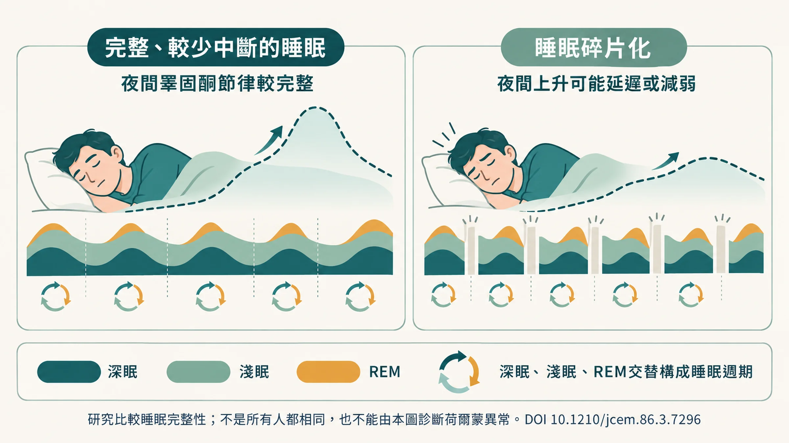
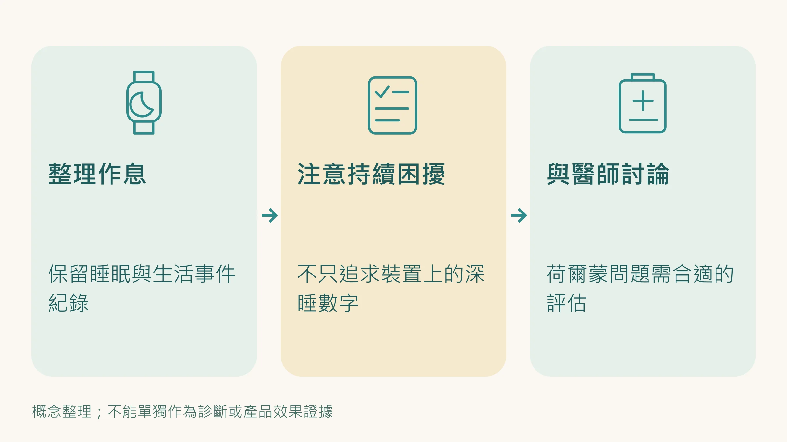
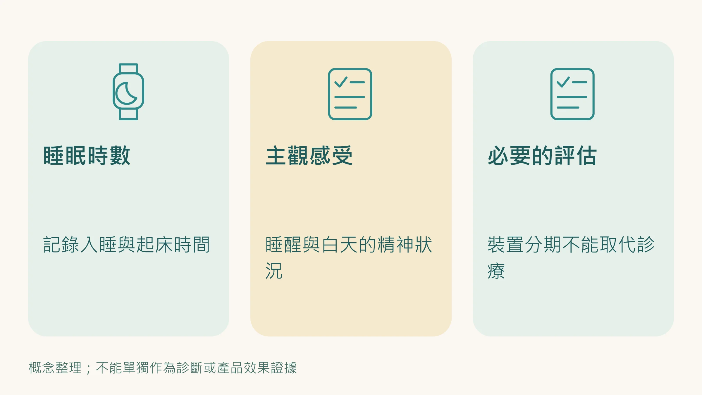

你有沒有這種感覺：

睡了七、八個小時，起床還是累。或者半夜會醒來，看一下手機，再翻個身，睡眠就這樣碎掉了。

你告訴自己：可能是壓力，可能是最近事情太多，或者就是「年紀大了，睡眠本來就淺」。

最後那個解釋最常被接受，因為它讓這件事看起來像是不需要處理的事情。

但它不對。

---

## 睪固酮不是在健身房裡製造的

你體內大部分的睪固酮是在睡著之後製造的。

具體來說，睪固酮在入睡後隨著一個個完整的睡眠週期（深眠、淺眠、REM 輪流出現）逐步上升。研究看到的是：睡眠越完整、越不被切斷，夜間的上升越明顯。

睾固酮在入睡後開始上升，在清晨達到當天最高峰，然後在整個白天逐漸下降。

以色列的睡眠實驗觀察到，夜間睪固酮的上升，需要大約 **連續三小時、結構完整的睡眠** 才會出現。

睡眠被打斷，或者深眠比例太低，睪固酮的夜間分泌節律就會被擾亂。

同一個實驗裡，睡眠被反覆打斷的那幾晚，睪固酮夜間的上升幅度明顯變小。

---

## 數字說明了什麼

芝加哥大學 Leproult & Van Cauter 於 2011 年發表在《JAMA》的研究，讓10位健康年輕男性連續一週每晚只睡 5 小時。

結果：**白天的睪固酮濃度下降了10–15%。**

這個數字相當於自然老化 10 – 15 年的荷爾蒙衰退量。

一週換來了十幾年的老化代價。

2022 年發表於《Reviews in Endocrine and Metabolic Disorders》的綜合分析整合了多項流行病學與介入研究，結論明確：

睡眠不足和較短的睡眠時間，與早晨、下午、全天 24 小時的睪固酮濃度降低都有顯著關聯，同時伴隨下午皮質醇的升高。

這兩件事同時發生，問題就倍增了。

---

## 睪固酮和皮質醇是蹺蹺板

睡眠不足對男性荷爾蒙的影響，不只是直接抑制睪固酮的製造，還有另一條路徑：**透過皮質醇間接壓制睾固酮的合成**。

皮質醇有正常的日節律，清晨升高幫你起床，傍晚後逐漸下降。

但睡眠不足會讓皮質醇在不該高的時段維持偏高，尤其是下午。

睾固酮和皮質醇是男性體內最主要的「合成代謝信號」和「分解代謝信號」的代表。

兩者之間的平衡，直接影響肌肉合成、脂肪分佈、免疫功能和情緒穩定。

**睡不好，這個蹺蹺板就一直往皮質醇那側傾。**

這解釋了為什麼睡眠不足的人除了疲倦，還更容易累積腹部脂肪、肌肉流失更快、情緒調節更困難，這些不是獨立的問題，是同一個荷爾蒙失衡造成的不同面向。

---

## 40歲之後，深眠本來就在消失

這裡有一個讓問題更複雜的背景事實：

從大約中年開始，**男性的慢波睡眠（深眠）比例本來就以比女性更快的速度在下降。**

年輕時，一個完整的睡眠週期裡深眠佔相當的比例；40 歲之後，深眠時間縮短，第一、二期的淺眠比例增加，夜間醒來的次數增多。

**就算你躺在床上的時間沒有變，你真正在深眠的時間已經比二十年前少了。**

睡眠結構變碎、深眠變少，睪固酮在夜間能爬升的空間也就跟著變小。

深眠隨年齡變少是常見的變化，但「常見」不等於「不用管」。它的下游效應，是睪固酮水位的結構性下滑；而睡眠被切碎的程度，是你可以介入的部分。

一個研究 65 歲以上健康男性的世代研究發現，睪固酮濃度較低的男性，同時有更低的睡眠效率、更多的夜間醒來、更少的慢波睡眠時間，以及更高的睡眠呼吸中止指數，這個關聯在調整了年齡和體重指數之後仍然存在。

---

## 這一切的共同節點

把這兩條線拉在一起：

睡眠被切碎、深眠縮短 → 睪固酮夜間上升變小  
睡眠不足 → 皮質醇偏高 → 進一步抑制睪固酮合成  

這不是兩個獨立的問題，而是一個互相強化的迴圈。

而這個迴圈的切入點，比你想像的更具體，**從睡眠品質開始，最能同時影響多個節點。**

## 今晚就可以先做的三件事

1. **固定起床時間**，週末也一樣。起床時間固定，入睡時間才會跟著穩定，睡眠週期比較不容易被切碎。
2. **睡前 3～4 小時吃完晚餐、睡前不喝酒**。酒精會讓上半夜睡得沉、下半夜醒得多，剛好打斷後半段的睡眠週期。
3. **如果另一半說你會打呼、你白天常想睡**，請找睡眠門診評估睡眠呼吸中止症。它是睡眠被切碎最常被忽略的原因，也和睪固酮偏低有關。

矽谷富豪布萊恩・強生在自己身上做過一個實驗：他觀察到睡前心率越低，當晚的睡眠分數越好。這是一個人的紀錄，不是臨床試驗，但他的做法可以參考：

**→ [延伸閱讀：為什麼你睡滿8小時還是累？矽谷富豪的抗老實驗：問題出在你的「睡前心率」](/blog/body-signals/aging-quantified-bryan-johnson-blueprint/)**

---

## 這不只是「睡眠問題」

中年男性的疲勞，從來不是單一問題的結果。

睡眠品質、睪固酮水位、皮質醇節律，這些變數環環相扣，在你不知道的情況下，正在決定你每天早上起床時感受到的狀態。

這篇文章的出發點是睡眠，但它的終點其實是：**你的荷爾蒙環境是否支持你的身體繼續正常運作。**

如果想從睪固酮和男性老化的角度理解更深層的機制：

**→ [40歲的你只剩一張嘴了嗎？——不是「自然老了」是睪丸細胞提前衰老了](/blog/intervention-optimization/testosterone-cell-aging-40/)**

---

## 參考資料

01. Leproult Rachel (2011). Effect of 1 Week of Sleep Restriction on Testosterone Levels in Young Healthy Men. *JAMA*, 305(21):2173. DOI：[10.1001/jama.2011.710](<https://doi.org/10.1001/jama.2011.710>)。
02. Liu Peter Y., Reddy Radha T. (2022). Sleep, testosterone and cortisol balance, and ageing men. *Reviews in Endocrine and Metabolic Disorders*, 23(6):1323-1339. DOI：[10.1007/s11154-022-09755-4](<https://doi.org/10.1007/s11154-022-09755-4>)。
03. Wittert Gary (2014). The relationship between sleep disorders and testosterone in men. *Asian Journal of Andrology*, 16(2):262. DOI：[10.4103/1008-682x.122586](<https://doi.org/10.4103/1008-682x.122586>)。
04. Barrett-Connor Elizabeth, Dam Thuy-Tien, Stone Katie et al. (2008). The Association of Testosterone Levels with Overall Sleep Quality, Sleep Architecture, and Sleep-Disordered Breathing. *The Journal of Clinical Endocrinology &amp; Metabolism*, 93(7):2602-2609. DOI：[10.1210/jc.2007-2622](<https://doi.org/10.1210/jc.2007-2622>)。
05. Penev Plamen D. (2007). Association Between Sleep and Morning Testosterone Levels In Older Men. *Sleep*, 30(4):427-432. DOI：[10.1093/sleep/30.4.427](<https://doi.org/10.1093/sleep/30.4.427>)。
06. Su Liang, Zhang Si-zheng, Zhu Jian et al. (2021). Effect of partial and total sleep deprivation on serum testosterone in healthy males: a systematic review and meta-analysis. *Sleep Medicine*, 88:267-273. DOI：[10.1016/j.sleep.2021.10.031](<https://doi.org/10.1016/j.sleep.2021.10.031>)。
07. Luboshitzky Rafael, Zabari Ziva, Shen-Orr Zila et al. (2001). Disruption of the Nocturnal Testosterone Rhythm by Sleep Fragmentation in Normal Men. *The Journal of Clinical Endocrinology & Metabolism*, 86(3):1134-1139. DOI：[10.1210/jcem.86.3.7296](<https://doi.org/10.1210/jcem.86.3.7296>)。
