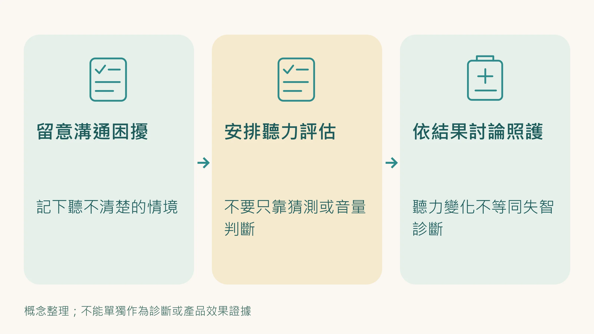
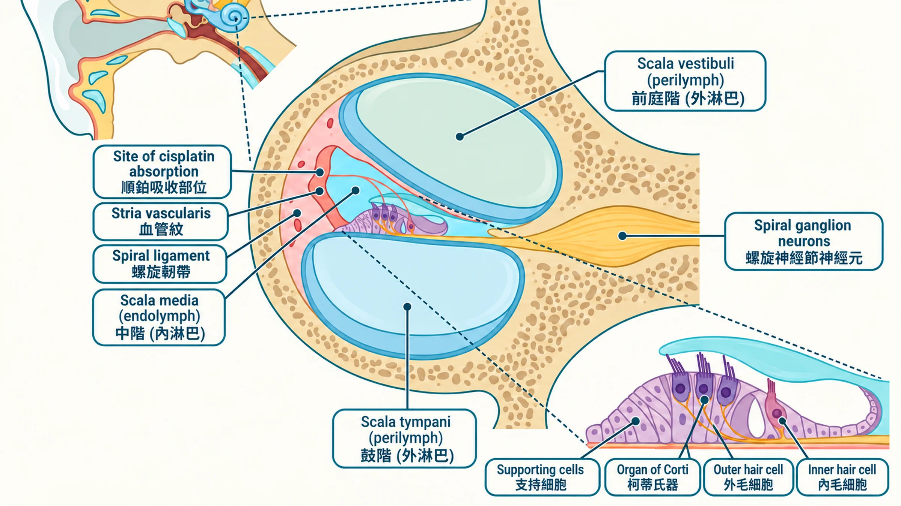
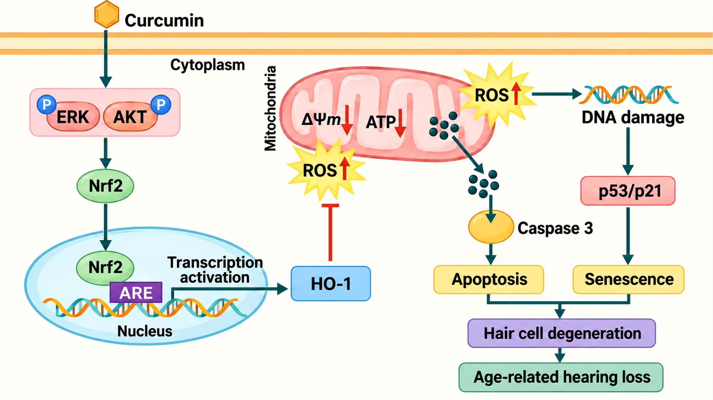

## 先問你幾個問題：你最近是不是開始覺得聽不太清楚？

開會的時候，對方講話要聽兩三次才確定？

電話裡的聲音感覺霧霧的？

家人說你把電視開太大聲了？

你可能覺得這沒什麼大不了，「就老了嘛，正常的。」

但你知道嗎，**聽力衰退跟失智症的關係，比你想像的密切得多**。

> **你以為只是別人說話不清楚。其實，是你的耳朵裡有一群細胞正在死去——而且死了就不會再長回來。**

而且，問題早在你注意到症狀之前，就已經在耳朵裡慢慢發生了。

| 數據 | 說明 |
|------|------|
| **25%** | 60 歲以上的人有聽力問題 |
| **70%** | 到了 70 歲，這比例升至七成 |
| **5 倍** | 重度聽損者罹患失智症的風險倍數 |

最後那個數字，你要再看一遍。**嚴重聽力損失的人，得失智症的機率是正常人的五倍。**

這不是在嚇你，這是約翰霍普金斯大學跟蹤了 639 個人、追了 12 年的研究結果。

聽力退化不只是感官的問題，它與認知能力下降、失智症風險、憂鬱症、跌倒風險以及社交隔離都有密切的關聯。

> **因為「聽不到又不好意思麻煩別人」就是自己把自己跟別人隔離的開始。**

---

## 你耳朵裡有一個「永遠不補貨」的倉庫

你的內耳深處有一個叫「耳蝸」的地方，長得像蝸牛殼，裡面住著幾萬根超細的「毛細胞」。

這些毛細胞的工作是把聲音震動轉換成電訊號，傳給大腦說「喂，有人在叫你」。

> **問題是：這些毛細胞死掉之後，你的身體完全不會補新的。一根死，少一根。死光，就完全聽不到了。**

跟皮膚不一樣，你的皮膚死了細胞，新的馬上長出來。

跟骨頭不一樣，你的骨頭斷了，會慢慢癒合。

> **耳朵的毛細胞，沒有這種奢侈。**

💡 **白話比喻：** 想像耳朵裡有一個只有一萬塊磚頭的城牆。每年掉幾塊、每次噪音吵一下又掉幾塊，磚頭不補貨。

你現在幾歲、磚頭還剩多少，決定了你的聽力還能用多久。

---

## 是「發電廠爆炸」，在你的耳朵裡

你身體裡每一個細胞都有自己的「發電廠」，叫做 **粒線體（Mitochondria）**。

它負責把你吃進去的東西變成能量，讓你可以思考、呼吸、活動。

但你的耳蝸是一個 **能量需求超級高** 的地方， 24 小時不休息，時時刻刻都在把聲音轉換成訊號。發電廠要一直全力運轉。

發電廠全力運轉有什麼問題？ **它會產生廢氣。**

這些「廢氣」在生物學裡叫做自由基（ROS）。

少量的自由基沒問題，身體有辦法處理。但隨著年齡增長，廢氣越來越多，處理能力越來越差——

💡 **白話比喻：** 就像一個老工廠，排廢氣的管子越來越破、空氣清淨機也越來越舊。廠房（細胞）開始被自己的廢氣嗆壞，最後倒閉關門，也就是細胞死亡。

更糟的是，這些廢氣特別愛攻擊的目標，就是發電廠自己的「說明書」（粒線體 DNA）。

說明書被破壞了，發電廠就越來越不會產電、越來越多廢氣…… **惡性循環，停不下來。**

科學家在老年性聽力損失患者身上發現了一個指標：有超過 **80%** 的患者，這份「說明書」有特定的破損痕跡。

這個比例在聽力正常的老人中，只有不到 50%。

這跟你感冒好得慢、睡滿還是累，是同一個底層機制， **慢性發炎持續消耗你的細胞資源，讓修復速度跟不上損耗速度。** 只是在耳朵裡，損耗是不可逆的。

---

## 你體內本來就有一個「超級消防隊」

好消息是，你的身體對這件事情不是毫無抵抗力。

你體內有一個叫做 **Nrf2** 的分子。它的工作就是在偵測到廢氣太多的時候，跑去細胞核拉響警報，啟動幾十個抗氧化基因，去清除自由基，保護細胞不被廢氣嗆死。

💡 **白話比喻：** Nrf2 就是你身體的「消防隊長」。

平時閒著，一偵測到火（自由基），馬上召集全隊出動滅火。

問題是：**隨著年齡增長，這個消防隊長的反應越來越慢、隊員越來越少。**

科學家做了一個很直接的實驗，把小鼠的 Nrf2 基因關掉（讓牠沒有消防隊長）。

結果？3 個月大的時候聽力還正常，但到 6 個月、11 個月，聽力就顯著比有 Nrf2 的小鼠差了，毛細胞和神經細胞也少了很多。

反過來，他們另外做了一批「消防隊長超活躍」的小鼠，結果這批小鼠到 12 個月大，聽力仍然比同齡小鼠好得多，細胞損傷標記物也顯著減少。

結論很明確：**能不能維持 Nrf2 的活性，直接決定你耳朵的壽命。**

---

## 工作壓力大的人，耳朵壞得更快

這不是在嚇你，這有機制上的原因。

| 你的日常行為 | 對耳朵的影響 |
|-------------|-------------|
| 長期睡眠不足 | ↑ 自由基產生增加、修復時間縮短 |
| 壓力荷爾蒙（皮質醇）長期偏高 | ↑ 內耳血流減少、毛細胞供氧下降 |
| 商務飛行、密閉空間噪音 | ↑ 毛細胞額外損耗 |
| 久坐、缺乏運動 | ↑ 粒線體品質下降 |
| 飲食不規律、精緻食物多 | ↑ 氧化壓力增加、Nrf2 活性降低 |
| 長期使用耳機開大聲 | ↑ 毛細胞機械性損傷 |

你每天承受的這些，都在加速那個倉庫的磚頭流失速度。

而你可能還沒感覺到，因為 **聽力損失有一個很殘忍的特性：等你感覺到的時候，大概已經損失了 30 – 40% 的毛細胞了。**

---

## 你的耳朵，此刻正在哪個階段？

**20 – 30 歲**
高頻聽力開始有輕微下降，但完全感覺不到。這是最佳預防窗口，幾乎沒有人會在這個時候做任何事。

**30 – 50 歲 ← 你在這裡**
壓力加上自然老化，毛細胞損耗明顯加速。開始在高頻（別人說話的子音）出現困難。這是關鍵的「還來得及」時期。

**50 – 70 歲**
聽力損失已可被察覺，開會、打電話、社交場合開始有困難。中低頻也開始受影響。

**70 歲以上**
七成的人有明顯聽力問題。很多人到了這個階段才考慮助聽器，但大量毛細胞已不可逆地消失了。

動物研究發現，保護措施越早開始，效果越明顯。這不代表中年才開始就沒用，而是代表越早開始，你能保住的毛細胞越多。

你現在 30 – 50 歲，**還在能做最多事情的時候**。

---

## 這些機制是可以介入的，但順序很重要

先說清楚一件事：目前沒有任何東西能「逆轉」已死亡的毛細胞。

所有介入的目標都是 **減緩損耗速度**：讓你的磚頭少掉得慢一點。

但介入之前，最重要的是先知道你的細胞資源現在的水位在哪裡。

方向對了，介入才有意義。方向打偏，補再多也是繞路，甚至有些成分在錯誤的劑量下會反效果。

**有了基準，才知道從哪裡開始。**

## 證據最強的兩件事：聽力檢查和助聽器

講了這麼多細胞機制，有兩件事的證據比任何補充品都強：

**第一，定期做聽力檢查。** 40 歲之後，如果你開會常聽漏、看電視音量越開越大，就去耳鼻喉科做一次純音聽力檢查。聽力損失越早發現，越有處理空間。

**第二，該配助聽器就配。** 2024 年《刺胳針》失智症委員會把聽力損失列為中年最大的可改變失智風險因子之一。2023 年 ACHIEVE 隨機試驗發現，對失智風險本來就較高的長者，配戴助聽器並接受聽力照護三年，認知退化速度明顯比較慢。

很多人拖到 70 歲才考慮助聽器。這兩件事，越早做越好。

---

## 最後

你投資了健身、投資了健康檢查、投資了一件事情又一件事情來維持你的狀態。

但你大概也從來沒有想過要投資你自己的耳朵。

因為耳朵出問題很安靜，它不會痛，不會讓你拉警報跑去急診。

它只是慢慢地、悄悄地、一點一點地讓聲音世界變窄。

等你注意到的時候，已經少了很多磚頭了。

**你現在 30 – 50 歲，正是你還能做最多事情的時候。**

---

**延伸閱讀：**
- [感冒拖三週、睡滿還是累、傷口好得比以前慢——這三件事同時出現，不是巧合](/blog/body-signals/three-signs-chronic-inflammation/) 
- [抗慢性發炎就是在抗老化——這不是廣告詞，這是2000年就確立的科學](/blog/chronic-inflammation/anti-inflammation-anti-aging/) 

---

## 參考資料

01. Someya Shinichi, Xu Jinze, Kondo Kenji et al. (2009). Age-related hearing loss in C57BL/6J mice is mediated by Bak-dependent mitochondrial apoptosis. *Proceedings of the National Academy of Sciences*, 106(46):19432-19437. DOI：[10.1073/pnas.0908786106](<https://doi.org/10.1073/pnas.0908786106>)。
02. Oishi Tetsuya, Matsumaru Daisuke, Ota Nao et al. (2020). Activation of the NRF2 pathway in Keap1-knockdown mice attenuates progression of age-related hearing loss. *npj Aging and Mechanisms of Disease*, 6(1):14. DOI：[10.1038/s41514-020-00053-4](<https://doi.org/10.1038/s41514-020-00053-4>)。
03. Bauer Mark A., Bazard Parveen, Acosta Alejandro A. et al. (2024). L-Ergothioneine slows the progression of age-related hearing loss in CBA/CaJ mice. *Hearing Research*, 446:109004. DOI：[10.1016/j.heares.2024.109004](<https://doi.org/10.1016/j.heares.2024.109004>)。
04. Doostkam Aida, Iravani Kamyar, Malekmakan Leila et al. (2024). The effectiveness of curcumin as a safe agent on hearing threshold improvement in patients with chronic kidney disease: a double-blind, placebo-controlled trial. *Scientific Reports*, 14(1):17576. DOI：[10.1038/s41598-024-68572-8](<https://doi.org/10.1038/s41598-024-68572-8>)。
05. Li Ning, Yan Xirui, Huang Weiling et al. (2023). Curcumin protects against the age-related hearing loss by attenuating apoptosis and senescence via activating Nrf2 signaling in cochlear hair cells. *Biochemical Pharmacology*, 212:115575. DOI：[10.1016/j.bcp.2023.115575](<https://doi.org/10.1016/j.bcp.2023.115575>)。
06. Lee Kyu-Yup (2013). Pathophysiology of Age-Related Hearing Loss (Peripheral and Central). *Korean Journal of Audiology*, 17(2):45. DOI：[10.7874/kja.2013.17.2.45](<https://doi.org/10.7874/kja.2013.17.2.45>)。
07. Curhan Sharon G, Halpin Christopher, Wang Molin et al. (2019). Prospective Study of Dietary Patterns and Hearing Threshold Elevation. *American Journal of Epidemiology*, 189(3):204-214. DOI：[10.1093/aje/kwz223](<https://doi.org/10.1093/aje/kwz223>)。
08. Fujimoto Chisato, Yamasoba Tatsuya (2014). Oxidative Stresses and Mitochondrial Dysfunction in Age-Related Hearing Loss. *Oxidative Medicine and Cellular Longevity*, 2014:1-6. DOI：[10.1155/2014/582849](<https://doi.org/10.1155/2014/582849>)。
09. Li Peipei, Li Shen, Wang Le et al. (2023). Mitochondrial dysfunction in hearing loss: Oxidative stress, autophagy and NLRP3 inflammasome. *Frontiers in Cell and Developmental Biology*, 11:1119773. DOI：[10.3389/fcell.2023.1119773](<https://doi.org/10.3389/fcell.2023.1119773>)。
10. Fujimoto Chisato, Yamasoba Tatsuya (2019). Mitochondria-Targeted Antioxidants for Treatment of Hearing Loss: A Systematic Review. *Antioxidants*, 8(4):109. DOI：[10.3390/antiox8040109](<https://doi.org/10.3390/antiox8040109>)。
11. Le Prell Colleen G., Gagnon Patricia M., Bennett David C. et al. (2011). Nutrient-enhanced diet reduces noise-induced damage to the inner ear and hearing loss. *Translational Research*, 158(1):38-53. DOI：[10.1016/j.trsl.2011.02.006](<https://doi.org/10.1016/j.trsl.2011.02.006>)。
12. Le Prell Colleen G., Hughes Larry F., Miller Josef M. (2007). Free radical scavengers vitamins A, C, and E plus magnesium reduce noise trauma. *Free Radical Biology and Medicine*, 42(9):1454-1463. DOI：[10.1016/j.freeradbiomed.2007.02.008](<https://doi.org/10.1016/j.freeradbiomed.2007.02.008>)。
13. Zhou Zhongming, Han Yanyan (2024). Association between oxidative balance score and hearing loss: a cross-sectional study from the NHANES database. *Frontiers in Nutrition*, 11:1375545. DOI：[10.3389/fnut.2024.1375545](<https://doi.org/10.3389/fnut.2024.1375545>)。
14. Szczepek Agnieszka J., Olze Heidi (2026). Coenzyme Q10 in Hearing Disorders: Replacement Therapy in Mitochondrial Deafness and Neuroprotective Use in Acquired Hearing Loss. *Journal of Otorhinolaryngology, Hearing and Balance Medicine*, 7(1):8. DOI：[10.3390/ohbm7010008](<https://doi.org/10.3390/ohbm7010008>)。
15. Lin Frank R., Pike James R., Albert Marilyn S. et al. (2023). Hearing intervention versus health education control to reduce cognitive decline in older adults with hearing loss in the USA (ACHIEVE): a multicentre, randomised controlled trial. *The Lancet*, 402(10404):786-797. DOI：[10.1016/S0140-6736(23)01406-X](<https://doi.org/10.1016/S0140-6736(23)01406-X>)。
16. Livingston Gill, Huntley Jonathan, Liu Kathy Y. et al. (2024). Dementia prevention, intervention, and care: 2024 report of the Lancet standing Commission. *The Lancet*, 404(10452):572-628. DOI：[10.1016/S0140-6736(24)01296-0](<https://doi.org/10.1016/S0140-6736(24)01296-0>)。
