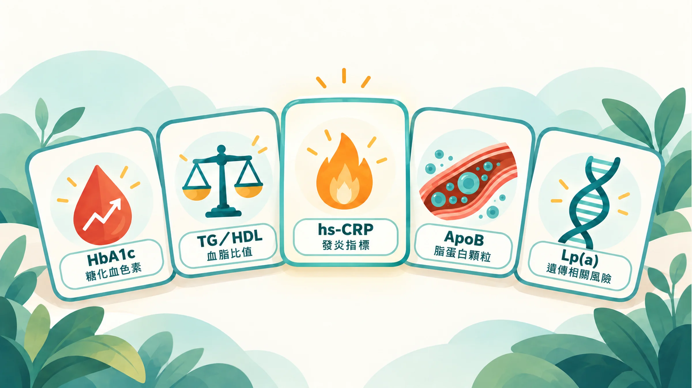

這次健檢沒紅字，你是不是就把報告收起來了？

先別急著加做檢查。把報告打開，看看下面五個名字，哪些真的有驗。

看完這篇，你會知道每個數字在回答什麼問題，回診時也比較知道該怎麼問。

## 先找名字，再決定要不要加驗

| 數字 | 主要看什麼 | 不能只靠它回答什麼 |
|---|---|---|
| HbA1c 糖化血色素 | 過去約兩三個月的平均血糖 | 所有血糖波動與疲勞原因 |
| TG/HDL 比值 | 血脂組合提供的代謝線索 | 是否已經有胰島素阻抗 |
| hs-CRP 高敏感度 C 反應蛋白 | 發炎相關訊號；特定情境下輔助心血管風險評估 | 發炎在哪裡、原因是什麼 |
| ApoB 載脂蛋白 B | 致動脈硬化脂蛋白顆粒數量的線索 | 血管有沒有堵塞 |
| Lp(a) 脂蛋白 a | 主要受遺傳影響的一部分心血管風險 | 一個人未來一定會不會發病 |

**這是一張討論清單，不是人人都要加做的套餐。** 項目是否適合你，要看既有報告、症狀、家族史，以及結果會不會改變後續處置。

報告的參考區間、用來診斷疾病的門檻、治療希望達到的目標，可能是三回事。沒有紅字，不能當成全身健康的保證；有紅字，也不等於已經確診。醫師還需要把病史、症狀和其他檢查放在一起判讀。[1]

## 1. HbA1c：補上抽血當天以外的時間

空腹血糖像抽血那天早上的一張照片。HbA1c 則反映較長時間的平均血糖，適合和前者一起討論。[2]

如果報告只有空腹血糖，而你有血糖異常紀錄或相關風險，可以問醫師：「我需要知道過去兩三個月的平均血糖嗎？」

HbA1c 也有盲點。貧血、紅血球壽命改變等因素可能影響結果；有時需要其他方法確認。不要看到一個數字，就自行判定疲勞是血糖造成的。[2]

## 2. TG/HDL：報告裡可能已經有的線索

找到三酸甘油脂 TG 和高密度脂蛋白膽固醇 HDL。兩者都以 mg/dL 表示時，可以用 TG 除以 HDL。

例如 TG 150、HDL 40，算出來是 3.75。**這只是計算示例，不是你的診斷門檻。**

研究曾用這個比值辨識較可能有胰島素阻抗的人，也就是說，身體需要更多胰島素，才能維持原本的血糖。但研究族群、單位和適用切點不同，不能拿網路上的單一標準套所有人。[3]

你可以帶著比值問：「我的血脂組合，和腰圍、血糖一起看，有沒有需要注意的地方？」

## 3. hs-CRP：有訊號，還需要找原因

hs-CRP 和一般 CRP 量的是同一種蛋白，差別在低濃度範圍的量測能力。它可以在特定情境下輔助心血管風險評估，但感冒、受傷等情況也可能讓它升高。[4]

因此，加驗之前先問「這個結果會怎麼影響我的評估」，比單純追求數字越低越好更有用。

檢驗單位和複驗時機，詳見 [CRP 正常，還需要看 hs-CRP 嗎？先看單位，再讀數字](/blog/chronic-inflammation/hs-crp-low-grade-inflammation/)。

## 4. ApoB：膽固醇總量之外，還有顆粒數量

把脂蛋白想成運貨的車，LDL-C 看的是車裡的膽固醇總量；ApoB 提供車子數量的線索。兩者有時會出現落差，尤其在三酸甘油脂偏高等情境下。[5]

這不表示原本的 LDL-C 沒用。2026 年美國血脂指引支持在適當族群選擇性使用 ApoB，協助釐清風險。[6]

想知道什麼時候值得討論，接著看 [LDL 看起來還好，為什麼醫師還會看 ApoB？](/blog/precision-health-tools/apob-vs-ldl/)。

## 5. Lp(a)：補上家族史的一條線索

Lp(a) 主要受基因影響。家人年輕時就有心肌梗塞或其他心血管疾病，值得把發病年齡記下來，和醫師討論這項檢驗。

歐洲共識及 2026 年美國指引建議成人一生至少測量一次。「至少一次」不等於任何情況都永遠不用複驗。[7][6]

有些報告用 mg/dL，有些用 nmol/L，兩者不能用固定倍數精準換算。更多說明見 [家人年輕就心肌梗塞？認識 Lp(a) 這條遺傳風險線索](/blog/chronic-inflammation/lpa-genetic-risk/)。

## 下次回診，把問題問得更具體

帶上既有報告，先確認三件事：這項是否已經驗過、日期與單位是什麼、結果會不會改變追蹤或治療。

如果你持續疲倦、活動時喘，或有其他不適，先找家醫科或內科評估。不要為了湊齊這五項，延後本來需要的診療。

想先整理不同量測的用途，可以看 [慢性發炎怎麼找線索？先分清血液、HRV、皮膚量測各在看什麼](/blog/chronic-inflammation/inflammation-three-clues/)；已有資料但不知怎麼持續記錄，則看 [做一份能持續的身體追蹤表](/blog/intervention-optimization/tracking-rhythm/)。

## 補充：公費健檢能提供什麼？

國健署成人預防保健服務自 2025 年擴大：30–39 歲每 5 年一次、40–64 歲每 3 年一次、65 歲以上每年一次；另有特定資格適用規定。它用來及早發現健康問題，並不是只有已經確診才有用。服務資格與項目以國健署公告為準。[8]

*本文供健康教育與就醫討論使用，檢驗選擇及判讀請由醫師依個人狀況決定。*

## 參考文獻

1. MedlinePlus（美國國家醫學圖書館）。How to Understand Your Lab Results。官方衛教頁。https://medlineplus.gov/lab-tests/how-to-understand-your-lab-results/
2. American Diabetes Association. 2. Diagnosis and classification of diabetes: Standards of Care in Diabetes—2025. *Diabetes Care*. 2025;48(Suppl 1):S27–S49. https://doi.org/10.2337/dc25-S002
3. McLaughlin T, et al. Use of metabolic markers to identify overweight individuals who are insulin resistant. *Ann Intern Med*. 2003;139:802–809. https://doi.org/10.7326/0003-4819-139-10-200311180-00007
4. Pearson TA, et al. Markers of inflammation and cardiovascular disease: AHA/CDC scientific statement. *Circulation*. 2003;107:499–511. https://doi.org/10.1161/01.CIR.0000052939.59093.45
5. Sniderman AD, et al. Apolipoprotein B particles and cardiovascular disease: a narrative review. *JAMA Cardiol*. 2019;4:1287–1295. https://doi.org/10.1001/jamacardio.2019.3780
6. American College of Cardiology。ACC/AHA Issue Updated Guideline for Managing Lipids, Cholesterol。2026 年 3 月 13 日官方指引發布說明。https://www.acc.org/About-ACC/Press-Releases/2026/03/13/18/01/ACCAHA-Issue-UpDated-Guideline-for-Managing-Lipids-Cholesterol
7. Kronenberg F, et al. Lipoprotein(a) in atherosclerotic cardiovascular disease and aortic stenosis: a European Atherosclerosis Society consensus statement. *Eur Heart J*. 2022;43:3925–3946. https://doi.org/10.1093/eurheartj/ehac361
8. 衛生福利部國民健康署。成人預防保健服務擴大至 30 歲以上之公告。2025。https://www.hpa.gov.tw/Pages/detail.aspx?nodeid=4878&pid=18755
