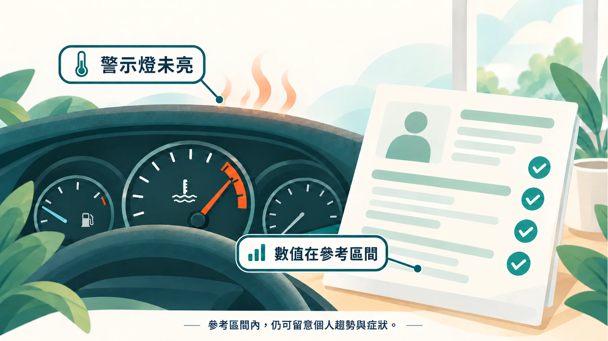

拿到健檢報告，你做的第一件事應該是往下滑，找有沒有紅字。

沒有。鬆一口氣，把報告收進抽屜。

可是最近爬兩層樓會喘，肚子越來越大，下午總是想睡。報告說你很健康，身體卻好像不太同意。

## 免費健檢在找什麼？

國健署的成人預防保健服務，從 2025 年起放寬到 30 歲以上就能做，40 到 64 歲每 3 年一次、65 歲以上每年一次[1]。血液項目包含空腹血糖、總膽固醇、三酸甘油脂、高密度與低密度膽固醇，以及肝腎功能[2]。

這套檢查的目標很明確：**及早找出已經達到疾病標準的三高、肝腎問題**。它是篩檢工具，設計時就以有明確醫學實證、適合大規模推行的項目為主[3]。

所以「沒有紅字」代表你還沒跨過疾病的診斷門檻。至於身體離門檻還有多遠、正在往哪個方向走，這份報告能告訴你的有限。

## 參考區間，是一群人的平均

報告上的「正常範圍」，大多是一群健康人數值的統計分布。你落在範圍內，代表你和大多數人差不多。

問題是，很多 40 歲上下的台灣人，本身就帶著代謝壓力在生活。國健署的調查顯示，30 到 39 歲已有將近 2 成高血脂、約 1 成高血壓[4]。「跟大家差不多」，未必是你想要的狀態。

就像車子儀表板沒亮燈，不代表引擎沒有過熱。想多看一步，下面這 5 個數字值得認識。

> 如果你也是「報告正常卻一直很累」，先看這篇：[健檢正常，為什麼還是累？](/blog/body-signals/normal-checkup-still-tired/)

## 5 個值得多看的數字

| 數字 | 它在看什麼 | 常見參考 | 免費成人健檢有沒有 |
|---|---|---|---|
| **HbA1c 糖化血色素** | 過去 2～3 個月的平均血糖 | <5.7% 正常；5.7–6.4% 糖尿病前期；≥6.5% 糖尿病[5] | 沒有 |
| **TG/HDL 比值** | 胰島素阻抗的線索 | 研究常以約 3 作為參考切點[6] | **有，可以自己算** |
| **hs-CRP** | 低度慢性發炎 | <1 mg/L 低風險；1–3 平均；>3 較高[7] | 沒有 |
| **ApoB** | 會造成動脈硬化的脂蛋白顆粒數 | 美國指引將 ≥130 mg/dL 列為風險加重因子[8] | 沒有 |
| **Lp(a)** | 遺傳性的血管風險 | ≥50 mg/dL（約 ≥125 nmol/L）屬偏高[9] | 沒有 |

### 1. HbA1c：比一次空腹血糖更穩定

空腹血糖只代表抽血那天早上。HbA1c 反映的是紅血球過去兩三個月被糖「浸泡」的程度，比較不受前一晚吃什麼影響。

一項追蹤超過 1 萬名非糖尿病成人的研究發現，HbA1c 即使在正常範圍內偏高，未來發生心血管疾病的風險也跟著上升[10]。

### 2. TG/HDL 比值：你現在就能算

打開報告，找到「三酸甘油脂（TG）」和「高密度脂蛋白膽固醇（HDL）」，兩個數字（單位 mg/dL）相除。

例如 TG 150、HDL 40，比值就是 3.75。

美國的研究用這個比值找出胰島素阻抗，也就是說，身體對胰島素反應變遲鈍、血糖要靠更多胰島素才壓得下來的狀態[6]。比值越高，越可能已經有代謝壓力。亞洲族群的合適切點可能更低，這個數字適合當作提醒，診斷仍以醫師評估為準。

### 3. hs-CRP：看小火的發炎指標

一般 CRP 是用來看感染、外傷這種「大火」。hs-CRP 靈敏度高得多，能抓到很低濃度的慢性發炎[7]。數值超過 10 mg/L 時，通常要先排除感冒或其他急性感染，隔一段時間再驗。

詳細解讀：[CRP 看大火，hs-CRP 看小火](/blog/chronic-inflammation/hs-crp-low-grade-inflammation/)

### 4. ApoB：數車子，不只秤貨物

LDL 膽固醇量的是脂蛋白裡「載了多少膽固醇」。ApoB 算的是「有幾台載膽固醇的車」。每一顆會鑽進血管壁的脂蛋白顆粒，都帶著一個 ApoB[11]。有些人 LDL 看起來正常，車子數量卻偏多，這在肚子大、三酸甘油脂高的人身上特別常見。

### 5. Lp(a)：一輩子驗一次

Lp(a) 的高低大多由基因決定，生活習慣很難改變它。歐洲動脈硬化學會建議成年人一生至少驗一次[9]。家族裡有人年紀輕輕就心肌梗塞或中風，更值得一驗。

詳細解讀：[Lp(a)：一輩子驗一次就夠的遺傳風險指標](/blog/chronic-inflammation/lpa-genetic-risk/)

## 怎麼驗？

這幾項大多屬於自費檢驗，多數醫院健檢中心和檢驗所都能加做，費用各家不同，可以先打電話詢問。抽血時請和醫師說明你的年齡、家族史和想了解的方向，由醫師判斷哪些項目適合你。

如果預算有限，可以先從**算出你的 TG/HDL 比值**，加上 **HbA1c 和 hs-CRP** 開始。

## 數字只是開始

血液只是三條線索之一。慢性發炎還會在睡眠和皮膚留下痕跡，三者一起看，才比較接近身體真正的狀態。

**延伸閱讀**
- [一把火，三處煙：慢性發炎從哪三個地方找線索](/blog/chronic-inflammation/inflammation-three-clues/)
- [內臟脂肪是一種代謝訊號](/blog/body-signals/visceral-fat-metabolic-signal/)
- [40 歲後的男性疲勞](/blog/body-signals/male-fatigue-after-40/)

---

*本文為健康教育與風險理解用途，不等同醫療診斷。檢驗數值請由醫師依個人狀況判讀。*

## 參考文獻

1. 公視新聞網：國人定期免費健檢門檻下修至30歲（2025）。https://news.pts.org.tw/article/733547
2. TVBS 健康2.0：40歲成人健檢 這6項檢查可搭配互補不足（2024）。https://health.tvbs.com.tw/nutrition/347913
3. 早安健康：公費健檢藏「十大死因6項精華」（2025）。https://edh.tw/articles/5Q9jRMK
4. NOWnews：成人預防保健服務下修至30歲（國健署國民營養健康調查數據）。https://www.nownews.com/news/6766598
5. American Diabetes Association. 2. Diagnosis and classification of diabetes: Standards of Care in Diabetes—2025. *Diabetes Care*. 2025;48(Suppl 1):S27–S49. https://doi.org/10.2337/dc25-S002
6. McLaughlin T, et al. Use of metabolic markers to identify overweight individuals who are insulin resistant. *Ann Intern Med*. 2003;139:802–809. https://doi.org/10.7326/0003-4819-139-10-200311180-00007
7. Pearson TA, et al. Markers of inflammation and cardiovascular disease: AHA/CDC scientific statement. *Circulation*. 2003;107:499–511. https://doi.org/10.1161/01.CIR.0000052939.59093.45
8. Grundy SM, et al. 2018 AHA/ACC guideline on the management of blood cholesterol. *Circulation*. 2019;139:e1082–e1143. https://doi.org/10.1161/CIR.0000000000000625
9. Kronenberg F, et al. Lipoprotein(a) in atherosclerotic cardiovascular disease and aortic stenosis: a European Atherosclerosis Society consensus statement. *Eur Heart J*. 2022;43:3925–3946. https://doi.org/10.1093/eurheartj/ehac361
10. Selvin E, et al. Glycated hemoglobin, diabetes, and cardiovascular risk in nondiabetic adults. *N Engl J Med*. 2010;362:800–811. https://doi.org/10.1056/NEJMoa0908359
11. Sniderman AD, et al. Apolipoprotein B particles and cardiovascular disease: a narrative review. *JAMA Cardiol*. 2019;4:1287–1295. https://doi.org/10.1001/jamacardio.2019.3780
