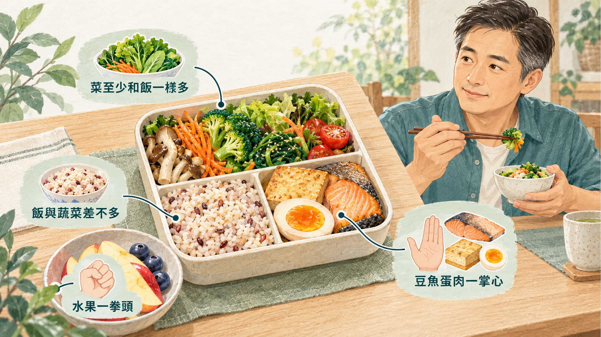
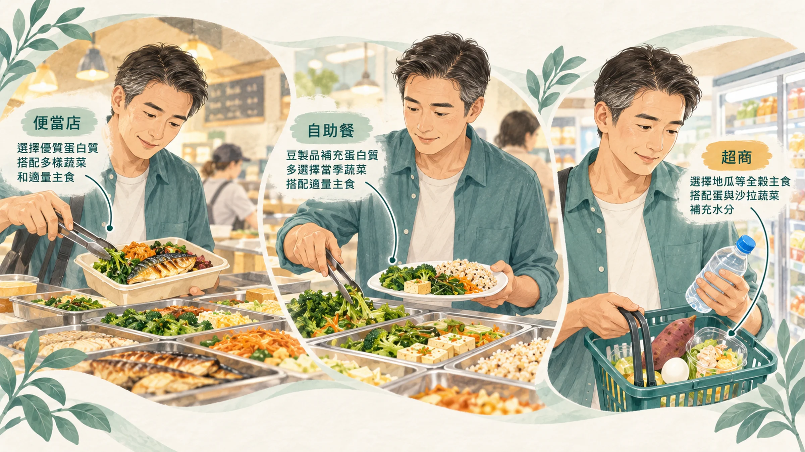
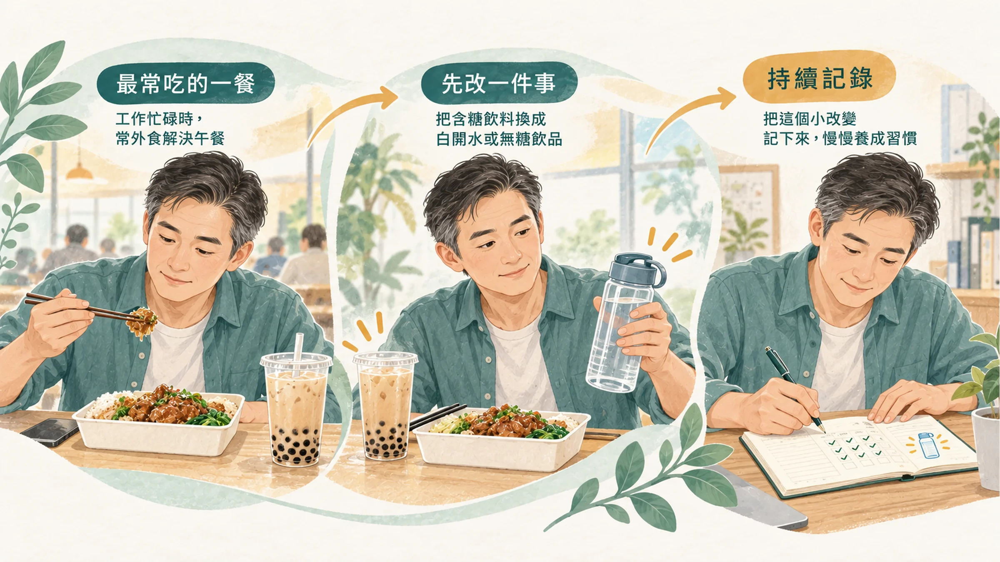

<!-- 🎨 [cover] [類型 A]
畫面：A Taiwanese bento box seen from above, divided into sections: rice, a piece of grilled fish, a braised egg, and two vegetable sides, with chopsticks and a cup of unsweetened tea. Warm off-white, teal and sage, soft editorial illustration.
標籤（Canva 填入）：外食族一餐怎麼配？
STYLE: 依 IMAGE-STYLE.md 第 7.2 節
-->

中午十二點，公司樓下的便當店排了一條人龍。

你點了招牌排骨飯：一大塊炸排骨、一大碗白飯、三樣小菜，其中一樣是滷豆干、一樣是炒高麗菜、一樣是酸菜。吃完很飽，下午兩點開始想睡。

晚上加班，便利商店買個御飯糰加一瓶奶茶。週末應酬，合菜一道接一道，啤酒一杯接一杯。

外食族不可能每一餐都自己煮，也不可能每一餐都算熱量。這篇只教一件事：**看到一餐，知道怎麼配。**

## 一個盤子，四個比例

國民健康署有一套「我的餐盤」，把一餐要吃什麼，變成六句口訣（衛生福利部，2019）：

1. 每天早晚一杯奶
2. 每餐水果拳頭大
3. 菜比水果多一點
4. 飯跟蔬菜一樣多
5. 豆魚蛋肉一掌心
6. 堅果種子一茶匙

外食的時候，最實用的是中間三句。換成你手上那一餐：

- **蔬菜：** 佔最多，至少和飯一樣多。
- **主食（飯、麵、地瓜）：** 和蔬菜差不多量。
- **蛋白質（豆、魚、蛋、肉）：** 一個手掌大小、厚度。
- **水果：** 一個拳頭，可以飯後或下午吃。

## 為什麼蛋白質要每餐都有

肌肉從中年開始慢慢流失，原料要跟得上。以 70 公斤的人來說，照歐洲老年醫學專家給 65 歲以上的建議（每公斤 1.0 到 1.2 公克），一天大約要 70 到 84 公克蛋白質（Bauer et al., 2013）。

很多外食男人的問題是：早餐一個麵包、一杯奶茶，中午一碗麵，蛋白質集中在晚餐那塊排骨。分散到每一餐，**每餐一個手掌**，比較容易吃夠。

體重沒變、褲子卻變緊的原因，也和肌肉有關，可以看〈[體重沒變，褲子卻越來越緊？](/blog/body-signals/same-weight-tighter-pants-body-composition/)〉。

## 便當店、自助餐、超商，怎麼配

**便當店：**

- 主菜選**烤、滷、蒸**的（烤雞腿、滷雞腿、烤魚），少選炸排骨、炸雞排。
- **飯少一點**，跟老闆說「飯半碗」。
- 小菜選**深綠色蔬菜**，少選炸物、加工品（例如甜不辣、熱狗）。
- 可以加一顆滷蛋或一份豆腐，補蛋白質。

**自助餐：**

- 先夾菜：**兩到三樣蔬菜，佔盤子一半。**
- 再夾一份手掌大的蛋白質：魚、雞、豆腐、蛋。
- 最後才是飯，跟蔬菜差不多量。
- 勾芡、糖醋、炸的少夾；菜湯不要淋在飯上。

**超商：**

- 主食：御飯糰、地瓜、全麥三明治選一個。
- 蛋白質：茶葉蛋、無糖豆漿、雞胸肉、優格選一到兩個。
- 蔬菜：生菜沙拉、燙青菜、關東煮的蘿蔔和蔬菜。
- 飲料：無糖茶或水，取代奶茶和含糖飲料。

## 應酬、聚餐，記住三件事

- **先吃菜和蛋白質，最後才吃飯和麵。** 合菜上桌，先夾青菜和魚。
- **酒杯旁邊放一杯水。** 喝一口酒、喝一口水，自然喝得比較少。
- **炸的、勾芡的，嚐一口就好。**

## 不用每一餐都完美

一週 21 餐，不可能每一餐都照比例。先從**最常吃的那一餐**開始改：

1. 找出你一週最常吃的一餐，例如中午的便當。
2. 只改一件事，例如「飯半碗、多一樣青菜」。
3. 兩週後變成習慣，再改下一件。

## 什麼時候看醫生、看哪一科

- 健檢血糖、血脂、尿酸有紅字，或腰圍超過 90 公分：看**家醫科**或**新陳代謝科**，也可以請醫師轉介**營養師**。
- 有腎臟病、糖尿病、痛風的人，蛋白質和主食的量要和醫師或營養師討論，不要直接套用這篇的比例。

## 帶走一句話

**外食不用算熱量，記住一個盤子：菜最多，飯跟菜一樣多，蛋白質一個手掌。** 先改你最常吃的那一餐。

---

## 參考資料

1. 衛生福利部。跟著「我的餐盤」6口訣 吃得均衡又健康。衛生福利部，2019。https://mohw.gov.tw/cp-16-50222-1.html
2. Bauer J, et al. Evidence-based recommendations for optimal dietary protein intake in older people: a position paper from the PROT-AGE Study Group. *Journal of the American Medical Directors Association*, 2013.（PMID：[23867520](https://pubmed.ncbi.nlm.nih.gov/23867520/)）

*本文為健康教育資訊，不構成醫療診斷或治療建議。*
