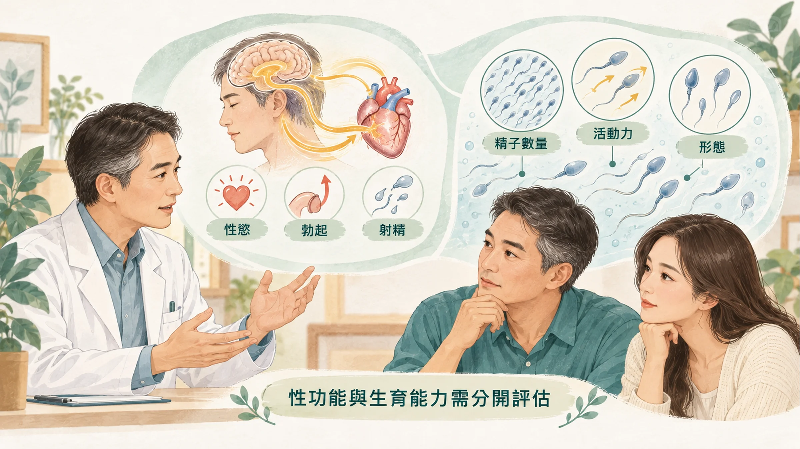

<!-- 🎨 [cover] [類型 A]
畫面：A couple in their late thirties sitting side by side at a clinic waiting area, holding hands, with a calm and supportive mood; a simple clipboard on the man's lap. Warm off-white, teal and sage, soft editorial illustration.
標籤（Canva 填入）：性功能正常，生育能力就正常嗎？
STYLE: 依 IMAGE-STYLE.md 第 7.2 節
-->

結婚幾年，兩個人開始認真想要孩子。試了一年，沒有消息。

太太去婦產科做了一輪檢查：抽血、超音波、輸卵管攝影。醫師問：「先生做過精液檢查了嗎？」

先生一臉疑惑：「我很正常啊，每次都沒問題。」

這句「我很正常」，是很多男人的盲點。**性功能正常，和生育能力正常，是兩件不同的事。**

## 能勃起、能射精，不代表精蟲沒問題

性功能看的是：有沒有慾望、能不能勃起、能不能射精。

生育能力看的是：射出來的精液裡，**精蟲夠不夠多、游得好不好、長得正不正常**。

這兩件事會互相影響，但不是同一件事。一個男人可以每次都「表現正常」，精液裡的精蟲卻很少、游不動；反過來，勃起有困難的人，精蟲也可能完全正常。

所以夫妻備孕遇到困難，**男女雙方要一起檢查**，不是只看太太。

## 男人的生育能力，也會隨年齡下降

很多人以為只有女性有「生育年齡」，男人七八十歲都還能當爸爸。

能當爸爸是真的，但品質會往下走。紐西蘭學者整理了 90 項研究、約 9 萬 4 千名男性的資料，發現隨著年齡增加，**精液量、精蟲活動力都穩定下降**，形狀異常和 DNA 受損的精蟲比例上升（Johnson et al., 2015）。

另外，冰島研究團隊分析了 78 組父母和孩子的基因，發現孩子身上「新出現」的基因突變，主要來自爸爸。**爸爸的年齡每增加一歲，孩子平均多大約兩個新突變**（Kong et al., 2012）。

這不是要嚇你，大多數這類突變不會造成問題。它提醒的是：**男人的年齡，也是生育計畫的一部分。**

## 想調整睪固酮的人，要特別注意這件事

40 歲之後，有些男人覺得精神差、性慾低，聽說可以「補睪固酮」。

如果你還打算生孩子，這件事要先知道：**從外面補充睪固酮，會讓身體自己少做，睪丸製造精蟲的訊號也跟著變弱，精蟲數量可能大幅下降。** 美國內分泌學會的治療指引就建議，近期打算生育的男性，**不要使用睪固酮治療**（Bhasin et al., 2018）。

所以想調整荷爾蒙，一定要先告訴醫師你的生育計畫，由醫師評估，不要自己在網路上買來用。

睪固酮為什麼會往下掉、睡眠的影響，可以看〈[40 歲之後為什麼越睡越累？](/blog/body-signals/sleep-quality-testosterone/)〉。

## 精液分析：一份報告看什麼

男性生育力最基本的檢查，就是**精液分析**。在泌尿科或生殖醫學中心就能做，不用抽血、不用照影。

世界衛生組織 2021 年的手冊，列出一般生育男性的參考下限（WHO, 2021）：

| 項目 | 參考下限 | 白話 |
| --- | --- | --- |
| 精液量 | 1.4 毫升 | 一次射出多少 |
| 精蟲濃度 | 每毫升 1,600 萬隻 | 每一毫升有多少隻 |
| 精蟲總數 | 每次 3,900 萬隻 | 一次總共多少隻 |
| 前進型活動力 | 30% | 有多少隻是往前游的 |
| 正常形態 | 4% | 有多少隻長得正常 |

低於參考下限，不代表一定不能生；高於參考下限，也不保證一定能生。這些數字要由醫師一起看，通常也會建議隔幾週再驗一次，因為精液品質本來就會波動。

**檢查前要注意：**

- 一般會請你**禁慾 2 到 7 天**再採檢，實際天數依檢驗單位說明。
- 最近發燒、生病，可能讓結果暫時變差，跟醫師說。
- 把正在吃的藥和保健品列出來，特別是荷爾蒙類的。

## 平常可以顧的事

- **戒菸、少喝酒。**
- **把體重和腰圍顧好。** 肥胖和精蟲品質、睪固酮都有關。
- **避免睪丸長時間過熱：** 少泡太久的熱水澡和三溫暖，筆電不要長時間放在大腿上。
- **睡飽：** 睪固酮需要完整、不被切碎的睡眠。
- **不要自己補睪固酮或吃來路不明的「壯陽藥」。**

## 和伴侶一起面對

生育這件事，很容易變成兩個人互相猜、互相怪。

比較好的方式，是**一起檢查、一起聽結果**。男方的檢查比女方簡單很多，先做精液分析，反而能讓太太少走一些冤枉路。

## 什麼時候看醫生、看哪一科

- 規律、沒有避孕的性生活超過一年還沒懷孕；女方 35 歲以上的話，半年就可以開始檢查：夫妻一起看**生殖醫學中心**或**婦產科**，男方看**泌尿科**。
- 有過睪丸受傷、隱睪、腮腺炎合併睪丸發炎、疝氣手術：提早檢查。
- 正在考慮荷爾蒙治療：先告訴醫師你的生育計畫。
- 勃起或射精有困難：看**泌尿科**，可以參考〈[硬度不如以前、晨間反應變少](/blog/body-signals/erection-libido-fatigue-three-questions/)〉。

## 帶走一句話

**性功能正常，不代表生育能力正常。** 想要孩子，夫妻一起檢查；男方先做一次精液分析，是最簡單的一步。

---

## 參考資料

1. Johnson SL, et al. Consistent age-dependent declines in human semen quality: a systematic review and meta-analysis. *Ageing Research Reviews*, 2015.（來源：[Ageing Research Reviews](https://doi.org/10.1016/j.arr.2014.10.007)，2015）
2. Kong A, et al. Rate of de novo mutations and the importance of father's age to disease risk. *Nature*, 2012.（PMID：[22914163](https://pubmed.ncbi.nlm.nih.gov/22914163/)）
3. Bhasin S, et al. Testosterone therapy in men with hypogonadism: an Endocrine Society clinical practice guideline. *Journal of Clinical Endocrinology & Metabolism*, 2018.（PMID：[29562364](https://pubmed.ncbi.nlm.nih.gov/29562364/)）
4. World Health Organization. *WHO laboratory manual for the examination and processing of human semen*, 6th edition. WHO, 2021. https://www.who.int/publications/i/item/9789240030787

*本文為健康教育資訊，不構成醫療診斷或治療建議。*
