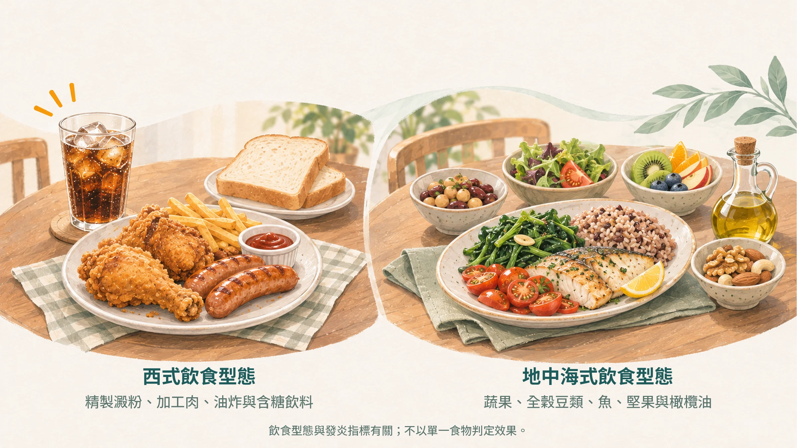
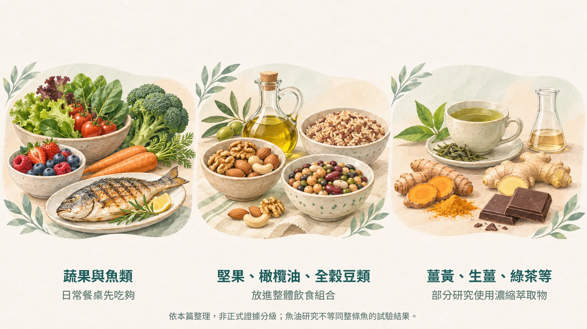
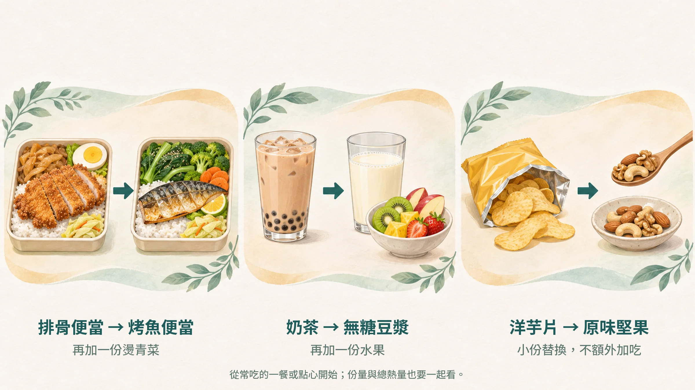

<!-- 🎨 [cover] [類型 A]
畫面：A middle-aged East Asian man at a home dining table looking at a phone full of blank "ranking" cards, while the table in front of him holds a colorful spread: leafy greens, tomatoes, carrots, a grilled fish, a small bowl of nuts, a bottle of olive oil, berries. Warm, inviting kitchen.
標籤（Canva 填入）：抗發炎食物排行榜？／答案是一桌菜
STYLE: 依 IMAGE-STYLE.md 第 7.2 節
-->

薑黃、綠花椰、藍莓、鮭魚、黑巧克力。

你應該看過不只一份「抗發炎食物排行榜」，而且每一份的第一名都不一樣。

那到底誰才是冠軍？把研究攤開來看，答案有點掃興，卻很實用：**效果最一致的，是一整桌菜的組合。**

## 為什麼找不到單一冠軍

研究單一食物，有兩個天生的困難。

第一，人不會只吃一種東西。你多吃了鮭魚，通常也少吃了炸雞；這時候 CRP 下降，很難分清楚是鮭魚的功勞，還是炸雞少了。

第二，很多「冠軍」的研究，用的是濃縮萃取物或補充品，劑量是你從餐桌上吃不到的。

所以研究者後來改看「飲食型態」，也就是說，不看你吃了哪一樣，看你整體吃得像什麼。

2013 年一篇整理了 46 項研究的系統性回顧發現：以肉類為主的「西式」飲食型態，和較高的發炎指標（主要是 CRP）有關；以蔬菜水果為主的型態，則和較低的發炎指標有關[1]。

2014 年另一篇整合了 17 項隨機對照試驗、約 2300 人的分析，比較的是至少吃 12 週的地中海飲食。結果是：發炎指標下降，血管內皮功能也改善[2]。血管內皮功能，也就是血管內壁還能不能正常放鬆和收縮。

照這些研究來排，第一名是「地中海式的一桌菜」：大量蔬菜、水果、全穀、豆類、堅果、魚，用橄欖油烹調，紅肉和加工食品少一點。

<!-- 🎨 [fig-01] [類型 B]
畫面：Two dinner tables side by side. Left table: fried chicken, processed sausages, white bread, sugary drink, with a small orange-red flame icon above. Right table: vegetables, fruits, whole grains, beans, fish, nuts, olive oil, with a calm teal leaf icon above. Clean split composition.
標籤（Canva 填入）：西式飲食型態, 發炎指標較高, 地中海式飲食型態, 發炎指標較低, 看整桌，不看單一食物
STYLE: 依 IMAGE-STYLE.md 第 7.2 節
-->

## 如果一定要排名：依證據強弱分三層

把常見的「抗發炎食物」依人體研究的多寡和一致性排一次：

| 層級 | 食物 | 研究說了什麼 |
|---|---|---|
| 第一層：研究最多 | 蔬菜、水果（尤其深色） | 83 項研究的整合分析中，約 68% 的介入試驗看到至少一項發炎指標改善[3] |
| 第一層：研究最多 | 魚（富含 Omega-3 的鯖魚、鮭魚、秋刀魚） | 68 項試驗、4601 人的分析中，海洋來源 Omega-3 讓 CRP、IL-6 下降；但 BMI 超過 30 的人，效果比較弱[4] |
| 第二層：有支持，多為觀察研究 | 堅果 | 一週吃 5 份以上堅果的人，CRP 比幾乎不吃的人低約 20%[5]；這是觀察研究，不能證明因果 |
| 第二層：有支持 | 橄欖油、全穀、豆類 | 多半是地中海飲食的一部分，很難單獨算功勞 |
| 第三層：研究多半用萃取物 | 薑黃、生薑、綠茶、黑巧克力 | 小型試驗多，劑量和日常吃法差很遠，不適合當主角 |

這張表要這樣讀：**第一層的食物先吃夠，第三層的再來錦上添花。**

很多人的順序是反過來的。每天一顆薑黃膠囊，蔬菜卻一份都不到。

## 台灣人最常卡在第一層

國健署的國民營養健康調查（2013–2016）發現，19 到 64 歲的成人裡，**86% 蔬菜吃不到每天 3 份，86% 水果吃不到每天 2 份，91% 堅果吃不到每天 1 份**[6]。

一份蔬菜，大約是煮熟後半碗。換成外食的畫面：一個便當的配菜，通常只有一份多一點。

所以對多數人來說，進步最大的一步很簡單：把那份不夠的蔬菜補回來。

<!-- 🎨 [fig-02] [類型 B]
畫面：A three-tier pyramid or stepped podium. Bottom and widest tier: vegetables, fruits, fish. Middle tier: nuts, olive oil, whole grains, beans. Top small tier: turmeric root, ginger, green tea cup, dark chocolate. A small figure climbing from the bottom.
標籤（Canva 填入）：依證據強弱分三層, 第一層：蔬果、魚, 第二層：堅果、橄欖油、全穀豆類, 第三層：薑黃、生薑、綠茶, 先吃夠第一層
STYLE: 依 IMAGE-STYLE.md 第 7.2 節
-->

## 該少吃的，比該多吃的更容易做到

前面那篇系統性回顧提到的「西式」型態，通常包含這幾樣[1]：

- 含糖飲料、甜點
- 香腸、培根、火腿這類加工肉
- 白麵包、白麵條這類精製澱粉吃太多
- 油炸食物
- 常喝酒

不用一次全部戒掉。挑一樣你最常吃的，先換掉一半。例如手搖飲從每天一杯改成兩天一杯，或改成無糖。

**吃對了，熱量也要對。** 一項地中海飲食試驗發現，血脂先改善了，CRP 卻要等到後段體重有變化才跟著下降。詳細看〈[吃對了，發炎指數卻不動？](/blog/chronic-inflammation/mediterranean-diet-fasting-hscrp-weight-loss/)〉。

## 從明天的一餐開始

| 你常吃的 | 換成 |
|---|---|
| 排骨便當 | 烤魚便當，加點一份燙青菜 |
| 早餐店蛋餅加奶茶 | 蛋餅加無糖豆漿，再加一份水果 |
| 晚上的洋芋片 | 一小把原味堅果（約一湯匙） |
| 炒菜用的油 | 部分換成橄欖油或苦茶油，涼拌用 |

外食怎麼配，可以參考〈[外食族一餐怎麼配？](/blog/body-signals/eating-out-plate-protein-vegetables-carbs/)〉。

想知道蔬果到底有沒有真的吃夠，可以看皮膚類胡蘿蔔素。Prysm iO 掃描反映的是你過去幾週蔬果與類胡蘿蔔素的攝取狀態，適合拿來看「這個月比上個月有沒有進步」；它量的是飲食，不是發炎指數。分數怎麼讀，看〈[你的 Prysm iO 分數出來了](/blog/precision-health-tools/prysm-io-score-guide/)〉。

<!-- 🎨 [fig-03] [類型 B]
畫面：A before-and-after meal swap illustration with three rows: a pork chop lunch box changing into a grilled fish lunch box with extra greens; a milk tea changing into unsweetened soy milk and fruit; a bag of chips changing into a small handful of nuts. Arrows between each pair.
標籤（Canva 填入）：從一餐開始換, 排骨便當→烤魚便當加青菜, 奶茶→無糖豆漿加水果, 洋芋片→一小把堅果
STYLE: 依 IMAGE-STYLE.md 第 7.2 節
-->

## 三個提醒

- **魚油膠囊不等於吃魚。** 正在吃抗凝血藥或抗血小板藥的人，高劑量魚油可能增加出血風險，補充前先問醫師或藥師，劑量依產品標示。
- **腎臟病患者的蔬果份量要另外算。** 蔬果含鉀，請依醫師或營養師的建議調整。
- **飲食改變需要時間。** 研究大多觀察 8 到 12 週以上。如果你已經有明顯的發炎症狀（關節腫痛、長期腹瀉、發燒），先看醫生，不要只靠調整飲食。不知道掛哪科，看〈[慢性發炎看哪科？](/blog/precision-health-tools/chronic-inflammation-which-doctor/)〉。

> 帶走這一句：**抗發炎要看整張餐桌。先把蔬菜吃夠，再談薑黃。**

## 參考資料

1. Barbaresko Janett, Koch Manja, Schulze Matthias B., Nöthlings Ute (2013). Dietary pattern analysis and biomarkers of low-grade inflammation: a systematic literature review. *Nutrition Reviews*, 71(8):511-527. DOI：[10.1111/nure.12035](<https://doi.org/10.1111/nure.12035>)。
2. Schwingshackl Lukas, Hoffmann Georg (2014). Mediterranean dietary pattern, inflammation and endothelial function: a systematic review and meta-analysis of intervention trials. *Nutrition, Metabolism and Cardiovascular Diseases*, 24(9):929-939. DOI：[10.1016/j.numecd.2014.03.003](<https://doi.org/10.1016/j.numecd.2014.03.003>)。
3. Hosseini Banafshe, Berthon Bronwyn S., Saedisomeolia Ahmad et al. (2018). Effects of fruit and vegetable consumption on inflammatory biomarkers and immune cell populations: a systematic literature review and meta-analysis. *The American Journal of Clinical Nutrition*, 108(1):136-155. DOI：[10.1093/ajcn/nqy082](<https://doi.org/10.1093/ajcn/nqy082>)。
4. Li Kelei, Huang Tao, Zheng Jusheng, Wu Kejian, Li Duo (2014). Effect of marine-derived n-3 polyunsaturated fatty acids on C-reactive protein, interleukin 6 and tumor necrosis factor α: a meta-analysis. *PLoS ONE*, 9(2):e88103. DOI：[10.1371/journal.pone.0088103](<https://doi.org/10.1371/journal.pone.0088103>)。
5. Yu Zhi, Malik Vasanti S., Keum NaNa et al. (2016). Associations between nut consumption and inflammatory biomarkers. *The American Journal of Clinical Nutrition*, 104(3):722-728. DOI：[10.3945/ajcn.116.134205](<https://doi.org/10.3945/ajcn.116.134205>)。
6. 衛生福利部國民健康署。國人9成9乳品攝取不足、逾9成堅果攝取不足、近9成蔬果攝取不足（2013-2016國民營養健康狀況變遷調查）。衛生福利部，2018。<https://mohw.gov.tw/cp-16-41108-1.html>
