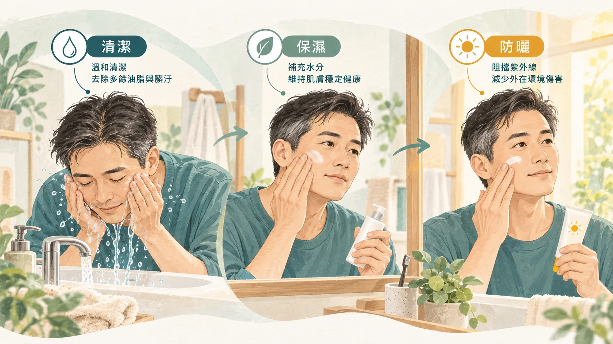
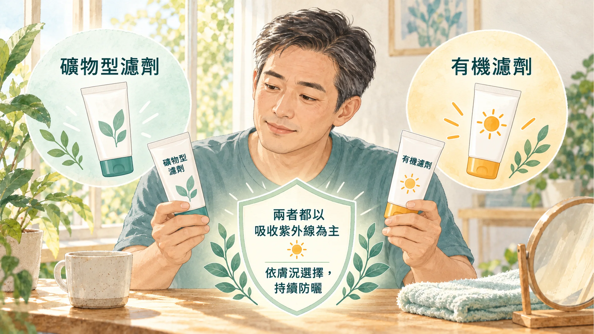
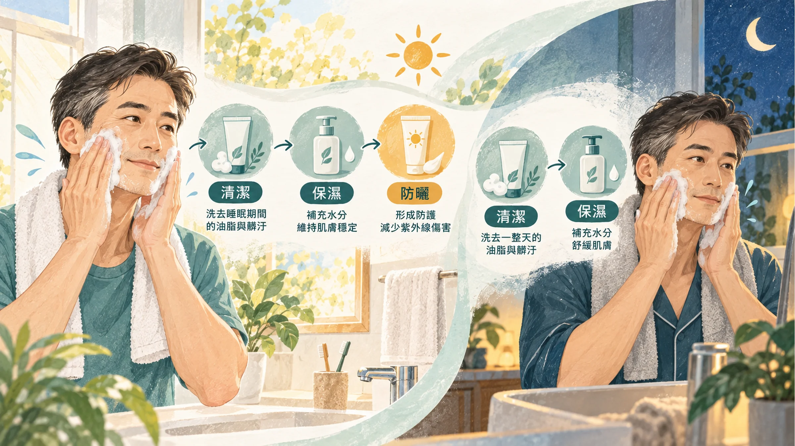

<!-- 🎨 [cover] [類型 A]
畫面：A tidy bathroom shelf with only three items lined up: a face cleanser, a moisturizer, and a mineral sunscreen, next to a towel and a mirror in morning light. Warm off-white, teal and sage, soft editorial illustration.
標籤（Canva 填入）：男人保養只做三件事
STYLE: 依 IMAGE-STYLE.md 第 7.2 節
-->

老婆的化妝桌上，一排瓶瓶罐罐。化妝水、精華液、乳液、面霜、眼霜，每一瓶你都叫不出名字。

你心想：「男人保養要這麼麻煩？那算了。」

其實不用。把三件事做好，就已經贏過大部分的同齡男人：**洗乾淨、補水分、擋太陽。**

## 第一件事：洗乾淨，但不要洗到緊繃

男生皮膚油脂分泌比較旺盛，加上整天在外面跑，臉上有汗、油、灰塵，晚上一定要洗。

很多人以為洗完「緊緊的、澀澀的」才叫洗乾淨。其實那代表你把皮膚該有的油脂也一起洗掉了，洗完越緊繃，接下來越容易乾、越容易出油。

**怎麼洗：**

- 用溫水，不要用太燙的熱水。
- 洗面乳擠一點在手上搓出泡，用指腹在臉上輕輕畫圈，鼻翼、額頭、下巴這些容易出油的地方多停一下。
- 沖乾淨，用乾淨毛巾**輕壓**吸乾，不要用力擦。
- 早上如果臉不油，用清水洗就夠了。

想讓清潔更有步驟、又不想自己拿捏力道，可以參考〈[為什麼我推薦 ageLOC LumiSpa iO？](/blog/intervention-optimization/ageloc-lumispa-io-guide/)〉。

## 第二件事：補水分，選一瓶就好

洗完臉三分鐘內，擦一層保濕。

男生不需要化妝水、精華、乳液、面霜全部疊上去。**選一瓶乳液或凝露就好**：

- **容易出油的人：** 選清爽的凝露或乳液，擦完不黏。
- **容易乾、會脫皮的人：** 選質地比較滋潤的乳液或乳霜。
- **兩頰乾、T 字油：** 選中間質地，乾的地方多擦一點。

剛開始擦會不習慣，覺得「臉好油」。先從少量開始，一顆黃豆大小，薄薄擦開就好。兩三週之後，你會發現洗完臉不擦反而怪怪的。

## 第三件事：防曬，這一步最值得做

如果三件事只能做一件，我會選防曬。

澳洲一項研究找了 903 位 55 歲以下的成人，隨機分成兩組：一組**每天早上**擦防曬，另一組想到才擦。追蹤大約四年半後，每天擦防曬的那組，皮膚老化程度比想到才擦的那組少了 24%（Hughes et al., 2013）。

紫外線是讓皮膚提早出現皺紋和斑點最主要的外在因素。每天騎車、開車、在戶外跑業務的男人，臉被曬的時間比你想的多很多。

## 為什麼我推薦物理防曬

防曬品依使用的濾劑成分，大致分成兩類：

- **物理防曬（礦物防曬）：** 常見成分是**氧化鋅**和**二氧化鈦**。它們主要靠吸收紫外線提供防護，也會散射或反射部分光線。
- **化學防曬（有機濾劑）：** 常見成分像 avobenzone、oxybenzone、octocrylene，透過吸收紫外線能量提供防護。

也就是說，兩者都主要靠吸收紫外線發揮作用，不是「一種反射、一種吸收」；濾劑也不需要先進入血液才能防曬。氧化鋅與二氧化鈦的光學實驗支持這項區分（Cole et al., 2016）。

我比較推薦物理防曬，原因有兩個：

**第一，安全資料比較完整。** 美國 FDA 在 2019 年重新檢視市面上的 16 種防曬成分，只有氧化鋅和二氧化鈦被認定為「一般認為安全有效」；另外 12 種化學防曬成分，FDA 認為安全資料還不夠，要求廠商補件（U.S. FDA, 2019）。

**第二，化學防曬成分會被吸收進血液。** FDA 研究人員讓 48 位健康成人依研究設計的最大使用條件擦防曬，結果測試的 6 種化學防曬成分，擦一次之後血中濃度就超過 FDA 設定的「需要進一步做安全評估」門檻（Matta et al., 2020）。

要說清楚的是：**被吸收不等於有害**，研究作者也強調，這只代表需要更多研究，大家還是應該繼續擦防曬。所以重點是「擦」，而不是因為擔心成分就乾脆不擦。

在都可以選的情況下，我會選安全資料比較完整、比較不刺激的物理防曬。尤其是皮膚比較敏感、容易泛紅的人，物理防曬通常比較溫和。

**物理防曬的小缺點：** 早期的物理防曬擦起來比較白、比較厚。現在很多產品已經改善，選「清爽」「不泛白」的款式，或帶一點膚色的，男生擦也很自然。

**怎麼擦才有用：**

- 出門前 15 分鐘擦，臉、耳朵、脖子都要。
- 量要夠：大約一元硬幣大小，薄薄擦一層等於沒擦。
- 流汗、擦臉之後要補擦。
- 選 SPF 30 以上、標示 PA+++ 或廣效的產品。
- 帽子、口罩、墨鏡也是防曬，戶外活動時一起用。

## 早上和晚上，怎麼排

**早上（3 分鐘）：** 清水或洗面乳洗臉 → 保濕 → 防曬。

**晚上（3 分鐘）：** 洗面乳洗臉，把防曬和一天的油汙洗掉 → 保濕。

就這樣。等這三件事變成習慣，再考慮要不要加精華液或眼霜。

## 什麼時候看皮膚科

- 臉上持續泛紅、脫屑、發癢，換了產品也沒改善。
- 痘痘很多、會痛、留下疤痕。
- 臉上的斑點**形狀不規則、顏色不均、短時間內變大，或會出血**：請盡快看**皮膚科**。
- 擦了任何產品後出現紅腫、起疹子、刺痛：先停用，必要時就醫。

## 帶走一句話

**男人保養先做三件事：洗乾淨、補水分、擋太陽。** 防曬選物理防曬，最重要的是每天擦。

---

## 參考資料

1. Hughes MCB, et al. Sunscreen and prevention of skin aging: a randomized trial. *Annals of Internal Medicine*, 2013.（來源：[Annals of Internal Medicine](https://doi.org/10.7326/0003-4819-158-11-201306040-00002)，2013）
2. Matta MK, et al. Effect of sunscreen application on plasma concentration of sunscreen active ingredients: a randomized clinical trial. *JAMA*, 2020.（來源：[JAMA](https://doi.org/10.1001/jama.2019.20747)，2020）
3. U.S. Food and Drug Administration. Sunscreen Drug Products for Over-the-Counter Human Use; Proposed Rule. *Federal Register*, 2019. https://www.federalregister.gov/documents/2019/02/26/2019-03019/sunscreen-drug-products-for-over-the-counter-human-use

4. Cole C, Shyr T, Ou-Yang H. Metal oxide sunscreens protect skin by absorption, not by reflection or scattering. *Photodermatology, Photoimmunology & Photomedicine*. 2016;32:5–10. DOI：[10.1111/phpp.12214](https://doi.org/10.1111/phpp.12214)。

*本文為健康教育資訊，不構成醫療診斷或治療建議。*
