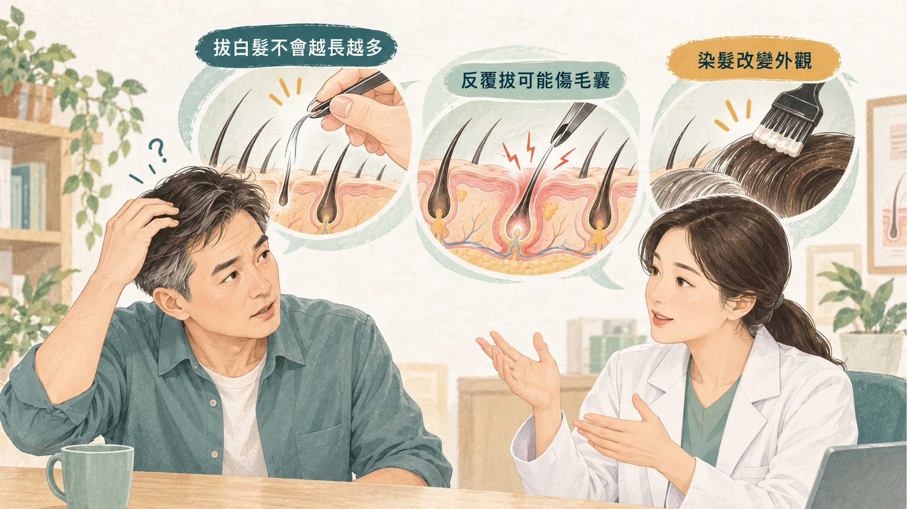
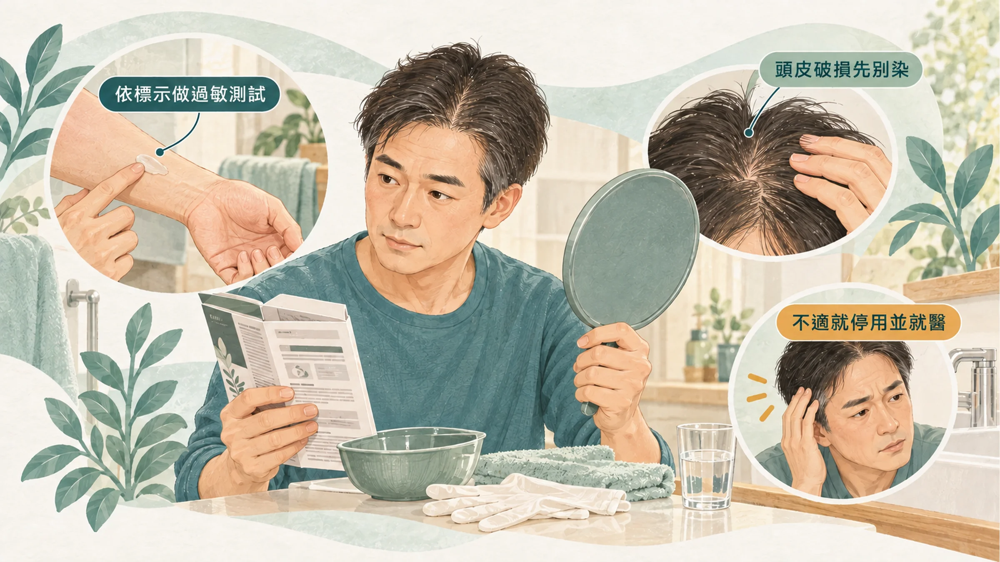
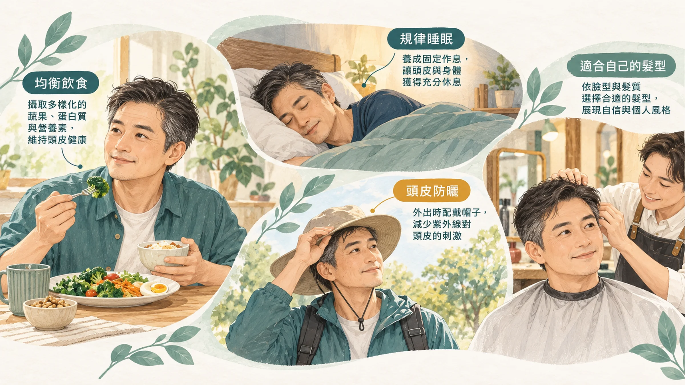

<!-- 🎨 [cover] [類型 A]
畫面：A middle-aged East Asian man in front of a bathroom mirror holding a pair of tweezers near his temple, pausing with a thoughtful half-smile, a box of hair dye on the counter. Warm off-white, teal and sage, soft editorial illustration.
標籤（Canva 填入）：白頭髮可以拔嗎？
STYLE: 依 IMAGE-STYLE.md 第 7.2 節
-->

剪頭髮的時候，設計師順口一句：「你白頭髮變多了喔。」

回家對著鏡子一看，耳朵上面、兩鬢，果然一撮一撮冒出來。你拿起夾子，正要拔，腦中響起長輩的聲音：「不要拔！拔一根長三根！」

白頭髮為什麼會長，我在〈[那幾根白的，不只是壓力造成的](/blog/body-signals/white-hair-stem-cells/)〉寫過。這篇回答最實際的幾個問題：**可以拔嗎？會變回黑的嗎？染髮安全嗎？**

## 拔一根，會長三根嗎？

不會。

每一根頭髮都長在自己的毛囊裡，拔掉一根，不會影響旁邊的毛囊，也不會讓它們變白。

**但還是不建議拔。** 皮膚科醫師提醒，反覆拔同一個位置，可能傷到毛囊，之後那個位置可能長不出頭髮來（Sharp HealthCare）。白頭髮至少還是頭髮，拔到不長了，那一塊就變稀疏。

如果真的很在意，**用剪刀從根部剪掉**，比拔更好。

## 白頭髮會變回黑的嗎？

會，但很少見，而且有條件。

美國哥倫比亞大學的研究團隊，把 14 位健康成人的頭髮一根一根拿來分析。頭髮大約每個月長 1 公分，所以一根頭髮就像一條時間軸，可以看出它在哪一段時間變白、哪一段時間又變黑（Rosenberg et al., 2021）。

他們發現：

- 有些白頭髮，真的會在同一根頭髮上**重新長回顏色**。
- 其中兩位受試者，頭髮變白的時間點對得上生活壓力變大的時期；壓力減輕後，有些頭髮又變回黑色。
- 研究團隊推測，只有**剛好在變白邊緣**的頭髮，比較有機會變回來；已經白很久的，通常回不去了。

這項研究人數很少，壓力和白髮的關係只是線索。它告訴我們的是：**剛開始冒白頭髮的時候，把睡眠和壓力顧好，可能還有一點機會。**

## 這些情況，白頭髮可能是身體在提醒你

大部分中年男人的白頭髮，和年紀、遺傳有關。但有些情況值得抽血看一下。

印度一項研究，觀察 100 位頭髮提早變白的人：大約 24% 維生素 B12 偏低，14% 甲狀腺功能異常，12% 有貧血（Mediratta et al., 2018）。

所以如果你有下面這些情況，可以請醫師抽血，看血球、鐵、甲狀腺和維生素 B12：

- 白頭髮在**短時間內**變多很多。
- 同時覺得很累、怕冷、手腳發麻、臉色蒼白。
- 吃全素，或腸胃手術後吸收不好。

如果真的是缺 B12 或甲狀腺問題，處理好之後，整體狀態會改善；白髮能不能變回來，就看個人了。

## 染髮安全嗎？

**致癌風險：** 美國哈佛團隊追蹤超過 11 萬名女性，比較有沒有使用永久性染髮劑。整體來看，染髮和大部分癌症、癌症死亡**沒有明顯關聯**；只有皮膚的基底細胞癌風險略高一點，部分乳癌和卵巢癌的類型和使用量有關（Zhang et al., 2020）。研究對象主要是美國白人女性，結論套到男性時要保守一點。

**過敏：** 比致癌更常遇到的是過敏。衛福部提醒，染髮前要先做皮膚過敏測試，**48 小時後沒有異常**才染；頭皮有傷口時不要染，冷燙後也不要馬上染（衛生福利部，2023）。

過敏的表現是頭皮紅、癢、起水泡、甚至破皮。出現這些情況，立刻沖掉並停止使用，嚴重的話看皮膚科。

**男生染髮的小建議：**

- 白髮不多的時候，選「**灰白融合**」或半永久染，讓白髮變淡、不要染成死黑，看起來比較自然。
- 鬍子另外有專用的染劑，不要拿染頭髮的直接用在臉上。
- 每次染都先做過敏測試，就算上次用過沒事也一樣。

## 轉黑洗髮精、轉黑保健品，有用嗎？

市面上很多「白髮轉黑」的洗髮精和保健品。

洗髮精型的，常見兩種做法：一種是裡面其實含有**染色成分**，洗久了慢慢把頭髮染深；一種是添加植物萃取，宣稱讓頭髮變黑。前者其實就是染髮，一樣要注意過敏；後者目前**沒有可靠的人體研究**證明能讓白髮轉黑。

吃的「轉黑」產品，常見中草藥成分。正在吃其他藥物、肝功能不好的人，吃之前先問醫師或藥師；吃了之後出現食慾變差、疲倦、茶色尿，要儘快就醫。

## 白髮族可以顧的事

- **戒菸。**
- **睡飽、處理壓力。**
- **均衡飲食**，吃全素的人注意 B12。
- **頭皮防曬**：戶外活動戴帽子。
- 換個髮型：灰白頭髮剪短、整理俐落，很多男人反而更有型。

## 什麼時候看醫生、看哪一科

- 白頭髮短時間內大量出現，合併疲倦、怕冷、手腳發麻：看**家醫科**或**新陳代謝科**，抽血檢查。
- 頭髮或皮膚出現一塊一塊變白的地方：看**皮膚科**，排除白斑症。
- 染髮後頭皮紅腫、起水泡、破皮：看**皮膚科**。

## 帶走一句話

**白頭髮拔一根不會長三根，但會傷毛囊。** 在意就剪掉或染，突然變很多就抽血看看。

---

## 參考資料

1. Rosenberg AM, et al. Quantitative mapping of human hair greying and reversal in relation to life stress. *eLife*, 2021.（PMID：[34155974](https://pubmed.ncbi.nlm.nih.gov/34155974/)）
2. Mediratta V, et al. An observational, epidemiological study on pattern of clinical presentation and associated laboratory findings in patients of premature hair graying. *International Journal of Trichology*, 2018.（來源：[International Journal of Trichology](https://doi.org/10.4103/ijt.ijt_65_17)，2018）
3. Zhang Y, et al. Personal use of permanent hair dyes and cancer risk and mortality in US women: prospective cohort study. *BMJ*, 2020.（來源：[BMJ](https://doi.org/10.1136/bmj.m2942)，2020）
4. 衛生福利部。「染髮5撇步，安全又美麗」正確染髮及選購染髮劑！衛生福利部，2023。https://mohw.gov.tw/cp-16-24032-1.html
5. Sharp HealthCare. Does plucking gray hair cause more to grow? Sharp Health News，非同儕審查。https://www.sharp.com/health-news/does-plucking-gray-hair-cause-more-to-grow

*本文為健康教育資訊，不構成醫療診斷或治療建議。*
