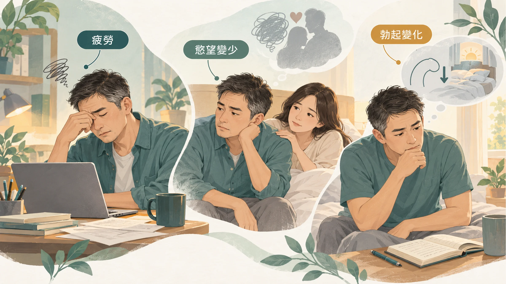
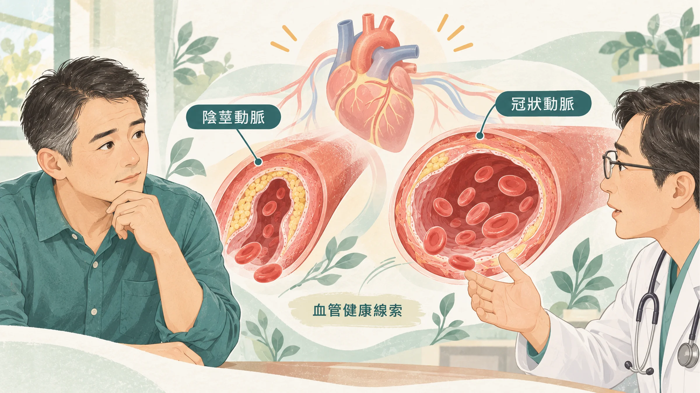
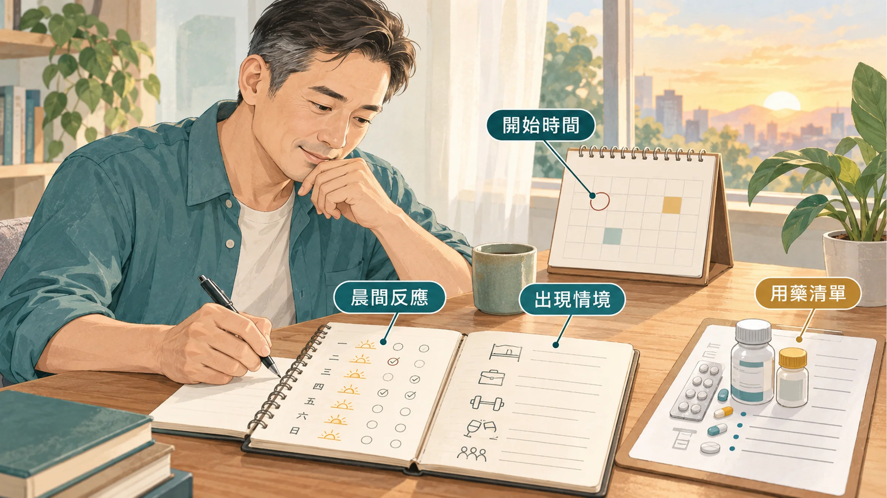

<!-- 🎨 [cover] [類型 A]
畫面：A middle-aged East Asian man sitting on the edge of a bed in soft morning light, looking thoughtfully out of a window, with a glass of water on the bedside table. Calm, respectful mood, no intimacy implied. Warm off-white background, flat illustration, teal and sage palette.
標籤（Canva 填入）：先分清楚是哪一種
STYLE: 依 IMAGE-STYLE.md 第 7.2 節
-->

「男生們！你只剩一張嘴了嗎？」

「聽說你以前是兩棲部隊啊？」怎麼現在是這樣？

二十幾歲的時候，你大概從來沒想過這件事。現在「大老二」（大還不一定大，不過老是真的）會很老實地告訴你：早上的自然反應好像少了，硬度不如以前，中場休息要好幾個小時，有時候甚至叫也叫不醒。

你要推說工作壓力大也可以，反正都是「they」的錯。🤷‍♂️ 不過，不要害羞。

這些變化很常見，但它們不是同一件事。先分清楚你在意的是哪一種，因為原因不一樣，該找的醫師也不一樣。

## 先分清楚：你在意的是哪一種

**第一種：累。** 體力撐不到晚上，運動後恢復變慢，對什麼都提不起勁，親密只是其中一件。這多半要先看睡眠、壓力和代謝，可以從〈[大多數男人沒有意識到：40 歲之後的疲勞，和 20 歲的疲勞不一樣](/blog/body-signals/male-fatigue-after-40/)〉開始讀。

**第二種：沒慾望。** 不是做不到，是不太想。性慾（也就是想要親密的念頭本身）會受睪固酮、情緒、壓力和某些藥物影響。

**第三種：勃起本身變了。** 想要，但硬度不夠、維持不久，或晨間反應明顯變少。勃起靠的是血液流進陰莖海綿體，所以它和血管、神經、血糖的關係最直接。

三種可能同時出現。你可以先問自己：如果今天睡飽、沒有壓力，問題還在不在？還在的話，比較像第二或第三種。

## 睪固酮真的會往下掉，只是比你想的慢

男性最重要的荷爾蒙是睪固酮。美國麻州男性老化研究追蹤了上千名中年男性，總睪固酮大約每年下降 1.6%，游離睪固酮下降得更快一些（Feldman et al., 2002）。

也就是說，40 歲之後是慢慢下坡，不是一夜之間掉下去。如果你覺得「這半年突然差很多」，反而要想想睡眠、體重、壓力或新吃的藥，有沒有同時在變。

想初步了解自己有沒有睪固酮偏低的跡象，醫師常用一份叫 **ADAM** 的 10 題問卷，問的是性慾、勃起硬度、體力、耐力、情緒、飯後想睡等等。其中「性慾降低」或「勃起硬度不如以往」任一題回答是，或其他題有 3 題以上是，就建議抽血確認（Morley et al., 2000）。

這份問卷很敏感，但不夠精準：答「是」的人很多其實睪固酮正常。它的用途是告訴你該不該去驗，不是幫你下結論。

## 勃起變化，有時是心血管先開口

這是最多人沒想到的一點。

陰莖的動脈比心臟的冠狀動脈細得多。血管內皮（也就是血管內壁那層負責放鬆、擴張的細胞）一開始變差，最先出問題的常常是比較細的血管。

美國梅約診所追蹤一個社區的男性長達十年，發現在 40 多歲就出現勃起問題的男性，之後發生冠狀動脈疾病的機會明顯較高（Inman et al., 2009）。

所以如果你同時有腰圍變大、血壓或血脂紅字、家族裡有人早發心臟病，勃起變化值得當成一個提醒，連同心血管一起檢查。報告上的血脂怎麼看，可以參考〈[LDL 看起來還好，為什麼醫師還會看 ApoB？](/blog/precision-health-tools/apob-vs-ldl/)〉。

## 以形補形和「壯陽食物」，研究到底說了什麼

牛鞭、海馬酒、雞睪丸，這些說法流傳很久。那哪天你吃猴腦，會補腦嗎？補了會變成猴子的思考嗎？

這些大多是高脂肪、高膽固醇的內臟，吃多了反而讓腰圍和血脂往錯的方向走，最後頭禿、肚子凸還不舉，超慘。為什麼「以形補形」站不住腳，可以看〈[打爆保健品神話，以形補形為什麼不行？](/blog/precision-health-tools/supplement-myths-debunked/)〉。

比較常被拿出來討論的營養素和植物，研究狀況大致如下。以下是成分研究，不代表任何產品的效果：

- **精胺酸（L-arginine）：** 日本「AV 之王」清水健（しみけん）曾在受訪時說，他每天吃精胺酸等補充品，來應付繁重的「體力」工作。精胺酸是一氧化氮的原料，而一氧化氮負責讓陰莖的血管放鬆。一篇統合分析整理了 10 個隨機試驗、540 位輕到中度勃起障礙的男性，每天補充 1,500 到 5,000 毫克，和安慰劑相比勃起功能有改善，但性慾沒有變化（Rhim et al., 2019）。試驗規模都不大，正在吃降血壓藥或威而鋼的人不要自己加。
- **鋅：** 牡蠣、紅肉、堅果裡都有。研究發現缺鋅的人睪固酮會偏低，補足之後會回升（Prasad et al., 1996）。如果你本來就不缺，多吃不一定有差別。
- **瑪卡：** 一項 12 週的小型研究，受試男性自評的性慾有提升，但血中睪固酮沒有變化（Gonzales et al., 2002）。人數少、時間短，只能當線索。
- **淫羊藿：** 它的成分淫羊藿苷，在細胞和大鼠實驗中看到改善勃起相關的指標（Shindel et al., 2010）。這是動物研究，人體證據還不夠。

正在吃降血壓、心臟病或抗凝血藥物的人，吃任何補充品之前，先問醫師或藥師。

## 有證據、今天就能做的事

- **肌力訓練：** 深蹲、硬舉這類用到大肌群的阻力訓練，研究顯示會帶動睪固酮的反應（Vingren et al., 2010）。肌肉量本身也是代謝的底盤。
- **把腰圍降下來：** 腹部脂肪多，睪固酮通常偏低，血管也比較吃力。低頭看不見自己的台 GG，想到就起肖。低頭看得到自己的腳尖，是很實際的第一個目標。
- **睡飽、睡完整：** 睪固酮需要完整、不被切碎的睡眠，原因寫在〈[40 歲之後為什麼越睡越累？](/blog/body-signals/sleep-quality-testosterone/)〉。
- **戒菸、少喝酒：** 兩者都直接傷害血管。

## 威而鋼這類藥物，要由醫師評估

大家熟悉的「藍色小藥丸」，成分是西地那非（sildenafil），屬於 PDE5 抑制劑，作用是幫助陰莖的血管放鬆、讓血液流進去。

它是處方藥，有兩件事一定要知道：

- **正在使用硝化甘油等硝酸鹽類心臟藥物的人不能併用**，可能造成血壓危險地下降。
- **網路上來路不明的「壯陽藥」不要買。** 成分和劑量都不清楚，對有心血管問題的人風險更高。

要不要用、用哪一種、劑量多少，請和醫師討論，不要自己買、自己調整。

## 什麼時候看醫生、看哪一科

- **勃起或性慾的變化持續超過 3 個月：** 看**泌尿科**。這是泌尿科醫師每天都在處理的問題，不用不好意思。
- **想確認睪固酮：** 泌尿科或**新陳代謝科**都可以安排抽血，通常會建議早上抽。
- **同時有血壓、血脂、血糖紅字，或爬樓梯會喘：** 加看**家醫科或心臟內科**。
- **如果有胸痛、胸悶或呼吸困難，請立即就醫。**
- **心情持續低落、對很多事都提不起興趣：** 也和醫師說。需要有人聽你說話時，可以撥衛福部安心專線 **1925**。

看診前可以先記下這幾件事：從什麼時候開始、晨間反應大概一週幾次、在什麼情況下比較明顯、目前在吃的藥和保健品。這些紀錄是給醫師看的，不需要傳給任何人。

## 帶走一句話

**累、沒慾望、勃起變了，是三件不同的事。** 先分清楚是哪一種，再找對的科別。勃起的變化，有時候是心血管最早的提醒。

---

## 參考資料

1. Feldman HA, et al. Age trends in the level of serum testosterone and other hormones in middle-aged men: longitudinal results from the Massachusetts Male Aging Study. *Journal of Clinical Endocrinology & Metabolism*, 2002.（PMID：[11836290](https://pubmed.ncbi.nlm.nih.gov/11836290/)）
2. Morley JE, et al. Validation of a screening questionnaire for androgen deficiency in aging males. *Metabolism*, 2000.（PMID：[11016912](https://pubmed.ncbi.nlm.nih.gov/11016912/)）
3. Inman BA, et al. A population-based, longitudinal study of erectile dysfunction and future coronary artery disease. *Mayo Clinic Proceedings*, 2009.（PMID：[19181643](https://pubmed.ncbi.nlm.nih.gov/19181643/)）
4. Prasad AS, et al. Zinc status and serum testosterone levels of healthy adults. *Nutrition*, 1996.（PMID：[8875519](https://pubmed.ncbi.nlm.nih.gov/8875519/)）
5. Gonzales GF, et al. Effect of Lepidium meyenii (MACA) on sexual desire and its absent relationship with serum testosterone levels in adult healthy men. *Andrologia*, 2002.（PMID：[12472620](https://pubmed.ncbi.nlm.nih.gov/12472620/)）
6. Shindel AW, et al. Erectogenic and neurotrophic effects of icariin, a purified extract of horny goat weed (Epimedium spp.) in vitro and in vivo. *Journal of Sexual Medicine*, 2010.（PMID：[20141584](https://pubmed.ncbi.nlm.nih.gov/20141584/)）
7. Rhim HC, et al. The potential role of arginine supplements on erectile dysfunction: a systemic review and meta-analysis. *Journal of Sexual Medicine*, 2019.（來源：[Journal of Sexual Medicine](https://doi.org/10.1016/j.jsxm.2018.12.002)，2019）
8. Vingren JL, et al. Testosterone physiology in resistance exercise and training: the up-stream regulatory elements. *Sports Medicine*, 2010.（PMID：[21058750](https://pubmed.ncbi.nlm.nih.gov/21058750/)）

*本文為健康教育資訊，不構成醫療診斷或治療建議。*
