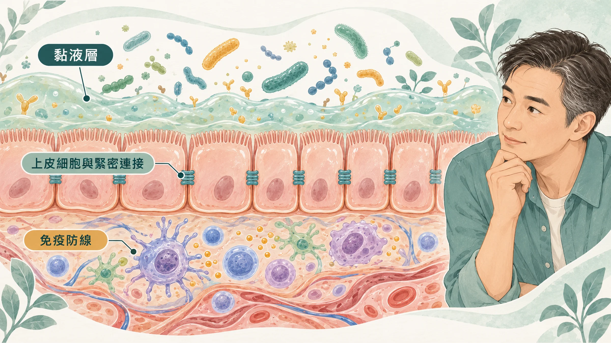
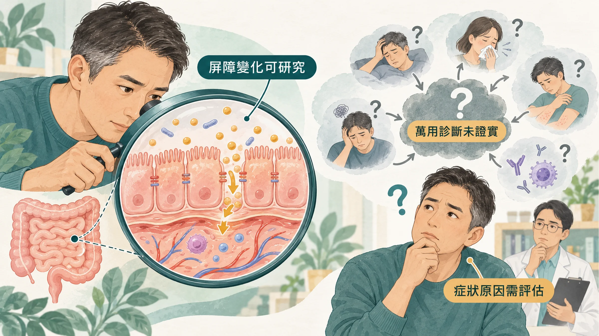
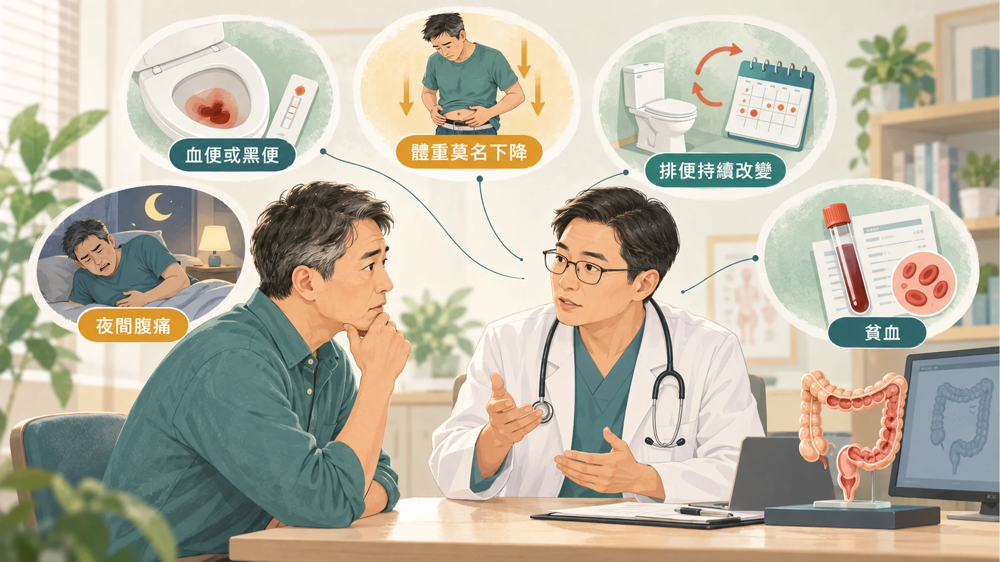

<!-- 🎨 [cover] [類型 A]
畫面：A middle-aged East Asian man holding his stomach while reading health claims on a phone, with a simple cross-section of intestinal lining floating beside him. Warm off-white, teal and sage, soft editorial illustration.
標籤（Canva 填入）：腸漏症是真的嗎？
STYLE: 依 IMAGE-STYLE.md 第 7.2 節
-->

吃完飯就脹，下午很累，皮膚也比以前容易出狀況。

上網一查，很多文章給你同一個答案：**你有腸漏症**。接著推薦你一套檢測、一套飲食，再加幾罐「修復腸道」的補充品。

腸道屏障和慢性發炎可以放在一起談，但不能把所有症狀都算到「腸漏」頭上。這篇先把兩邊分清楚，後面三篇再談哪些習慣讓腸道變漏、檢測準不準、益生菌能不能修。

## 腸道本來就有一道「守門系統」

腸道每天要做一件很矛盾的事：把營養吸收進來，同時把細菌和它們的碎片擋在外面。

負責這件事的，叫**腸道屏障**（也就是腸壁上一層一層的防線）。梅約診所的腸胃科學者把它整理成三層（Camilleri, 2019）：

- **黏液層：** 最外面一層像果凍的黏液，讓細菌不要直接貼到腸壁。
- **上皮細胞：** 一排緊緊靠在一起的細胞，細胞和細胞之間有**緊密連接**（也就是把相鄰細胞綁在一起的蛋白質，像拉鍊）。
- **免疫防線：** 黏膜底下的免疫細胞，負責處理跑進來的東西。

所謂「腸漏」，指的是這道防線變得比較鬆，平常擋得住的東西，比較容易穿過去。

## 有證據的部分：腸道真的會變「漏」

腸道通透性（也就是腸壁讓東西通過的程度）在研究裡是量得到的。最常用的方法，是讓人喝下幾種身體不太吸收的糖，再看尿液裡出現多少（Camilleri, 2019）。

研究看到通透性上升的情況，大致分兩類：

**第一類，本來就有腸道疾病。** 發炎性腸道疾病（例如克隆氏症、潰瘍性結腸炎）、乳糜瀉這類會讓腸壁發炎或破損的疾病，腸道會變漏。這時候屏障異常常伴隨既有病變，需要先釐清並治療疾病本身。

**第二類，健康的人在某些狀態下。** 長時間的耐力運動、使用某些消炎止痛藥，以及特定飲食或生理條件，在部分研究中都被觀察到通透性改變（Camilleri, 2019）。下一篇會把這些習慣一個一個拆開來看。

## 慢性發炎和腸道屏障，為什麼可以一起談？

如果把腸道想成一座有門禁的城市，腸道屏障就是查驗通行證的地方。它不是完全不透水的牆，而是要讓養分進來，同時限制不該大量進入身體的東西。

當屏障的調節出了問題，腸道內某些細菌成分就可能比較容易跨過防線。其中常被研究的 **LPS（脂多醣，也稱內毒素）**，是部分細菌外膜的成分。它被免疫系統辨識後，可能啟動發炎訊號；不代表整隻細菌一定跑進血液，也不等於敗血症。

關係也可能反過來：**腸壁本身發炎，會影響細胞之間的連接與屏障功能。** 所以研究關心的是兩者如何互相影響，而不是只畫一支「腸漏 → 所有疾病」的箭頭。2022 年的腸道屏障回顧，以及 2023 年刊出的心血管回顧，都整理了這條路徑的機轉與人體觀察資料。

但能解釋機轉，還不等於找到每個人的病因。**hs-CRP 是全身發炎的指標，不能告訴你發炎一定從腸道來；肚子脹、容易累，也不能直接推定有腸漏。** 更不能把「腸道和心血管有關」跳接成某一款產品能預防心血管疾病。

## 人體試驗怎麼說？有進展，也有沒有變的指標

我覺得這裡最值得看的是：研究真的量了什麼，又有哪些結果沒有跟著變。

### 多酚飲食：有些發炎指標出現改善

2024 年 MaPLE 研究分析 51 位六十歲以上成人，採交叉試驗，每種飲食各八週。富含多酚的飲食後，糞便與血清的鈣衛蛋白下降，提供了飲食與腸道相關發炎的線索。

不過，研究以血清 zonulin 篩選受試者，這種檢測的辨識能力本身有爭議；部分結果也是介入前後比較。因此不能把這篇翻譯成「吃多酚已證明修好腸漏」，更不能直接套用到任何補充品。

### 腸道指標改善，全身發炎未必同步下降

另一項 2024 年雙盲交叉試驗，納入 19 位健康成人與 21 位代謝症候群成人。四週綠茶萃取物介入後，循環內毒素、部分腸道發炎與通透性指標改善，但 **TNF-α、IL-6 等全身發炎指標沒有明顯改變**。

這不是建議你去買高劑量萃取物，而是提醒：**「腸道指標變好」和「全身慢性發炎改善」是兩個需要分開驗證的結果。**

### 乳化劑也不是吃了就一定全身發炎

2025 年先行發表、2026 年刊出的探索性試驗，讓 60 位健康成人先吃兩週不含乳化劑的飲食，再隨機分組介入四週。不同乳化劑影響了部分菌相或短鏈脂肪酸結果，但介入結束時，乳化劑組與安慰劑組的 CRP、糞便鈣衛蛋白等指標沒有顯著差異。

它不能證明長期大量吃都沒有影響，卻提醒我們：不能把動物研究或某個腸道指標，直接寫成「所有乳化劑都會讓人慢性發炎」。

### 同一種飲食，對不同人也可能不一樣

2025 年一項 32 位五十至七十九歲成人的短期交叉試驗，比較五天不同脂肪比例飲食。高脂飲食後的空腹內毒素上升，主要出現在肥胖組，正常體重組沒有相同的顯著變化。

這支持繼續研究飲食、代謝狀態和腸道屏障的交互作用；但時間只有五天，也用了有測量限制的 zonulin 指標，不能推論成「所有油脂都會傷腸」，或光靠這項試驗判定長期疾病風險。

## 還沒證實的部分：腸漏症是不是一種病

網路上的「腸漏症」，通常被當成一種病：先有腸漏，再引起疲倦、過敏、皮膚問題、情緒低落，甚至自體免疫疾病。

這種把許多症狀歸成同一個病的說法，證據仍不足。Camilleri 的回顧提醒：

- 腸漏目前**不是一個獨立的診斷**。
- 已知的腸道疾病可能伴隨屏障功能異常，仍要處理原本的疾病；不能把「修復屏障」當成通用治療。
- 屏障或發炎指標改善後，能不能帶來特定症狀與長期健康的改善，**仍須按疾病、介入和結果分別驗證**，不能一概而論。

作者也提醒醫師：在推薦排除飲食、發酵食品或「修復腸道」的補充品之前，先確認這些說法有沒有證據。

也就是說，腸道會變漏是真的；「你的疲倦、過敏都是腸漏造成的，吃這個就會好」，目前還是一個推論。

## 為什麼這個說法這麼紅

因為它很好用。

脹氣、疲倦、皮膚差、注意力不集中，這些症狀很常見，原因也很多，看了醫生常常得到「沒什麼問題，多休息」。這時候有人告訴你「原因找到了，就是腸漏」，聽起來很合理，也給了一個看得見的解法。

問題是，這些症狀背後可能是睡眠、壓力、甲狀腺、貧血、食物不耐、腸躁症，也可能是需要及早處理的腸道疾病。把它們全部收進「腸漏」這個抽屜，反而可能錯過真正的原因。

身體一直累、健檢又沒紅字，可以先從〈[體檢報告沒有紅字，但你還是一直累](/blog/body-signals/normal-checkup-still-tired/)〉開始讀。

## 照顧腸道，也要一起看一天怎麼過

只盯著一罐「修復腸道」補充品，很容易漏掉每天反覆發生的事。我會先從四個地方整理，而不是先替自己貼上腸漏症的標籤。

**吃：先看日常吃的組合。** 包裝食品不等於超加工，還要看原料與加工方式。2022 年一項 16 人、十一天的控制飲食試驗，發現特定乳化劑 CMC 影響了菌相與代謝物；但它不能代表所有添加物，也不支持「任何超加工食物在兩天內就讓每個人腸漏」。

**動：有安排運動，也把久坐切開。** 小型交叉試驗發現，超重或肥胖的中年成人每坐二十分鐘、走兩分鐘，餐後血糖與胰島素反應較低；量到的是短期代謝結果，並不是直接證明腸漏修好。大型觀察資料也顯示，較高活動量可能減弱久坐與死亡風險的關聯，所以不必把運動說成「完全抵銷不了」。

**腰圍：體重以外，再看身形與代謝變化。** 減少內臟脂肪不必在重訓和有氧之間選邊。納入 84 項試驗的統合分析支持多種運動方式；不能概括成重訓一定比有氧更有效。能持續的活動，再搭配合適飲食，才有機會累積改變。

**睡：注意反覆缺覺，不用為一晚沒睡好嚇自己。** 2026 年刊出的實驗研究統合分析，較明確的 CRP、IL-6 上升出現在連續多晚部分睡眠剝奪；單晚缺覺沒有一致的發炎指標變化。先記錄自己的睡眠時間與規律，比隔天急著驗一個數字更有脈絡。

這四件事可以一起做，但不能拿它們取代需要的診斷與治療。想先動一小步，可以記下一週的飲食、久坐與睡眠，再挑一件最容易反覆做到的改變。

## 這些情況，先看腸胃科

腸胃不舒服的時候，比起先買一套「修復腸漏」的產品，下面這些訊號更值得注意：

- **血便、黑便，或糞便潛血檢查陽性。**
- **體重在沒有刻意減重的情況下明顯下降。**
- **排便習慣改變超過幾週**，例如以前很規律，最近常腹瀉或便祕交替。
- **半夜會被肚子痛醒**，或腹痛越來越頻繁。
- **抽血發現貧血**，或家人有大腸癌、發炎性腸道疾病。

有這些情況，請看**腸胃科**，必要時安排大腸鏡。

另外，國民健康署從 2025 年起，提供 45 到 74 歲民眾每兩年一次免費的糞便潛血檢查；父母、子女或兄弟姊妹曾罹患大腸癌的人，40 歲起就可以做（衛生福利部，2025）。過了 45 歲還沒做過的話，這是最簡單的第一步。

肚子不舒服是真的，值得找出原因。腸道屏障和慢性發炎可以一起理解，但不能靠「腸漏症」三個字解釋所有不適。先把需要處理的疾病排除，再來看自己的飲食、用藥與生活習慣。

下一篇〈[哪些習慣會讓腸道變漏？](/blog/chronic-inflammation/gut-barrier-habits-exercise-nsaids-alcohol/)〉，來看研究裡被抓到的幾個生活習慣。

---

## 參考資料
1. Camilleri M. Leaky gut: mechanisms, measurement and clinical implications in humans. *Gut*, 2019. DOI：[10.1136/gutjnl-2019-318427](https://doi.org/10.1136/gutjnl-2019-318427)。
2. 衛生福利部。健康台灣－擴展腸癌防護網 「腸」常篩檢護健康。衛生福利部，2025。https://mohw.gov.tw/cp-16-81256-1.html

3. Martel J, et al. Gut barrier disruption and chronic disease. *Trends Endocrinol Metab*. 2022;33:247–265. DOI：[10.1016/j.tem.2022.01.002](https://doi.org/10.1016/j.tem.2022.01.002)。
4. Violi F, et al. Gut-derived low-grade endotoxaemia, atherothrombosis and cardiovascular disease. *Nat Rev Cardiol*. 2023;20:24–37. DOI：[10.1038/s41569-022-00737-2](https://doi.org/10.1038/s41569-022-00737-2)。
5. Marino M, et al. A (poly)phenol-rich diet reduces serum and faecal calprotectin in older adults with increased intestinal permeability: the MaPLE randomised controlled trial. *BMC Geriatr*. 2024;24:707. DOI：[10.1186/s12877-024-05272-y](https://doi.org/10.1186/s12877-024-05272-y)。
6. Zeng M, et al. A green tea extract confection decreases circulating endotoxin and fasting glucose by improving gut barrier function but without affecting systemic inflammation: A double-blind, placebo-controlled randomized trial in healthy adults and adults with metabolic syndrome. *Nutr Res*. 2024. DOI：[10.1016/j.nutres.2024.02.001](https://doi.org/10.1016/j.nutres.2024.02.001)。
7. Wellens J, et al. Effect of Five Dietary Emulsifiers on Inflammation, Permeability, and the Gut Microbiome: A Placebo-controlled Randomized Trial. *Clin Gastroenterol Hepatol*. 2026;24:1092–1101.2025 年先行發表。 DOI：[10.1016/j.cgh.2025.08.005](https://doi.org/10.1016/j.cgh.2025.08.005)。
8. Ogilvie AR, et al. Short-term high fat diet-induced metabolic endotoxemia in older individuals with obesity: a randomized crossover study. *Am J Clin Nutr*. 2025;122:601–611. DOI：[10.1016/j.ajcnut.2025.06.001](https://doi.org/10.1016/j.ajcnut.2025.06.001)。

9. Scheffler L, et al. Widely Used Commercial ELISA Does Not Detect Precursor of Haptoglobin2, but Recognizes Properdin as a Potential Second Member of the Zonulin Family. *Front Endocrinol*. 2018;9:22. DOI：[10.3389/fendo.2018.00022](https://doi.org/10.3389/fendo.2018.00022)。
10. Monteiro CA, et al. Ultra-processed foods: what they are and how to identify them. *Public Health Nutr*. 2019;22:936–941. DOI：[10.1017/S1368980018003762](https://doi.org/10.1017/S1368980018003762)。
11. Chassaing B, et al. Randomized Controlled-Feeding Study of Dietary Emulsifier Carboxymethylcellulose Reveals Detrimental Impacts on the Gut Microbiota and Metabolome. *Gastroenterology*. 2022. DOI：[10.1053/j.gastro.2021.11.006](https://doi.org/10.1053/j.gastro.2021.11.006)。
12. Dunstan DW, et al. Breaking up prolonged sitting reduces postprandial glucose and insulin responses. *Diabetes Care*. 2012;35:976–983. DOI：[10.2337/dc11-1931](https://doi.org/10.2337/dc11-1931)。
13. Ekelund U, et al. Does physical activity attenuate, or even eliminate, the detrimental association of sitting time with mortality? A harmonised meta-analysis of data from more than 1 million men and women. *Lancet*. 2016;388:1302–1310. DOI：[10.1016/S0140-6736(16)30370-1](https://doi.org/10.1016/S0140-6736(16)30370-1)。
14. Chen X, et al. Effects of various exercise types on visceral adipose tissue in individuals with overweight and obesity: A systematic review and network meta-analysis of 84 randomized controlled trials. *Obes Rev*. 2024;25:e13666. DOI：[10.1111/obr.13666](https://doi.org/10.1111/obr.13666)。
15. Ballesio A, et al. Effects of Experimental Sleep Deprivation on Peripheral Inflammation: An Updated Meta-Analysis of Human Studies. *J Sleep Res*. 2026;35:e70099. DOI：[10.1111/jsr.70099](https://doi.org/10.1111/jsr.70099)。

*本文為健康教育資訊，不構成醫療診斷或治療建議。*