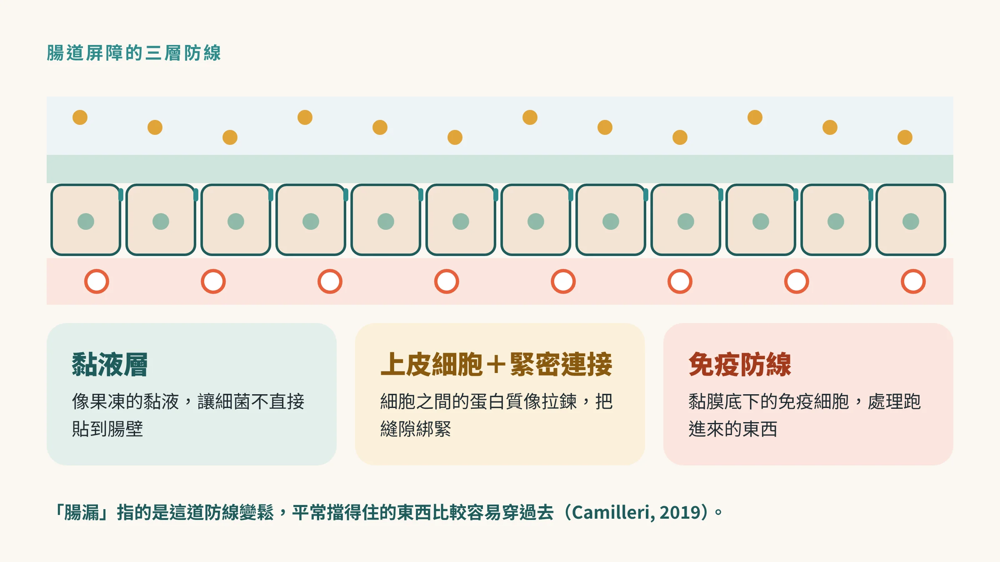
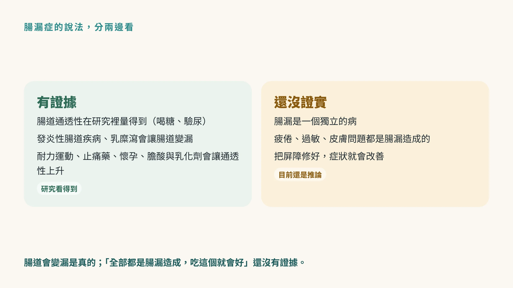
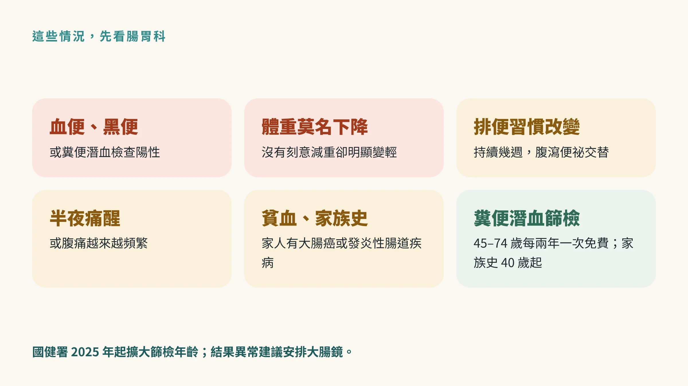

<!-- 🎨 [cover] [類型 A]
畫面：A middle-aged East Asian man holding his stomach while reading health claims on a phone, with a simple cross-section of intestinal lining floating beside him. Warm off-white, teal and sage, soft editorial illustration.
標籤（Canva 填入）：腸漏症是真的嗎？
STYLE: 依 IMAGE-STYLE.md 第 7.2 節
-->

吃完飯就脹，下午很累，皮膚也比以前容易出狀況。

上網一查，很多文章給你同一個答案：**你有腸漏症**。接著推薦你一套檢測、一套飲食，再加幾罐「修復腸道」的補充品。

腸漏這件事，有一半是真的，另一半還沒被證實。這篇先把兩邊分清楚，後面三篇再談哪些習慣讓腸道變漏、檢測準不準、益生菌能不能修。

## 腸道本來就有一道「守門系統」

腸道每天要做一件很矛盾的事：把營養吸收進來，同時把細菌和它們的碎片擋在外面。

負責這件事的，叫**腸道屏障**（也就是腸壁上一層一層的防線）。梅約診所的腸胃科學者把它整理成三層（Camilleri, 2019）：

- **黏液層：** 最外面一層像果凍的黏液，讓細菌不要直接貼到腸壁。
- **上皮細胞：** 一排緊緊靠在一起的細胞，細胞和細胞之間有**緊密連接**（也就是把相鄰細胞綁在一起的蛋白質，像拉鍊）。
- **免疫防線：** 黏膜底下的免疫細胞，負責處理跑進來的東西。

所謂「腸漏」，指的是這道防線變得比較鬆，平常擋得住的東西，比較容易穿過去。

## 有證據的部分：腸道真的會變「漏」

腸道通透性（也就是腸壁讓東西通過的程度）在研究裡是量得到的。最常用的方法，是讓人喝下幾種身體不太吸收的糖，再看尿液裡出現多少（Camilleri, 2019）。

研究看到通透性上升的情況，大致分兩類：

**第一類，本來就有腸道疾病。** 發炎性腸道疾病（例如克隆氏症、潰瘍性結腸炎）、乳糜瀉這類會讓腸壁發炎或破損的疾病，腸道會變漏。這時候「漏」是疾病的結果，要治療的是疾病本身。

**第二類，健康的人在某些狀態下。** 長時間的耐力運動、常吃消炎止痛藥、懷孕，以及膽酸和某些食品乳化劑，都被觀察到會讓通透性上升（Camilleri, 2019）。下一篇會把這些習慣一個一個拆開來看。

## 還沒證實的部分：腸漏症是不是一種病

網路上的「腸漏症」，通常被當成一種病：先有腸漏，再引起疲倦、過敏、皮膚問題、情緒低落，甚至自體免疫疾病。

研究目前還走不到這一步。同一篇回顧寫得很清楚（Camilleri, 2019）：

- 腸漏目前**不是一個獨立的診斷**。
- 發炎或潰瘍的腸道疾病會讓腸道變漏，但沒有一種疾病能「只靠把屏障修好」就治好。
- 把屏障功能恢復之後，腸胃或全身的症狀會不會跟著改善，**還沒有被證實**。

作者也提醒醫師：在推薦排除飲食、發酵食品或「修復腸道」的補充品之前，先確認這些說法有沒有證據。

也就是說，腸道會變漏是真的；「你的疲倦、過敏都是腸漏造成的，吃這個就會好」，目前還是一個推論。

## 為什麼這個說法這麼紅

因為它很好用。

脹氣、疲倦、皮膚差、注意力不集中，這些症狀很常見，原因也很多，看了醫生常常得到「沒什麼問題，多休息」。這時候有人告訴你「原因找到了，就是腸漏」，聽起來很合理，也給了一個看得見的解法。

問題是，這些症狀背後可能是睡眠、壓力、甲狀腺、貧血、食物不耐、腸躁症，也可能是需要及早處理的腸道疾病。把它們全部收進「腸漏」這個抽屜，反而可能錯過真正的原因。

身體一直累、健檢又沒紅字，可以先從〈[體檢報告沒有紅字，但你還是一直累](/blog/body-signals/normal-checkup-still-tired/)〉開始讀。

## 這些情況，先看腸胃科

腸胃不舒服的時候，比起先買一套「修復腸漏」的產品，下面這些訊號更值得注意：

- **血便、黑便，或糞便潛血檢查陽性。**
- **體重在沒有刻意減重的情況下明顯下降。**
- **排便習慣改變超過幾週**，例如以前很規律，最近常腹瀉或便祕交替。
- **半夜會被肚子痛醒**，或腹痛越來越頻繁。
- **抽血發現貧血**，或家人有大腸癌、發炎性腸道疾病。

有這些情況，請看**腸胃科**，必要時安排大腸鏡。

另外，國民健康署從 2025 年起，提供 45 到 74 歲民眾每兩年一次免費的糞便潛血檢查；父母、子女或兄弟姊妹曾罹患大腸癌的人，40 歲起就可以做（衛生福利部，2025）。過了 45 歲還沒做過的話，這是最簡單的第一步。

## 帶走一句話

**腸道會變漏是真的，但「腸漏症」還不是一個診斷。** 肚子出狀況，先排除需要處理的腸道疾病，再談怎麼照顧腸道屏障。

下一篇〈[哪些習慣會讓腸道變漏？](/blog/chronic-inflammation/gut-barrier-habits-exercise-nsaids-alcohol/)〉，來看研究裡被抓到的幾個生活習慣。

---

## 參考資料

1. Camilleri M. Leaky gut: mechanisms, measurement and clinical implications in humans. *Gut*, 2019.（PMID：[31076401](https://pubmed.ncbi.nlm.nih.gov/31076401/)）
2. 衛生福利部。健康台灣－擴展腸癌防護網 「腸」常篩檢護健康。衛生福利部，2025。https://mohw.gov.tw/cp-16-81256-1.html

*本文為健康教育資訊，不構成醫療診斷或治療建議。*
