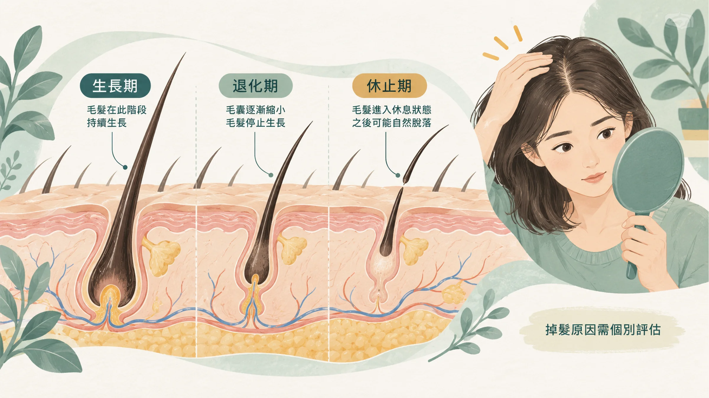
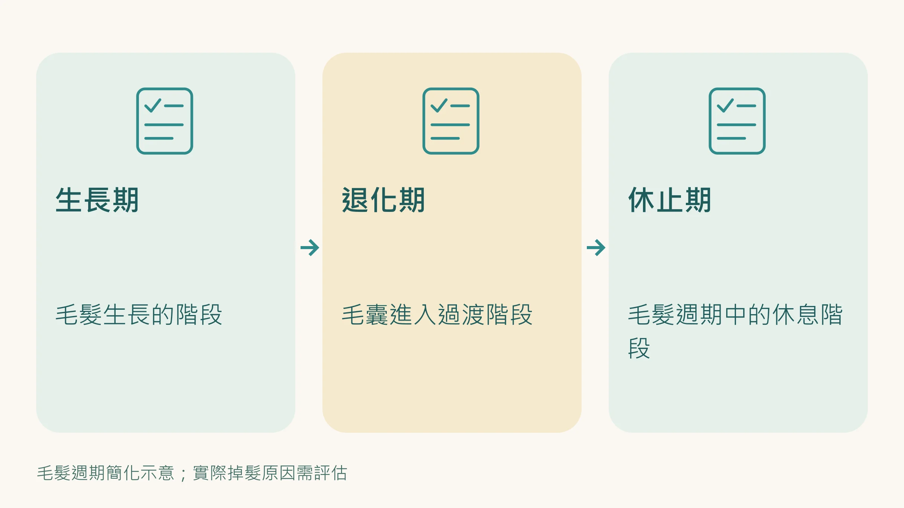
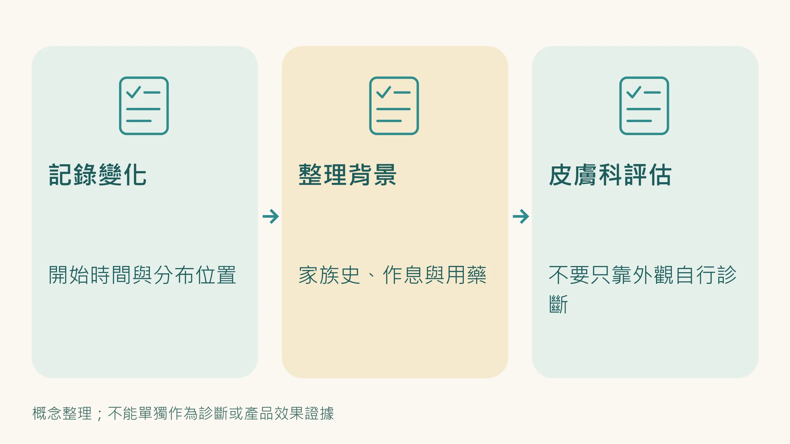

照鏡子的那一秒，你停下來了。

不是今天特別注意，是那個角度的光線，讓你突然看清楚一件你一直知道、但沒有正視的事。

兩側的髮際線，又退了。

你拿出幾年前的照片比一下。

不比不知道。

---

## 「只是雄性禿，家族遺傳，沒辦法的。」

這是大多數人告訴自己的解釋。

不完全是錯的。

雄性禿（Androgenetic Alopecia，AGA）確實有遺傳成分，而且遺傳的影響相當顯著。

根據流行病學數據，台灣男性 30 歲之後，雄性禿盛行率約 20%；40 歲以上超過三成；50 歲之後接近一半。

罪魁禍首通常被指向一個名詞：**DHT（二氫睪固酮，Dihydrotestosterone）**。

睪固酮透過5α-還原酶（5α-reductase）轉化成 DHT，DHT 與頭皮毛囊中的雄性素受體結合，縮短毛囊的生長週期，讓頭髮一根一根越長越細、越來越短，最後停止生長。

> **這個解釋是正確的。但它不完整。**

---

## 是誰真的殺死了你的毛囊

DHT是板機。

但板機扣下去之後，真正在毛囊裡發生的，是一件你在這個網站上一直再提的事：

**細胞衰老（Cellular Senescence）。**

2023年，Karger《Dermatology》期刊的研究發現，雄性禿患者禿髮區的皮乳頭細胞（Dermal Papilla Cells，DPCs），也就是毛囊底部負責指揮頭髮生長的關鍵細胞，出現了明顯的衰老特徵：衰老相關β-半乳糖苷酶（SA-β-gal）的表達上升，p16INK4a的表達增加，細胞形態出現衰老典型的扁平化改變。

換句話說，DHT 直接讓毛囊的關鍵細胞 **提前老化**。

衰老的細胞不死，但它停止正常工作，並開始分泌一種毒性的微環境物質，這就是你在這個網站上看過多次的名詞：**SASP（衰老相關分泌表型，Senescence-Associated Secretory Phenotype）**。

SASP裡的物質包括：TGF-β2（直接抑制毛囊生長訊號）、DKK-1（阻斷Wnt通路，使毛囊無法進入生長期）、以及大量的促炎細胞激素。

結果：毛囊進入縮小化（Miniaturization），每一輪生長週期，頭髮都更細一點、更短一點，最後完全退化成無法可見的汗毛，毛孔留在那裡，但頭髮不再長出來。

---

## 頭皮微發炎：全身Inflammaging的一個窗口

這裡有一個細節，很多人沒有注意到。

2025 年，蘇州大學的研究團隊在《Stem Cell Research & Therapy》發表了一篇雄性禿病理機制的完整回顧，在組織切片層級確認了一件事：**雄性禿患者的禿髮區，存在持續的慢性微發炎**：淋巴球浸潤、活化 T 細胞、肥大細胞脫顆粒，集中在毛囊幹細胞所在的毛囊鼓出區（bulge region）。

研究者特別強調：雄性禿的發炎不像感染時的急性發炎，它是一種「緩慢、持續、幾乎感覺不到」的慢性微發炎過程（**Microinflammation**），和全身性慢性低度發炎（Inflammaging）的特徵幾乎一模一樣。

同一份回顧還確認了另一條路徑：

**DHT → SIRT1 表達下降 → 粒線體功能失調 → TNF-α 發炎訊號 → 毛囊幹細胞再生受阻**

SIRT1 是細胞能量感應與抗老化的核心調控蛋白。

它下降，不只影響頭皮，而是影響全身所有依賴細胞再生的組織，肌肉、血管內皮、免疫系統。

這條路徑說明了一個你可能還沒意識到的事：

**頭皮的問題，不是獨立事件。**

你在鏡子裡看到的是髮際線。

但頭皮表面下正在發生的事，和你身體其他地方正在老化的事，是同一個機制在驅動。

---

## 禿頭男性的身體，還有什麼不一樣

流行病學數據支持這個連結。

多項大型研究顯示，提早出現雄性禿的男性（30歲前顯著禿髮），日後發展出 **代謝症候群、第二型糖尿病、心血管疾病**的風險明顯高於同齡無禿髮男性。

這個關聯並不是「禿頭導致心血管疾病」那麼簡單。

更正確的解讀是：雄性禿是全身慢性低度發炎狀態（Inflammaging）在毛囊上最早、最可見的外顯症狀之一。

掉頭髮讓你開始在意，這才是最重要的功能。

---

## 那，你現在應該做什麼

先說最重要的：**雄性禿目前證據最強的治療，是外用 Minoxidil 和口服 Finasteride。** 前者延長毛囊生長期、增加頭皮血流；後者抑制 5α-還原酶、降低 DHT。越早開始，能保住的毛囊越多。如果你發現髮際線在後退，請先找皮膚科醫師評估，用不用藥、用哪一種，和醫師討論。

這兩種藥處理的是 DHT 這條路徑。生活型態的管理是輔助，不能取代治療。但如果你想問的是：**為什麼在同樣的遺傳背景下，有人 50 歲只掉一點點，有人 35 歲就大面積禿了**——

答案在細胞層級，不在毛囊表面。

你的整體慢性發炎狀態、細胞再生能力、粒線體功能、SIRT1 活性，這些才是決定「遺傳傾向會不會真的發作、發作速度有多快」的調控變數。

而這些，是可以管理的。

---

## 這不只是外觀問題，是一個信號

鏡子裡的髮際線告訴你一件事：你的身體正在老化，而且這個老化是從細胞層級開始的。

M 型的 M，可以是 Male，可以是 Middle-aged，也可以是 Mitochondria。研究發現，粒線體功能下滑，可能是讓毛囊幹細胞無法繼續工作的原因之一。

下一步建議讀：

**→ [40歲之後的疲勞，和20歲不一樣——中年男性Inflammaging全解析](/blog/body-signals/male-fatigue-after-40/)**

那篇文章會告訴你，頭皮正在發生的事，在你的肌肉、大腦、血管裡也同時在進行。

---

**延伸閱讀：**
- [《鬼滅之刃》無慘搞錯了一件事：問題不在年輕的血有什麼，而在他老人家的血裡多了什麼](/blog/body-signals/demon-slayer-aging-blood/)
- [那幾根白的，不只是壓力造成的——也可能是你的幹細胞在保護你](/blog/body-signals/white-hair-stem-cells/)

---

## 參考資料

01. Deng Yongqiong, Wang Mengxue, He Yuxin et al. (2023). Cellular Senescence: Ageing and Androgenetic Alopecia. *Dermatology*, 239(4):533-541. DOI：[10.1159/000530681](<https://doi.org/10.1159/000530681>)。
02. Dong Ting-ru, Li Yu-jie, Jin Shi-yu et al. (2025). Progress on mitochondria and hair follicle development in androgenetic alopecia: relationships and therapeutic perspectives. *Stem Cell Research &amp; Therapy*, 16(1):44. DOI：[10.1186/s13287-025-04182-z](<https://doi.org/10.1186/s13287-025-04182-z>)。
03. Xiao Yu, Zhang Yi, Deng Shuting et al. (2025). Immune and Non-immune Interactions in the Pathogenesis of Androgenetic Alopecia.. *Clinical reviews in allergy & immunology*, 68(1):22. DOI：[10.1007/s12016-025-09034-5](<https://doi.org/10.1007/s12016-025-09034-5>)。
04. Mahé Yann F., Michelet Jean‐François, Billoni Nelly et al. (2000). Androgenetic alopecia and microinflammation. *International Journal of Dermatology*, 39(8):576-584. DOI：[10.1046/j.1365-4362.2000.00612.x](<https://doi.org/10.1046/j.1365-4362.2000.00612.x>)。
05. Jung Young Hyun, Chae Chang Woo, Choi Gee Euhn et al. (2022). Cyanidin 3-O-arabinoside suppresses DHT-induced dermal papilla cell senescence by modulating p38-dependent ER-mitochondria contacts. *Journal of Biomedical Science*, 29(1):17. DOI：[10.1186/s12929-022-00800-7](<https://doi.org/10.1186/s12929-022-00800-7>)。
06. Oiwoh Sebastine Oseghae, Enitan Ademola Olusegun, Adegbosin Olubola Titilope et al. (2024). Androgenetic Alopecia: A Review. *Nigerian Postgraduate Medical Journal*, 31(2):85-92. DOI：[10.4103/npmj.npmj_47_24](<https://doi.org/10.4103/npmj.npmj_47_24>)。
