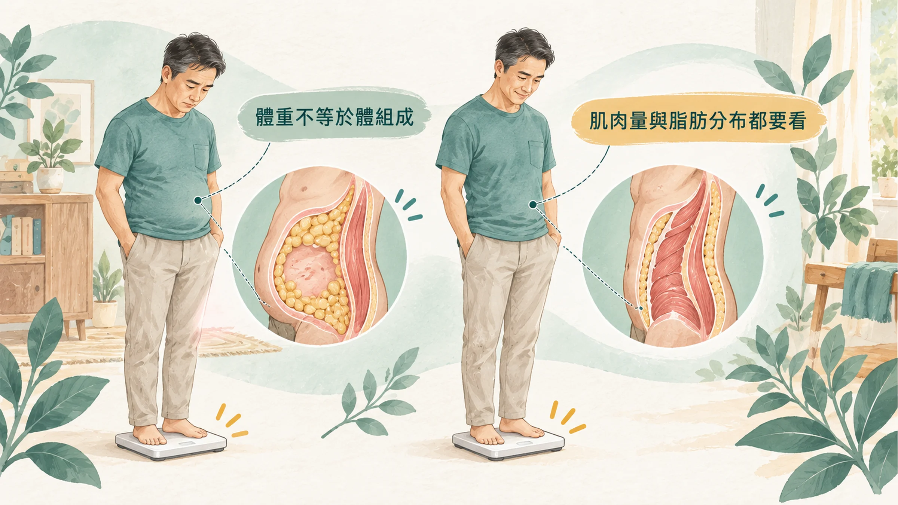
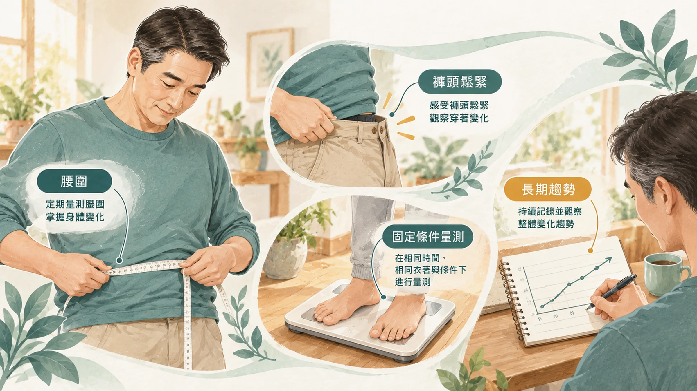

<!-- 🎨 [cover] [類型 A]
畫面：A middle-aged East Asian man standing on a bathroom scale, looking down with a puzzled expression while struggling to button his trousers. Light humor, warm off-white, teal and sage, soft editorial illustration.
標籤（Canva 填入）：體重沒變，褲子卻越來越緊？
STYLE: 依 IMAGE-STYLE.md 第 7.2 節
-->

早上要出門開會，翻出那件好久沒穿的西裝褲。

拉鍊拉到一半，卡住。吸一口氣，再拉，釦子扣得起來，但坐下去的那一刻，肚子先抗議。

你站上體重計：72 公斤。三年前也是 72 公斤啊。

**體重沒變，褲子卻越來越緊。** 不是褲子縮水，是你身體裡的東西換了位置。

## 體重一樣，裡面的東西不一樣了

體重計量的是全部加起來的重量：骨頭、肌肉、脂肪、水分。它不會告訴你，這三年裡哪一樣少了、哪一樣多了。

中年男人最常發生的，是這兩件事**同時**在進行：

1. **肌肉悄悄變少。**
2. **脂肪往肚子集中。**

一少一多，剛好抵銷，體重沒什麼變，身形卻已經走樣。

## 第一件事：肌肉悄悄變少

研究團隊用核磁共振，量了 468 位 18 到 88 歲成人全身的肌肉。他們發現：肌肉佔體重的比例，從 20 多歲就開始慢慢往下；到了 **50 歲左右，肌肉量的流失開始變得明顯**，而且流失最多的是**下半身**（Janssen et al., 2000）。

下半身肌肉少了，屁股和大腿撐不起褲子，整個人看起來就是「肚子大、腿細」。

肌肉不只是好不好看。它是身體燃燒熱量的主力，肌肉少了，同樣的飯量更容易囤成脂肪。

## 第二件事：脂肪往肚子跑

加拿大學者回顧研究後發現，隨著年齡增加，**內臟脂肪（包在器官旁邊的脂肪）會變多**，下半身的皮下脂肪反而減少。而且這些變化，可能在**體重甚至腰圍都還沒明顯改變時**就已經開始（Kuk et al., 2009）。

內臟脂肪不只讓肚子變大，它本身就是發炎和代謝問題的來源。為什麼腰圍比體重更值得盯，可以看〈[腰圍每年多三公分，不是你吃太多](/blog/body-signals/visceral-fat-metabolic-signal/)〉。

## 該量什麼，才看得出變化

光看體重不夠。下面三個，比體重更能看出身形：

- **腰圍：** 站直、放鬆、正常吐氣，皮尺水平繞過肚臍上緣。國民健康署的標準，男性腰圍 90 公分以上就要注意。
- **褲子的鬆緊：** 最誠實的量尺。挑一件「基準褲」，每個月穿一次。
- **體脂和肌肉量：** 用同一台機器、同一個時間量，看趨勢。怎麼量才比得出變化，可以看〈[體脂計準不準？](/blog/precision-health-tools/body-fat-measurement-bia-inbody-dxa/)〉。

另外，**每個月拍一張正面、側面的照片**，固定位置和光線，三個月後對照，比體重計更有感。

## 怎麼把形穿回來

**第一，練肌肉，特別是下半身。**

前面那篇回顧也提到，有氧加上阻力訓練，能減少全身和內臟脂肪，改善代謝和活動能力，就算強度不高也有幫助（Kuk et al., 2009）。

不用一開始就上健身房，從這幾個開始：

- **深蹲：** 扶著椅背也可以，一天 3 組、每組 10 到 15 下。
- **弓箭步、登階：** 爬樓梯就是最好的練習。
- **伏地挺身：** 跪姿開始也可以。

一週練 2 到 3 次，三個月後，褲子的屁股和大腿會先告訴你。

**第二，蛋白質要吃夠。**

肌肉需要原料。歐洲老年醫學專家建議，65 歲以上的人每天每公斤體重吃 1.0 到 1.2 公克蛋白質，才能維持肌肉（Bauer et al., 2013）。中年男人雖然還沒到 65 歲，但很多人蛋白質吃得比想像中少，特別是早餐只吃一個麵包的人。

簡單的做法：**每一餐都有一份手掌大小的豆、魚、蛋、肉。**

**第三，晚上少一點酒和宵夜。**

肚子的脂肪，很多是應酬和宵夜累積來的。不用全部戒掉，先從「一週少一次」開始。

## 什麼時候看醫生、看哪一科

- 腰圍超過 90 公分，同時健檢的血壓、血糖、血脂有紅字：看**家醫科**或**新陳代謝科**。
- 沒有刻意減重，體重或肌肉卻在半年內明顯下降：先看**家醫科**，排除其他疾病。
- 想用藥物協助減重：要由醫師評估，可以先看〈[打瘦瘦針前你應該先搞清楚這些事](/blog/intervention-optimization/glp1-clinical-guide-tirzepatide/)〉。
- 有膝蓋、腰背的老毛病，不確定能不能做肌力訓練：先問**復健科**或**骨科**。

## 帶走一句話

**體重沒變，不代表身形沒變。** 中年之後肌肉會少、肚子會多，練下半身、吃夠蛋白質，再用一件基準褲來量。

---

## 參考資料

1. Janssen I, et al. Skeletal muscle mass and distribution in 468 men and women aged 18–88 yr. *Journal of Applied Physiology*, 2000.（PMID：[10904038](https://pubmed.ncbi.nlm.nih.gov/10904038/)）
2. Kuk JL, et al. Age-related changes in total and regional fat distribution. *Ageing Research Reviews*, 2009.（來源：[Ageing Research Reviews](https://doi.org/10.1016/j.arr.2009.06.001)，2009）
3. Bauer J, et al. Evidence-based recommendations for optimal dietary protein intake in older people: a position paper from the PROT-AGE Study Group. *Journal of the American Medical Directors Association*, 2013.（PMID：[23867520](https://pubmed.ncbi.nlm.nih.gov/23867520/)）
4. 衛生福利部國民健康署。代謝症候群判定標準。國民健康署。https://www.hpa.gov.tw/

*本文為健康教育資訊，不構成醫療診斷或治療建議。*
