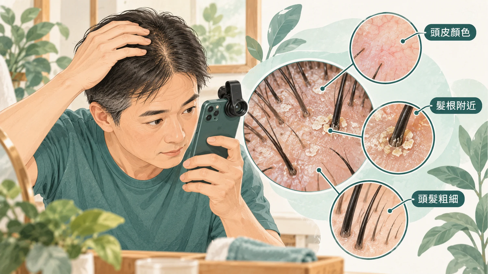
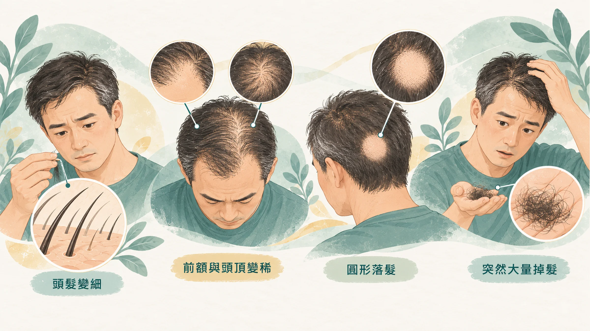

<!-- 🎨 [cover] [類型 A]
畫面：A middle-aged East Asian man in an elevator checking his receding hairline in the mirror with a slightly worried but humorous expression. Soft flat illustration, warm off-white background, teal and sage palette, one small amber accent.
標籤（Canva 填入）：髮際線往後退，可以做什麼？
STYLE: 依 IMAGE-STYLE.md 第 7.2 節
-->

幾年前流行過一個禿頭 app，上傳一張照片，就能看到自己禿頭的樣子，瞬間老了十歲。

大家笑完就關掉了。可是過了 40 歲，有一天等電梯時瞄了一眼鏡子，才發現那個樣子已經不用 app 也看得到。

一個男人從「嘴上無毛，辦事不牢」的菜鳥，好不容易爬到「頂上無毛，經驗老道」的位置，額頭卻越來越高。這篇不談安慰的話，只整理三件事：怎麼看自己的頭皮、哪些掉髮要注意、真的想處理時有哪些選擇。

為什麼髮際線後退和全身的慢性發炎有關，我在〈[那條後退的髮際線，是身體給中年男人的第一個警告](/blog/body-signals/hairline-recession-warning/)〉寫過，這篇專注在「可以做什麼」。

## 先看頭皮：手機就能做的自我檢查

現在手機加一個微距鏡頭，就能拍到頭皮和毛囊（也就是包住髮根、負責長出頭髮的小囊袋）。拍的時候注意幾件事：

- **顏色：** 健康的頭皮大多偏淡白或帶一點淡粉。如果整片偏紅，合併癢、刺痛或脫屑，代表頭皮可能有發炎，例如毛囊炎或脂漏性皮膚炎，先看皮膚科。
- **髮根附近：** 有沒有黃色油垢、厚厚的皮屑，或一顆一顆的紅疹。
- **頭髮的粗細：** 同一區的頭髮，有沒有越長越細、越來越軟。雄性禿最典型的變化，就是頭髮一代比一代細。

每次拍同一個位置、同一盞燈，存在同一個相簿。頭髮長得慢，三個月比一次才看得出差別。

## 哪些掉髮要注意

每天掉一些頭髮是正常的，頭髮本來就會依週期生長、休息、脫落。比起數量，更值得注意的是這些：

- **掉下來的頭髮越來越短、越來越細：** 代表毛囊正在縮小，常見於雄性禿。
- **前額兩側（M 字）或頭頂一圈慢慢變稀：** 這是雄性禿最常見的形狀，常和家族遺傳有關。
- **一塊一塊、邊界清楚的圓形禿：** 比較像圓禿，屬於免疫相關的問題，要看皮膚科。
- **生病、手術、壓力很大之後兩三個月，突然大把掉：** 這類掉髮常會自己恢復，但也要排除甲狀腺、貧血等原因。

生活習慣也有影響。台灣的研究團隊調查社區裡 40 歲以上的男性，發現抽菸和中重度雄性禿有關，每天抽 20 根以上的人關聯更明顯（Su & Chen, 2007）。

## 研究走到哪裡了

毛囊裡有一群幹細胞，負責在每個生長週期重新長出頭髮。科學家發現，交感神經和讓我們「起雞皮疙瘩」的豎毛肌，會一起調節這群幹細胞的活性（Shwartz et al., 2020）。

這類研究讓治療禿頭多了新方向，但目前還停在小鼠和實驗室階段，還不是可以使用的治療。

## 真的想處理：皮膚科有哪些選擇

雄性禿越早處理，能保住的毛囊越多。毛囊一旦完全萎縮，就很難再長回來。下面這些方式都要先經過**皮膚科**評估，由醫師依你的情況決定：

- **外用 minoxidil：** 塗在頭皮上，延長頭髮的生長期。剛開始用的前幾週可能短暫掉得更多，這是常見現象，持續使用才看得出效果；停用後效果會慢慢消失。
- **口服 finasteride 或 dutasteride：** 處方藥，作用是降低讓毛囊縮小的雙氫睪固酮（DHT）。可能的副作用要和醫師討論清楚。這類藥物懷孕或準備懷孕的女性不能接觸，家裡有女性的人要特別小心保管。
- **低能量雷射：** 用特定波長的光照射頭皮，統合分析顯示對雄性禿有幫助（Afifi et al., 2017）。
- **PRP、植髮等療程：** 在醫療院所進行，費用和效果差異大，要和醫師談清楚適不適合自己。

不要自己在網路上買處方藥來吃，也不要相信「保證長回來」的廣告。

## 吃的東西：缺乏時才有幫助

蛋白質、鐵、鋅、維生素 D 這些營養素，嚴重缺乏時會造成掉髮。皮膚科學者回顧研究後的結論是：**補充主要對缺乏的人有用**，本來不缺的人多吃，不一定有額外好處；常被宣傳的生物素，真正缺乏的人其實很少（Guo & Katta, 2017）。

所以比較實際的順序是：先把三餐的蛋白質和蔬菜吃夠；如果懷疑缺乏，請醫師抽血確認，再決定要不要補充。

## 日常照顧與造型

- **洗頭：** 選溫和的洗髮精，用指腹按摩，不要用指甲抓。目標是洗乾淨，不需要把頭皮的油脂全部洗掉。
- **睡眠和壓力：** 長期熬夜、壓力大，會讓掉髮更明顯。
- **換個造型：** 在處理的同時，請設計師幫你剪一個適合現在髮量的髮型。很多男人剃成短髮或光頭之後，反而看起來更俐落、更有精神。

## 什麼時候看皮膚科

- 頭皮紅、癢、痛、脫屑，或長膿包。
- 一塊一塊、邊界清楚的掉髮。
- 短時間內大把掉髮。
- 髮際線或頭頂明顯變薄，而且你想處理。
- 掉髮合併疲倦、怕冷、體重變化等其他不舒服。

看診前把固定角度的照片、開始掉髮的時間、家人的掉髮狀況、目前在吃的藥都整理好，醫師會更容易判斷。

## 帶走一句話

**髮際線越早處理，能保住的越多。** 先用手機看懂自己的頭皮，再讓皮膚科醫師幫你選方法。

---

## 參考資料

1. Su LH, Chen TH. Association of androgenetic alopecia with smoking and its prevalence among Asian men: a community-based survey. *Archives of Dermatology*, 2007.（來源：[Archives of Dermatology](https://doi.org/10.1001/archderm.143.11.1401)，2007）
2. Shwartz Y, et al. Cell types promoting goosebumps form a niche to regulate hair follicle stem cells. *Cell*, 2020.（PMID：[32679029](https://pubmed.ncbi.nlm.nih.gov/32679029/)）
3. Afifi L, et al. Low-level laser therapy as a treatment for androgenetic alopecia. *Lasers in Surgery and Medicine*, 2017.（PMID：[27114071](https://pubmed.ncbi.nlm.nih.gov/27114071/)）
4. Guo EL, Katta R. Diet and hair loss: effects of nutrient deficiency and supplement use. *Dermatology Practical & Conceptual*, 2017.（來源：[Dermatology Practical & Conceptual](https://doi.org/10.5826/dpc.0701a01)，2017）

*本文為健康教育資訊，不構成醫療診斷或治療建議。*
