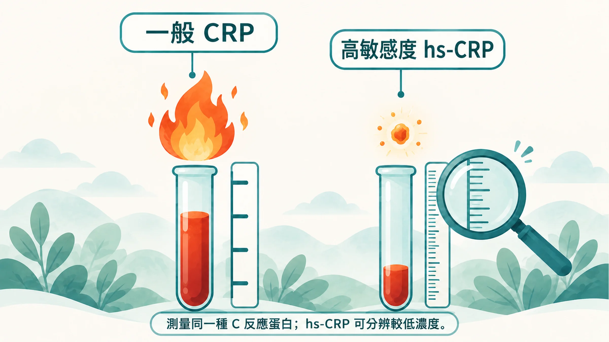
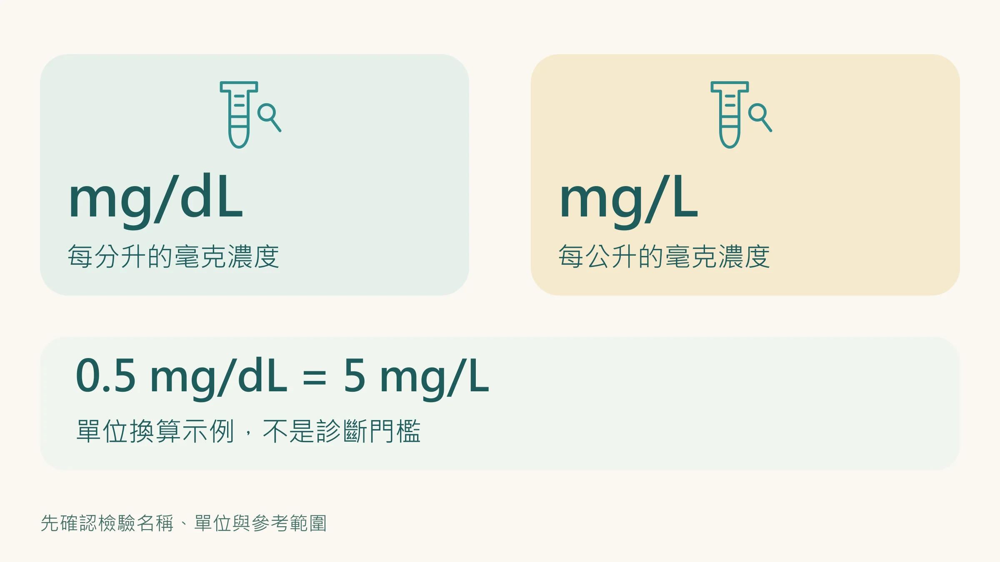
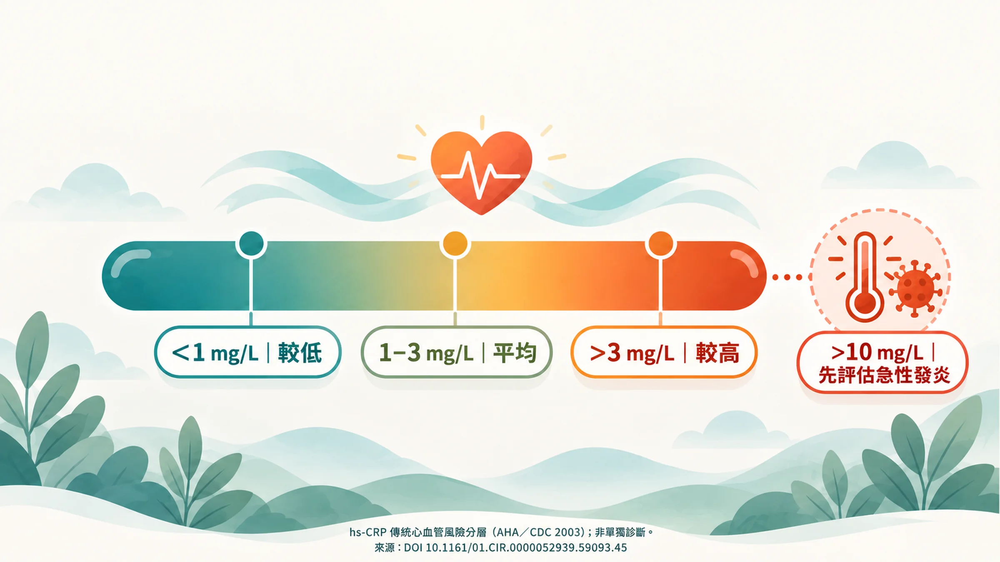

你有沒有在報告上看過「CRP <0.5」？

先別急著解讀。旁邊的單位是 mg/dL，還是 mg/L？

這兩種寫法差十倍。0.5 mg/dL 等於 5 mg/L；同樣一串數字，放錯單位，意思就完全不同。

**讀 CRP 的第一步，是看檢驗名稱和單位。**

## 同一種蛋白，量測能力不同

CRP 是 C 反應蛋白，身體發炎時，血中濃度可能升高。一般 CRP 和 hs-CRP 量的是同一種物質；hs-CRP 的方法針對較低濃度的測量，常用在特定心血管風險評估情境。[1]

所以「CRP 正常，要不要再驗 hs-CRP」，需要先知道原本的方法與用途。單看「<0.5」，不能斷定機器量不到，也不能直接說沒有慢性發炎。

## 報告拿到手，先找這四個欄位

1. **檢驗名稱**：一般 CRP，還是 hs-CRP？
2. **單位**：mg/L 或 mg/dL？
3. **結果與參考範圍**：是明確數值，還是小於某個值？
4. **抽血時的狀況**：最近有沒有感染、受傷或劇烈運動？

找不到方法或範圍，就問檢驗單位。把這一步做好，才有後面的判讀。

## 1、3、10，該怎麼理解？

2003 年 AHA/CDC 聲明提出下列 hs-CRP 分層，單位都是 **mg/L**，用來輔助心血管風險評估。它不是慢性發炎的確診表，也不能取代整體風險評估。[1]

| hs-CRP（mg/L） | 當時聲明的風險分層或處理原則 |
|---|---|
| < 1 | 相對低風險 |
| 1–3 | 平均風險 |
| > 3 | 相對較高風險 |
| > 10 | 先評估感染等發炎原因，待狀況穩定後依醫師安排複驗 |

數字 1、3、10 並不是三個開關。數值略過一條線，不會突然變成另一種人；醫師還會看血壓、血脂、抽菸與疾病史。

## 為什麼有時需要再驗一次？

感冒、牙齦發炎、受傷或劇烈運動，都可能影響結果。若目的是評估長期風險，AHA/CDC 聲明建議在狀況穩定時，約相隔兩週測量兩次，再由醫師判斷。這不代表所有人都需要自行安排兩次抽血。[1]

你可以問：「這次抽血剛好在感冒後，是否需要等恢復再確認？」這比看見高值就急著買抗發炎補充品更有幫助。

## 它能提醒風險，不能替你指出火源

大型資料整合顯示，CRP 和冠心病、中風等風險有關聯；但考慮其他危險因子後，關聯會減弱。基因研究也提醒，CRP 本身升高不等於它就是造成冠心病的原因。[2][3]

慢性低度發炎，也就是長期、較低程度的免疫活化，與多種疾病有關；一個 hs-CRP 數值仍不足以辨識病因。[4]

如果持續偏高，先和家醫科、內科或原本追蹤的醫師討論，再依症狀與病史釐清。不要只憑數字認定一定是內臟脂肪、牙周或睡眠造成的。

## 下一步，是帶著脈絡討論

把檢驗名稱、日期、單位和近期身體狀況放在同一張紀錄上。是否複驗、是否加做其他檢查，都由醫師依用途決定。

若合併胸痛、呼吸困難或突然明顯不適，應即時就醫，不要等 hs-CRP 追蹤。

**先讀對報告，再決定要追什麼。**

延伸閱讀：[健檢五項數字的用途](/blog/body-signals/checkup-five-numbers/)｜[血液、HRV、皮膚量測各在看什麼](/blog/chronic-inflammation/inflammation-three-clues/)

*本文供健康教育使用，hs-CRP 不能單獨診斷疾病。*

## 參考文獻

1. Pearson TA, et al. Markers of inflammation and cardiovascular disease: application to clinical and public health practice. A statement for healthcare professionals from the CDC and the AHA. *Circulation*. 2003;107:499–511. https://doi.org/10.1161/01.CIR.0000052939.59093.45
2. Emerging Risk Factors Collaboration. C-reactive protein concentration and risk of coronary heart disease, stroke, and mortality: an individual participant meta-analysis. *Lancet*. 2010;375:132–140. https://doi.org/10.1016/S0140-6736(09)61717-7
3. C Reactive Protein Coronary Heart Disease Genetics Collaboration (CCGC). Association between C reactive protein and coronary heart disease: mendelian randomisation analysis based on individual participant data. *BMJ*. 2011;342:d548. https://doi.org/10.1136/bmj.d548
4. Furman D, et al. Chronic inflammation in the etiology of disease across the life span. *Nat Med*. 2019;25:1822–1832. https://doi.org/10.1038/s41591-019-0675-0
