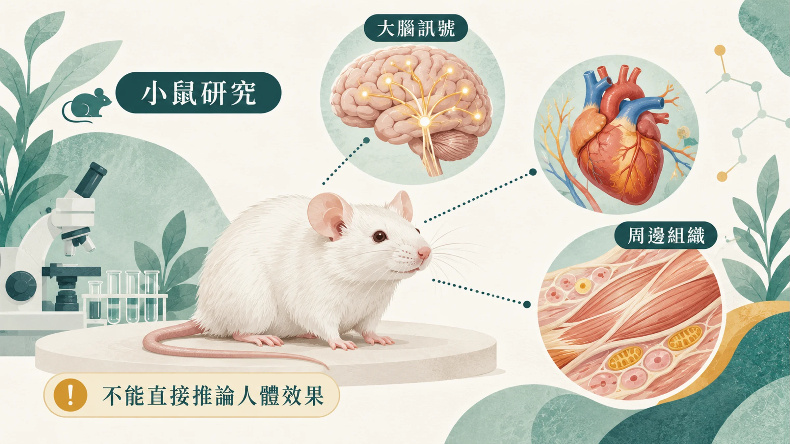
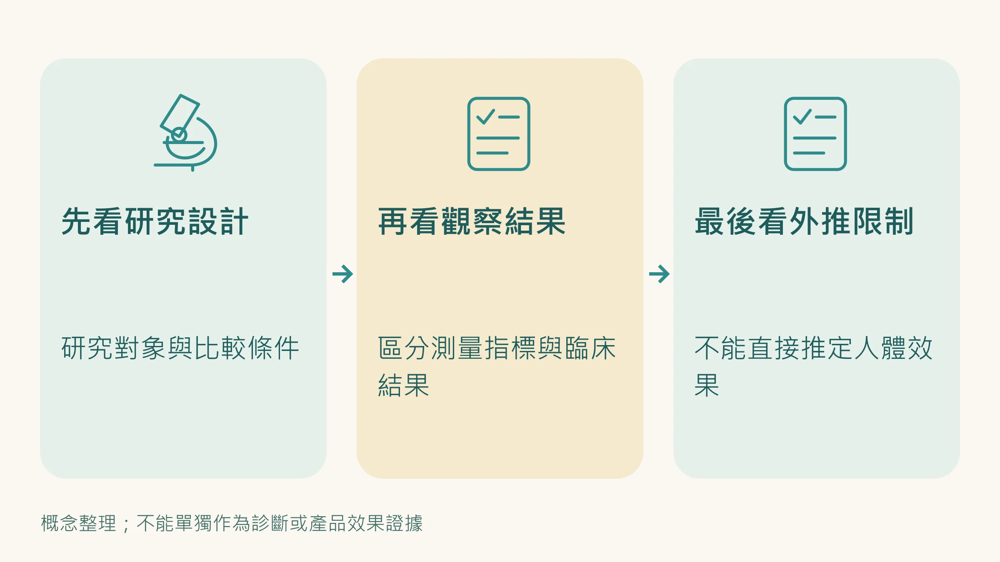
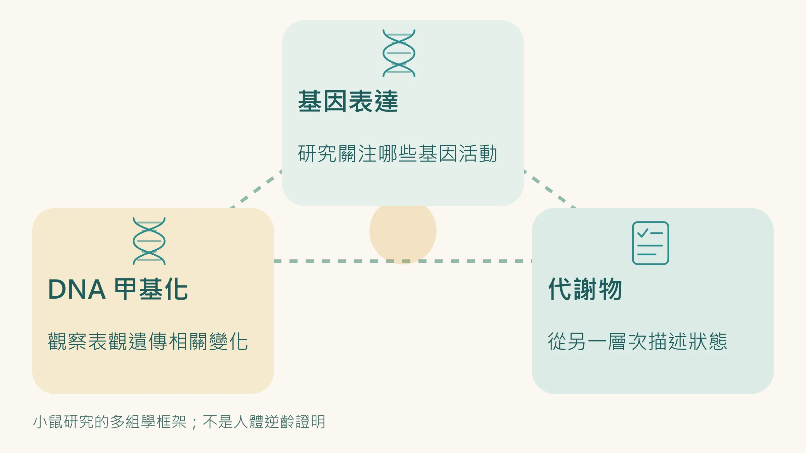

在[〈不節食也能啟動長壽基因？〉](/blog/chronic-inflammation/caloric-restriction-mimetics-science/)那篇我們說了一件事：

老化不只是時間的問題，而是基因表達模式失衡的問題。當細胞的「修復開關」關掉、「發炎開關」開著，老化就加速了。

我們也說到，熱量限制（CR）和熱量限制模擬物（CRM）的核心邏輯，就是把這些開關的狀態往年輕方向調整，特別是透過抑制 mTOR 通路，讓細胞從「盲目消耗」切換到「精準修復」。

2025年12月一項發表於頂級期刊《Cell Metabolism》的研究，直接替這個邏輯提供了迄今最全面的分子層級證據。

---

## 這項研究做了什麼？

香港中文大學研究團隊對衰老小鼠（相當於人類中年）進行了為期 30 週的實驗。

研究設計上有一個刻意的安排：他們使用的是 **低劑量的 GLP-1 受體促效劑**：低到治療組小鼠的體重和進食量都沒有顯著變化。

這個設計的目的很明確：排除「減重帶來的代謝改善」這個混淆變數，直接觀察是否存在 **獨立於減重之外的抗老化分子機制**。

研究團隊不只是觀察外表變化，是做了全面的分子層級分析，轉錄組學（RNA-seq）、表觀遺傳學（DNA甲基化）、代謝組學，同時涵蓋大腦、心臟、骨骼肌、血液等多個組織。

---

## 三個層面的「分子逆齡」

**轉錄組學（基因表達）：**
衰老組織中，原本老化的基因表達模式，在治療後顯著逆轉，基因活動狀態趨向年輕組的樣子。這不是一兩個基因的微小變化，是跨多個組織的大規模基因表達重組。

**表觀遺傳學（DNA甲基化）：**
DNA 甲基化是調控基因開啟和關閉的深層機制，被認為是目前最可靠的生物年齡標記之一。研究顯示，治療組小鼠的 DNA 甲基化模式，顯著逆轉了老化相關的改變。

**代謝組學：**
衰老小鼠的血漿代謝物譜，在治療後呈現出年輕化趨勢，細胞層級的代謝狀態發生了系統性的改變。

三個完全不同的分子層面，指向同一個方向：基因老化模式的逆轉。

---

## 關鍵發現：大腦下丘腦是全身抗老化的總開關

這是這項研究最重要的機制發現。

研究團隊做了一個關鍵實驗：用基因工程技術，專門關閉小鼠下丘腦中的 GLP-1 受體。

結果是：**全身（心臟、骨骼肌等）的抗老化保護作用大幅消失。**

這確認了一個「大腦-身體軸心（Brain-Body Axis）」的運作邏輯：

訊號作用於大腦的下丘腦 → 下丘腦發出協調指令 → 全身器官同步啟動抗衰老機制。

老化不是各個器官各自獨立衰退的問題。

中樞神經系統扮演的是協調者的角色，當協調訊號正確，全身才能同步抗衰。

---

## 為什麼這個發現和 mTOR 的關係很重要

研究還有一個關鍵觀察：

這個多組學調控模式，與**mTOR 抑制**所產生的基因效應高度相似。

mTOR 是我們在前幾篇反覆提到的概念，它是細胞的「生長感應器」，被抑制時細胞進入修復模式；被過度激活時，細胞盲目擴張、老化加速。

熱量限制抑制 mTOR。熱量限制模擬物（CRM）透過不同路徑模擬這個效應。

這項研究的發現，在另一個完全不同的角度提供了佐證：**mTOR 抑制所代表的「精準修復模式」，確實能在分子層面產生全身性的逆齡效果。**

這不是三個互不相關的分析碰巧說了類似的話。這是同一項研究裡三種不同的分析方法，收斂到同一個機制。

---

## 這項研究告訴我們什麼？

把這個研究放回你理解自己身體的框架裡：

老化是可以在分子層面被測量的，轉錄組、DNA甲基化、代謝物譜都是指標。

老化是多組織、多系統同步發生的問題，心臟、肌肉、大腦不是各自獨立在老化，它們受到共同的中樞協調機制控制。

逆轉老化的基因表達模式，能讓功能性指標（肌力、協調性）同步改善，而這個效果，不依賴體重的變化。

這三點，是目前抗老化科學裡最重要的方向確認。

---

## 現在，問題回到你身上

這項研究是在動物模型上進行的，從動物到人類還有距離要走。

但它確認的那個機制方向，**透過調整基因表達模式，讓細胞抗衰老，是你現在就可以開始思考的問題。**

你的細胞基因表達狀態，目前沒有簡單的方法可以直接量。但你可以先從看得見的訊號開始：疲勞、睡眠、修復速度、感冒頻率。這些訊號放在一起看，能讓你知道自己大概落在哪個位置。

---

**延伸閱讀：**
- [不節食也能啟動長壽基因？CRM 的概念和 DNA 微陣列技術](/blog/chronic-inflammation/caloric-restriction-mimetics-science/) 
- [ageLOC Youthspan：不節食，也能啟動修護基因](/blog/intervention-optimization/ageloc-youthspan-longevity-genes/) 
- [老化不是零件壞了，是細胞「忘了」自己是誰](/blog/precision-health-tools/epigenetic-dysregulation-2026-nature-review/)

---

## 參考資料

01. Huang Junzhe, Kwok Andrew J., Li Jason Chak Yan et al. (2025). Body-wide multi-omic counteraction of aging with GLP-1R agonism. *Cell Metabolism*, 37(12):2362-2380.e8. DOI：[10.1016/j.cmet.2025.10.014](<https://doi.org/10.1016/j.cmet.2025.10.014>)。
02. Celletti Francesca, Farrar Jeremy, De Regil Luz (2026). World Health Organization Guideline on the Use and Indications of Glucagon-Like Peptide-1 Therapies for the Treatment of Obesity in Adults.. *JAMA*, 335(5):434. DOI：[10.1001/jama.2025.24288](<https://doi.org/10.1001/jama.2025.24288>)。
