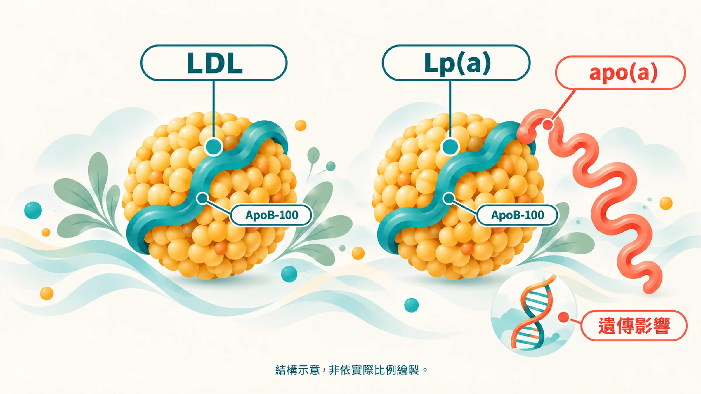

他不抽菸、不太喝酒，每年健檢膽固醇都在標準內。

52 歲那年，他在會議室裡胸口一緊，被送進導管室。

後來他才想起，爸爸也是 50 出頭就心肌梗塞。當時大家都說是「遺傳體質」，沒人說得出遺傳的到底是什麼。

## Lp(a) 是什麼？

Lp(a)（脂蛋白 a）長得很像 LDL 顆粒，同樣裝著膽固醇，同樣帶著一個 ApoB。不同的是，它身上多黏了一條叫 apo(a) 的蛋白質尾巴。

這條尾巴讓 Lp(a) 比一般 LDL 更容易卡在血管壁上，促進動脈粥狀硬化，也就是說，血管內壁逐漸堆積斑塊、變硬變窄的過程。它還帶有促發炎的氧化磷脂質，並且可能干擾血栓溶解[1]。

最關鍵的一點：**血中 Lp(a) 的高低，九成以上由基因決定**[1]。2009 年《新英格蘭醫學期刊》的基因研究，找到兩個和 Lp(a) 濃度強烈相關的 LPA 基因變異，帶有這些變異的人，冠心病風險明顯較高[2]。

## 一張出生就拿到的牌

很多健康指標，你可以靠努力改善：少吃糖，HbA1c 會降；多運動，三酸甘油脂會降。

Lp(a) 幾乎不聽這些話。飲食和運動對它的影響很小，它從小到大都差不多是那個數字[1]。

這聽起來令人沮喪，換個角度想卻很實用：**你只需要驗一次**，就知道自己手上拿的是什麼牌。拿到一手比較差的牌，打法自然要更小心。

全世界大約每 5 個人，就有 1 個 Lp(a) 偏高[1]。而一般的成人健檢不會驗它，大多數人一輩子都不知道。

## 誰該驗？數值怎麼看？

歐洲動脈硬化學會 2022 年的共識建議：**每個成年人一生至少驗一次 Lp(a)**[1]。歐洲心臟學會 2019 年的血脂指引也有相同建議[3]。

以下情況更值得優先驗：

- 家族中有人在 55 歲（男性）或 65 歲（女性）以前發生心肌梗塞、中風
- 自己或家人有早發性心血管疾病，但血脂、血壓都不算高
- 有家族性高膽固醇血症
- 已經在吃降血脂藥，LDL 降下來了，心血管事件仍然發生

| Lp(a) 數值 | 意義（EAS 2022 共識）[1] |
|---|---|
| < 30 mg/dL（約 < 75 nmol/L） | 風險不太因 Lp(a) 增加 |
| 30 – 50 mg/dL | 灰色地帶，需搭配其他風險因子判斷 |
| > 50 mg/dL（約 > 125 nmol/L） | 風險明顯增加 |

美國 2018 年的膽固醇指引，也把 Lp(a) ≥50 mg/dL 列為「風險加重因子」[4]。

**單位要注意**：有些檢驗所用 mg/dL，有些用 nmol/L。因為 Lp(a) 顆粒大小因人而異，兩種單位沒辦法用固定的係數精準換算，比較時請盡量用同一種單位[1]。

## 偏高了，能做什麼？

目前還沒有被核准、專門用來降 Lp(a) 的藥物；多款針對 Lp(a) 的新藥正在進行大型臨床試驗，進展很快，可以和醫師討論最新資訊[1]。

在那之前，國際共識的做法是：**Lp(a) 改不了，就把其他能改的風險管得更嚴格**[1]。

1. **更積極控制 LDL 和 ApoB**：醫師可能會建議比一般人更低的目標值 → [ApoB 為什麼比 LDL 更準？](/blog/precision-health-tools/apob-vs-ldl/)
2. **血壓顧好**：高血壓會放大血管壁的損傷 → [高血壓、膠淋巴系統與失智](/blog/chronic-inflammation/hypertension-glymphatic-dementia/)
3. **不抽菸、控制血糖和體重、規律運動**
4. **告訴家人**：Lp(a) 會遺傳，你偏高，兄弟姊妹和孩子也值得驗一次

基因決定了起點，生活方式仍然影響你走多遠。關於遺傳和長壽的關係，可以參考 [長壽有 55% 是基因？](/blog/chronic-inflammation/longevity-55-percent-genetics/)

## 先知道自己拿到什麼牌

**延伸閱讀**
- [健檢沒紅字，也值得多看的 5 個數字](/blog/body-signals/checkup-five-numbers/)
- [CRP 看大火，hs-CRP 看小火](/blog/chronic-inflammation/hs-crp-low-grade-inflammation/)
- [一把火，三處煙](/blog/chronic-inflammation/inflammation-three-clues/)

---

*本文為健康教育與風險理解用途，不等同醫療診斷。是否檢驗、數值如何處置，請和醫師討論。*

## 參考文獻

1. Kronenberg F, et al. Lipoprotein(a) in atherosclerotic cardiovascular disease and aortic stenosis: a European Atherosclerosis Society consensus statement. *Eur Heart J*. 2022;43:3925–3946. https://doi.org/10.1093/eurheartj/ehac361
2. Clarke R, et al. Genetic variants associated with Lp(a) lipoprotein level and coronary disease. *N Engl J Med*. 2009;361:2518–2528. https://doi.org/10.1056/NEJMoa0902604
3. Mach F, et al. 2019 ESC/EAS Guidelines for the management of dyslipidaemias. *Eur Heart J*. 2020;41:111–188. https://doi.org/10.1093/eurheartj/ehz455
4. Grundy SM, et al. 2018 AHA/ACC guideline on the management of blood cholesterol. *Circulation*. 2019;139:e1082–e1143. https://doi.org/10.1161/CIR.0000000000000625
