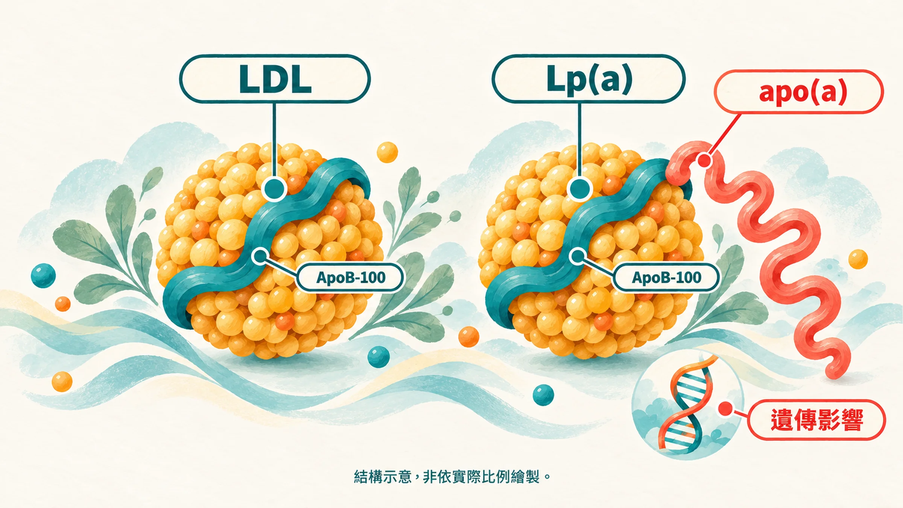
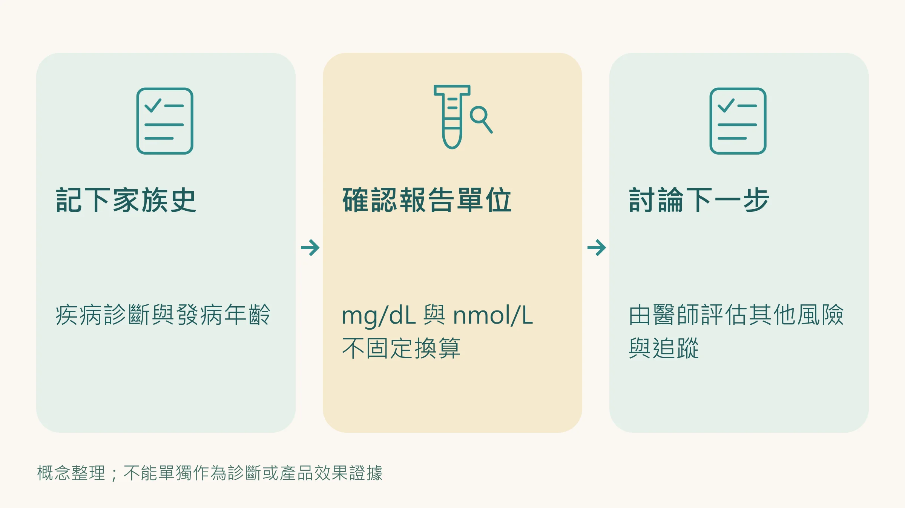

家人年輕時就心肌梗塞，你可能聽過一句話：「我們家體質就是這樣。」

但「體質」可以再問得具體一點：家人幾歲發病？自己驗過哪些血脂？報告裡，有沒有 Lp(a)？

這項主要受遺傳影響的數字，能補上一條風險線索。知道它，是為了和醫師討論怎麼照顧其他能改變的風險。

## Lp(a) 是什麼？先認識那條尾巴

Lp(a)，也就是脂蛋白 a，長得像 LDL 顆粒，帶著膽固醇和 ApoB；它還多了一個 apo(a) 蛋白。研究證據支持 Lp(a) 與動脈粥狀硬化性心血管疾病及主動脈瓣狹窄的風險有關。[1]

動脈粥狀硬化，指的是血管壁逐漸形成斑塊的過程。Lp(a) 偏高會增加風險，但不表示你一定會心肌梗塞。

## 為什麼血脂還好，也值得討論？

一般血脂報告不一定包含 Lp(a)。而它的高低主要受基因影響，不能用一次 LDL-C 或飲食紀錄推算。基因研究也支持 LPA 基因變異、Lp(a) 濃度與冠心病風險的關聯。[1][2]

如果家族中有人年輕時發病，把年齡和診斷記下來，比只說「家裡心臟都不好」更能幫助醫師評估。

## 一生至少驗一次，為什麼不是「一次就夠」？

歐洲動脈硬化學會共識及 2026 年美國血脂指引建議成人一生至少測量一次 Lp(a)。[1][3]

多數人的 Lp(a) 相對穩定，通常不需要像一般血脂那樣頻繁追蹤。不過，檢驗時的身體狀況、可能影響數值的疾病，以及特定治療，都可能改變是否需要複驗的判斷。請由醫師決定，而不是把「至少一次」讀成「永遠不用再驗」。[1]

## 讀數字之前，先看單位

| 報告使用的單位 | EAS 2022 共識的分層參考 |
|---|---|
| mg/dL | <30：較低範圍；30–50：灰色地帶；>50：風險增加範圍 |
| nmol/L | <75：較低範圍；75–125：灰色地帶；>125：風險增加範圍 |

這是同一份共識針對不同單位列出的參考範圍，**不能把兩列當成固定換算表**。顆粒大小因人而異，跨單位比較容易誤判。風險也隨數值連續變化，不是跨線才突然出現。[1]

## 偏高之後，還有哪些事能做？

先把整體心血管風險看清楚：LDL-C、血壓、血糖、抽菸、既有疾病和家族史，都會影響處置。Lp(a) 較高的人，醫師可能會更積極處理其他風險；不是只盯著這個數字。[1][3]

飲食、規律活動和不抽菸，仍然有意義。不能因為它們不容易大幅改變 Lp(a)，就認為照顧生活沒有用。

藥物選擇及相關研究會更新，有需要時請心臟內科或原本追蹤的醫師評估，不要自行停藥或改藥。家人是否需要檢驗，也可以一起討論。

## 你可以帶去門診的三個問題

1. 我的家族史，是否需要把 Lp(a) 納入評估？
2. 這次結果的單位與風險意義是什麼？
3. 結果會不會改變其他血脂的治療目標或家人的檢驗安排？

知道遺傳風險，不是替未來下判決。它讓下一次討論更具體。

延伸閱讀：[LDL 看起來還好，為什麼醫師還會看 ApoB？](/blog/precision-health-tools/apob-vs-ldl/)｜[健檢五項數字的用途](/blog/body-signals/checkup-five-numbers/)

*本文供健康教育使用，檢驗及治療請依個人風險與醫師討論。*

## 參考文獻

1. Kronenberg F, et al. Lipoprotein(a) in atherosclerotic cardiovascular disease and aortic stenosis: a European Atherosclerosis Society consensus statement. *Eur Heart J*. 2022;43:3925–3946. https://doi.org/10.1093/eurheartj/ehac361
2. Clarke R, et al. Genetic variants associated with Lp(a) lipoprotein level and coronary disease. *N Engl J Med*. 2009;361:2518–2528. https://doi.org/10.1056/NEJMoa0902604
3. American College of Cardiology。ACC/AHA Issue Updated Guideline for Managing Lipids, Cholesterol。2026 年 3 月 13 日官方指引發布說明。https://www.acc.org/About-ACC/Press-Releases/2026/03/13/18/01/ACCAHA-Issue-UpDated-Guideline-for-Managing-Lipids-Cholesterol
