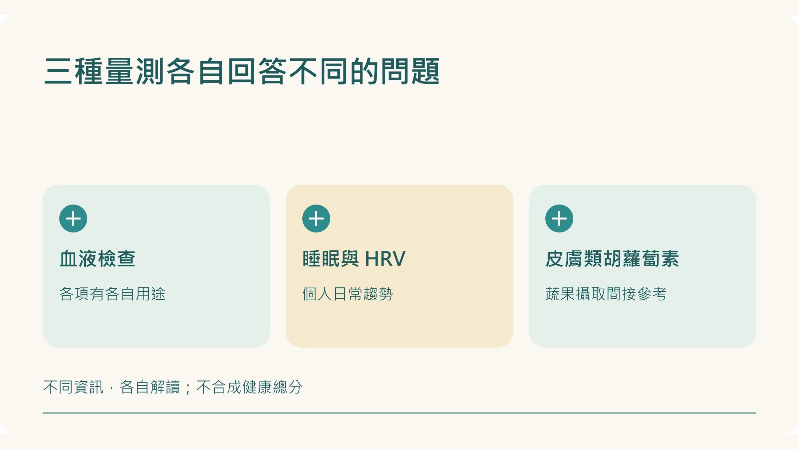
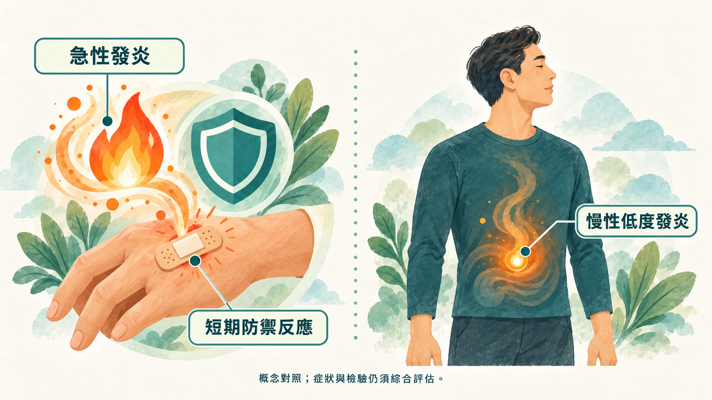
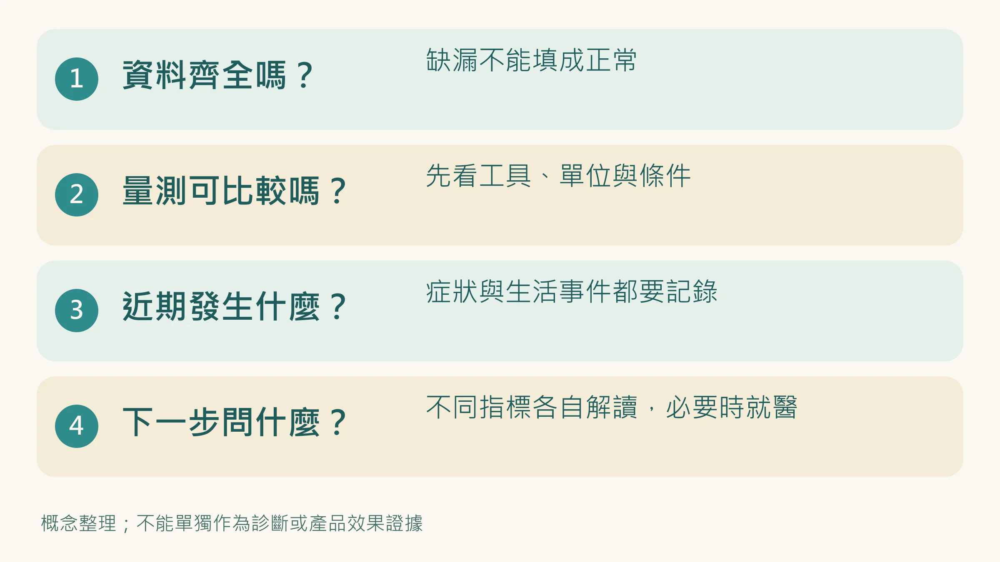

抽血結果在參考範圍，手錶卻說 HRV 偏低，皮膚量測分數又往下。

到底該相信哪一個？

先別急著挑一個。這些工具原本就在量不同的事，數字不同步，不代表哪一個一定壞了，也不能直接拼成全身健康總分。

**先分清楚每一項能回答什麼，才知道下一步該問什麼。**

## 一張表，先把三種量測分開

| 資料 | 可以提供的資訊 | 不能直接推論 |
|---|---|---|
| 血液檢查 | hs-CRP 提供發炎相關訊號；HbA1c 看平均血糖；ApoB、Lp(a) 協助血脂風險評估 | 所有血液項目都是發炎檢查；正常就排除所有疾病 |
| 睡眠與 HRV | 睡眠紀錄與心跳間隔變化，協助觀察個人的日常趨勢 | 細胞已修復多少、慢性發炎是否確診 |
| 皮膚類胡蘿蔔素光學量測 | 作為近期蔬果、類胡蘿蔔素攝取狀態的間接參考，適合看趨勢 | 全身抗氧化能力、疾病風險、老化速度 |

血液各項有各自的用途，不能統稱成一個「血液分數」。HRV 與發炎指標在研究中有關聯，但個人手錶的低值不能用來確診。皮膚光學研究主要支持它作為蔬果攝取的代理指標，也就是間接參考，而不是完整防禦力。[1][2][3]

## 慢性發炎，為什麼不能靠感覺或三個燈號判定？

發炎是身體正常的防禦反應。受傷時的紅、腫、熱、痛，和長期、低程度的免疫活化，情境並不相同。研究把後者與多種慢性疾病連在一起，但不能因此把疲勞、睡不好或皮膚分數下降，都歸因於慢性發炎。[4][5]

檢驗在參考範圍，也不表示已排除所有問題。若持續疲倦或身體不適，家醫科或內科仍需要依症狀、病史與檢查釐清。[6]

## 數字不同步時，先問這六種問題

下面是**資料整理情境，不是經驗證的診斷模型**。沒有一套研究證明，把這三種量測排成燈號，就能定位「發炎、恢復、防禦」哪一層出問題。

### 1. 三項看起來都穩定：有沒有沒被量到的困擾？

先確認資料有效，再看自己有沒有持續不適。穩定只表示這些已量到的資料沒有明顯變化，不能當作全身健康認證。

### 2. 血液在參考範圍、HRV 下降：資料可比嗎？

裝置有沒有換？有效夜晚夠不夠？最近是否飲酒、熬夜、訓練或生病？先把量測條件與生活事件寫下來，不能直接判定夜間修復失敗。

看 HRV 的具體方法：[手錶說 HRV 偏低，今天該擔心嗎？先看這 4 件事](/blog/precision-health-tools/hrv-recovery-guide/)。

### 3. 只有皮膚分數下降：近期飲食和量測方式變了嗎？

先回想最近幾週蔬果種類、份量和相關補充品有沒有變，再確認同一裝置、同一量測部位與操作條件。介入研究觀察到皮膚類胡蘿蔔素會隨飲食在數週間變化，但個人分數仍有誤差與其他影響因素。[7][3]

量測時依裝置指示使用手指，不把不同儀器的分數直接接在一起。分數低，不能自動推成吸收不良或「防禦網變薄」。

### 4. hs-CRP 偏高、其他量測穩定：抽血當時發生了什麼？

最近有感染、受傷或其他發炎情況嗎？是否需要複驗，由醫師依濃度、症狀與用途決定。HRV 或皮膚數字穩定，不能拿來抵銷異常血液結果。[1]

### 5. 血糖或血脂偏高：各項本來要回答什麼問題？

HbA1c、ApoB 的異常，要按各自的臨床用途處理。它們與 hs-CRP 不同步，不能排出「代謝先壞、之後才發炎」的個人時間表。

先從 [健檢五項數字的用途](/blog/body-signals/checkup-five-numbers/) 找到相對應的問題，再和醫師討論。

### 6. 好幾項都改變：把完整紀錄帶去，不自己下總結

列出每一項的日期、單位、量測條件與症狀。多項改變值得釐清，但不能靠組合自行診斷多系統耗損。若出現胸痛、呼吸困難等急性不適，應即時就醫，不等下一次量測。

## 讓資料有用的四個習慣

1. **固定可比較的條件**：同一工具、指標與操作方式；抽血是否空腹依該檢驗指示，不是所有檢查一律空腹。
2. **記錄生活事件**：加班、飲酒、生病、旅行、換裝置，寫在結果旁邊。
3. **分開看各項趨勢**：不要把不同單位加總，也不要用一個漂亮數字抵銷另一個異常。
4. **資料不夠就留白**：沒戴手錶、匯出為零或量測失敗，標「缺資料」，不能填成正常。

下次看到數字打架，先問「它們真的在回答同一題嗎？」很多焦慮，會在這一步少一點。

延伸閱讀：[做一份能持續的身體追蹤表](/blog/intervention-optimization/tracking-rhythm/)｜[CRP 與 hs-CRP 的單位怎麼看](/blog/chronic-inflammation/hs-crp-low-grade-inflammation/)｜[皮膚類胡蘿蔔素量測的原理](/blog/precision-health-tools/carotenoid-rrs-science/)

*本文供健康教育與資料整理使用，不能用三種量測的組合診斷疾病。*

## 參考文獻

1. Pearson TA, et al. Markers of inflammation and cardiovascular disease: AHA/CDC scientific statement. *Circulation*. 2003;107:499–511. https://doi.org/10.1161/01.CIR.0000052939.59093.45
2. Williams DP, et al. Heart rate variability and inflammation: a meta-analysis of human studies. *Brain Behav Immun*. 2019;80:219–226. https://doi.org/10.1016/j.bbi.2019.03.009
3. Radtke MD, et al. Criterion-related validity of spectroscopy-based skin carotenoid measurements as a proxy for fruit and vegetable intake: a systematic review. *Adv Nutr*. 2020;11:1282–1299. https://doi.org/10.1093/advances/nmaa054
4. Medzhitov R. Origin and physiological roles of inflammation. *Nature*. 2008;454:428–435. https://doi.org/10.1038/nature07201
5. Furman D, et al. Chronic inflammation in the etiology of disease across the life span. *Nat Med*. 2019;25:1822–1832. https://doi.org/10.1038/s41591-019-0675-0
6. MedlinePlus（美國國家醫學圖書館）。How to Understand Your Lab Results。官方衛教頁。https://medlineplus.gov/lab-tests/how-to-understand-your-lab-results/
7. Jahns L, et al. Skin and plasma carotenoid response to a provided intervention diet high in vegetables and fruit: uptake and depletion kinetics. *Am J Clin Nutr*. 2014;100:930–937. https://doi.org/10.3945/ajcn.114.086900
