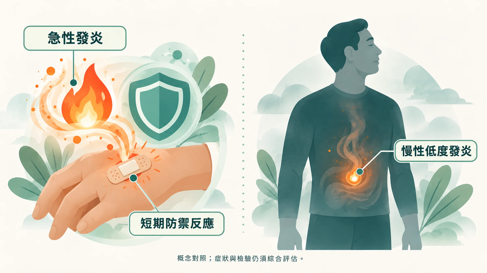
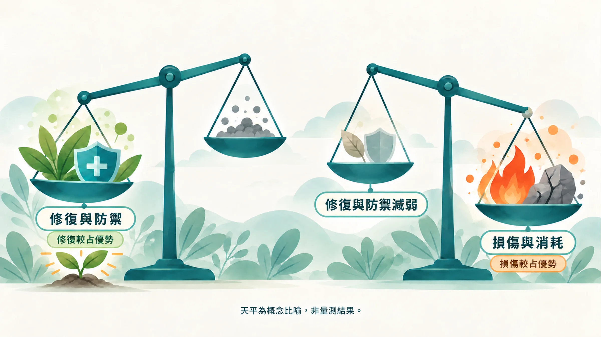
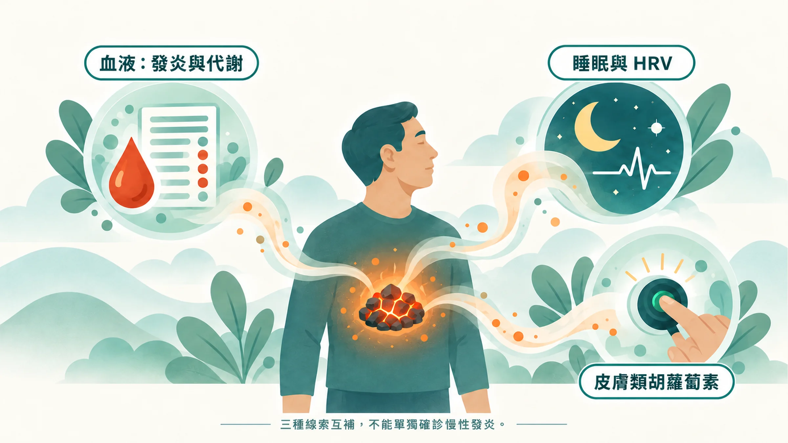

早上鬧鐘響了，你按掉，躺著不想動。睡了七個小時，身體還像沒充電。

上個月的健檢報告，每一格都是綠色勾勾。肝功能正常、血糖正常、血壓正常。醫師說：「很好啊，明年再來。」

可是你知道自己不太對。感冒一來就拖兩週，皮膚越來越容易過敏，下午三點不靠咖啡撐不下去。

如果你是那種「把健康排最後」的人，這篇想給你一個新的看法：**很多身體的消耗，在報告出現紅字之前，已經悄悄累積了好幾年。**

## 發炎本身沒有錯，問題在火關不掉

發炎是身體的修復系統。手被割傷時，傷口紅、腫、熱、痛，那是免疫細胞趕到現場救火。問題解決了，火就熄滅，這叫**急性發炎**，短期、有保護性、可控制[1]。

另一種發炎安靜得多。它的強度很低、沒有明顯症狀，卻長期存在，叫做**慢性低度發炎**，也就是說，免疫系統的警報一直沒有完全關掉，像爐子裡一直有一點炭火在悶燒。

研究老化的學者把這種現象稱為「發炎老化（inflammaging）」：隨著年齡增加，身體的背景發炎程度會慢慢升高，而這和心血管疾病、第二型糖尿病、失智等多種慢性病都有關聯[2][3]。2019 年《Nature Medicine》的回顧指出，全球超過一半的死亡和慢性發炎相關的疾病有關[3]。

## 年輕時修得比壞得快，現在反過來了

二十幾歲熬夜、應酬、壓力大，睡一覺就回來了。那時候身體的修復速度大於損傷速度。

過了 40 歲，同樣的生活，恢復要兩三天。這是因為修復系統跟不上了：細胞裡的活性氧（ROS）變多，抗氧化防禦變弱，發炎訊號（例如 NF-κB 這條路徑）更容易一直開著，負責收拾殘局的修復開關（例如 Nrf2）反應變慢[4][5]。

這也是為什麼健檢報告可以全綠，你卻一直覺得累。**參考區間是一群人的統計範圍**，你落在範圍內，代表還沒跨過疾病的診斷門檻，身體可能早就在付代價了。生理學家 Bruce McEwen 把這種長期適應壓力所累積的耗損稱為「生理負荷（allostatic load）」[6]。

> 想多了解 ROS 和 Nrf2：
> [自由基的兩張臉](/blog/chronic-inflammation/free-radical-two-faces/)｜[多酚、Nrf2 與抗氧化迷思](/blog/chronic-inflammation/polyphenol-nrf2-antioxidant-myth/)

## 火看不見，但煙會從三個地方冒出來

慢性發炎沒有單一的檢查可以「確診」。可以做的，是從不同角度收集線索，再把它們放在一起看。

### 線索一：血液，看代謝和發炎指標

一般健檢會驗血糖和血脂，但有幾個更早期的指標通常不在免費項目裡：

- **hs-CRP（高敏感度 C 反應蛋白）**：專門看「小火」的發炎指標
- **HbA1c（糖化血色素）**：過去兩三個月的平均血糖
- **ApoB、Lp(a)**：比 LDL 更細緻的血管風險指標

每一項的意義、參考值，我分別寫在 [hs-CRP 這篇](/blog/chronic-inflammation/hs-crp-low-grade-inflammation/)和 [ApoB 這篇](/blog/precision-health-tools/apob-vs-ldl/)。

### 線索二：睡眠與 HRV，看夜間修復

深層睡眠是身體修復最集中的時段。睡眠長期不足或品質差，和較高的 CRP、IL-6 等發炎指標有關[7]。

手錶或戒指量到的 **HRV（心率變異度）**，可以反映自律神經，也就是說，身體踩油門（交感神經）和踩煞車（副交感神經）的平衡。HRV 長期偏低，和較高的發炎指標有關聯[8]。怎麼看懂自己的 HRV，請看 [HRV：今天，修好了嗎？](/blog/precision-health-tools/hrv-recovery-guide/)

### 線索三：皮膚，看抗氧化防禦網

皮膚裡的類胡蘿蔔素，是身體對抗氧化壓力的第一道防線之一。它會隨蔬果攝取增加，也會在壓力、睡眠不足、抽菸時下降[9]。用光學方式量測皮膚類胡蘿蔔素，可以在不抽血的情況下追蹤這張防禦網的變化[10]。

## 為什麼要三條線索一起看？

每一條線索都有盲點。

hs-CRP 會因為一次感冒飆高；HRV 會因為前一晚喝酒掉下來；皮膚數值會因為最近一個月少吃蔬菜而下降。單看任何一個數字，都很容易誤判。

三個數字放在一起、看好幾個月的趨勢，比較接近身體真實的狀態。例如血液正常、HRV 卻連續下滑，往往代表恢復跟不上；三項同時變差，就值得認真調整生活並和醫師討論。六種常見組合的解讀方式，我整理在 [三個數字一起看](/blog/precision-health-tools/three-clues-cross-reading/)。

## 能做的事，比你想的更有份量

2026 年 6 月《JAMA》發表了糖尿病預防計畫（DPP/DPPOS）追蹤 21 年的結果：糖尿病前期的成人，接受密集生活型態介入的那組，日後出現兩種以上慢性病的風險比安慰劑組低了約 21%（HR 0.79）；服用 metformin 的組別則沒有達到統計上的差異（HR 0.91）[11]。即使把糖尿病本身排除在外，這個差距依然存在。

藥物可以延緩疾病，生活型態更像源頭的煞車。先看見火，才知道該往哪裡踩。

## 先從了解自己開始

你不需要一次做完所有檢查。先回頭看看身體最近發出哪些訊號。

**延伸閱讀**
- [慢性發炎的三個早期跡象](/blog/body-signals/three-signs-chronic-inflammation/)
- [抗發炎，就是抗老化？](/blog/chronic-inflammation/anti-inflammation-anti-aging/)
- [健康餘命和壽命，差在哪裡](/blog/chronic-inflammation/healthspan-vs-lifespan/)
- [CRP 看大火，hs-CRP 看小火](/blog/chronic-inflammation/hs-crp-low-grade-inflammation/)

---

*本文為健康教育與風險理解用途，不等同醫療診斷。若有身體不適或檢驗數值異常，請諮詢醫師。*

## 參考文獻

1. Medzhitov R. Origin and physiological roles of inflammation. *Nature*. 2008;454:428–435. https://doi.org/10.1038/nature07201
2. Franceschi C, Garagnani P, Parini P, Giuliani C, Santoro A. Inflammaging: a new immune–metabolic viewpoint for age-related diseases. *Nat Rev Endocrinol*. 2018;14:576–590. https://doi.org/10.1038/s41574-018-0059-4
3. Furman D, et al. Chronic inflammation in the etiology of disease across the life span. *Nat Med*. 2019;25:1822–1832. https://doi.org/10.1038/s41591-019-0675-0
4. Sies H, et al. Defining roles of specific reactive oxygen species (ROS) in cell biology and physiology. *Nat Rev Mol Cell Biol*. 2022;23:499–515. https://doi.org/10.1038/s41580-022-00456-z
5. Cuadrado A, et al. Therapeutic targeting of the NRF2 and KEAP1 partnership in chronic diseases. *Nat Rev Drug Discov*. 2019;18:295–317. https://doi.org/10.1038/s41573-018-0008-x
6. McEwen BS. Protective and damaging effects of stress mediators. *N Engl J Med*. 1998;338:171–179. https://doi.org/10.1056/NEJM199801153380307
7. Irwin MR, Olmstead R, Carroll JE. Sleep disturbance, sleep duration, and inflammation: a systematic review and meta-analysis. *Biol Psychiatry*. 2016;80:40–52. https://doi.org/10.1016/j.biopsych.2015.05.014
8. Williams DP, et al. Heart rate variability and inflammation: a meta-analysis of human studies. *Brain Behav Immun*. 2019;80:219–226. https://doi.org/10.1016/j.bbi.2019.03.009
9. Darvin ME, et al. One-year study on the variation of carotenoid antioxidant substances in living human skin: influence of dietary supplementation and stress factors. *J Biomed Opt*. 2008;13:044028. https://doi.org/10.1117/1.2952976
10. Radtke MD, et al. Criterion-related validity of spectroscopy-based skin carotenoid measurements as a proxy for fruit and vegetable intake: a systematic review. *Adv Nutr*. 2020;11:1282–1299. https://doi.org/10.1093/advances/nmaa054
11. Salive ME, et al. Lifestyle and metformin interventions and risk of multimorbidity in adults with prediabetes. *JAMA*. 2026. https://doi.org/10.1001/jama.2026.8492 ｜NIH 新聞稿：https://www.nih.gov/news-events/news-releases/adults-prediabetes-lifestyle-intervention-lowered-risk-developing-multiple-chronic-conditions
