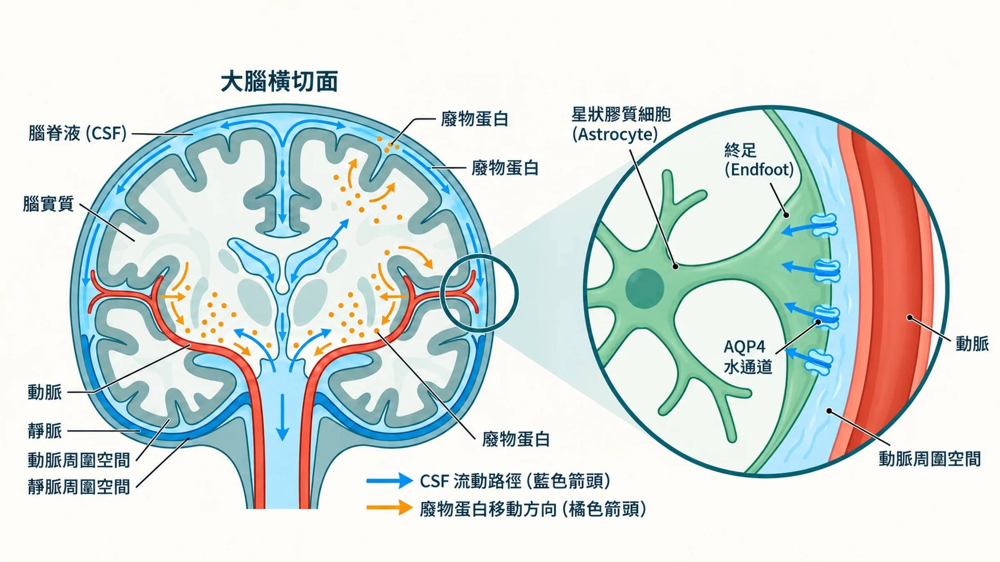
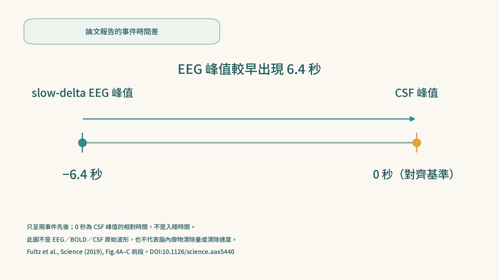
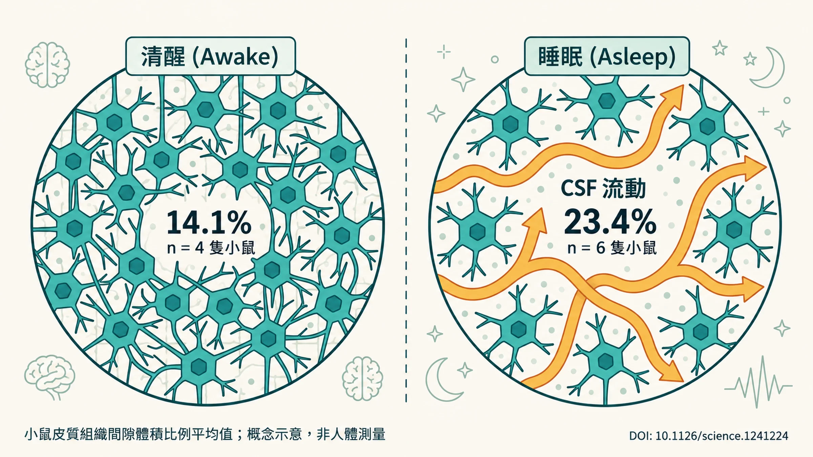
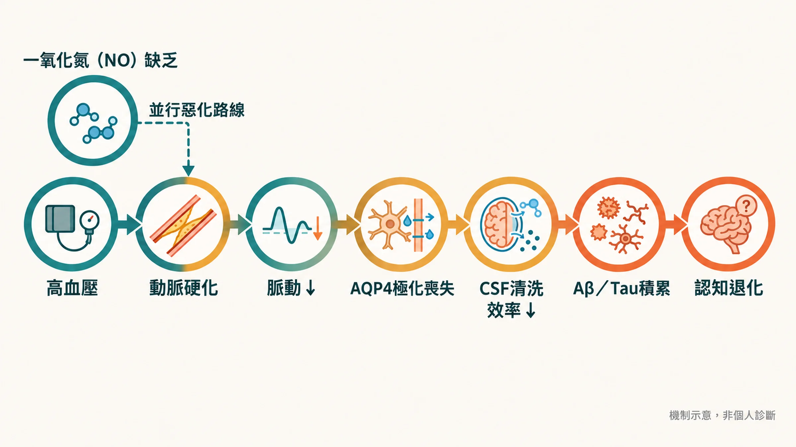
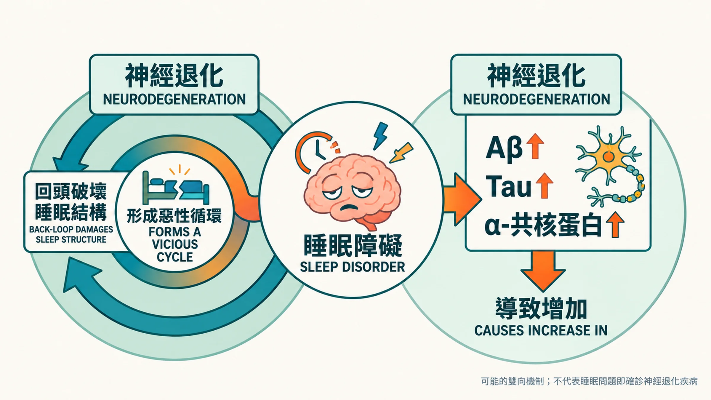
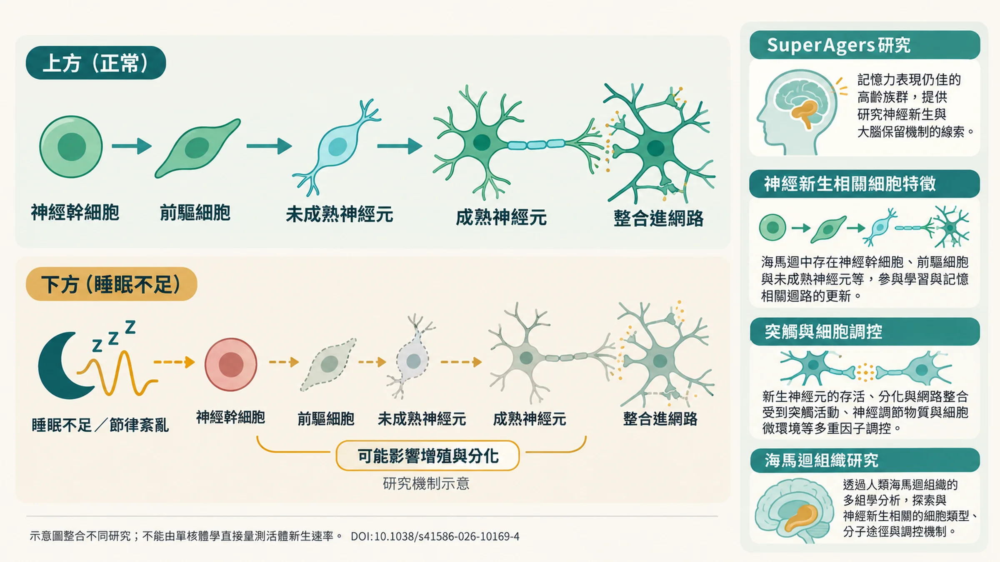
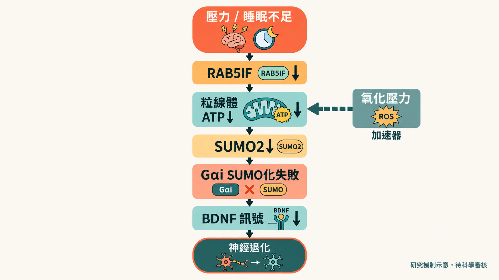
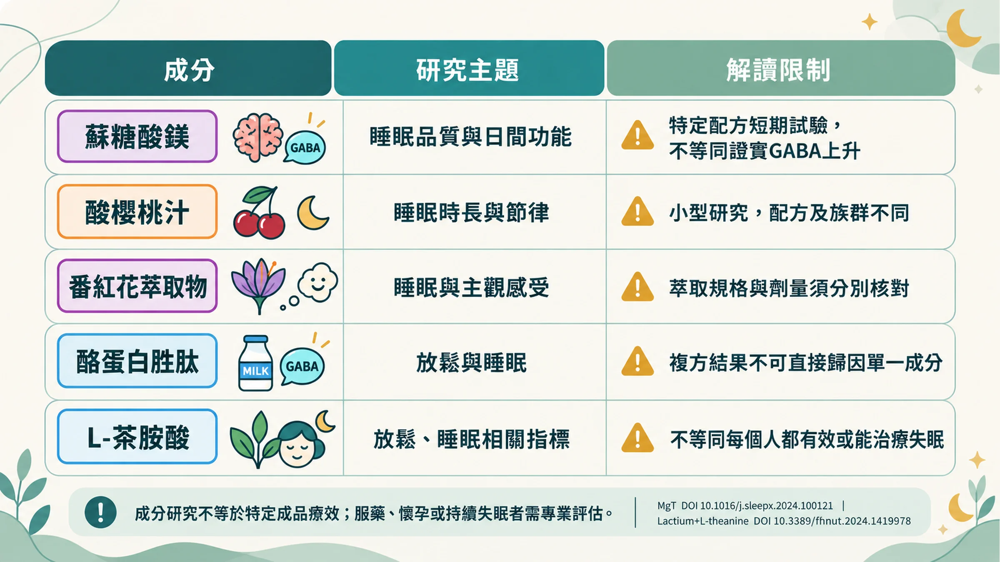

你每天晚上，都有一個清洗大腦的機會。

大多數人都錯過了。

不是因為沒有時間睡覺，而是因為睡了，但沒有真正進入大腦需要的那種睡眠。

大腦是人體唯一有「專屬清洗系統」的器官。

這套系統只在深度睡眠期間全速運作，負責沖走白天代謝產生的廢物蛋白，維護神經網路的正常運作。

如果這套系統長期無法好好工作，後果不只是「隔天精神差」那麼簡單，它與記憶退化、情緒失調、甚至阿茲海默症的早期病理都有直接關聯。

2019年，波士頓大學在《Science》期刊透過腦部影像，首次在人類身上看見這個過程：腦脊髓液像海浪一樣，在深度睡眠期間有節奏地沖洗整個大腦。

這篇研究讓「睡眠時大腦會被沖洗」這個說法，第一次在人身上有了影像證據。

不過要先說清楚：這個領域還在爭論中。2024 年《自然神經科學》一篇小鼠研究（Miao 等人）用不同的量測方法，反而發現睡眠和麻醉時，大腦的清除速度是下降的。睡眠時大腦清洗到底有多快、怎麼運作，科學家還沒有共識。下面介紹的，是目前主流的說法和支持它的研究。

以下，我們從運作機制、疾病關聯、到實際介入策略，完整解析這套夜間清洗系統。

---

## 類淋巴系統與神經流體動力學的生物物理基礎

大腦是人體代謝最旺盛的器官，雖然僅佔體重的 2%，卻消耗了約 20% 的能量。

這種高度的代謝活動必然產生大量的副產品，如β-澱粉樣蛋白（Amyloid-beta, Aβ）和 Tau 蛋白。

在身體其他部位，這些代謝廢物由淋巴系統回收；然而長期以來科學界一直找不到腦內代謝廢物是怎麼被清除的。

直到類淋巴系統的發現，才填補了這一學術空白。

### 類淋巴系統的運作架構

類淋巴系統是一個功能性的廢物清除路徑，其依賴於星狀膠質細胞及其末端足突上的水通道蛋白4（Aquaporin-4, AQP4）。

該系統的流動遵循特定的解剖路徑：腦脊髓液從蛛網膜下腔進入動脈周圍間隙（Perivascular Spaces，PVS），在 AQP4 的介導下，穿過組織間隙與組織間液（ISF）進行交換，最後將溶解的廢物帶向靜脈周圍間隙並排出腦外。

| 路徑組分 | 功能描述 | 生物物理關鍵因素 |
|:---|:---|:---|
| 入口：動脈周圍間隙 (PVS) | CSF進入大腦實質的通道 | 動脈搏動產生的泵送動力 |
| 交換區：實質間隙 (Interstitial Space) | CSF與ISF的對流與擴散 | 間隙體積分數（α）與迂迴度（λ） |
| 出口：靜脈周圍間隙 | 廢物與流體離開大腦的路徑 | 匯流至頸部淋巴結進行體循環處理 |

### 2019年《Science》論文的核心發現：巨觀波動的同步性

Fultz等人（2019）的研究展示了大腦清洗並非隨機的滲透，是一場由神經活動引導的節奏性「海嘯」。

在非快速動眼期（Non-Rapid Eye Movements，NREM）睡眠中，大腦會出現頻率約為 0.05 Hz 的巨觀震盪。

這場「流體交響樂」的發生次序如下：

1. **神經慢波出現**：EEG紀錄到低頻、高振幅的慢波活動，代表大量神經元同步進入沉默狀態（Down states）。
2. **血液體積縮減**：由於神經活動減少，大腦對氧氣和葡萄糖的需求下降，導致大腦血流和血容量（BOLD訊號）減少。
3. **CSF脈衝流入**：根據Monro-Kellie原理，大腦內部體積必須恆定。當血液體積退出時，壓力梯度驅動大量腦脊髓液湧入填補空間。

*▲ 論文記錄的 EEG 峰值比 CSF 峰值早約 6.4 秒；圖示峰值先後，不虛構完整波形或清除效率。*

數據顯示，這種神經波領先於 CSF 波約 **6.4秒**。

這項結果呈現時間上的耦合，不能將峰值的先後直接換算成人腦代謝物的清除效率。

---

## 睡眠誘導的組織擴大與代謝清除效率

類淋巴系統最引人注目的特徵之一是它的「睡眠依賴性」。

早期的小鼠研究觀察到，這套系統在睡眠時的流動，比清醒時明顯增加（部分實驗量到數倍差距）。但如前面所說，2024 年也有研究得到相反結果。

### 「60% 規則」：細胞間隙的動態擴張

Xie等人（2013）在小鼠模型中發現，睡眠或麻醉會導致大腦細胞間隙的體積分數（α）增加約 60%。

在清醒狀態下，間隙空間僅佔大腦體積的13–15%；而在睡眠中，這一數值上升至 22–24%。

這種間隙擴張極大地降低了流體流動的阻力，使腦脊髓液能夠像「動力洗車」一樣沖刷神經元之間的空隙。

### 去甲腎上腺素（Norepinephrine）的開關作用

調節這種間隙變化的分子開關是去甲腎上腺素。在清醒時，高水準的去甲腎上腺素會使神經元和膠質細胞體積保持膨脹。

當進入深眠後，腦幹中藍斑核（Locus Coeruleus）的放電頻率降至最低，去甲腎上腺素水準隨之下降，細胞收縮釋放出空間，成為類淋巴流動的高速公路。

### 睡眠剝奪的「複利損傷」效應

理解了類淋巴系統的運作機制之後，有一件事變得很清楚：**睡眠不足的損害不是線性的，是複利的。**

每一個深眠不足的夜晚，廢物蛋白的清除效率下降，積累量增加。

第二天，起點就比昨天更髒一點。長期下來，這不只是疲勞問題，是神經環境的持續惡化。

更關鍵的是：這種損傷並不只停留在「代謝廢物積累」這個層次。

最新研究顯示，睡眠不足會同時破壞大腦的 **神經新生機制**：也就是新神經元的生成能力，以及神經訊號傳遞所依賴的 **分子修飾系統**。

---

## 睡眠障礙與神經退化性疾病的惡性循環

長期睡眠不足和阿茲海默症、帕金森氏症都有明顯的關聯，而且是雙向的：睡不好可能加速病理變化，病理變化也會讓人更睡不好。

###  蛋白質病理積累

**Aβ 的快速反應**：僅一晚的睡眠剝奪就會導致人類大腦中 Aβ 濃度升高約 25 – 30%。

**Tau 蛋白的擴散**：慢性睡眠不足會加速 Tau 蛋白在神經網路中的傳播，積累與深度睡眠（Slow-Wave Sleep，SWS）的減少高度相關。

###  帕金森氏症與α-共核蛋白

類淋巴系統功能障礙導致α-共核蛋白無法有效清除，引發多巴胺神經元死亡。REM 睡眠行為障礙（Rapid Eye Movement (REM) Sleep Behavior Disorder，RBD）常被視為此類病變的前驅指標，可能早於運動症狀 **11年** 出現。

###  神經新生：睡眠不足正在關閉大腦的「自我更新」能力

阿茲海默症的神經退化，過去我們以為主要來自蛋白質積累（Aβ、Tau）。

2026年2月，《Nature》期刊一項分析 355,997 個人類大腦細胞核的研究，揭示了另一條更早開始的損傷路線：**神經新生（Neurogenesis）的失調**。

研究發現，在臨床前期阿茲海默症患者身上，也就是還沒有明顯失智症狀的人，海馬迴的神經幹細胞基因調控狀態就已經開始異常。

換句話說：大腦停止製造新神經元，**早於記憶退化出現**。

這對睡眠的意義是什麼？神經新生高度依賴睡眠品質：

睡眠不足
↓ 皮質醇（壓力荷爾蒙）持續偏高
↓ 海馬迴神經幹細胞受抑制
↓ BDNF（神經滋養因子）活性下降
↓ 新神經元生成減少、存活率下降
↓ 海馬迴結構逐漸萎縮
↓ 記憶與情緒調控功能衰退

同一項《Nature》研究也發現，80 歲以上但認知能力媲美 50 歲的「超級老年人（Super-agers）」，他們的共同特徵是：神經幹細胞活性接近年輕人，神經分化相關基因持續活躍，染色質維持開放狀態，大腦在分子層級保住了一個年輕的環境。而這套機制的維持，與睡眠品質密不可分。

###  BDNF 訊號：壓力與睡眠不足如何從分子層級破壞大腦

神經新生需要一個關鍵分子來驅動：**腦源性神經滋養因子（Brain-Derived Neurotrophic Factor，BDNF）**，也就是「大腦的養分」，它驅動神經幹細胞分化、維持突觸連結、保護神經元不退化。

2026年3月《Science Signaling》期刊揭示了慢性壓力破壞 BDNF 的具體分子路徑：

長期壓力 / 睡眠不足
↓ RAB5IF 蛋白減少（粒線體調控蛋白）
↓ 粒線體 ATP 產量下降
↓ SUMO2 合成不足（蛋白質修飾分子）
↓ G 蛋白 SUMO 化失敗（訊號轉導關鍵分子）
↓ BDNF-TrkB 訊號受阻
↓ 神經突觸連結減少、神經新生下降
↓ 情緒調控能力下降、出現憂鬱傾向

這條路徑有一個重要的起點：**粒線體功能受損**。

當睡眠不足導致氧化壓力增加、粒線體損傷加劇，整個路徑的每一個環節都同步惡化，形成惡性循環：

睡眠不足 → 氧化壓力↑ → 粒線體損傷 → ATP↓ → BDNF 訊號↓ → 神經退化↑ → 睡眠品質更差

也就是說：**睡眠不足不只是讓大腦「沒洗乾淨」，它還在分子層級削弱大腦自我修復和更新的能力。**

### 血壓：你從未想到的類淋巴系統殺手

大多數人知道高血壓傷心臟、傷血管。但很少人知道高血壓同時在悄悄關掉大腦的「清洗閥門」。

類淋巴系統的運作，高度依賴動脈脈動的物理推力。

每一次心跳，動脈壁的彈性收縮與舒張，會產生「蠕動泵」效應，把腦脊髓液沿血管周圍間隙向前推進。這個推力，是大腦清洗的主要引擎。

當高血壓長期存在，動脈壁逐漸硬化，平滑肌肥厚、膠原蛋白增生，血管失去彈性，脈動振幅減小。

研究已證實：誘導高血壓的動物模型中，腦脊髓液流速顯著減慢。

連鎖反應如下：
高血壓
↓ 動脈硬化、脈動振幅下降
↓ 類淋巴系統推進力不足
↓ AQP4水通道極化喪失（星狀細胞失能）
↓ Aβ、Tau蛋白清除效率下降
↓ 神經毒性蛋白持續積累
↓ 認知功能退化

還有一條更細的路線：高血壓引發的慢性內皮損傷，會降低一氧化氮（NO）的生物利用度。

NO 不足讓血管更僵硬，同時破壞 AQP4 的正常排列，這個水通道蛋白負責讓腦脊髓液滲入腦組織，是清洗系統的「滲透閘門」。

兩個機制疊加，大腦的夜間清洗效率加倍惡化。

這解釋了一個長期被忽略的臨床現象：長期高血壓的人，即使從未發生中風，認知功能仍會提前退化。 不是腦血管「爆了」，是大腦「洗不乾淨」。

血壓控制的意義，因此不只是保護心臟，是保住大腦每晚進行清洗的物理條件。

---

## 神經病變年輕化趨勢與現代生活方式的衝擊

根據 2021 年全球疾病負擔（Global Burden of Disease，GBD）研究，早發型帕金森氏症（Early-Onset Parkinson's Disease，EOPD）的全球發病率在過去三十年中增加了近 **三倍**。

現代年輕人晚間過度暴露於電子設備產生的短波藍光（460–480 nm），強烈抑制褪黑素分泌，進而壓縮深度睡眠比例。

這不只是「睡眠衛生」的問題。

藍光、晚間飲酒、不規律作息、慢性壓力，這四個因素都會從不同角度削減深眠比例，而深眠比例的下降，正是上述所有損傷路徑的共同起點。

---

## 營養素：有研究，但都還小

網路上常見幾種「助眠營養素」，這裡簡單整理目前的研究狀況：

- **蘇糖酸鎂**：動物研究顯示能進入大腦；人體研究多半看的是認知表現，對睡眠的證據還少。
- **酸櫻桃汁**：含少量褪黑激素與花青素。常被引用的「多睡 84 分鐘」來自一個只有 11 位失眠長者的小型試驗。
- **番紅花萃取物**：幾個小型臨床試驗觀察到失眠量表分數改善。
- **乳蛋白肽（α-casozepine）、L-茶胺酸**：有放鬆相關的小型研究。

這些研究規模都不大，效果也因人而異。它們不能取代睡眠習慣的調整，更不能取代失眠的治療。如果你正在服用安眠藥、抗憂鬱藥或其他藥物，任何補充品都請先和醫師或藥師確認。長期失眠（每週三晚以上、持續三個月）請找睡眠門診或身心科評估，認知行為治療（CBT-I）是第一線治療。

###  超越「讓你睡著」：神經新生與 BDNF 的支持策略

前面所說的成分，主要針對「讓你更容易進入深眠」這個目標。

如果你關心的不只是當下的睡眠品質，是**長期的認知健康與大腦可塑性**，還需要同時支持神經新生機制和 BDNF 訊號的正常運作。

目前有研究支持的策略：

**有氧運動（最強的 BDNF 促進因子）**：規律有氧運動是目前已知最有效的 BDNF 提升方式，也是促進海馬迴神經新生的最強介入。每週 150 分鐘中等強度有氧，效果在多項研究中被一致確認。

**睡眠規律（不只是睡眠時長）**：神經新生的品質高度依賴睡眠時序的穩定性，而不只是睡了幾個小時。固定的就寢和起床時間，比週末補眠更能維持海馬迴的神經幹細胞活性。

**慢性發炎控制**：發炎環境會把海馬迴的神經新生從「生長模式」切換到「凋零模式」。 Omega-3、抗氧化植化素、以及避免長期高升糖飲食，都是降低神經發炎的實際手段。

**慢性壓力的早期偵測**：皮質醇持續偏高是神經新生最直接的抑制因子。這不只是「壓力管理」的問題，它是一個有具體分子路徑的生理問題，需要具體的介入，而不只是放鬆心情。

---

## 從今晚開始的選擇

睡眠不是被動的休息，它是大腦最主動的修復時段。

類淋巴系統的清洗、神經新生的維持、BDNF 訊號的正常運作，這些都在你閉上眼睛的那幾個小時裡發生。

而這些能不能順利進行，取決於兩件事：你是否真正進入深度睡眠，以及你的神經系統在睡前是否有足夠的靜默條件。

幾件可以從今晚開始做的事：

**睡眠環境**：溫度維持在 18–20°C，入睡前 1 小時減少藍光暴露，避免睡前飲酒。

**睡眠規律**：固定的就寢和起床時間，比任何補眠策略都更重要。

**神經系統平靜**：如果你的腦袋在睡前停不下來，這是神經系統還沒有退出「備戰狀態」的生理訊號，不是意志力問題。這個節點，是可以被具體介入的。

**長期策略**：規律有氧運動、慢性發炎控制、壓力累積的早期偵測。這些不只影響睡眠品質，它們直接決定你的大腦在 30 年後的狀態。

---

## 延伸閱讀

- [壓力正在改變你大腦裡的蛋白質——從粒線體到情緒的分子路徑](/blog/body-signals/stress-mitochondria-bdnf-depression/)
- [同樣80歲，有人記得每個孫子的名字——Super-agers的大腦秘密](/blog/chronic-inflammation/super-agers-neurogenesis-healthspan/)
- [MYND360如何在睡前一小時幫大腦強制關機](/blog/intervention-optimization/mynd360-sleep-brain-shutdown/)

---

## 參考資料

01. Fultz Nina E., Bonmassar Giorgio, Setsompop Kawin et al. (2019). Coupled electrophysiological, hemodynamic, and cerebrospinal fluid oscillations in human sleep. *Science*, 366(6465):628-631. DOI：[10.1126/science.aax5440](<https://doi.org/10.1126/science.aax5440>)。
02. Xie Lulu, Kang Hongyi, Xu Qiwu et al. (2013). Sleep Drives Metabolite Clearance from the Adult Brain. *Science*, 342(6156):373-377. DOI：[10.1126/science.1241224](<https://doi.org/10.1126/science.1241224>)。
03. Wang Chanung, Holtzman David M. (2019). Bidirectional relationship between sleep and Alzheimer’s disease: role of amyloid, tau, and other factors. *Neuropsychopharmacology*, 45(1):104-120. DOI：[10.1038/s41386-019-0478-5](<https://doi.org/10.1038/s41386-019-0478-5>)。
04. Rothman Sarah M., Mattson Mark P. (2012). Sleep Disturbances in Alzheimer’s and Parkinson’s Diseases. *NeuroMolecular Medicine*, 14(3):194-204. DOI：[10.1007/s12017-012-8181-2](<https://doi.org/10.1007/s12017-012-8181-2>)。
 14(3):194-204.
05. Simmonds Emily, Levine Kristin S., Han Jun et al. (2025). Sleep disturbances as risk factors for neurodegeneration later in life. *npj Dementia*, 1(1):6. DOI：[10.1038/s44400-025-00008-0](<https://doi.org/10.1038/s44400-025-00008-0>)。
06. Ji Qiwei, Chen Zujie, Ma Yuning et al. (2025). Global burden of early-onset Parkinson’s disease, 1990–2021: results from the Global Burden of Disease Study 2021. *Journal of Neurology, Neurosurgery &amp; Psychiatry*, 97(1):33-43. DOI：[10.1136/jnnp-2024-335535](<https://doi.org/10.1136/jnnp-2024-335535>)。
07. Conti Federica (2025). Dietary Protocols to Promote and Improve Restful Sleep: A Narrative Review. *Nutrition Reviews*, 84(5):962-980. DOI：[10.1093/nutrit/nuaf062](<https://doi.org/10.1093/nutrit/nuaf062>)。
08. Barforoush Fateme, Ebrahimi Sara, Abdar Maryam Karimian et al. (2025). The Effect of Tart Cherry on Sleep Quality and Sleep Disorders: A Systematic Review. *Food Science &amp; Nutrition*, 13(9):e70923. DOI：[10.1002/fsn3.70923](<https://doi.org/10.1002/fsn3.70923>)。
09. Hausenblas Heather A, Lynch Tarah, Hooper Stephanie et al. (2024). Magnesium-L-threonate improves sleep quality and daytime functioning in adults with self-reported sleep problems: A randomized controlled trial. *Sleep Medicine: X*, 8:100121. DOI：[10.1016/j.sleepx.2024.100121](<https://doi.org/10.1016/j.sleepx.2024.100121>)。 **證據範圍：此試驗未測量腦電電壓，不能支持正文的「增加約4.7 μV」數值。**
10. Schuster Julius, Mundhenke Christin, Nordsieck Hannah et al. (2025). Effect of a saffron extract on sleep quality in adults with moderate insomnia: A decentralized, randomized, double-blind, placebo-controlled trial. *Sleep Medicine: X*, 10:100147. DOI：[10.1016/j.sleepx.2025.100147](<https://doi.org/10.1016/j.sleepx.2025.100147>)。
11. Norouzi Ali, Jabraeilipour Armin, Doustar Nadia et al. (2025). Saffron’s promise: a systematic review of its role in Alzheimer's treatment. *The Egyptian Journal of Neurology, Psychiatry and Neurosurgery*, 61(1):21. DOI：[10.1186/s41983-025-00950-z](<https://doi.org/10.1186/s41983-025-00950-z>)。
12. Cotter Jack, Caddick Charlotte E., Harper Jessica L. et al. (2025). Examining the effect of L-theanine on sleep: a systematic review of dietary supplementation trials. *Nutritional Neuroscience*, 29(2):224-238. DOI：[10.1080/1028415x.2025.2556925](<https://doi.org/10.1080/1028415x.2025.2556925>)。
13. Lim Su Eun, Kim Ho Seok, Lee Siwoo et al. (2024). Dietary supplementation with Lactium and L-theanine alleviates sleep disturbance in adults: a double-blind, randomized, placebo-controlled clinical study.. *Frontiers in nutrition*, 11:1419978. DOI：[10.3389/fnut.2024.1419978](<https://doi.org/10.3389/fnut.2024.1419978>)。
14. Dagum Paul, Giovangrandi Laurent, Levendovszky Swati Rane et al. (2025). A wireless device for continuous measurement of brain parenchymal resistance tracks glymphatic function in humans. *Nature Biomedical Engineering*, 9(10):1656-1676. DOI：[10.1038/s41551-025-01394-9](<https://doi.org/10.1038/s41551-025-01394-9>)。
15. Disouky Ahmed, Sanborn Mark A., Sabitha K. R. et al. (2026). Human hippocampal neurogenesis in adulthood, ageing and Alzheimer’s disease. *Nature*, 652(8112):1264-1273. DOI：[10.1038/s41586-026-10169-4](<https://doi.org/10.1038/s41586-026-10169-4>)。
16. Shi Xin, Liu Han-qi, Cai Shi-zhong et al. (2026). The protein RAB5IF promotes BDNF signaling by stimulating the SUMOylation of Gα i1/3 to reduce depressive-like behaviors in mice. *Science Signaling*, 19(931):eaec8898. DOI：[10.1126/scisignal.aec8898](<https://doi.org/10.1126/scisignal.aec8898>)。
17. Mestre Humberto, Tithof Jeffrey, Du Ting et al. (2018). Flow of cerebrospinal fluid is driven by arterial pulsations and is reduced in hypertension.. *Nature communications*, 9(1):4878. DOI：[10.1038/s41467-018-07318-3](<https://doi.org/10.1038/s41467-018-07318-3>)。
18. Mortensen Kristian Nygaard, Sanggaard Simon, Mestre Humberto et al. (2019). Impaired Glymphatic Transport in Spontaneously Hypertensive Rats. *The Journal of Neuroscience*, 39(32):6365-6377. DOI：[10.1523/JNEUROSCI.1974-18.2019](<https://doi.org/10.1523/JNEUROSCI.1974-18.2019>)。
19. Miao Andrawus, Luo Tianyuan, Hsieh Bryan et al. (2024). Brain clearance is reduced during sleep and anesthesia. *Nature Neuroscience*, 27(6):1046-1050. DOI：[10.1038/s41593-024-01638-y](<https://doi.org/10.1038/s41593-024-01638-y>)。
