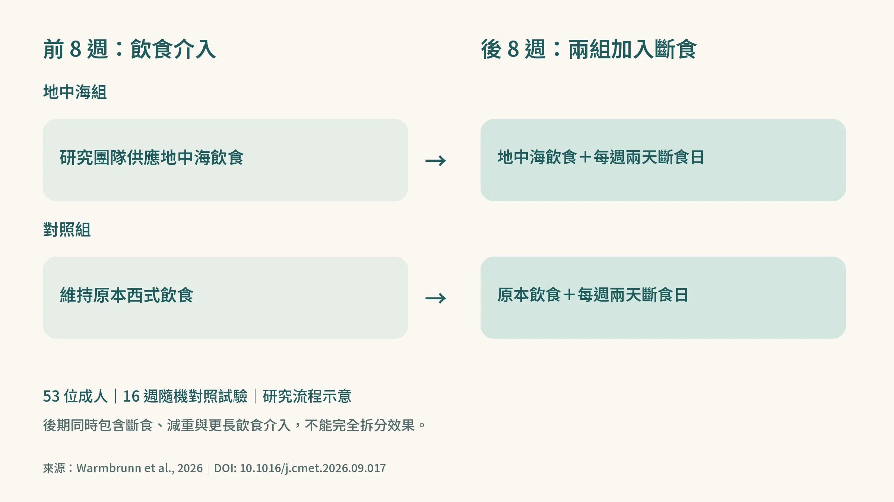
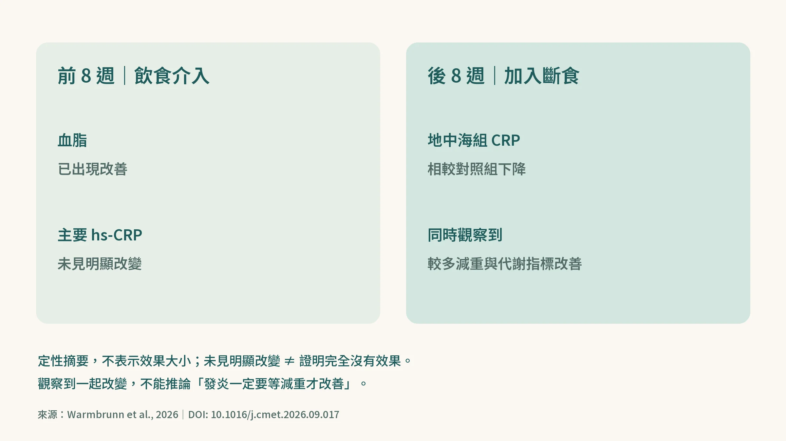
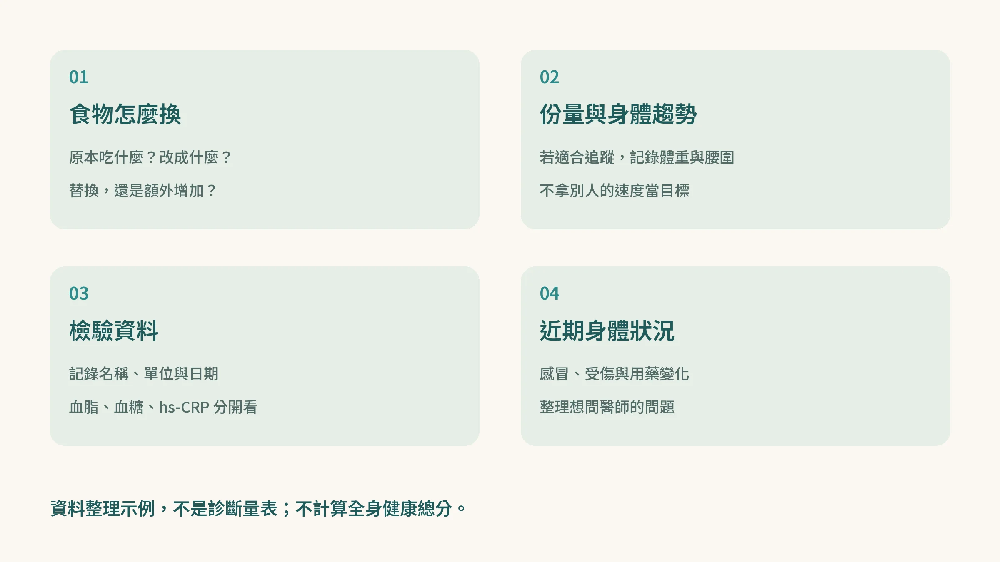

<!-- 🎨 [cover] [類型 A]
畫面：A thoughtful middle-aged East Asian man at a kitchen table with a Mediterranean meal and a health report. Warm off-white, teal and sage, soft editorial illustration. No invented lab values.
標籤：吃對了，發炎指數卻不動？／地中海飲食研究提醒：也要看熱量與體重變化
STYLE: AGELOCKED 暖米白、青綠與柔和紙感健康插畫。
-->

你把白飯換成糙米，炸雞換成烤魚，炒菜改用橄欖油。

如果下次拿到健檢報告，血脂有進步，hs-CRP 卻跟上次差不多，你會不會懷疑：「不是說吃健康能抗發炎？難道我白忙了？」

2026 年《Cell Metabolism》的一項試驗，觀察到血脂與發炎指標在不同階段出現變化。它提醒我們，除了吃什麼，也要注意熱量與體重趨勢。但不能因此下結論說：**只要沒瘦，發炎就不會改善。**（來源：[Cell Metabolism](https://doi.org/10.1016/j.cmet.2026.09.017)，2026）

## 研究先換菜單，再加入斷食

這項十六週試驗納入 53 位帶有代謝風險的成人，平均 54.7 歲，77% 是女性。前八週，一組吃研究團隊供應的地中海飲食，另一組維持原本的西式飲食；後八週，兩組都加入每週兩天的斷食日。（來源：[Cell Metabolism](https://doi.org/10.1016/j.cmet.2026.09.017)，2026；試驗登錄 NCT02148458）

<!-- 🎨 [fig-01] [類型 C]
數據來源：10.1016/j.cmet.2026.09.017；摘要可核對的兩組、兩階段研究設計。程式圖解，不含未核實降幅。
-->

前八週，主要觀察的 hs-CRP，也就是高敏感度 C 反應蛋白，沒有出現明顯改變；血脂卻已經改善。後八週加入斷食後，地中海組相較對照組，才觀察到 CRP 下降，並伴隨較多減重、血壓及胰島素敏感度改善。胰島素敏感度，白話說就是身體回應胰島素的能力。（來源：[Cell Metabolism](https://doi.org/10.1016/j.cmet.2026.09.017)，2026）

放回日常情境，就是同一張報告上的數字，可能不會同時給你回饋。

## 別把「一起發生」，讀成唯一原因

後半段同時發生了斷食、減重，以及更長時間的飲食介入。這個設計無法把三者的獨立效果完全拆開，也不能保證每個人只要減重，hs-CRP 就會下降。

這項研究人數不多、以女性為主，套用到四十歲男性時也要保留空間。它提供一條值得追蹤的線索，還不足以變成所有人的飲食處方。

<!-- 🎨 [fig-02] [類型 C]
數據來源：10.1016/j.cmet.2026.09.017；只呈現摘要確認的階段性結果，不補造百分比、誤差線或因果箭頭。
-->

## 八週沒下降，不等於地中海飲食沒有用

PREDIMED 的一項長期子研究，追蹤 165 位心血管高風險成人，在第三年、第五年觀察到地中海飲食組的部分發炎指標較各自起點下降。這與八週試驗問的是不同時間尺度的問題；也不能只看一組顯著、另一組不顯著，就當成直接的組間差異。（來源：[Journal of Nutrition](https://doi.org/10.3945/jn.115.229476)，2016）

PREDIMED 主試驗的 2018 年修正重刊分析，則支持地中海飲食對特定高風險族群的心血管事件預防效益。抽血指標與實際發生心血管事件，是不同的研究結果，不能混成同一件事。（來源：[New England Journal of Medicine](https://doi.org/10.1056/NEJMoa1800389)，2018）

所以，別因為一個指標暫時沒動，就把換菜單的努力全部打掉。

## 吃什麼、吃多少，都值得整理

把飲食品質想成只管血脂、熱量平衡只管發炎，也太簡化了。CALERIE 的兩年試驗分析，觀察到熱量限制與多項心血管代謝指標改善有關，血脂也在其中。（來源：[Lancet Diabetes & Endocrinology](https://doi.org/10.1016/S2213-8587(19)30151-2)，2019）

日常可以先問：魚、豆類、全穀和堅果，是替換原本的食物，還是在原本的份量外又加一輪？這是整理飲食的起點，不代表每個人都需要減重。

斷食也不是唯一選項。2022 年一項肥胖成人的一年試驗中，在熱量限制之外再限制進食時段，沒有顯示額外明確的減重優勢；2025 年的隨機試驗統合分析，整體結果也顯示間歇性斷食與持續熱量限制效果相近，部分隔日斷食比較有小幅體重優勢。（來源：[New England Journal of Medicine](https://doi.org/10.1056/NEJMoa2114833)，2022；[BMJ](https://doi.org/10.1136/bmj-2024-082007)，2025）

選哪種方式，還要看你的身體狀況和能否持續執行，不能把不同斷食模式當成同一套方法。

## 下次帶著四件事，和醫師討論

1. **食物怎麼換：**記下實際替換了什麼，不只寫「吃得健康」。
2. **份量與身體變化：**若適合追蹤，保留體重、腰圍趨勢；不拿別人的減重速度當目標。
3. **檢驗項目、單位與日期：**血脂、血糖與 hs-CRP 分開記，不合成健康總分。
4. **近期身體狀況：**感冒、受傷或用藥變化也記下，提供醫療人員參考。

<!-- 🎨 [fig-03] [類型 B]
畫面：Four simple record cards for food substitutions, portions and trends, lab names/units/dates, and recent health changes. Editable diagram with Traditional Chinese labels.
標籤：食物怎麼換、份量與身體趨勢、檢驗名稱單位日期、近期身體狀況。
STYLE: AGELOCKED 暖米白與青綠簡潔圖解；不加文章式大標題。
-->

hs-CRP 是風險評估的一部分，不能單憑一次數字診斷慢性發炎。若大於 10 mg/L，應由醫師評估是否有感染等原因及是否需要複驗，別自行當成減重考卷。反覆偏高也值得帶報告找家醫科討論。（來源：[Circulation](https://doi.org/10.1161/01.CIR.0000052939.59093.45)，2003）

正在使用胰島素或其他降血糖藥、有低血糖病史，或有懷孕、哺乳、體重偏輕與飲食失調等情況，先和醫師或營養師討論，不自行斷食、停藥或調藥。

**吃得好值得繼續，份量與身體變化也值得記錄。不同指標要分開追蹤，才不會被一個數字帶著走。**

想進一步了解熱量限制，可以接著讀〈[少吃真的能讓你活更久——熱量限制的科學，從 1930 年代到今天](/blog/chronic-inflammation/caloric-restriction-longevity-science/)〉。

## 參考資料

1. Warmbrunn MV, Tosti V, Biswas RK, et al. Weight loss during intermittent fasting, not Mediterranean diet quality alone, is associated with lower inflammation: A randomized controlled trial. *Cell Metabolism*. 2026. DOI：[10.1016/j.cmet.2026.09.017](https://doi.org/10.1016/j.cmet.2026.09.017)。[PubMed PMID 42906553](https://pubmed.ncbi.nlm.nih.gov/42906553/)；[NCT02148458](https://clinicaltrials.gov/study/NCT02148458)。
2. Casas R, Sacanella E, Urpí-Sardà M, et al. Long-Term Immunomodulatory Effects of a Mediterranean Diet in Adults at High Risk of Cardiovascular Disease in the PREvención con DIeta MEDiterránea (PREDIMED) Randomized Controlled Trial. *J Nutr*. 2016;146(9):1684–1693. DOI：[10.3945/jn.115.229476](https://doi.org/10.3945/jn.115.229476)。
3. Estruch R, Ros E, Salas-Salvadó J, et al. Primary Prevention of Cardiovascular Disease with a Mediterranean Diet Supplemented with Extra-Virgin Olive Oil or Nuts. *N Engl J Med*. 2018;378:e34. DOI：[10.1056/NEJMoa1800389](https://doi.org/10.1056/NEJMoa1800389)。（2018 年修正重刊版）
4. Kraus WE, Bhapkar M, Huffman KM, et al. 2 years of calorie restriction and cardiometabolic risk (CALERIE): exploratory outcomes of a multicentre, phase 2, randomised controlled trial. *Lancet Diabetes Endocrinol*. 2019;7(9):673–683. DOI：[10.1016/S2213-8587(19)30151-2](https://doi.org/10.1016/S2213-8587(19)30151-2)。
5. Liu D, Huang Y, Huang C, et al. Calorie Restriction with or without Time-Restricted Eating in Weight Loss. *N Engl J Med*. 2022;386:1495–1504. DOI：[10.1056/NEJMoa2114833](https://doi.org/10.1056/NEJMoa2114833)。
6. Semnani-Azad Z, Khan TA, Chiavaroli L, et al. Intermittent fasting strategies and their effects on body weight and other cardiometabolic risk factors: systematic review and network meta-analysis of randomised clinical trials. *BMJ*. 2025;389:e082007. DOI：[10.1136/bmj-2024-082007](https://doi.org/10.1136/bmj-2024-082007)。
7. Pearson TA, Mensah GA, Alexander RW, et al. Markers of inflammation and cardiovascular disease: application to clinical and public health practice: A statement for healthcare professionals from the Centers for Disease Control and Prevention and the American Heart Association. *Circulation*. 2003;107(3):499–511. DOI：[10.1161/01.CIR.0000052939.59093.45](https://doi.org/10.1161/01.CIR.0000052939.59093.45)。

*本文為健康教育資訊，不構成醫療診斷或治療建議。*
