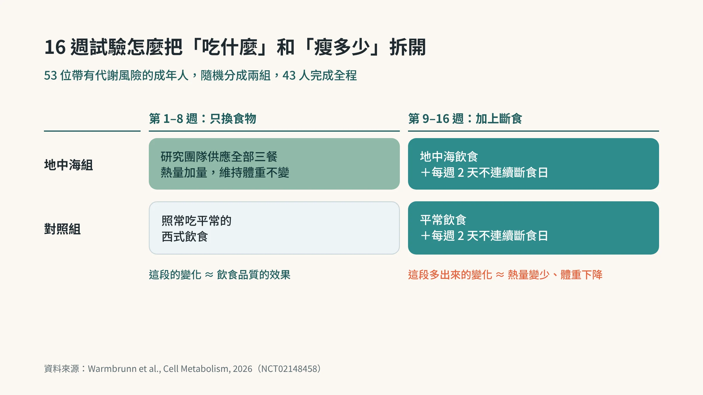
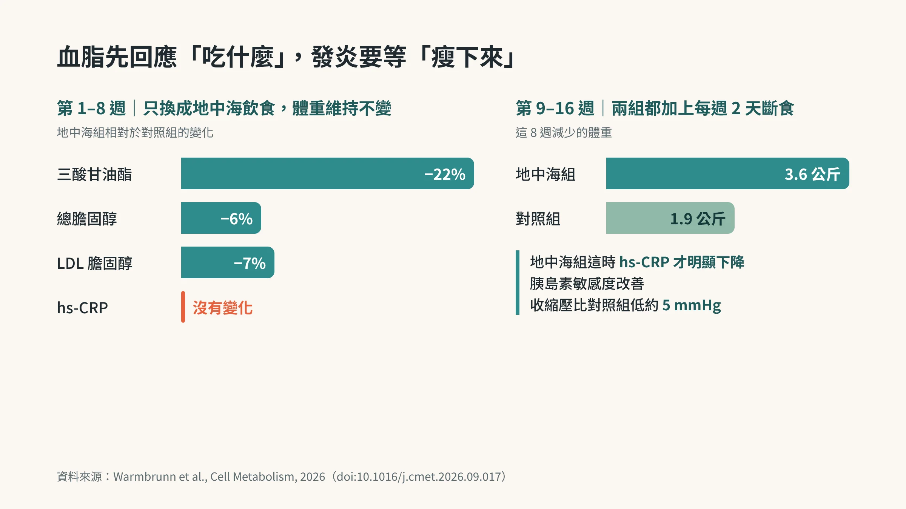

<!-- 🎨 [cover] [類型 A]
畫面：A middle-aged East Asian man in a casual shirt sits at a kitchen table with a colorful Mediterranean plate (grilled fish, olive oil, vegetables, whole grains). Beside the plate lies a printed health report with two blank rounded label boxes. He looks at the report with mild puzzlement. Warm off-white background, soft flat illustration, calm teal and sage palette, one small amber accent.
標籤（Canva 填入）：吃對了，發炎卻沒降？
STYLE: 依 IMAGE-STYLE.md 第 7.2 節
heroImage 做好後加進 frontmatter：heroImage: './cover.webp'
-->

你把白飯換成糙米，炸雞換成烤魚，炒菜改用橄欖油。

三個月後拿到健檢報告，血脂真的變漂亮了。可是 hs-CRP 那一欄，數字跟上次差不多。

你可能會懷疑自己哪裡做錯。2026 年 10 月，《Cell Metabolism》刊出的一個隨機對照試驗，剛好回答了這個問題：**換對食物，管得動血脂；發炎指數要動，體重得先往下走。**

## 為什麼這個問題以前很難回答

地中海飲食的好名聲，很多來自大型研究，例如西班牙的 PREDIMED。這些研究讓受試者照自己的方式吃，沒有把體重固定住。

問題在於，吃得比較健康的人，常常也順便瘦了一點。高纖、蔬菜多的飲食本來就比較容易飽。所以當研究看到發炎指標下降，很難分清楚功勞屬於橄欖油和魚，還是屬於少掉的那幾公斤。

hs-CRP（也就是高敏感度 C 反應蛋白，血液裡用來看「低度、長期」發炎的指標）剛好是最常被拿來當證據的那一項。想知道它怎麼讀，可以先看〈[CRP 正常，還需要看 hs-CRP 嗎？先看單位，再讀數字](/blog/chronic-inflammation/hs-crp-low-grade-inflammation/)〉。

## 這個試驗怎麼把兩件事拆開

研究由雪梨大學與美國華盛頓大學聖路易分校等團隊進行（臨床試驗登記 NCT02148458）。53 位 30 到 65 歲、帶有至少一項代謝風險（血壓偏高、膽固醇偏高或腰圍過大）、但沒有重度肥胖的成年人參加，平均 54.7 歲，約四分之三是女性，最後 43 人完成全程。

設計分成兩段，每段 8 週：

- **第一段：只換食物，不准瘦。** 一組的三餐全部由研究團隊供應地中海飲食，另一組照常吃平常的西式飲食。地中海組一開始自然掉體重，研究團隊就幫他們加量，讓體重盡量維持不變。
- **第二段：加上斷食，允許瘦。** 兩組都改成每週兩天、不連續的斷食日，其餘日子照原本的飲食。

<!-- 🎨 [fig-01] [類型 C]
數據來源：Warmbrunn et al., Cell Metabolism, 2026（doi:10.1016/j.cmet.2026.09.017）；研究設計時間軸，已用程式產出
-->

這樣一來，第一段看到的變化，大致可以算在「吃什麼」頭上；第二段多出來的變化，才和熱量變少、體重下降有關。

## 第一段：血脂動了，hs-CRP 沒動

只換食物的 8 週，地中海組和對照組相比：

- 三酸甘油酯下降 22%
- 總膽固醇下降約 6%
- LDL 膽固醇下降約 7%

hs-CRP 呢？沒有變化。

換成生活裡的畫面：你很認真地改了餐盤，體重計上的數字幾乎沒動，報告上的血脂先給了回饋，發炎那一欄卻像沒收到消息。這個試驗告訴你，這種結果很正常，不是你偷吃。

## 第二段：體重往下走，發炎才跟著退

加上每週兩天斷食之後，地中海組多瘦了 3.6 公斤，對照組瘦了 1.9 公斤。

到了這個階段，地中海組的 hs-CRP 才明顯下降，胰島素敏感度（也就是身體對胰島素的反應有多靈敏，越靈敏，血糖越容易回穩）跟著改善，收縮壓也比對照組低約 5 mmHg。

腸道菌的整體組成，在兩個階段都大致穩定，沒有出現大幅改變。

<!-- 🎨 [fig-02] [類型 C]
數據來源：Warmbrunn et al., Cell Metabolism, 2026（doi:10.1016/j.cmet.2026.09.017）；第一段血脂變化與第二段體重變化，已用程式產出
-->

論文標題把結論寫得很直接：和較低發炎有關的，是斷食期間的體重下降，單靠地中海飲食的品質還不夠。

## 這對你的意思：兩個開關，分別管不同的事

你可以把它想成兩個開關。

**第一個開關是「吃什麼」。** 它管血脂，反應快，換了幾週就看得到。

**第二個開關是「吃多少」。** 它管發炎、血壓和血糖，要等熱量真的少一點、體重真的往下走，才開始動。

兩個開關沒辦法互相代替。只開第一個，你會得到漂亮的血脂和沒動的 hs-CRP。只開第二個，效果可能打折：試驗裡的對照組同樣每週斷食兩天，瘦得卻只有地中海組的一半左右。研究裡表現最好的，是好的飲食底子加上適度的熱量赤字。

腰圍偏大、hs-CRP 落在中間區間（1 到 3 mg/L）的人，最值得記住這件事。內臟脂肪本身就會分泌發炎訊號，原因可以看〈[不是卡路里，是你的荷爾蒙！3 大荷爾蒙陷阱大公開](/blog/chronic-inflammation/visceral-fat-three-cycles/)〉。

### 換成日常可以做的三件事

1. **餐盤先換，血脂會先回饋。** 蔬菜、全穀、魚、豆類和橄欖油，這部分照做，三個月後的血脂通常會給你答案。想看懂血脂報告，可以搭配〈[LDL 看起來還好，為什麼醫師還會看 ApoB？](/blog/precision-health-tools/apob-vs-ldl/)〉。
2. **熱量要真的少一點，體重要真的動。** 試驗用的是每週兩天斷食；如果你做不到，也可以從固定的晚餐份量、少掉宵夜和含糖飲料開始。其他做法可以參考〈[間歇性斷食做不到？這個每月 5 天的版本](/blog/chronic-inflammation/fasting-mimicking-diet-5days/)〉。
3. **追蹤時分開看。** 血脂看飲食品質，腰圍和 hs-CRP 看熱量平衡。三個月只看到血脂進步，不代表失敗，代表第二個開關還沒打開。

## 先問醫師的情況

- **正在用降血糖藥或胰島素：** 斷食日容易低血糖，開始前先和新陳代謝科或家醫科醫師討論，調整用藥時間與劑量。
- **懷孕、哺乳、有飲食失調病史，或體重已經偏輕：** 不建議自行嘗試斷食，先和醫師討論。
- **hs-CRP 大於 10 mg/L：** 常代表近期有感染、受傷或其他急性發炎，先找家醫科釐清，不要拿來當慢性發炎的分數。
- **hs-CRP 反覆高於 3 mg/L，或居家血壓常常超過 130/80 mmHg：** 帶著報告找家醫科或心臟內科，一起評估心血管風險。

## 這個研究的限制

- **人數不多：** 完成全程的只有 43 人，而且以女性為主，套用到中年男性時要保守一點。
- **兩件事綁在一起：** 第二段的斷食、體重下降和更長的飲食時間同時發生，沒辦法單獨證明「斷食本身」的效果。
- **研究以外的專家也有保留：** 有學者認為設計不算強，而且 hs-CRP 單一數值在臨床上的用途有限。比較穩當的讀法，是把它當成調整的方向，再拿自己的報告和醫師討論。

## 帶走一句話

**飲食品質管血脂，熱量平衡管發炎。** 兩個開關都要開，報告上的每一欄才會一起往好的方向走。

想先搞懂「少吃」為什麼會影響老化與發炎，可以接著讀〈[少吃真的能讓你活更久——熱量限制的科學，從 1930 年代到今天](/blog/chronic-inflammation/caloric-restriction-longevity-science/)〉。

---

## 參考資料

1. Warmbrunn MV, et al. Weight loss during intermittent fasting, not Mediterranean diet quality alone, is associated with lower inflammation: A randomized controlled trial. *Cell Metabolism*, 2026.（來源：[Cell Metabolism](https://doi.org/10.1016/j.cmet.2026.09.017)，2026；PMID 42906553；臨床試驗登記 NCT02148458）
2. Estruch R, et al. Primary prevention of cardiovascular disease with a Mediterranean diet supplemented with extra-virgin olive oil or nuts. *New England Journal of Medicine*, 2018.（來源：[NEJM](https://doi.org/10.1056/NEJMoa1800389)，2018）
3. Pearson TA, et al. Markers of inflammation and cardiovascular disease: application to clinical and public health practice. *Circulation*, 2003.（來源：[Circulation](https://doi.org/10.1161/01.CIR.0000052939.59093.45)，2003）

*本文為健康教育資訊，不構成醫療診斷或治療建議。*
