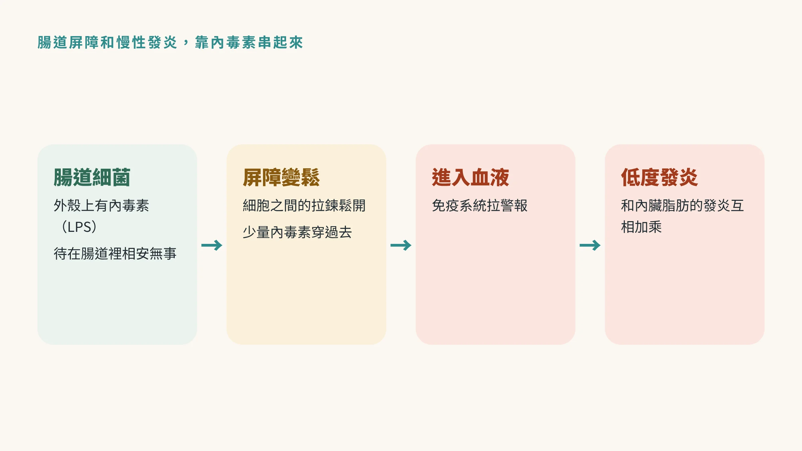
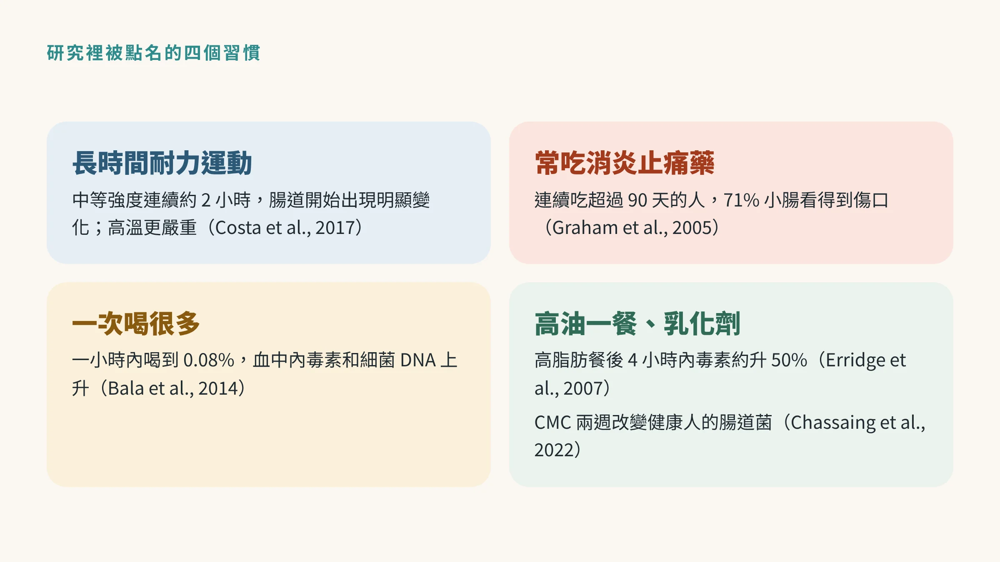
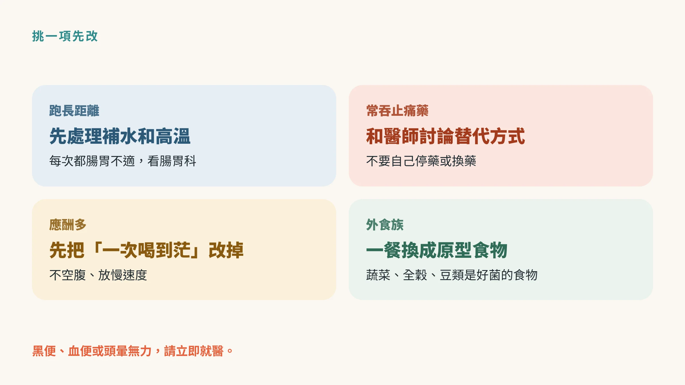

<!-- 🎨 [cover] [類型 A]
畫面：A still-life of four everyday items on a warm off-white table: running shoes, a blister pack of painkillers, a beer glass, and a packaged snack, with a faint outline of the intestine behind them. Teal and sage palette, soft editorial illustration.
標籤（Canva 填入）：哪些習慣會讓腸道變漏？
STYLE: 依 IMAGE-STYLE.md 第 7.2 節
-->

上一篇〈[腸漏症是真的嗎？](/blog/body-signals/leaky-gut-what-is-real/)〉講到：腸道真的會變漏，但「腸漏症」還不是一個診斷。

那接下來的問題是：**是什麼讓腸道變漏？**

研究裡被點名的，不是什麼罕見毒物，而是很多男人每週都在做的事：跑長距離、吃止痛藥、應酬喝酒、吃加工食品。

## 先懂一個詞：內毒素

腸道裡住著大量細菌。其中一類細菌的外殼上，有一種叫**內毒素**（也叫脂多糖、LPS，也就是細菌外殼的碎片）的分子。

它待在腸道裡的時候相安無事。可是如果腸道屏障變鬆，少量內毒素跑進血液，免疫系統就會拉警報，引起低度的發炎反應。

這也是為什麼腸道屏障會和「慢性發炎」扯上關係。慢性發炎怎麼從血液數字看出線索，可以參考〈[CRP 正常，還需要看 hs-CRP 嗎？](/blog/chronic-inflammation/hs-crp-low-grade-inflammation/)〉。

## 一、長時間、高強度的耐力運動

先說清楚：運動對腸道是好的。問題出在「很長、很硬、很熱」。

澳洲學者回顧研究後發現，運動時間越長、強度越高，腸道越容易受傷、功能越容易亂掉。大約在**以中等強度（約最大攝氧量的 60%）連續運動 2 小時**左右，腸道就開始出現明顯的變化，不管體能好不好都一樣；在大熱天運動，問題會更嚴重（Costa et al., 2017）。

原因是運動時血液大量流向肌肉，腸道分到的血變少，腸壁細胞受傷、變漏，內毒素就有機會跑進血液。作者把這種情況稱為「運動引起的腸胃症候群」。

跑過全馬、騎過百K的人應該有感：後半段肚子翻攪、想跑廁所。這不全是心理作用。

**可以怎麼做：** 長距離訓練注意補水、避開最熱的時段、比賽前用平常吃慣的食物。如果每次運動都有明顯的腸胃症狀，請找**腸胃科**完整評估，不要硬撐。

## 二、常吃消炎止痛藥

腰痠、膝蓋痛、頭痛，很多人習慣吞一顆消炎止痛藥（NSAIDs，例如 ibuprofen、naproxen 這類）。

大家比較熟悉的是它傷胃，其實它也會傷小腸。美國一項研究用膠囊內視鏡（也就是吞下一顆小攝影機，拍整段小腸）檢查長期吃止痛藥的關節炎患者：連續吃超過 90 天的人，**71% 的小腸看得到傷口**，從小糜爛到嚴重潰瘍都有（Graham et al., 2005）。腸道通透性上升，也是這類藥物已知的影響之一（Camilleri, 2019）。

**可以怎麼做：** 偶爾痛一下吃一顆，和天天吃好幾個月是兩回事。如果你已經長期在吃，**不要自己停藥或換藥**，回去和開藥的醫師或藥師討論：有沒有別的止痛方式、需不需要保護腸胃的藥。出現黑便、血便或頭暈無力，請立即就醫。

## 三、一次喝很多

應酬場合「乾杯」一攤接一攤，是很多台灣男人的日常。

美國研究找來 25 位健康成人，在一小時內喝到血中酒精濃度 0.08%（相當於美國對「狂飲」的定義），之後每 30 分鐘抽血。喝完不久，血中的內毒素和細菌 DNA 就上升；女性的血中酒精濃度和內毒素都比男性更高（Bala et al., 2014）。

長期喝酒的影響更大。美國國家酒精濫用研究所出版的期刊中，一篇回顧指出，酒精會讓腸道屏障變鬆、改變腸道菌，從腸道來的發炎訊號，是酒精傷肝的重要原因之一（Bishehsari et al., 2017）。

**可以怎麼做：** 少喝是最直接的。真的要喝，避免空腹、放慢速度、不要一次喝到茫。如果你發現自己很難控制喝酒的量，可以和**家醫科**或**身心科**醫師聊聊。

## 四、高油的一餐，和加工食品裡的乳化劑

**高油的一餐：** 英國研究讓 12 位健康男性吃一頓高脂肪餐，4 小時內血中內毒素平均上升約 50%；只抽菸不吃東西則沒有這個變化（Erridge et al., 2007）。這說明一頓很油的飯，就可能讓少量內毒素進到血液。

**乳化劑：** 很多加工食品會加乳化劑，讓口感滑順、油水不分離。法國和美國的研究團隊讓健康成人住進研究中心，吃完全相同的飲食兩週，其中一組額外加入常見的乳化劑羧甲基纖維素（CMC）。加了 CMC 的那組，腸道菌的組成改變、對腸道有益的代謝物減少，有些人的腸道細菌更靠近黏液層（Chassaing et al., 2022）。

這項研究只有兩週，沒有人因此生病，作者認為長期影響還需要研究。它提醒的是方向：**加工食品吃越多，腸道要應付的東西越多。**

**可以怎麼做：** 不需要每一樣都看成分表，從「多吃原型食物、少吃包裝零食和加工肉品」開始就好。蔬菜、全穀、豆類裡的纖維，也是腸道好菌的食物。飲食品質和發炎指數的關係，可以搭配〈[吃對了，發炎指數卻不動？](/blog/chronic-inflammation/mediterranean-diet-fasting-hscrp-weight-loss/)〉一起看。

## 腰圍，是把這些串起來的那條線

應酬多、喝得多、外食多、吃得油，最先反映在哪裡？多半是肚子。

內臟脂肪本身就是發炎的來源，再加上腸道來的內毒素，兩邊會互相加乘。腰圍為什麼值得盯，可以看〈[腰圍每年多三公分，不是你吃太多](/blog/body-signals/visceral-fat-metabolic-signal/)〉。

## 先從哪一項開始

你不需要四項同時改。挑一項你最常做、也最容易調整的：

- 每週跑長距離的人：先處理補水和高溫。
- 腰痠背痛常吞止痛藥的人：先和醫師討論替代方式。
- 應酬多的人：先把「一次喝到茫」改掉。
- 外食族：先把一餐的加工食品換成原型食物。

## 什麼時候看醫生、看哪一科

- 血便、黑便、體重莫名下降、排便習慣改變超過幾週：看**腸胃科**。
- 長期吃止痛藥：回到開藥的科別，和醫師或藥師討論。
- 喝酒量難以控制、肝功能指數異常：看**家醫科**、**腸胃肝膽科**或**身心科**。
- 運動時反覆腸胃不適：看**腸胃科**，必要時找運動醫學專科。

## 帶走一句話

**讓腸道變漏的，常常是很日常的習慣。** 很長很熱的運動、天天吞的止痛藥、一攤接一攤的酒、包裝食品，挑一項先改。

下一篇〈[腸漏症檢測準不準？](/blog/precision-health-tools/leaky-gut-test-zonulin/)〉，來看網路上很紅的 zonulin 檢測到底在量什麼。

---

## 參考資料

1. Costa RJS, et al. Systematic review: exercise-induced gastrointestinal syndrome—implications for health and intestinal disease. *Alimentary Pharmacology & Therapeutics*, 2017.（來源：[Alimentary Pharmacology & Therapeutics](https://doi.org/10.1111/apt.14157)，2017）
2. Graham DY, et al. Visible small-intestinal mucosal injury in chronic NSAID users. *Clinical Gastroenterology and Hepatology*, 2005.（PMID：[15645405](https://pubmed.ncbi.nlm.nih.gov/15645405/)）
3. Camilleri M. Leaky gut: mechanisms, measurement and clinical implications in humans. *Gut*, 2019.（PMID：[31076401](https://pubmed.ncbi.nlm.nih.gov/31076401/)）
4. Bala S, et al. Acute binge drinking increases serum endotoxin and bacterial DNA levels in healthy individuals. *PLoS ONE*, 2014.（來源：[PLoS ONE](https://doi.org/10.1371/journal.pone.0096864)，2014）
5. Bishehsari F, et al. Alcohol and gut-derived inflammation. *Alcohol Research: Current Reviews*, 2017.（PMID：[28988571](https://pubmed.ncbi.nlm.nih.gov/28988571/)）
6. Erridge C, et al. A high-fat meal induces low-grade endotoxemia: evidence of a novel mechanism of postprandial inflammation. *American Journal of Clinical Nutrition*, 2007.（來源：[American Journal of Clinical Nutrition](https://doi.org/10.1093/ajcn/86.5.1286)，2007）
7. Chassaing B, et al. Randomized controlled-feeding study of dietary emulsifier carboxymethylcellulose reveals detrimental impacts on the gut microbiota and metabolome. *Gastroenterology*, 2022.（來源：[Gastroenterology](https://doi.org/10.1053/j.gastro.2021.11.006)，2022）

*本文為健康教育資訊，不構成醫療診斷或治療建議。*
