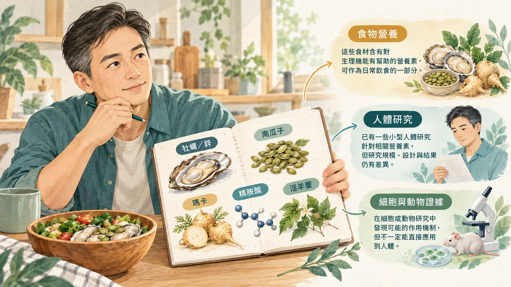
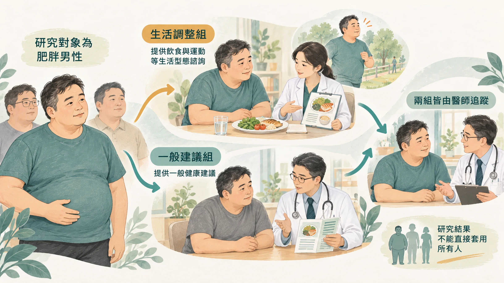
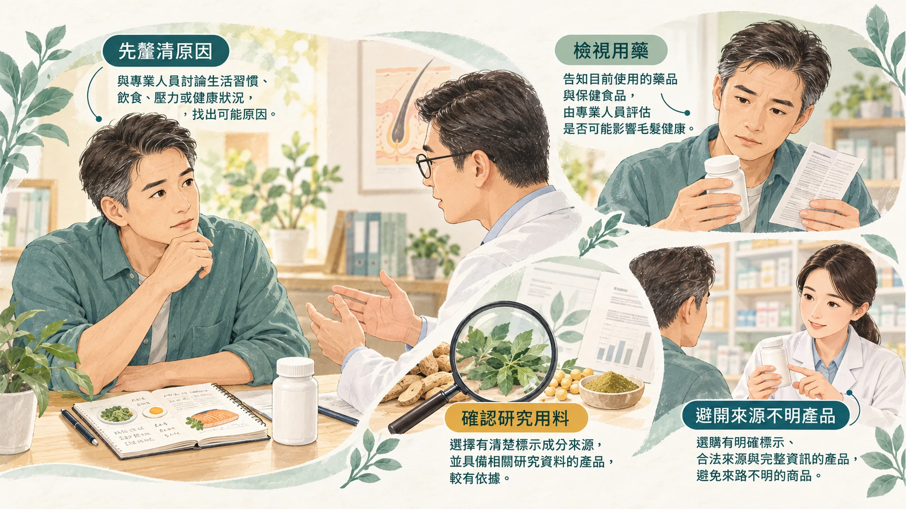

<!-- 🎨 [cover] [類型 A]
畫面：A wooden table with a plate of oysters, a small bowl of pumpkin seeds, a maca root and a few capsules, arranged like a still-life, with a magnifying glass resting beside them. Warm off-white, teal and sage, soft editorial illustration.
標籤（Canva 填入）：壯陽食物，研究怎麼說？
STYLE: 依 IMAGE-STYLE.md 第 7.2 節
-->

晚上朋友聚餐，桌上一盤生蠔。有人夾了一顆給你：「多吃一點，補一下！」大家笑成一團。

隔天你在網路上看到：「南瓜子是天然威而鋼」「瑪卡讓你重返二十歲」。下面一排留言：「真的有效嗎？」

這篇把常聽到的幾種「壯陽食物」拿出來，一個一個看研究到底說了什麼。先講結論：**有幾個有一點證據，但沒有一個比得上另一件事。** 那件事放在最後。

如果你還不確定自己是累、沒慾望，還是勃起本身變了，可以先看〈[硬度不如以前、晨間反應變少](/blog/body-signals/erection-libido-fatigue-three-questions/)〉。

## 牡蠣：重點是鋅

生蠔、牡蠣被叫做「海裡的牛奶」，在男人圈裡的名聲來自一個營養素：**鋅**。牡蠣是含鋅最高的食物之一。

鋅和睪固酮有關。美國研究發現，缺鋅的人血中睪固酮偏低；讓他們把鋅補足之後，睪固酮就回升（Prasad et al., 1996）。

但要注意兩件事：

- 這是對**缺鋅的人**有用。本來就不缺的人，多吃不一定有差別。
- 生蠔要注意新鮮度和來源，腸胃比較弱的人，煮熟吃比較安全。

紅肉、海鮮、堅果、豆類也都有鋅，三餐吃得均衡的人，通常不太會缺。

## 南瓜子：被講得太神了

「南瓜子是天然威而鋼」這句話，在網路上很紅。

南瓜子確實有鋅、鎂和不飽和脂肪酸，是很好的零嘴。但說它能直接改善勃起，目前**沒有找到可靠的人體研究**。南瓜子油比較常被研究的方向，是攝護腺和頭髮，不是勃起。

想吃可以吃，一天一小把，當成補充鋅和好油脂的點心，不要期待它是藥。

## 瑪卡：性慾可能有一點，睪固酮沒變

瑪卡（又稱秘魯人蔘）是南美安地斯山的根莖類植物。

秘魯的研究團隊做了一項 12 週的小型試驗，健康男性吃瑪卡之後，**自己回報的性慾**有提升，但血中睪固酮沒有變化（Gonzales et al., 2002）。

也就是說，瑪卡可能讓人「比較想」，但不是透過提高睪固酮。這項研究人數少、時間短，只能當成線索。

## 精胺酸：一氧化氮的原料

精胺酸會紅，AV 男優的代言功不可沒。它是身體製造一氧化氮的原料，而一氧化氮的工作，就是讓陰莖的血管放鬆、讓血液流得進去。

研究怎麼說？10 個隨機試驗合起來看，540 位輕到中度勃起障礙的男性，每天吃 1,500 到 5,000 毫克，勃起功能比吃安慰劑的人好；性慾則沒有差別（Rhim et al., 2019）。

試驗規模都不大。**正在吃降血壓藥、心臟藥物或威而鋼的人，不要自己加精胺酸**，先問醫師或藥師。

## 淫羊藿：動物研究有，人體研究不足

淫羊藿的成分淫羊藿苷，在細胞和大鼠實驗裡，看到改善勃起相關指標的結果（Shindel et al., 2010）。但這是動物研究，人體證據還不夠。

## 比任何一種食物都有效的：把腰圍降下來

義大利一項隨機試驗，找了 110 位肥胖、有勃起障礙的中年男性（35 到 55 歲）。一組接受詳細的減重指導：少吃一點、多動一點，目標減掉 10% 的體重；另一組只拿到一般的健康飲食和運動資訊（Esposito et al., 2004）。

兩年後：

- 減重組每週運動時間從 48 分鐘增加到 195 分鐘，體重明顯下降。
- 減重組大約**三分之一**的人，勃起功能恢復到正常範圍；對照組只有大約 5%。

沒有吃任何「壯陽食物」，只是把體重和運動顧好。

這和勃起的原理有關：勃起靠的是血管，腰圍變大、血糖血脂變差，最先受影響的常常就是比較細的陰莖血管。腰圍怎麼量、為什麼值得盯，可以看〈[腰圍每年多三公分，不是你吃太多](/blog/body-signals/visceral-fat-metabolic-signal/)〉。

## 那「以形補形」呢？

牛鞭、海馬、雞睪丸這些，大多是高脂肪、高膽固醇的內臟。想補下面，結果先補到肚子，血脂也跟著往上衝，剛好和前面那個試驗反方向。

## 吃補充品之前，先問這幾件事

- **你正在吃什麼藥？** 降血壓藥、心臟藥物（特別是硝酸鹽類）、抗凝血藥、威而鋼，和補充品可能互相影響。
- **你缺不缺？** 鋅這類營養素，缺了補才有用，可以請醫師抽血確認。
- **成分研究不等於產品效果：** 研究用的劑量和形式，要對得上你手上那一罐。
- **網路上來路不明的「壯陽藥」不要買**，成分和劑量都不清楚，有心血管問題的人風險更高。

## 什麼時候看醫生、看哪一科

- 勃起或性慾的變化持續超過 3 個月：看**泌尿科**。
- 同時有血壓、血脂、血糖紅字，或爬樓梯會喘：加看**家醫科**或**心臟內科**。
- **有胸痛、胸悶、呼吸困難，請立即就醫。**

牡蠣、南瓜子可以放進日常菜單，瑪卡和精胺酸則要看研究條件，不能靠一份食物或一罐補充品保證表現。若勃起狀況持續改變，先找醫師釐清原因，再把運動、體重與作息一起顧好。

---

## 參考資料
1. Prasad AS, et al. Zinc status and serum testosterone levels of healthy adults. *Nutrition*, 1996. DOI：[10.1016/s0899-9007(96)80058-x](https://doi.org/10.1016/s0899-9007(96)80058-x)。
2. Gonzales GF, et al. Effect of Lepidium meyenii (MACA) on sexual desire and its absent relationship with serum testosterone levels in adult healthy men. *Andrologia*, 2002. DOI：[10.1046/j.1439-0272.2002.00519.x](https://doi.org/10.1046/j.1439-0272.2002.00519.x)。
3. Rhim HC, et al. The potential role of arginine supplements on erectile dysfunction: a systemic review and meta-analysis. *Journal of Sexual Medicine*, 2019. DOI：[10.1016/j.jsxm.2018.12.002](https://doi.org/10.1016/j.jsxm.2018.12.002)。
4. Shindel AW, et al. Erectogenic and neurotrophic effects of icariin, a purified extract of horny goat weed (Epimedium spp.) in vitro and in vivo. *Journal of Sexual Medicine*, 2010. DOI：[10.1111/j.1743-6109.2009.01699.x](https://doi.org/10.1111/j.1743-6109.2009.01699.x)。
5. Esposito K, et al. Effect of lifestyle changes on erectile dysfunction in obese men: a randomized controlled trial. *JAMA*, 2004. DOI：[10.1001/jama.291.24.2978](https://doi.org/10.1001/jama.291.24.2978)。

*本文為健康教育資訊，不構成醫療診斷或治療建議。*