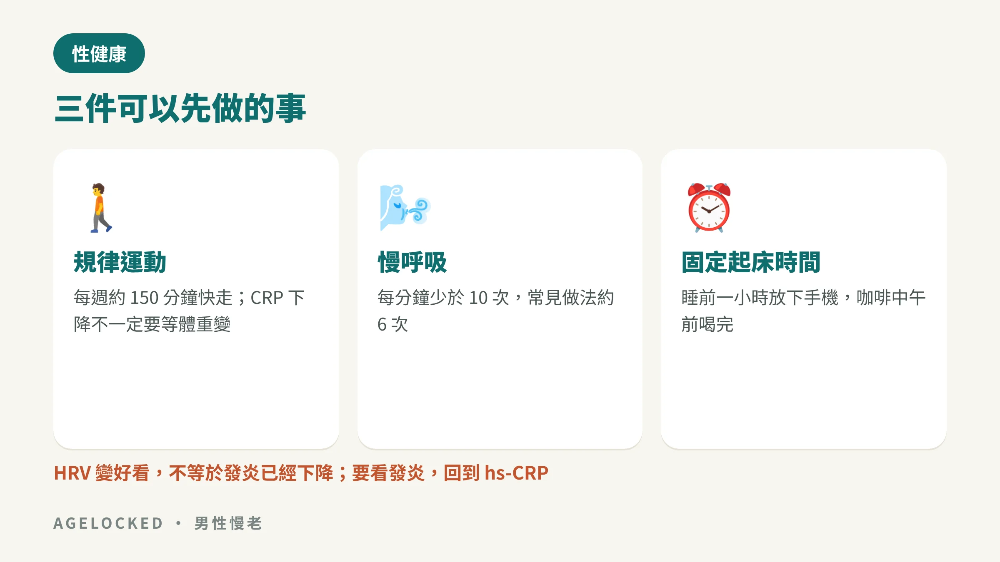

<!-- 🎨 [cover] [類型 A]
畫面：A middle-aged East Asian man sitting on the edge of his bed at night, one hand on his chest, phone glowing on the nightstand showing a heart-rate graph. Soft blue night light from the window, a faint warm glow suggesting tension inside his body.
標籤（Canva 填入）：自律神經失調和慢性發炎／一條雙向的線
STYLE: 依 IMAGE-STYLE.md 第 7.2 節
-->

半夜醒來，心跳得很快。白天胸口悶、腸胃時好時壞，檢查做了一輪，報告都說正常。

最後拿到一句話：「應該是自律神經失調。」

這句話聽起來像答案，其實更像起點。這篇想回答兩個問題：自律神經和慢性發炎有沒有關係？如果有，你可以從哪裡開始？

## 先說清楚：「自律神經失調」是什麼

自律神經，也就是說，不用你下指令就自己在運作的那套神經，管心跳、呼吸、消化、流汗和睡眠。它分兩邊：

- **交感神經**：油門。壓力、趕報告、熬夜時踩下去，心跳變快、血壓上升。
- **副交感神經**：煞車。主角是迷走神經，負責讓身體慢下來、消化、修復。

「自律神經失調」是門診和一般人常用的說法，描述的是油門和煞車的平衡亂掉，不是一個單一、有明確檢驗標準的診斷。也因為這樣，它常常被拿來概括很多還沒找到原因的不舒服。

## 神經和發炎之間，有一條雙向的線

2002 年，研究者提出「發炎反射」的概念：迷走神經能感覺到身體裡的發炎訊號，也能回頭送出訊息，讓脾臟裡的免疫細胞少放一點發炎物質[1]。

人身上也看得到。2016 年一項小型研究，讓類風濕性關節炎病人植入迷走神經刺激器，結果發炎物質 TNF 的產生減少，關節症狀也改善[2]。這是重症病人的醫療器材研究，一般人不需要也不適用，但它說明了：**神經真的能調節發炎。**

反過來，發炎物質也會影響大腦和神經，讓人疲倦、情緒低落、睡不好。所以這是一條雙向的線。

<!-- 🎨 [fig-01] [類型 B]
畫面：A simple two-way loop diagram. Top: a brain with a wavy vagus nerve line running down to the abdomen. Bottom: a cluster of small immune cells releasing tiny orange particles. One arrow goes down labeled as a calming signal, another arrow goes up labeled as an inflammation signal.
標籤（Canva 填入）：神經與發炎的雙向迴路, 迷走神經：讓免疫細胞少放發炎物質, 發炎物質：回頭讓人疲倦、睡不好
STYLE: 依 IMAGE-STYLE.md 第 7.2 節
-->

## 研究看到的三個連結

**1. HRV 偏低的人，發炎指標通常偏高。**

HRV，也就是說，每一次心跳之間的間隔有多少變化，常被拿來反映副交感神經的活性。2019 年一篇整合分析發現，HRV 和發炎指標呈負相關，其中 SDNN 和高頻 HRV 的關聯最明顯[3]。要注意的是，這是相關性，還不能說是誰造成誰。

**2. 急性壓力會讓發炎指標短暫上升。**

一篇整合實驗室壓力研究的分析發現，人在接受公開演講、心算這類壓力測試後，血液裡的 IL-6 等發炎物質會上升[4]。偶爾一次沒關係，問題是天天都在壓力測試裡的人。

**3. 睡不好，發炎指標也跟著上來。**

2016 年一篇整合了 72 項研究、超過 5 萬人的分析指出，睡眠障礙和較高的 CRP、IL-6 有關；有意思的是，睡太長的人也一樣[5]。

這三件事，剛好就是「自律神經失調」最常見的生活樣貌：壓力大、睡不好、身體一直在油門上。

## 先排除這些原因，再談調整

心悸、胸悶、睡不好、腸胃不適，可能有很多原因。在把它歸給自律神經之前，以下幾種情況值得先請醫師評估：

| 可能的原因 | 常見線索 | 可以先看 |
|---|---|---|
| 甲狀腺亢進 | 心悸、手抖、怕熱、體重下降 | 新陳代謝科 |
| 貧血 | 喘、頭暈、臉色蒼白 | 家醫科 |
| 心律不整 | 心跳忽快忽慢、漏拍感 | 心臟內科 |
| 睡眠呼吸中止 | 打呼很大聲、白天很想睡 | 睡眠門診、耳鼻喉科 |
| 焦慮或憂鬱 | 長期緊張、提不起勁、睡不著 | 身心科 |
| 咖啡因、酒精、藥物 | 喝咖啡或能量飲後更明顯 | 先自己記錄一週 |

**如果出現胸痛、昏倒、呼吸困難，請直接去急診。**

如果你最近情緒低落、壓力大到撐不住，可以撥 1925 安心專線，24 小時都有人接。

不知道從哪一科開始，可以看〈[慢性發炎看哪科？](/blog/precision-health-tools/chronic-inflammation-which-doctor/)〉。

<!-- 🎨 [fig-02] [類型 B]
畫面：A checklist card with five rows, each with a small icon: a thyroid gland, a blood drop, a heart with an irregular line, a sleeping face with snoring lines, and a cloud over a head. A red-bordered note at the bottom with a hospital cross icon.
標籤（Canva 填入）：先排除這些原因, 甲狀腺亢進, 貧血, 心律不整, 睡眠呼吸中止, 焦慮或憂鬱, 胸痛、昏倒、呼吸困難→急診
STYLE: 依 IMAGE-STYLE.md 第 7.2 節
-->

## 三件有研究支持的日常做法

**1. 規律運動。**

一篇整合 83 項試驗、3769 人的分析發現，規律運動能讓 CRP 下降，而且即使體重沒有變化也看得到[6]。先從每週 150 分鐘的快走開始就好。

**2. 慢呼吸。**

2022 年一篇整理 223 項研究的回顧指出，每分鐘少於 10 次的慢呼吸（常見做法是約 6 次），能在練習當下和短期內提高跟迷走神經有關的 HRV 指標[7]。具體做法可以看〈[睡前腦袋停不下來？](/blog/body-signals/478-breathing-sleep-vagus-nerve/)〉。

**3. 把睡眠時間固定下來。**

固定起床時間，比拼命早睡更容易做到。睡前一小時放下手機，咖啡在中午前喝完。

**HRV 上升，不等於發炎已經下降。** 慢呼吸能讓 HRV 數字變好看，但目前還沒有足夠研究證明，只靠呼吸練習就能長期降低發炎指標。想知道發炎有沒有改善，還是要回到抽血驗 hs-CRP，詳見〈[hs-CRP 是什麼？](/blog/chronic-inflammation/hs-crp-low-grade-inflammation/)〉。

如果你有戴手錶，HRV 可以用來看自己的趨勢，怎麼讀看〈[HRV：今天，修好了嗎？](/blog/precision-health-tools/hrv-recovery-guide/)〉；手錶怎麼選，看〈[穿戴裝置怎麼選](/blog/precision-health-tools/wearable-choose-guide/)〉。

<!-- 🎨 [fig-03] [類型 B]
畫面：Three simple action cards in a row: a man briskly walking in a park; a man sitting with eyes closed and a slow breathing wave line; an alarm clock at the same time next to a bed with a phone placed face-down away from it.
標籤（Canva 填入）：三件可以先做的事, 規律運動：每週 150 分鐘, 慢呼吸：每分鐘約 6 次, 固定起床時間
STYLE: 依 IMAGE-STYLE.md 第 7.2 節
-->

## 關於補充品

市面上有不少標榜「調節自律神經」的保健食品。目前多數缺乏夠大的人體研究；如果要吃，劑量依產品標示，正在吃抗凝血藥、抗憂鬱藥或安眠藥的人，先問醫師或藥師，避免交互作用。

> 帶走這一句：**自律神經和發炎互相拉扯。先排除疾病，再從運動、呼吸、睡眠把油門鬆開。**

## 參考資料

1. Tracey Kevin J. (2002). The inflammatory reflex. *Nature*, 420(6917):853-859. DOI：[10.1038/nature01321](<https://doi.org/10.1038/nature01321>)。
2. Koopman Frieda A., Chavan Sangeeta S., Miljko Sanda et al. (2016). Vagus nerve stimulation inhibits cytokine production and attenuates disease severity in rheumatoid arthritis. *Proceedings of the National Academy of Sciences*, 113(29):8284-8289. DOI：[10.1073/pnas.1605635113](<https://doi.org/10.1073/pnas.1605635113>)。
3. Williams DeWayne P., Koenig Julian, Carnevali Luca et al. (2019). Heart rate variability and inflammation: a meta-analysis of human studies. *Brain, Behavior, and Immunity*, 80:219-226. DOI：[10.1016/j.bbi.2019.03.009](<https://doi.org/10.1016/j.bbi.2019.03.009>)。
4. Steptoe Andrew, Hamer Mark, Chida Yoichi (2007). The effects of acute psychological stress on circulating inflammatory factors in humans: a review and meta-analysis. *Brain, Behavior, and Immunity*, 21(7):901-912. DOI：[10.1016/j.bbi.2007.03.011](<https://doi.org/10.1016/j.bbi.2007.03.011>)。
5. Irwin Michael R., Olmstead Richard, Carroll Judith E. (2016). Sleep disturbance, sleep duration, and inflammation: a systematic review and meta-analysis of cohort studies and experimental sleep deprivation. *Biological Psychiatry*, 80(1):40-52. DOI：[10.1016/j.biopsych.2015.05.014](<https://doi.org/10.1016/j.biopsych.2015.05.014>)。
6. Fedewa Michael V., Hathaway Elizabeth D., Ward-Ritacco Christie L. (2017). Effect of exercise training on C reactive protein: a systematic review and meta-analysis of randomised and non-randomised controlled trials. *British Journal of Sports Medicine*, 51(8):670-676. DOI：[10.1136/bjsports-2016-095999](<https://doi.org/10.1136/bjsports-2016-095999>)。
7. Laborde Sylvain, Allen Mark S., Borges Uirassu et al. (2022). Effects of voluntary slow breathing on heart rate and heart rate variability: a systematic review and a meta-analysis. *Neuroscience & Biobehavioral Reviews*, 138:104711. DOI：[10.1016/j.neubiorev.2022.104711](<https://doi.org/10.1016/j.neubiorev.2022.104711>)。
