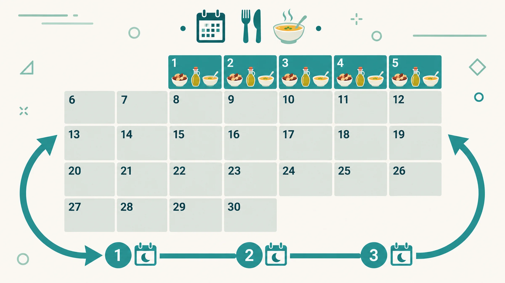
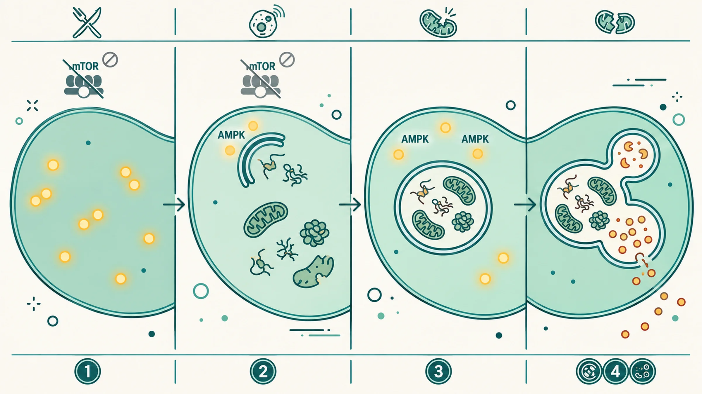
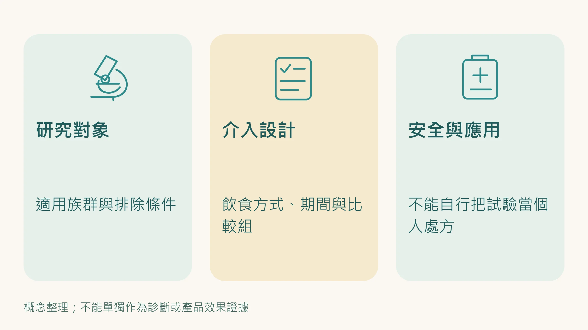

[上一篇](/blog/chronic-inflammation/caloric-restriction-longevity-science/)說到，熱量限制是目前科學上最有跨物種一致性的抗老化方法。

從 1930 年代的大鼠實驗，到追蹤 27 年的恆河猴研究，減少20%到30%的熱量攝取，能啟動 Sirtuins、抑制 mTOR、激活自噬，把細胞切換到「精準修復模式」。

然後我們說了那個現實問題：沒有人能長期少吃 20%。

間歇性斷食（168斷食）是很多人嘗試的折衷方案。

但研究顯示，能真正長期維持 168 的人，比例也不樂觀，尤其是有社交飲食習慣、工作壓力大、或是本來就睡眠不足的人。

科學家因此開始研究另一個問題：

**有沒有辦法讓身體得到熱量限制的好處，但執行難度低到一般人真的做得到？**

---

## 模擬斷食飲食（Fasting-Mimicking Diet）

西元 2024 年《自然通訊》（Nature Communications）發表了一項由南加州大學長壽研究所主導的臨床研究。

研究設計是這樣的：

每個月進行一個 5 天的飲食周期，第1天攝取約 1100 大卡，第2到第5天每天約 712 大卡。

這 5 天結束後，接下來 25 天完全恢復正常飲食，想吃什麼吃什麼。

整個實驗進行 3 個月，也就是 3 輪這樣的循環。

這5天的飲食內容是經過設計的：低蛋白質、低糖、高不飽和脂肪，蛋白質來源以堅果為主，脂肪來源以橄欖油為主，製作成湯品、燉菜和沙拉的形式，目的是在維持極低熱量的同時，盡可能減少飢餓感。

---

## 數字說了什麼？

100 位受試者隨機分配到實驗組和對照組，3個月後分析血液生化數據。

結果：

實驗組的空腹血糖和胰島素阻抗顯著改善，糖尿病風險指標明顯下降。

腹部脂肪和肝臟脂肪都減少。

**生理年齡平均下降 2.6 歲。**

最後這個數字需要停下來理解一下。

這裡的生理年齡，是用血液生化指標（例如血糖、發炎指標、腎功能等）計算出來的生物年齡，反映的是身體多個系統的整體狀態，不是體重或外表。

只做了 3 個月、每個月只有 5 天的飲食介入，讓身體的生化年齡倒退了 2.6 年。

研究團隊還做了電腦模擬：如果持續這樣的飲食模式 20 年，生物年齡可能減少約 11 歲，在 70 歲時延長約 5 年的預期壽命，未來 20 年的全因死亡率降低 10.5%。

---

## 為什麼這 5 天能產生效果？

關鍵在於：這 5 天的低熱量狀態，足以讓身體啟動「求生修復模式」，激活的機制和長期熱量限制是一樣的。

**AMPK 被激活**：細胞的能量感應器偵測到能量不足，啟動一連串修復和節能反應。

**mTOR 被抑制**：細胞停止盲目增殖，切換到維護模式。

**自噬被激活**：細胞開始清除受損的蛋白質、老化的粒線體，執行「細胞大掃除」。

這三個機制，正是前幾篇反覆提到的熱量限制抗老化效果的核心。

模擬斷食飲食做到的事情是：**用 5 天的刺激，啟動這套機制，然後讓身體在接下來的25天維持一部分效果。**

---

## 這個方法安全嗎？

模擬斷食飲食提供足夠的維生素、礦物質和必要營養素，不是清水斷食。

它的安全性被研究到什麼程度？

常見的輕微症狀（這 5 天可能出現的）：疲勞、輕微頭暈、飢餓感、煩躁。

這些在 5 天結束後通常會消退。

一個重要的前提：以下族群 **不適合自己嘗試**，必須先和熟悉你病史的醫師討論：

- 正在使用降血糖藥或胰島素的糖尿病患者（低血糖風險）
- 懷孕或哺乳中
- 體重過輕，或有飲食障礙病史
- 有其他慢性病、正在長期服藥的人

另外要知道：這套飲食的主要研究者 Valter Longo，同時是市售模擬斷食產品公司的創辦人，有商業上的利益關係。

---

## 這和 CRM 策略的關係

模擬斷食飲食是一個有效的介入方式，但它有一個執行門檻，需要 5 天的飲食控制，對某些人來說仍然有難度，而且每個月都要重複。

這引出了下一個問題：

**如果我們已經理解了這套修復機制（AMPK激活、mTOR抑制、自噬啟動），有沒有辦法在不改變飲食的情況下，持續維持這個狀態？**

這正是 CRM（熱量限制模擬物）策略在做的事，用特定成分組合，在不挨餓的情況下，每天持續發送「啟動修復模式」的訊號。

模擬斷食飲食和 CRM 不是競爭關係，而是可以搭配的兩層策略：前者是定期的強力重置，後者是日常的持續維護。

---

**延伸閱讀：**
- [少吃真的能讓你活更久——熱量限制的科學](/blog/chronic-inflammation/caloric-restriction-longevity-science/) 
- [不節食也能啟動長壽基因？CRM的概念和DNA微陣列技術](/blog/chronic-inflammation/caloric-restriction-mimetics-science/)

---

你的身體現在在哪個狀態？

修復機制是活躍的，還是已經長期關閉了？

這個問題，可以從你日常的身體訊號開始觀察。

---

## 參考資料

01. Brandhorst Sebastian, Levine Morgan E., Wei Min et al. (2024). Fasting-mimicking diet causes hepatic and blood markers changes indicating reduced biological age and disease risk. *Nature Communications*, 15(1):1309. DOI：[10.1038/s41467-024-45260-9](<https://doi.org/10.1038/s41467-024-45260-9>)。
02. Fontana Luigi, Partridge Linda (2015). Promoting Health and Longevity through Diet: From Model Organisms to Humans. *Cell*, 161(1):106-118. DOI：[10.1016/j.cell.2015.02.020](<https://doi.org/10.1016/j.cell.2015.02.020>)。
03. Waziry R., Ryan C. P., Corcoran D. L. et al. (2023). Effect of long-term caloric restriction on DNA methylation measures of biological aging in healthy adults from the CALERIE trial. *Nature Aging*. DOI：[10.1038/s43587-022-00357-y](<https://doi.org/10.1038/s43587-022-00357-y>)。
04. Vernieri Claudio, Fucà Giovanni, Ligorio Francesca et al. (2021). Fasting-Mimicking Diet Is Safe and Reshapes Metabolism and Antitumor Immunity in Patients with Cancer. *Cancer Discovery*, 12(1):90-107. DOI：[10.1158/2159-8290.CD-21-0030](<https://doi.org/10.1158/2159-8290.CD-21-0030>)。
05. Mattson Mark P., Longo Valter D., Harvie Michelle (2017). Impact of intermittent fasting on health and disease processes. *Ageing Research Reviews*, 39:46-58. DOI：[10.1016/j.arr.2016.10.005](<https://doi.org/10.1016/j.arr.2016.10.005>)。
