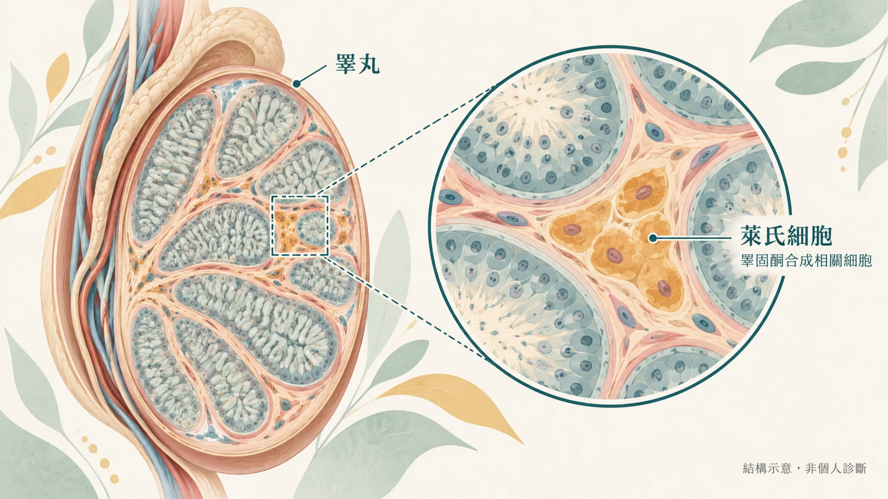
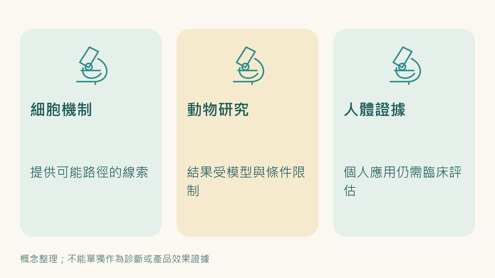
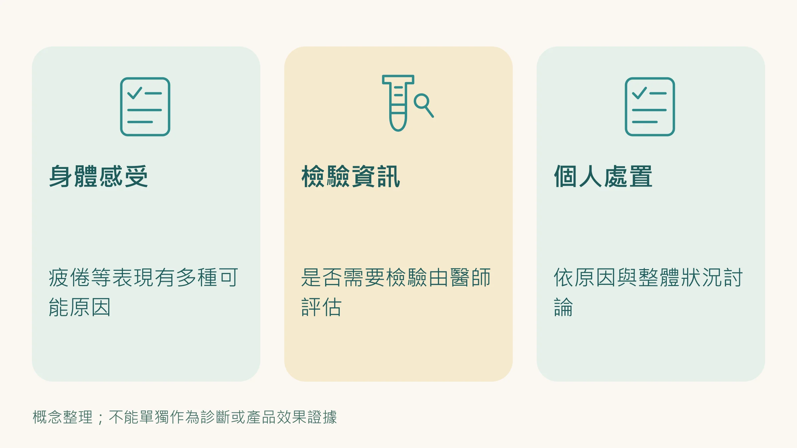

先做一個快速測試。

以下 10 個問題，誠實回答是或否：

| 題號 | 問題 |
|------|------|
| 01 | 性慾是否降低？ |
| 02 | 是否感到缺乏活力？ |
| 03 | 體力與耐力是否不足？ |
| 04 | 是否有變矮？ |
| 05 | 「享受生活」的感受是否不如從前？ |
| 06 | 是否感到沮喪或脾氣變壞？ |
| 07 | 勃起硬度是否明顯不如以往？ |
| 08 | 最近運動時體力是否變差很多？ |
| 09 | 吃完晚餐後是否馬上昏昏欲睡？ |
| 10 | 工作績效是否每下愈況？ |

這是 **聖路易大學老化男性睪固酮低下問卷（ADAM）**的標準版本。

**判讀：** 第1題或第7題答「是」，或其他八題中任三題答「是」，建議進一步抽血確認睪固酮數值。

根據台灣男性醫學會的統計，40到80歲的台灣男性中，**三分之一有睪固酮低下的症狀**。

如果你剛才數了一下，發現自己勾了不只幾格，你不是特例。

---

## 「年紀到了，正常的。」，這個解釋只說對了一半

標準答案是：睪固酮從 40 歲開始每年下降約 1%，所以體力下滑、性慾減退、肌肉流失。

這是事實。但它省略了一個更關鍵的問題：

**睪固酮為什麼在下降？是誰在阻止它繼續合成？**

答案在你的睪丸裡，在一種叫做 **萊氏細胞（Leydig Cells）**的細胞裡。

萊氏細胞是睪丸裡負責合成睪固酮的工廠。整個流程是這樣的：大腦發出LH（黃體素）信號 → 萊氏細胞接收信號 → 膽固醇由StAR蛋白運進粒線體 → 酵素切割合成睪固酮 → 釋放進血液。

當這個工廠老化、停工、或被外部破壞，睪固酮就下降。

2024-2025 年的多篇研究，用單細胞 RNA 定序（single-cell RNA sequencing）分析了人類睪丸的老化過程，答案很清楚：

**萊氏細胞在中年之後，出現了顯著的細胞衰老特徵，p16、p21表達上升，SA-β-Gal陽性，SASP物質開始分泌。**

你的睪固酮工廠，不是老了，是 **提前被衰老了**。

---

## 是什麼在加速萊氏細胞衰老

這裡有一條你可能沒有聽過的機制路徑，但它出現在 2024 年的幾篇最新研究裡：

**全身慢性發炎（Inflammaging）→ 睪丸局部免疫環境惡化 → 萊氏細胞被攻擊 → 睪固酮下降**

具體來說，發生了以下幾件事：

**第一：睪丸巨噬細胞從抗炎轉向促炎**

正常情況下，睪丸裡的巨噬細胞是 M2 型，它們維持免疫特權環境，分泌抗炎物質，並提供25-羥膽固醇直接支援萊氏細胞合成睪固酮。

隨著年齡和全身慢性發炎的積累，這些巨噬細胞開始向M1型極化，轉而分泌**IL-6、TNF-α、IL-1β**，這些促炎細胞激素直接抑制萊氏細胞的合成功能。

**第二：NF-κB / p38 MAPK 發炎路徑被持續激活**

2024年，《Frontiers in Endocrinology》發表了一篇專門回顧 Inflammaging 與晚發性性腺功能低下（LOH）關係的研究，確認：NF-κB 和 p38 MAPK 這兩條老化與發炎的核心路徑，在萊氏細胞老化中扮演決定性角色，它們持續激活 → 觸發SASP → 進一步破壞睪丸的微環境，形成 **自我強化的惡性循環**。

**第三：粒線體功能失調中斷了睪固酮合成**

睪固酮合成的第一步發生在粒線體內膜，需要StAR蛋白把膽固醇「搬進」粒線體才能開始。

衰老的萊氏細胞，粒線體功能下降，StAR蛋白表達量減少，整條合成路徑的第一步就被卡住了。

這不是大腦出問題，不是你懶，也不是「心理因素」。是細胞層級的機器在停工。

---

## 胖是最快的催化劑

2025 年， PMC 收錄的一篇系統性回顧特別強調了一點：

**代謝症候群（肥胖、高血脂、胰島素阻抗）會大幅加速萊氏細胞的衰老過程。**

腹部脂肪組織是慢性發炎的主要來源之一，它持續釋放促炎細胞激素。

同時，脂肪組織含有大量的 **芳香化酶（Aromatase）**，會把睪固酮轉化成雌激素，所以腰圍越大，有效睪固酮越少，這不是比喻，是真實的生化轉換。

如果你的肚子已經開始讓你低頭看不清楚腳尖，這件事的優先級需要認真考慮。

---

## 不是根本解法

市面上常見的介入方式，有必要說清楚各自的作用層次：

**威而鋼（Sildenafil）/ PDE5抑制劑：** 機制是抑制陰莖海綿體的磷酸二酯酶，增加一氧化氮（NO）讓血管擴張，它處理的是血流問題，不處理睪固酮問題，也完全不影響萊氏細胞衰老。急性症狀有效，不改變任何根本機制。

**L-精胺酸（一氧化氮前驅物）：** 同樣是血管擴張路徑，有輔助效果，但同樣是表層解方。

**鋅：** 缺鋅確實影響睪固酮合成，但缺鋅只是眾多原因之一，且台灣飲食普遍缺鋅的人並不多。補充有意義，但不是核心。

**瑪卡、淫羊藿：** 有動物實驗數據，部分人體研究，機制尚未完全釐清，屬於輔助性建議。

這些都不是壞東西。但它們的作用點在症狀層，不在萊氏細胞衰老這個根本機制上。

**真正的醫療選項在這裡：** 如果抽血確認睪固酮偏低、又有明顯症狀，這叫晚發性性腺功能低下（LOH），是可以正式治療的。泌尿科或新陳代謝科醫師會評估是否適合睪固酮補充療法，也會一併檢查是否有其他原因（例如肥胖、睡眠呼吸中止、用藥）。睪固酮補充療法有適應症和風險，一定要在醫師監測下使用，不要自己買來用。

---

## 睪丸需要的，是抑制發炎、支援粒線體、減少細胞衰老

現在機制清楚了，邏輯就清楚了：

如果問題的核心是——
- 全身慢性發炎（Inflammaging）驅動睪丸局部免疫惡化
- NF-κB / p38 發炎路徑過度激活
- 粒線體功能失調中斷睪固酮合成
- 萊氏細胞出現衰老特徵（SASP、p16↑）

那麼有效的介入，應該在這些機制點上有作用。

生活型態裡，能同時碰到這幾個機制點的，是 **控制腰圍、規律運動（尤其是肌力訓練）、睡好睡滿、減少長期壓力**。這些做法同時能降低慢性發炎、改善胰島素阻抗，研究也觀察到減重與運動能讓睪固酮回升。

如果你想在生活型態之外加上營養補充，依原廠說明，ageLOC R2 分成日錠和夜錠：日錠著重支持白天細胞的能量代謝，夜錠著重支持夜間身體本身的淨化與修復機制。它是營養補充品，不是藥物，不能治療或改善任何疾病。 有些人會把它當成生活型態調整之外的輔助，但它不能取代就醫評估與治療。

---

## 你現在可以做的第一步

**第一步是抽血。** 有疲倦、性慾下降、晨間勃起減少這些症狀，請到泌尿科或新陳代謝科抽血，早上 7～11 點測總睪固酮，確認是不是真的偏低。

抽血之外，如果你想在細胞層面先主動做些什麼——

從現在開始管理全身的慢性發炎狀態，是唯一能同時影響所有相關機制的策略。

---

還沒讀過中年男性慢性發炎全貌的，建議先讀這篇：

**→ [40歲之後的疲勞，和20歲不一樣——中年男性Inflammaging全解析](/blog/body-signals/male-fatigue-after-40/)**

---

**延伸閱讀：**
- [瑪卡加精胺酸，為什麼吃了還是沒感覺？——市售男性活力配方的根本盲點](/blog/intervention-optimization/maca-arginine-vs-ageloc-r2/)

---

## 參考資料

01. Xing Dong, Jin Yihan, Jin Baofang (2024). A narrative review on inflammaging and late-onset hypogonadism. *Frontiers in Endocrinology*, 15:1291389. DOI：[10.3389/fendo.2024.1291389](<https://doi.org/10.3389/fendo.2024.1291389>)。
02. Huang Xinshuang, Zhao Hui, Wu Xiaodong et al. (2025). Mechanisms of Leydig Cell Aging and Obesity-Related Hypogonadism in Men: A Review. *Medical Science Monitor*, 31. DOI：[10.12659/MSM.948180](<https://doi.org/10.12659/MSM.948180>)。
03. Zhan Ming-Wei, Zhou Mu-Hua, Zhao Bin-Bin et al. (2025). Testicular immunosenescence: a key player in age-related spermatogenic decline. *Frontiers in Cell and Developmental Biology*, 13:1669826. DOI：[10.3389/fcell.2025.1669826](<https://doi.org/10.3389/fcell.2025.1669826>)。
04. Kaltsas Aris, Dimitriadis Fotios, Zachariou Athanasios et al. (2026). When Testosterone Fades: Leydig Cell Aging Shaped by Environmental Toxicants, Metabolic Dysfunction, and Testicular Niche Crosstalk. *Cells*, 15(2):158. DOI：[10.3390/cells15020158](<https://doi.org/10.3390/cells15020158>)。
05. Luo Dandan, Qi Xiangyu, Xu Xiaoqin et al. (2023). Involvement of p38 MAPK in Leydig cell aging and age-related decline in testosterone. *Frontiers in Endocrinology*, 14:1088249. DOI：[10.3389/fendo.2023.1088249](<https://doi.org/10.3389/fendo.2023.1088249>)。
