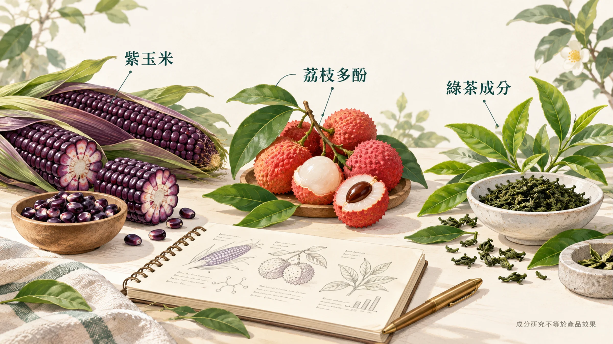
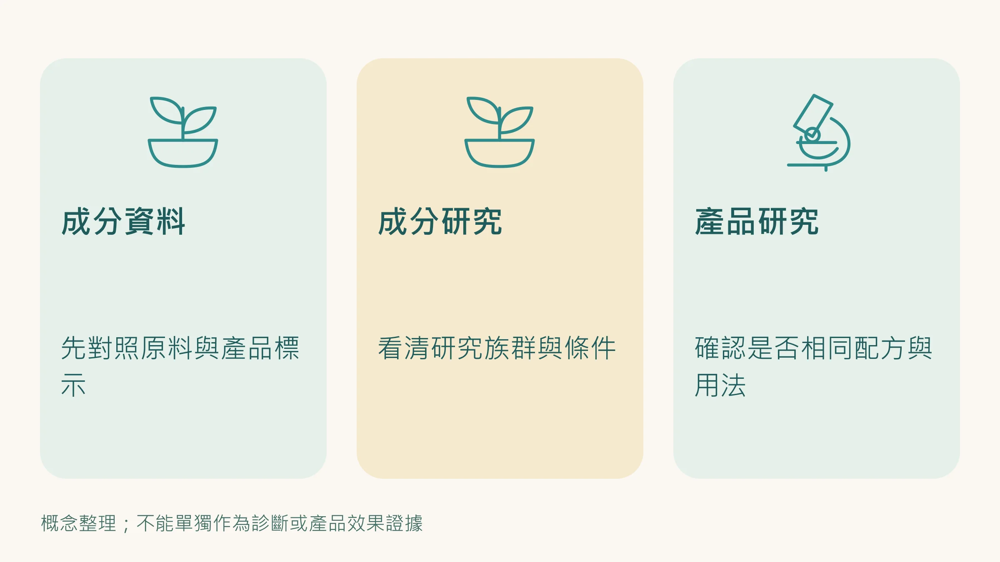
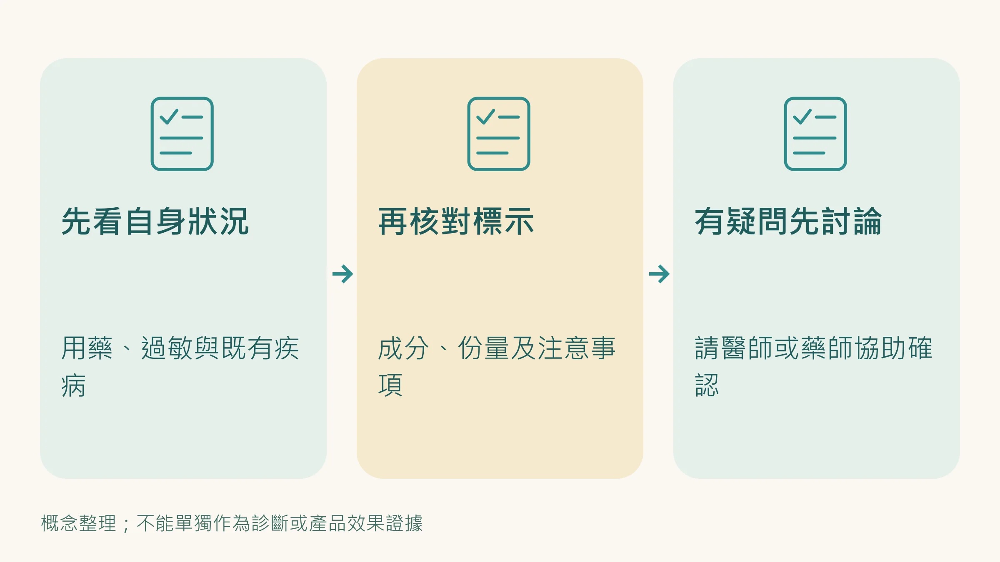

[前三篇](/blog/body-signals/visceral-fat-metabolic-signal/)我們已經講完三件事：

- 內臟脂肪不是「胖一點而已」，而是一個會主動干擾代謝的內分泌器官  
- 胰島素阻抗、皮質醇、睪固酮三個迴路，會彼此放大，讓你越來越難只靠少吃多動解決  
- 花青素、Oligonol®、兒茶素，分別從**腸道／產熱／脂肪動員**三條路徑切進去，各有研究支持  

但真正困難的，從來不是「知道哪一種有效」。

而是：**現實中很少有人能自己把這三條路徑補齊，還同時避開劑量不足、搭配錯誤、買了卻沒感覺的問題。**

所以這篇不再重講原理，是直接回答三個問題。先說清楚：在台灣，食品不能宣稱減少腰圍或體脂肪。下面談的是配方設計對應的研究方向，以及怎麼觀察自己的數字，不是產品功效保證。

1. **為什麼是 ageLOC Meta 每代紫這樣的配方？**  
2. **什麼樣的人最適合用？**  
3. **怎麼用、看哪些指標，才知道自己是不是走在對的方向？**

---

## 為什麼不是再找第四種成分，是先把三條路徑補齊？

如果你回頭看前三篇，其實你會發現：內臟脂肪不是單一路徑造成的。

有人卡在腸道菌相與低度發炎，吃得不多，肚子卻一直鼓；  
有人卡在皮質醇與睡眠，明明有運動，腰圍還是下不來；  
也有人是脂肪動員訊號不夠，身體根本沒有把脂肪「叫出來用」。

這也是為什麼很多人補充單一成分時，常常會出現兩種結果：

- **不是完全沒效，是只有一小段有效**
- **感覺有變化，但不夠穩、不夠完整**

問題不一定出在成分本身，是你只碰到其中一個缺口，卻沒有處理另外兩個。

**依原廠說明，ageLOC Meta 的設計邏輯，是讓配方成分分別對應前幾篇談到的三條代謝路徑，而不是把熱門成分湊在一起。**

---

## 產品核心配方：它到底在補哪三個缺口？

ageLOC Meta 每代紫的核心不是「多酚很多」，是**多酚分工清楚**。

### 一、紫玉米花青素：先處理腸道與發炎基層噪音

Meta 使用的是 **紫玉米萃取物（Purple Corn Extract）**，作為花青素來源。

這一類花青素的代表成分之一，是 **矢車菊素-3-葡萄糖苷（C3G）**。  

白話翻譯就是：**它比較像腸道環境的整理員，先把會一直放大內臟脂肪問題的背景噪音壓低。**

它處理的不是「吃下去立刻燃脂」這種表面效果，是比較前端的問題，例如：

- 腸道菌相失衡
- 腸道屏障變差
- LPS 相關的低度發炎
- 讓脂肪組織越來越不聽話的代謝背景

也就是說，**花青素負責的是地基**。 
 
地基沒有穩，後面的產熱、脂肪動員，常常都會被打折。

---

### 二、Oligonol®：把低代謝、低循環、低產熱的狀態往上拉

Meta 的第二個核心，是 **荔枝綠茶多酚複合物 Oligonol®**。

Oligonol® 的特色，不只是「它也是多酚」，是它的分子設計讓吸收與利用效率更有優勢。
  
白話翻譯就是：**它像是把原本悶住的微循環和產熱開關重新打開。**

很多人之所以腰圍降不下來，不一定是吃太多，反而是身體長期處在：

- 循環偏弱  
- 產熱偏低  
- 活動量一樣，但身體不願意多消耗一點能量  

這時候，Oligonol® 的角色就不是「硬逼你瘦」，是把身體從那種**節能到過頭的狀態**稍微拉回來。

---

### 三、兒茶素：延長脂肪動員訊號，不讓身體太快把燃脂煞車踩回去

Oligonol® 的組成裡，同時也包含**兒茶素類（catechins）**。

這一段很重要，因為很多人以為兒茶素只是綠茶的一般保健成分，但真正關鍵的是： 
 
**它能幫助延長脂肪動員相關的訊號時間。**

白話翻譯就是：  

你有運動、你有活動、你有刺激到交感系統，身體原本準備要把脂肪調出來用； 
 
但有些人這個訊號很快就沒了。 
 
兒茶素做的事情，比較像是 **不要讓那個好不容易打開的燃脂訊號太快關掉。**

所以它最適合的人，不是完全不動的人，是：

- 已經有在運動  
- 或至少願意增加步行、爬樓梯、簡單有氧  
- 但腹部脂肪還是卡很久的人  

---

## 簡單一句話：Meta 不是一把刀，是一組工具

如果要把這個配方講得更白一點：

- **花青素**：處理腸道與發炎背景  
- **Oligonol®**：處理低循環、低產熱  
- **兒茶素**：延長脂肪動員訊號  

這三個不是互相重複，是互相接力。

所以它的設計方向不是「單點爆衝」，是 **三個成分各自對應一條代謝路徑的研究**。

---

## 誰最適合 ageLOC Meta？

不是每個人都一樣適合。
  
但如果你符合下面其中幾種狀況，Meta 的切入點通常會比較準。

### ① 腰圍先出問題，但體重不一定很誇張的人

最典型的就是那種：

- BMI 看起來還好
- 體重沒有胖到很誇張
- 但褲頭變緊、肚子變厚、腰圍一直往上

這種人最容易被體重騙。  

你以為自己只是「最近鬆了一點」，實際上常常是 **內臟脂肪先開始堆**。

---

### ② 已經有運動，但腹部脂肪就是特別難掉的人

這一群人最挫折。

因為他不是完全沒做事，反而做了不少：

- 有走路  
- 有上健身房  
- 有控制澱粉  
- 體重可能也有動一點  

但最頑固的還是肚子。

這類人通常不是缺「再努力一點」，而是要先找出自己卡在**脂肪動員、產熱效率、代謝背景**的哪一段。

---

### ③ 40 歲後開始感覺代謝明顯變慢的人

這種變化通常不只是一年比一年容易胖而已，還會一起出現：

- 精神恢復慢  
- 睡不好時更容易囤肚子  
- 以前有用的方法，現在效果越來越差  

這通常代表你不是單純熱量超標，是整個代謝訊號環境正在往不利方向偏。

---

### ④ 想先看腰圍、血脂、血糖趨勢，而不是只盯體重的人

Meta 比較適合願意用**數字和趨勢**看自己的人。

因為它最值得觀察的，往往不是短期體重，是：

- 腰圍
- 腰圍／身高比
- TG/HDL 比值
- 空腹血糖
- 飯後精神狀態
- 運動後恢復感

你如果願意這樣看，就比較容易知道它到底有沒有切中你的問題。

---

## 哪些情況要先評估，不要直接自己亂上？

以下幾種情況，建議先評估再決定：

- 孕婦、哺乳期
- 正在服用抗凝血藥物者
- 對荔枝、玉米等原料有明確過敏史者
- 腸胃極度敏感、近期有明顯胃腸道不適者
- 正在接受其他慢性病藥物治療，且不確定是否適合搭配者

這不是說一定不能用，是 **不要把保健介入當成盲抽**。

---

## 怎麼用，才比較不容易吃成「有補跟沒補差不多」？

### 1. 不要把它當成熬夜、壓力大、完全不動的免死金牌

Meta 可以幫你補路徑，但不能幫你取消生理規則。

如果你同時有下面三件事：

- 睡眠很亂
- 壓力很高
- 幾乎沒有活動量

那你感受到的效果，通常一定會被打折。

因為第二篇講過了：  

**皮質醇這一環如果一直開著，本來就會抵消很多代謝努力。**

---

### 2. 最好搭配穩定、可持續的活動量

不需要一開始就高強度。  

但至少要有規律的刺激，像是：

- 快走
- 飛輪
- 慢跑
- 爬坡
- 重訓後加 10–20 分鐘有氧

原因很簡單：  

**兒茶素這條路徑，在有活動刺激時，通常比較容易發揮。**

---

### 3. 先看腰圍與血脂，不要每天盯體重

很多人最大的誤判，就是吃兩週後先去看體重，然後說沒感覺。

但內臟脂肪相關變化，更值得看的其實是：

- 腰圍
- 腰圍／身高比
- TG/HDL 比值
- 空腹血糖
- 飯後脹、飯後睏、飯後想吃甜的情況

**體重只是表面，腰圍和代謝數字才比較接近核心。**

---

### 4. 觀察週期不要抓太短

這類型介入，比較合理的觀察方式是：

- **2 週**：先看精神、飯後感覺、脹氣、排便、活動耐受度  
- **4 週**：看腰圍、腰圍／身高比、整體浮腫感  
- **8–12 週**：再看血脂、空腹血糖等趨勢  

你要的是方向對，不是今天吃、明天量、後天放棄。

---

## 可不可以自己去平台買？可以，但你少掉的不是「貨」，是判讀

這一段我會直接說。

你在平台上買到的，也許是同樣的產品。  

但真正的問題從來不是「有沒有買到」，是：

**你知不知道自己現在最主要卡在哪一個迴路？**

因為同樣是腰圍大，背後可能完全不同：

- 有人主要是胰島素阻抗  
- 有人主要是皮質醇太高、睡眠差  
- 有人是活動有做，但脂肪動員效率差  
- 也有人是腸道狀況很差，先天就把整個代謝背景拖住了  

產品本身只能解決一半。 
 
另外一半是：**判斷你現在的主要缺口在哪裡，需不需要先處理睡眠、壓力、腸道或運動型態。**

這也是為什麼，同樣的產品，有些人用起來覺得很有感，有些人卻覺得普通。

不是產品差，是 **路徑沒有對準。**

---

## 下一步：先不要急著買，先確認你是不是對的人

你不一定缺產品。你更可能缺的是：**先看懂自己現在卡在三條路徑中的哪一條。**

把上面提到的數字整理出來：腰圍、身高、TG、HDL、空腹血糖，以及最近半年腰圍和體重的變化。有了這些，才能判斷你是適合直接開始，還是該先處理睡眠、壓力或活動方式。

如果腰圍、血脂、血糖已經在異常範圍，請先和醫師討論，該用藥的就用藥，營養補充只能是輔助。

---

## 這整個系列，其實只在回答一件事

| 篇次 | 核心問題 | 核心答案 |
|------|----------|----------|
| 第一篇 | 為什麼腰圍比體重更值得警覺？ | 因為內臟脂肪是主動干擾代謝的器官 |
| 第二篇 | 為什麼你越來越難只靠少吃多動瘦下來？ | 因為胰島素、皮質醇、睪固酮三個迴路會互相鎖死 |
| 第三篇 | 有沒有比節食更聰明的切入點？ | 有，三種多酚從三條不重疊的路徑切入 |
| 第四篇（本篇） | 那實際上該怎麼整合？ | 用對配方、看對指標、判斷自己是不是對的人 |

---

## 最後一句話

真正麻煩的，從來不是你不知道「要減腰圍」。

而是你以為自己缺的是意志力，  
其實你缺的可能是：**把腸道、產熱、脂肪動員三條路徑一次看清楚。**

ageLOC Meta 的定位，不是在於它叫 Meta。  
而是把這三條路徑的研究方向，整理成一個比較容易執行的入口。

前提不是盲買。  
前提是：**先確認，你是不是現在最適合走這條路的人。**

---

## 參考資料

01. Cremonini Eleonora, Daveri Elena, Mastaloudis Angela et al. (2019). Anthocyanins protect the gastrointestinal tract from high fat diet-induced alterations in redox signaling, barrier integrity and dysbiosis. *Redox Biology*, 26:101269. DOI：[10.1016/j.redox.2019.101269](<https://doi.org/10.1016/j.redox.2019.101269>)。
02. Hester Shelly N., Mastaloudis Angela, Gray Russell et al. (2018). Efficacy of an Anthocyanin and Prebiotic Blend on Intestinal Environment in Obese Male and Female Subjects. *Journal of Nutrition and Metabolism*, 2018:1-11. DOI：[10.1155/2018/7497260](<https://doi.org/10.1155/2018/7497260>)。
03. Jennings Amy, Koch Manja, Jensen Majken K et al. (2020). The role of the gut microbiome in the association between habitual anthocyanin intake and visceral abdominal fat in population-level analysis. *The American Journal of Clinical Nutrition*, 111(2):340-350. DOI：[10.1093/ajcn/nqz299](<https://doi.org/10.1093/ajcn/nqz299>)。
04. Oteiza Patricia I., Cremonini Eleonora, Fraga Cesar G. (2023). Anthocyanin actions at the gastrointestinal tract: Relevance to their health benefits. *Molecular Aspects of Medicine*, 89:101156. DOI：[10.1016/j.mam.2022.101156](<https://doi.org/10.1016/j.mam.2022.101156>)。
05. Park Seongmin, Choi Munji, Lee Myoungsook (2021). Effects of Anthocyanin Supplementation on Reduction of Obesity Criteria: A Systematic Review and Meta-Analysis of Randomized Controlled Trials. *Nutrients*, 13(6):2121. DOI：[10.3390/nu13062121](<https://doi.org/10.3390/nu13062121>)。
06. Aruoma Okezie I., Sun Buxiang, Fujii Hajime et al. (2006). Low molecular proanthocyanidin dietary biofactor Oligonol: Its modulation of oxidative stress, bioefficacy, neuroprotection, food application and chemoprevention potentials. *BioFactors*, 27(1-4):245-265. DOI：[10.1002/biof.5520270121](<https://doi.org/10.1002/biof.5520270121>)。
07. [Effect of Lychee Fruit Extract (Oligonol) on Peripheral Circulation, a Pilot Study](<https://aminoup.info/en/oligonol/research02>). 原料商Amino Up研究摘要頁；不是論文全文，已核對Kitadate等人2014年Natural Medicine Journal 6(7)書目。未查得 DOI；來源身分已核對（2026-10-19）。
08. Nishihira Jun, Sato-Ueshima Maremi, Kitadate Kentaro et al. (2009). Amelioration of abdominal obesity by low-molecular-weight polyphenol (Oligonol) from lychee. *Journal of Functional Foods*, 1(4):341-348. DOI：[10.1016/j.jff.2009.09.002](<https://doi.org/10.1016/j.jff.2009.09.002>)。
09. Bahijri Suhad M., Ajabnoor Ghada, Hegazy Gehan A. et al. (2018). Supplementation with Oligonol, Prevents Weight Gain and Improves Lipid Profile in Overweight and Obese Saudi Females. *Current Nutrition &amp; Food Science*, 14(2):164-170. DOI：[10.2174/1573401313666170609101408](<https://doi.org/10.2174/1573401313666170609101408>)。
10. Nagao Tomonori, Hase Tadashi, Tokimitsu Ichiro (2007). A Green Tea Extract High in Catechins Reduces Body Fat and Cardiovascular Risks in Humans. *Obesity*, 15(6):1473-1483. DOI：[10.1038/oby.2007.176](<https://doi.org/10.1038/oby.2007.176>)。
11. Liu Hung‐Wen, Wei Chu‐Chun, Chen Yen‐Ju et al. (2016). Flavanol‐rich lychee fruit extract alleviates diet‐induced insulin resistance via suppressing mTOR/SREBP‐1 mediated lipogenesis in liver and restoring insulin signaling in skeletal muscle. *Molecular Nutrition &amp; Food Research*, 60(10):2288-2296. DOI：[10.1002/mnfr.201501064](<https://doi.org/10.1002/mnfr.201501064>)。

> *免責聲明：本文所提供之資訊與文獻探討，皆為日常健康促進與保養參考，不具備醫療診斷、治療、減輕或預防任何疾病之功效。若有明確醫療需求，請務必尋求專業醫師協助。*