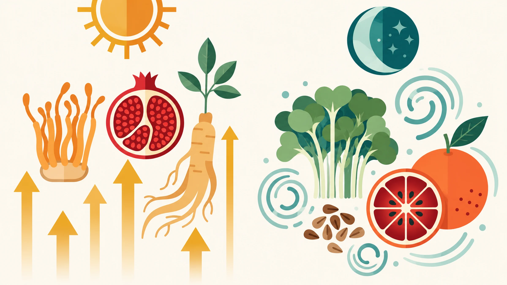

同樣 40 歲出頭，但他看起來就是不像那個年紀。精神好、身形穩、眼神還有光，不是特別在健身，也沒有特別自律，就是狀態一直在那裡。

然後你看看鏡子。

體力下降，你說是工作太忙。

睡了八小時，早上還是不想起來，你說是睡眠品質差。

記憶力開始出現空白，你說是壓力太大。性慾下降，你說是太累了。

這些解釋都對。但它們描述的是結果，不是原因。

**原因是：你的細胞耗損速度，已經超過了修復速度。**

而那個狀態還在的男人，他的細胞在夜晚完成了你的細胞沒有完成的事。

> **更怕那個男人，完成了你沒有完成的事。**

---

## 男性 30–50 歲的老化，有一個共同的底層

前幾篇我們說到，慢性發炎（Inflammaging）是老化加速的核心機制，細胞的修復開關關掉、損耗在累積、能量輸出在下降。

男性在 30 歲之後，這個過程有幾個特別明顯的表現方式：

- 粒線體效率下降，細胞能量輸出減少，體力和耐力跟著走下坡。

- 睾酮和生長激素水準逐年降低，影響肌肉維持、性功能、情緒和認知敏銳度。

- 抗氧化防禦能力下降，自由基累積加速，細胞受損的速度超過修復速度。

- 細胞清除代謝廢物、汰換受損粒線體的效率也在下降。

ageLOC R2 日錠和夜錠的設計，就是從「白天的能量」和「夜間的清除」這兩個方向出發。

---

## 為什麼要分日錠和夜錠？

這不是行銷包裝，而是生理邏輯。

你的細胞在白天和夜晚做的事情不一樣。

**白天：** 身體處於活躍狀態，需要的是能量支撐、抗氧化防禦、和認知功能維持。

**夜晚：** 身體進入修復模式，這是細胞清除廢物、執行解毒、以及粒線體品質控制的主要時間窗口。

如果你用同一套成分試圖同時做這兩件事，效果會互相干擾。

R2 的設計是：**日錠支援白天的耗損，夜錠支援夜晚的清除。**

---

## 日錠：天天帶勁

日錠的三個核心成分，蟲草菌絲體、石榴萃取物、人參萃取物，針對的是男性白天功能下降的三個主要面向。

**蟲草菌絲體（Cordyceps）**

蟲草在中醫裡是傳統的補益藥材，現代研究探討過它的多個分子機制，例如抗氧化與粒線體能量代謝。

動物實驗顯示，補充蟲草配方的老年小鼠在負重游泳測試中，耐力時間延長了22%，同時肌肉中的自由基累積顯著減少，肝醣消耗更有效率。

這不只是「體力更好」的感受，是細胞層級的能量利用效率在提升。

**石榴萃取物（含尿石素前驅物）**

石榴裡含有的多酚成分，在腸道細菌的作用下會轉化為尿石素（Urolithin A），目前抗老化研究中最受關注的粒線體自噬啟動劑之一。

粒線體自噬是細胞清除老化、受損粒線體的機制，讓細胞的「發電廠」維持品質。石榴萃取物同時具有降低慢性發炎、保護血管彈性的明確研究支持。

**人參萃取物（Ginsenoside）**

人參皂苷是亞洲傳統醫學裡研究最充分的成分之一。在現代分子研究中，常被討論的是它對超氧化物歧化酶（SOD）抗氧化活性與認知功能的影響。

原廠公布的人體試驗（116 名受試者，40–70 歲，雙盲隨機對照）觀察到，使用日錠的組別在生理功能、心理功能問卷評分，以及反應時間、短期記憶等認知測驗上有改善。這是原廠自行執行的研究，詳細數據以原廠公布資料為準。

---

## 夜錠：夜夜清淨

夜錠的設計核心是 **Nrf2 通路**：這是人體最重要的抗氧化和解毒調控系統之一。

Nrf2 平時待在細胞質裡，當細胞偵測到氧化壓力或特定植化素訊號時，Nrf2 進入細胞核，啟動一系列抗氧化酶和解毒酶的基因表達，包括肝臟第二階段解毒（Phase II Detoxification）所需的關鍵酵素。

夜錠的三個成分，分別從不同角度激活這個系統：

**青花椰菜籽萃取物（蘿蔔硫素前驅物）**

青花椰菜籽富含蘿蔔硫苷（Glucoraphanin），進入人體後轉化為蘿蔔硫素（Sulforaphane），研究最多的天然 Nrf2 激活劑之一。

蘿蔔硫素激活 Nrf2 後，啟動肝臟第二階段解毒酶的合成，同時具有抗氧化、抗發炎、神經保護的多重效果。你需要吃非常大量的新鮮青花椰菜，才能達到萃取物提供的濃度。

**葡萄籽萃取物（Grape Seed Extract，GSE）**

低聚原花青素（Oligomeric Proanthocyanidins，OPC）是葡萄籽中最活躍的多酚成分，有大量研究支持其對心血管保護、膽固醇調節和血管彈性維持的效果。同時在 Nrf2 通路的激活上也有協同作用。

**血橙萃取物**

含有花青素、維生素 C、維生素 E，以及β-胡蘿蔔素。花青素屬於類黃酮（和β-胡蘿蔔素所屬的類胡蘿蔔素是不同家族），兩者都參與細胞的抗氧化防禦網路。

動物實驗（中年小鼠，補充3個月，與年輕組和未補充中年組三組對比）顯示：R2 配方能刺激肝臟抗氧化酶和解毒酶的基因表現，蛋白酶合成增加， Nrf2 通路在夜間被系統性激活。

**台灣配方補充：** 台灣版夜錠另外添加了橄欖葉萃取物、橄欖果萃取物，以及輔酶Q10，進一步強化粒線體保護和夜間修復的覆蓋範圍。

---

## 科學篩選邏輯：不是憑感覺選成分

R2 的配方篩選，和 Youthspan 一樣，使用的是基因微陣列技術（DNA Microarray），觀察成分組合是否能讓老化的基因表達模式往年輕方向移動。

這個篩選標準的意義是：不是「這個成分聽說有效」，而是先在基因表達層面（動物實驗）觀察成分組合的方向，再做人體試驗。

Weindruch 和 Prolla 團隊從 1999 年開始建立的基因表達資料庫，就是 ageLOC 技術的核心資產，也是 R2 配方設計的科學基礎。

---

## 適合誰？

- 體力和耐力明顯不如三年前的男性
- 睡眠時間夠但早上醒來仍覺得疲憊的人
- 記憶力和反應速度開始感覺鈍化的人
- 想要有系統地補充、而不是靠單一成分零散補充的人

R2 不是急性的效果，它針對的是細胞層級的耗損模式，改變需要時間累積。

人體實驗的觀察期是 8 - 12 週，這是對效果評估的合理時間框架。
 
---

## 使用前要知道的事

R2 是營養補充品，不是藥物，不能治療或改善任何疾病。疲勞、記憶力變差、性慾下降持續一段時間，請先就醫，排除甲狀腺、貧血、睡眠呼吸中止、睪固酮低下等原因。正在服用抗凝血藥、降血糖藥或其他慢性病用藥，或懷孕哺乳中，使用前請先問醫師或藥師。

---

**延伸閱讀：**
- [20歲睡一覺就好，40歲睡八小時還是空——不是你變懶，是你的發電廠壞了](/blog/chronic-inflammation/mitochondria-energy-after-40/) 
- [不節食也能啟動長壽基因？CRM的概念和DNA微陣列技術](/blog/chronic-inflammation/caloric-restriction-mimetics-science/) 

---

## 參考資料

01. Tan Ning‐Zhi, Barger Jamie L, Zhang Yan et al. (2011). Cordyceps sinensis Cs‐4 restores aging‐associated changes in gene expression and extends lifespan in normal aged mice. *The FASEB Journal*, 25(S1). DOI：[10.1096/fasebj.25.1_supplement.1090.13](<https://doi.org/10.1096/fasebj.25.1_supplement.1090.13>)。
02. Dong Yun‐Zi, Lu Ji‐Hong, Yang Jie‐Ying et al. (2011). An ageLOC Vitality formula improves endurance exercise in aged mice and energy metabolism in muscle mitochondria. *The FASEB Journal*, 25(S1). DOI：[10.1096/fasebj.25.1_supplement.1114.9](<https://doi.org/10.1096/fasebj.25.1_supplement.1114.9>)。
03. Wu Zimei, Dong Yunzi, Zhao Chunsheng et al. (2012). ageLOC Vitality enhances sexual functions in normal and impotent models. *The FASEB Journal*, 26(S1). DOI：[10.1096/fasebj.26.1_supplement.1095.1](<https://doi.org/10.1096/fasebj.26.1_supplement.1095.1>)。
04. Tan Ning‐Zhi, Yang Jie‐Ying, Yang Guang et al. (2013). ageLOC Vitality improves memory and learning ability in memory impairment models. *The FASEB Journal*, 27(S1). DOI：[10.1096/fasebj.27.1_supplement.661.4](<https://doi.org/10.1096/fasebj.27.1_supplement.661.4>)。
05. Mastaloudis Angela, Wood Steven M. (2012). Age‐related changes in cellular protection, purification, and inflammation‐related gene expression: role of dietary phytonutrients. *Annals of the New York Academy of Sciences*, 1259(1):112-120. DOI：[10.1111/j.1749-6632.2012.06610.x](<https://doi.org/10.1111/j.1749-6632.2012.06610.x>)。
06. Lee Cheol-Koo, Pugh Thomas D, Klopp Roger G et al. (2004). The impact of α-lipoic acid, coenzyme Q10 and caloric restriction on life span and gene expression patterns in mice. *Free Radical Biology and Medicine*, 36(8):1043-1057. DOI：[10.1016/j.freeradbiomed.2004.01.015](<https://doi.org/10.1016/j.freeradbiomed.2004.01.015>)。
