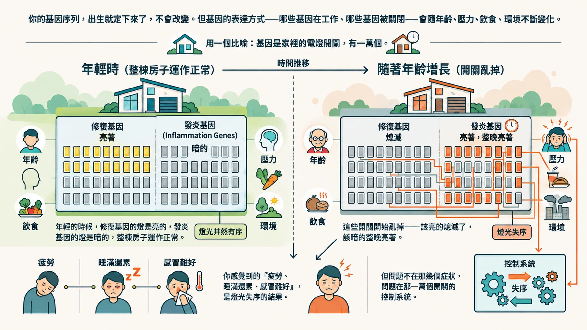
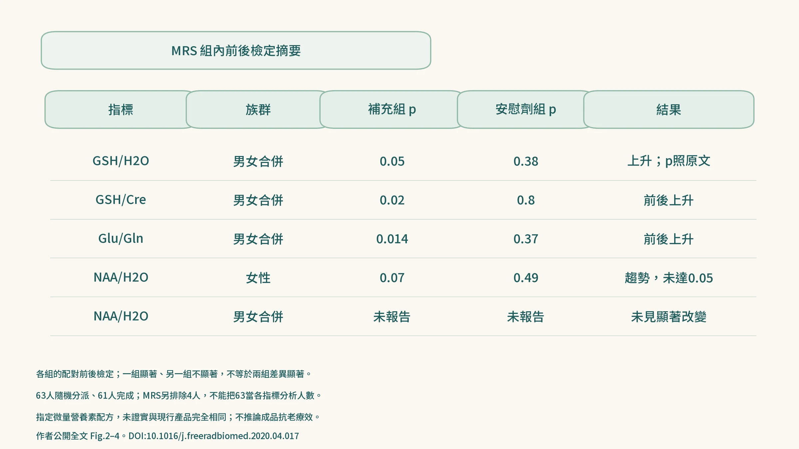
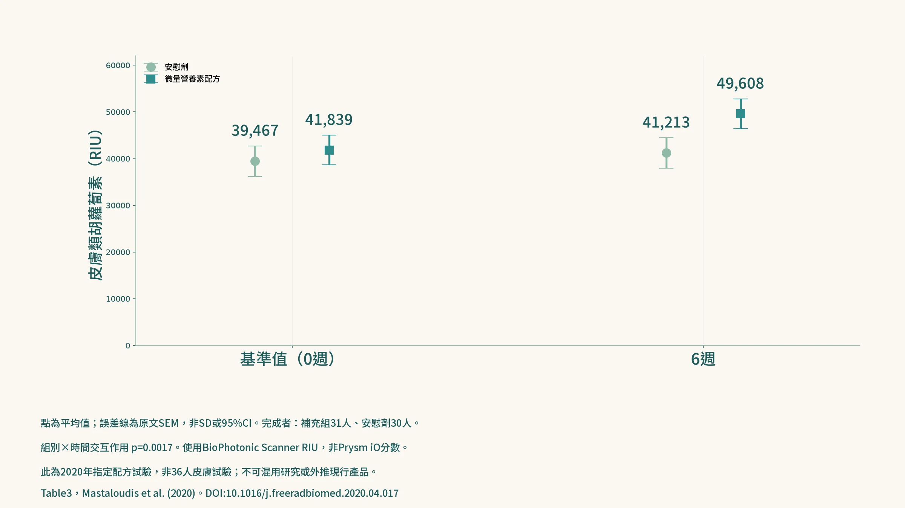

你可能已經在補一些保健品了。

CoQ10、魚油、維生素 D、白藜蘆醇，每一樣東西都有它的道理。

但你補了這些之後，有沒有想過一個問題：

**這些成分怎麼知道要去哪裡？怎麼知道要做什麼？**

這個問題的答案，就是 Youthspan 的整個設計邏輯。

---

## 老化的底層，是基因表達的失衡

你的基因序列，出生就定下來了，不會改變。

但基因的 **表達方式**：哪些基因在工作、哪些基因被關閉，會隨著年齡、壓力、飲食、環境不斷變化。

用一個比喻：基因是家裡的電燈開關，有一萬個。

年輕的時候，修復基因的燈是亮的，發炎基因的燈是暗的，整棟房子運作正常。

隨著年齡增長，這些開關開始亂掉，該亮的熄滅了，該暗的整晚亮著。

你感覺到的「疲勞、睡滿還累、感冒難好」，是燈光失序的結果。但問題不在那幾個症狀，問題在那一萬個開關的控制系統。

**ageLOC 技術針對的，正是這個控制系統。**

---

## 為什麼「少吃」是目前最有科學支持的抗老方法？

在所有已知的抗老化介入方式中，有一個方法在從酵母菌到靈長類的跨物種研究中，都顯示出最一致的效果——

**熱量限制（Caloric Restriction，CR）。**

1930 年代康奈爾大學就發現，限制大鼠熱量攝取能讓牠們活得明顯更久。

此後數十年，從線蟲、果蠅到恆河猴，研究一再確認：在營養充足的前提下，減少 20% - 30% 的熱量攝取，能啟動一套強大的細胞修復程式。

機制是這樣的：當身體感知到能量供應不足時，它不再盲目生長，而是切換到「求生模式」，修復DNA、清除損壞的細胞器（自噬）、優化粒線體效率、減少慢性發炎。

這一套修復程式，就是長壽研究者最想啟動的東西。

---

## 問題來了：誰能長期少吃 20%？

答案是幾乎沒有人。

長期熱量限制帶來的飢餓感、低血糖、肌肉流失，這些代價讓它成為理論上有效、實際上幾乎不可能執行的策略。

這催生了一個新的研究方向：

**熱量限制模擬物（Caloric Restriction Mimetics，CRM）**

核心問題是：能不能找到特定的成分，在不減少食物攝取的情況下，讓細胞以為正處於熱量受限狀態，進而啟動那套修復基因組？

**這正是 ageLOC Youthspan 開發的核心邏輯。**

---

## 科學家怎麼找到這些成分？DNA微陣列技術

這不是憑感覺選成分。

開發團隊使用的是 **基因微陣列技術（DNA Microarray）**，它可以同時監測上萬個基因的表達狀態，給你一張基因的「熱圖（Heat Map）」。

實驗把受試對象分成三組：年輕組、老化組、補充組（正常飲食但補充特定成分）。

然後比對三組的基因熱圖。

**結果：補充組的基因表達模式，與年輕組高度重疊。**

這些成分在分子層級，把「老化模式」切換回了「年輕模式」。

Barger等人在西元 2008 年的研究顯示，特定的微量營養素組合影響了 85% 的差異表達基因，效果在某些路徑上甚至優於單獨使用白藜蘆醇。

Youthspan配方篩選的標準就是這個——

> **不能只是「這個成分有抗氧化效果」，而是「這個成分能不能讓基因熱圖往年輕方向移動」。**

---

## 13種成分，為什麼不能自己去藥局組合？

很多人的第一個反應是：那我自己去買這些成分來吃就好了。

這個想法有一個根本的問題：**成分之間存在化學拮抗。**

配比錯誤會抑制彼此的吸收；過量的某個成分可能干擾另一個的受體；不同成分的血漿達峰時間不同，一次吞下去不等於同時在體內工作。

Youthspan 的 13 種成分，是經過「基因微陣列技術」實驗數據篩選、確保在血漿濃度、生物利用度與受體競爭上達到平衡的組合，協同作用讓整體效果遠大於個別成分的加總。

---

## 核心成分與它們在做的事

**槲皮素（Quercetin）**：除了抗氧化和抑制NF-κB慢性發炎路徑，槲皮素的 Senolytic（清除衰老細胞）特性是近年受關注的研究方向。衰老細胞停止分裂但不死亡，持續釋放促發炎的 SASP 物質，是 Inflammaging 的來源之一。不過要說清楚：這方面的研究多半是槲皮素和藥物 dasatinib 合併使用，而且劑量和產品裡的不同，不能直接推論到補充品的效果。

**α-硫辛酸（ALA）**：既溶於水又溶於脂肪，是少數能在細胞所有環境中工作的抗氧化劑。它能活化AMPK路徑（細胞能量感應器），這正是熱量限制在代謝層面的關鍵機制之一。同時能將已消耗的維生素C和E還原回活性形式，讓抗氧化網路持續運作。

**蝦青素（Astaxanthin）**：分子結構長度剛好能橫跨細胞膜的雙層脂質，同時保護膜的內外兩側，這是大多數抗氧化劑做不到的。它也是Prysm iO掃描測量的類胡蘿蔔素家族成員，補充後掃描數值的變化可以量化追蹤效果。

**白藜蘆醇（虎杖根萃取物）**：激活 SIRT1 長壽蛋白，是熱量限制最重要的下游效應之一。使用天然來源萃取，並經過吸收率驗證。**重要：** 白藜蘆醇研究一致顯示低劑量有效、高劑量反效果，配方中的劑量控制是關鍵。

**紫玉米萃取物（富含花青素C3G）**：代謝彈性的調節因子，優化脂肪細胞訊號傳導，抑制慢性低度發炎。在模擬熱量限制的代謝層面效應中扮演關鍵角色。
 
**維生素K2（MK-7形式）**：透過活化基質 Gla 蛋白（MGP），防止鈣質沉積在血管壁。血管健康的維護是很多人抗老化補充策略裡最常被忽略的缺口。

**茄紅素＋葉黃素＋Omega-3**：三者都是飲食中難以達到研究劑量的成分。茄紅素的心血管保護、葉黃素的神經和視網膜保護、Omega-3 的抗發炎調控，各自填補不同的防禦缺口。

---

## 動物實驗：不只活得久，還活得有活力

在線蟲實驗中，攝取 Youthspan 配方的線蟲不只壽命延長，在老年期的活動力也顯著高於對照組。

後者比前者更重要，這個研究追求的不只是「活得久」，是 **健康地活著**。這正是Healthspan的核心定義。

在老年小鼠實驗中，補充 Youthspan 配方的小鼠與熱量限制組呈現高度相似的基因表達模式：腦皮層 3,468 個基因、骨骼肌 2,386 個基因、心臟 3,523 個基因受到調節。

這些數字說明：Youthspan 在不改變飲食攝取量的情況下，在分子層級重現了熱量限制的基因效應。

---

## 人體臨床：分清楚組內變化與組間效果

2020 年的隨機、雙盲、安慰劑對照研究，以質子磁共振波譜（1H-MRS）評估受測營養配方。63 人隨機分組，61 人完成；MRS 分析另排除 4 人。

下圖整理原文可核對的組內檢定：補充組 GSH/H₂O 的 p 值為 0.05、GSH/Cre 為 0.02，安慰劑組分別為 0.38 與 0.80。Glu/Gln 的組內 p 值分別為 0.014 與 0.37。女性 NAA 的 p 值為 0.07 與 0.49，不能稱為顯著提升。

**一組顯著、另一組不顯著，不等於兩組的變化有顯著差異。** 這些數字也不能直接證明目前販售的 Youthspan 有相同的腦部效果。

*▲ 原文組內檢定結果摘要，並非組間療效比較。來源：DOI 10.1016/j.freeradbiomed.2020.04.017。*

---

## 皮膚數據：回到可核對的原始表格

同一份 2020 年研究表 3 記錄了受測配方在 0 與 6 週的皮膚類胡蘿蔔素數據。安慰劑組均值由 39,467 變為 41,213 RIU，補充組由 41,839 變為 49,608 RIU；下圖誤差線依原表的平均值標準誤（SEM）繪製。

這裡使用的是該試驗的受測配方與 RIU 單位，不是 Prysm iO 的分數，也不是目前 Youthspan 成品效果的保證。先前無法核對的「36 人、6 週提升 40%」組合不再作為本圖依據。

*▲ 2020 年試驗表 3 的均值 ± SEM；不與其他裝置的分數直接換算。來源：DOI 10.1016/j.freeradbiomed.2020.04.017。*

---

## 你不需要每天吞 100 顆膠囊

有些人為了抗老化，每天補充十幾種不同的保健品，自行組合、自行決定劑量。

這是高風險且低效率的做法，你不知道這些成分在你體內是協同還是拮抗，也不知道你的劑量組合是否讓某個成分的吸收被壓制。

Youthspan 的做法，是用基因表達研究來決定配比，再做人體試驗。

每天兩次、每次兩顆膠囊，比自己組合十幾種保健品單純。

它是營養補充品，不是藥物。正在服用抗凝血藥（槲皮素、白藜蘆醇等成分可能有交互作用）或其他慢性病用藥、或懷孕哺乳中，使用前請先問醫師或藥師。

---

**延伸閱讀：**
- [抗慢性發炎就是在抗老化——這不是廣告詞，這是2000年就確立的科學](/blog/chronic-inflammation/anti-inflammation-anti-aging/) 
- [你的身體老化速度，有辦法知道嗎？](/blog/precision-health-tools/aging-speed-measurement-methods/)
  
---

## 參考資料

01. Barger Jamie L., Kayo Tsuyoshi, Vann James M. et al. (2008). A Low Dose of Dietary Resveratrol Partially Mimics Caloric Restriction and Retards Aging Parameters in Mice. *PLoS ONE*, 3(6):e2264. DOI：[10.1371/journal.pone.0002264](<https://doi.org/10.1371/journal.pone.0002264>)。
02. Serna Eva, Mastaloudis Angela, Martorell Patricia et al. (2020). A Novel Micronutrient Blend Mimics Calorie Restriction Transcriptomics in Multiple Tissues of Mice and Increases Lifespan and Mobility in C. elegans. *Nutrients*, 12(2):486. DOI：[10.3390/nu12020486](<https://doi.org/10.3390/nu12020486>)。
03. Mastaloudis Angela, Sheth Chandni, Hester Shelly N. et al. (2020). Supplementation with a putative calorie restriction mimetic micronutrient blend increases glutathione concentrations and improves neuroenergetics in brain of healthy middle-aged men and women. *Free Radical Biology and Medicine*, 153:112-121. DOI：[10.1016/j.freeradbiomed.2020.04.017](<https://doi.org/10.1016/j.freeradbiomed.2020.04.017>)。
04. Madeo Frank, Carmona-Gutierrez Didac, Hofer Sebastian J. et al. (2019). Caloric Restriction Mimetics against Age-Associated Disease: Targets, Mechanisms, and Therapeutic Potential. *Cell Metabolism*, 29(3):592-610. DOI：[10.1016/j.cmet.2019.01.018](<https://doi.org/10.1016/j.cmet.2019.01.018>)。
05. Lee Cheol-Koo, Pugh Thomas D, Klopp Roger G et al. (2004). The impact of α-lipoic acid, coenzyme Q10 and caloric restriction on life span and gene expression patterns in mice. *Free Radical Biology and Medicine*, 36(8):1043-1057. DOI：[10.1016/j.freeradbiomed.2004.01.015](<https://doi.org/10.1016/j.freeradbiomed.2004.01.015>)。
