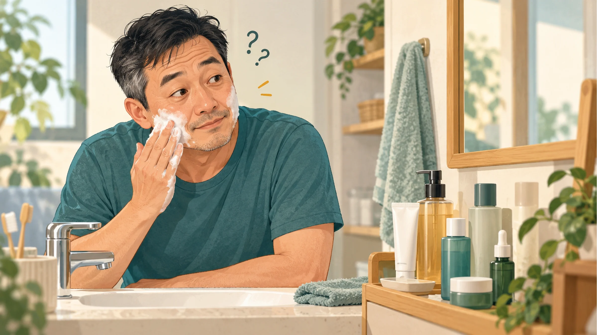
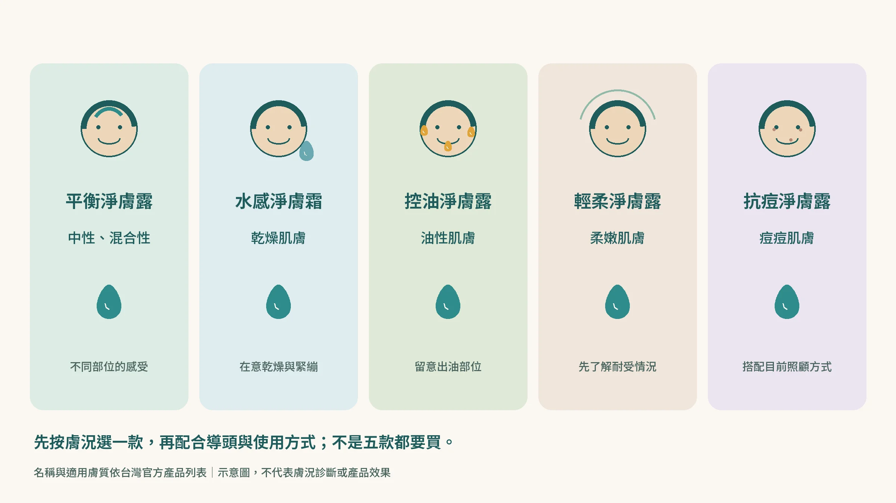
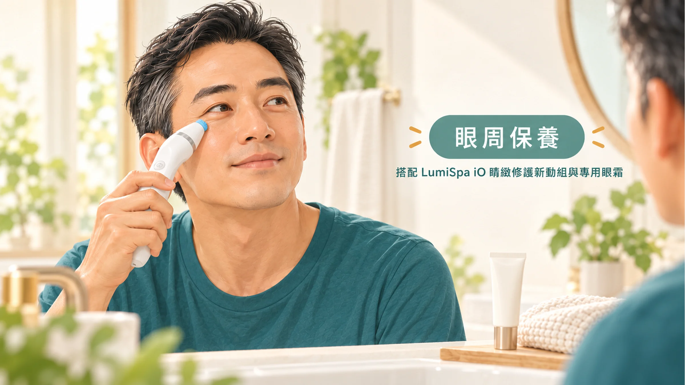
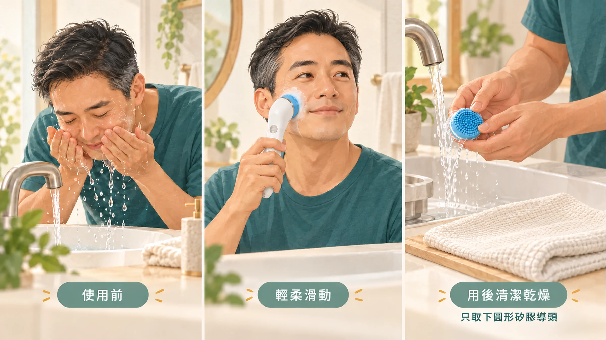
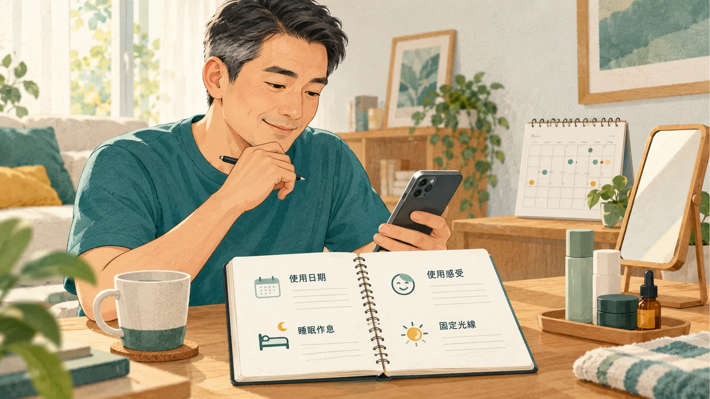
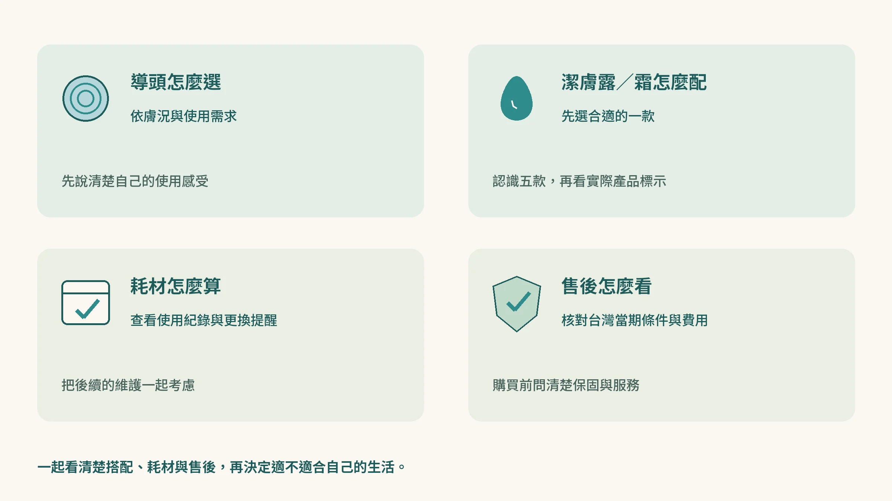
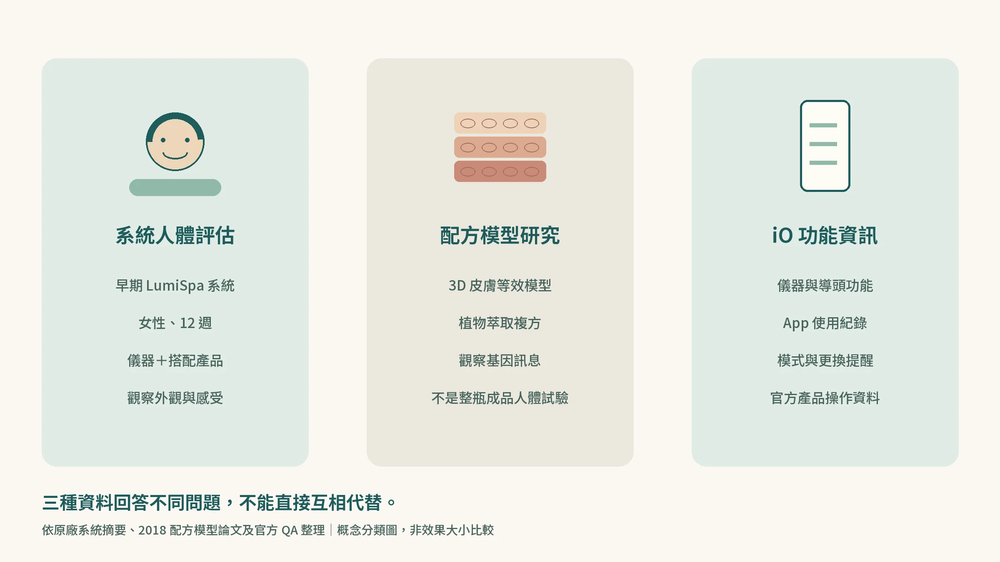

四十歲了，你洗臉是不是還停在這一套？

洗面乳擠在手上，兩邊臉頰隨便抹幾下，鼻子帶過，沖水，毛巾一擦。好了，今天的「保養」結束。

化妝水、乳液、精華液？名字聽過，哪一瓶做什麼、先用哪一個，還真說不上來。

看到老婆化妝桌上一排排的瓶瓶罐罐，心裡只想：「幸好男生不用那麼麻煩，洗完後還要擦什麼？」

想像哪天和老婆出門，遇到她許久不見的朋友。對方熱情地打招呼：

「欸！好久不見！怎麼沒看到妳老公呢？妳今天跟妳爸出門啊？」

你站在旁邊，笑容突然有點僵。

回家再照鏡子，才開始認真看自己的臉：鼻子旁的油光、摸起來的粗糙，還有照片裡那張總覺得少了點精神的臉。心裡終於冒出一句：「好啦，我是不是也該開始顧一下了？」

可是，一查保養步驟，又覺得麻煩，最後還是回到抹兩下、沖掉就好。

這種想開始、卻又不習慣的感覺，我也懂。電視上廣告男生的保養品，老婆某天幫我帶了一瓶回家，叫我要記得擦。結果一塗上去，第一個感覺就是：「我的臉怎麼好油！好不習慣！」

原本只是想顧一下臉，卻連擦完應該是什麼感覺都沒概念。產品用途、用量、先後順序，一下子全變成問題。這也是我推薦時，會想把每個步驟和使用感受一起說清楚的原因。

**如果這很像你，我會推薦你從 ageLOC LumiSpa iO 開始認識一套有步驟的清潔方式。**

我覺得它適合想開始照顧臉蛋、卻不想先研究一整套保養名詞的男人。先知道怎麼搭配潔膚產品、跟著程序把清潔做完，用後整理好，再慢慢認識保濕與日間防曬。保養可以從這樣的小步驟開始。

這篇就照買之前最想知道的順序，帶你看它有哪些功能、怎麼使用、App 能記錄什麼，最後再把研究依據說清楚。

> 我也是 Nu Skin 經銷商，透過我的推薦管道購買，可能讓我取得銷售利益。這篇會把我推薦的理由、官方功能與研究資料分開說清楚，讓你知道自己選的是什麼。

## 你需要洗臉機嗎？這三種情況，我會推薦你考慮

**第一種，就是洗面乳抹幾下、沖掉就收工的人。** 保養品名字叫不齊也沒關係。我推薦先從「今天的臉怎麼洗」開始，知道搭配哪一款潔膚產品、照什麼程序完成，先把一件事做得有條理。

**第二種，是開始在意油光與粗糙，卻不知道怎麼選的人。** 洗完緊繃，是不是就代表洗乾淨了？導頭要選哪一種？這些問題值得先弄清楚。我推薦時會先從膚況與使用感受談起，再看適合的搭配，保養新手也能一項一項認識。

**第三種，是保養常常看心情，忙起來就忘記的人。** iO 的連線與使用紀錄，是我覺得值得推薦的一點。先從看得懂自己的使用紀錄開始，回頭確認這段時間做了什麼，不必一開始就變成保養達人。

我會推薦把它當成日常清潔保養的工具。如果目前正在紅腫、破皮、持續刺痛，或接受皮膚治療，先請皮膚科確認適合的清潔方式。

## ageLOC LumiSpa iO 厲害的地方

我覺得它厲害的地方，是把清潔工具、搭配產品與使用紀錄串成一套。對保養新手來說，有一個知道怎麼開始、做完又能回頭看的流程，是我推薦它的理由。

**我推薦它的一個理由，就是讓「洗臉隨便抹兩下」的人，有一套知道怎麼做、也跟得上的流程。** 矽膠導頭以反向振盪的方式運動，搭配適合膚況的潔膚露／霜；你要做的是跟著程序提示，讓導頭在臉上緩慢滑動，而不是拿著機器拚命刷。

對四十歲、剛想開始保養的男人，我覺得這個設計很有吸引力：先把每天本來就會做的洗臉，變成一件有步驟的事。**不用先背熟一整排保養品，先把導頭、潔膚搭配和操作方法弄懂，就有一個明確的開始。** 這也是我會把 LumiSpa iO 放進推薦清單的原因。

我推薦時也會一起幫你認識導頭與潔膚產品的搭配，再留意使用後的感受。保養新手需要的，是買回去知道怎麼用、願意繼續做的工具；接下來就先看怎麼選搭配的潔膚露／霜。

### 搭配的「膠」也有講究：五款潔膚露／霜怎麼挑？

我推薦 LumiSpa iO，會把搭配的這支「膠」一起介紹。它正式的名稱是潔膚露／霜，除了清潔，也配合導頭在臉上滑動時的介質與緩衝需求。**機器怎麼動、用哪一款潔膚產品、使用後舒不舒服，我會一起看。**

台灣官方列有五款，先用你的膚況認識它們，不需要一開始就背成分表：

| 品項 | 官方標示的適用膚質 | 我會先和你確認什麼 |
| --- | --- | --- |
| **平衡淨膚露** | 中性及混合性肌膚 | 你是整臉狀況差不多，還是鼻子、額頭與兩頰的感受不同？ |
| **水感淨膚霜** | 乾燥肌膚 | 是否容易乾燥、洗後緊繃？你在意的洗後舒適感是什麼？ |
| **控油淨膚露** | 油性肌膚 | 哪些部位容易油？清潔之後的感受如何？ |
| **輕柔淨膚露** | 柔嫩肌膚 | 過去容易對哪些產品不適？先把使用感受與目前膚況說清楚。 |
| **抗痘淨膚露** | 痘痘肌膚 | 痘痘狀況與目前是否接受治療；持續紅腫或不適，先由皮膚科評估。 |

對像前面提到「擦了覺得臉好油」的保養新手，我會先問清楚：那是洗完就油，還是擦了後續乳液才有的感覺？清潔用的產品與洗後留在臉上的保養品，是不同步驟，別急著把它們全算成「我不適合保養」。

**五款不是要你全部買齊，而是依自己的膚況選一款合適的搭配。** 配方與包裝可能更新，具體成分看手上產品標示；先用合適的方式開始，之後再看使用感受與紀錄。這也是我覺得整套搭配值得推薦的地方。

### 不只洗臉，還能搭配眼周配件

臉洗好之後，如果你也開始在意眼周看起來沒精神，可以再加一個步驟：**LumiSpa iO 睛緻修護新動組（Accent）**。

它是另外選購的眼周小導頭，換上之後，搭配 **ageLOC LumiSpa 睛緻修護新動眼霜**，在眼周輕輕滑過，早晚各一分鐘。台灣官方把它定位為眼周肌膚保養。

這樣一套，洗臉和眼周就都有了，不用一次買一整排保養品。購買時注意兩件事：要選 iO 用的款式（舊款 LumiSpa 的配件不能共用），也看清楚套裝裡有沒有附眼霜。

## 怎麼使用與保養？把清潔、用後整理一起做好

如果你以前洗臉只有「抹一抹、沖掉」兩個動作，第一次先把完整程序走過一遍。哪個步驟要做什麼，弄懂以後，就不用每天站在洗手台前猜。

我也建議把「使用完怎麼收好」算進流程，讓清潔與整理接在一起。

基本清潔動作可依原廠 iO 操作說明掌握：先潤濕臉部、把搭配的潔膚產品均勻塗在臉上，再以導頭緩慢、大範圍地來回滑動，跟著程序提示移動部位；結束後把殘留潔膚產品沖淨。

用後只取下圓形矽膠導頭，不拆解機身。將機身、導頭與導頭背面依說明沖洗乾淨，充分乾燥再收好。導頭的使用紀錄與更換提醒，也值得一起查看。

這裡整理的是基本動作；台灣實際販售的套裝、適用產品、充電安全與保固條款，以目前隨機附的台灣說明書為準。保養流程還有後續的保濕與日間防曬，清潔是起點。

## App 紀錄能幫什麼忙？

iO 加入 App 連線與紀錄功能。依台灣官方 QA，完成設定後可以單獨使用儀器，不必每次把手機帶進浴室；導頭使用時間與更換提醒也在功能範圍內。

這是我推薦 iO 時會特別提的地方：**把「我有沒有認真保養」變成能回頭看的紀錄。**

除了 App 的使用資料，我也建議另外記下作息、搭配產品與使用後感受。如果那陣子同時換了精華液、睡得比較晚，都一起記，回顧時才有脈絡。這是我建議的紀錄方法，不表示 App 會自動測量作息或判斷膚況。

拍照可以幫忙回顧，但盡量固定光線、角度與距離，關閉美肌。照片記錄的是外觀，不能用來判定膠原增加或皮膚年齡倒退。這是紀錄方式的建議，不是原廠研究的評分工具。

## 買之前最常問的問題

### 一定要每次連手機嗎？

不必。台灣官方 QA 說明，完成配對設定後可單機使用，已同步的個人化模式也可從儀器選擇。

### 舊款導頭可以沿用嗎？

依台灣官方 QA，LumiSpa 1.0 與 iO 的護膚導頭、睛緻修護新動組不能互用；不要因為外觀相似就自行混搭。潔膚產品的搭配則應另外核對目前品項與官方說明。

### 充電多久、更換手機會不會失去紀錄？

充飽電大約 5 小時。充電時，正面的燈號會由下往上亮起，全部亮綠燈就是充飽了。正常使用的話，充飽一次至少可以用一週。

App 的紀錄會備份在雲端，換手機之後，用原本的帳號登入就能看到。

### 敏感、泛紅時，也能照同樣方式使用嗎？

不要把「產品有不同導頭」讀成所有膚況都適合。若正在紅腫、破皮、持續刺痛或接受皮膚治療，先向皮膚科確認，不靠加強清潔解決。實際使用依台灣當前說明書與個人耐受情況調整。

### 保固與耗材費用怎麼看？

我推薦你在購買前把套裝內容、潔膚產品與導頭耗材、台灣保固及售後條件一起看清楚。你買的是要放進生活的工具，除了第一次購買，也要知道後續怎麼照顧與維護；實際費用以當期台灣官方資訊為準。

## 研究支持到哪裡？推薦的同時，也把依據說清楚

### 為什麼是 15 Hz、內外反向轉動？

LumiSpa 的導頭不是隨便選一個速度在轉，這套振盪設計有美國專利（US 10,080,428，專利權人 NSE Products，是 Nu Skin 旗下的公司）。專利裡寫明：導頭分成內圈和外圈兩區，以每秒約 5 到 30 次的頻率擺動，內外可以朝相反方向動，讓矽膠導頭帶著皮膚做小幅度、規律的拉動。

研發時，團隊用合成皮膚模型和高速攝影，觀察導頭和皮膚之間的動作，一步步調出合適的頻率和擺動方式。LumiSpa 最後採用的是每秒 15 次（15 Hz）的微脈衝振盪。專利文件裡也記錄了實驗室測試：不同的施力方式，對皮膚細胞裡膠原蛋白等基因表現的影響。研發團隊的想法是，溫和而規律地拉動皮膚，可能讓負責製造膠原蛋白的纖維母細胞產生有利的變化。這是實驗室階段的設計依據，不是在使用者臉上量到的結果。

實際用起來，壓得太用力時導頭會自動停下來，提醒你放輕。

這也是我推薦它給保養新手的原因：你不用自己拿捏力道和速度，跟著機器走就好。

### 12 週的人體評估

早期的 LumiSpa 做過一項 12 週的評估。原廠委託第三方機構，找來 90 位 35 到 65 歲的女性，依一般／混合、油性、乾性膚質各 30 人，使用各自搭配的導頭和潔膚產品。

12 週後，受試者自己的感受和評估人員的觀察，都看到皮膚更平滑、更柔嫩，膚質和透亮度也有改善；有些人用第一次就摸得出差別。

要說清楚的是：這是原廠委託的評估，做在早期機型，受試者都是女性，也沒有只用手洗臉的對照組。我把它當成參考，用起來適不適合，還是看你自己的使用感受。

### 水仙鱗莖與五味子，研究實際看到了什麼？

眼周保養的配方研究，不只是在成分表放上植物名稱。Nu Skin 研究人員在 2018 年，把水仙鱗莖與五味子果實萃取組成 **BlendIP 複方**，用在人類皮膚等效模型，觀察處理二十四小時後的變化。研究記錄了幾類具體發現：

| 研究觀察 | 實際發現 | 用白話理解 |
| --- | --- | --- |
| 生長因子相關基因 | NGF、FGF2、FGF7 的表現上升 | 與細胞生長及溝通有關的訊息出現變化；不是直接量到新皮膚長出來。 |
| 皮膚結構與保水相關基因 | 透明質酸合成酶 HAS2、HAS3 的基因表現上升 | 涉及製造玻尿酸的路徑，是研究保水與皮膚結構的線索；沒有直接測得人體含水量增加多少。 |
| 氧化壓力應答相關基因 | NQO1、TXNRD1、HMOX1 等表現上升 | 模型中與應對氧化壓力有關的系統產生反應。 |
| microRNA | miR-146a、miR-22 等調節分子表現改變 | 細胞調控其他基因訊息的方式也受到影響；不能把「上升」一律當成逆齡。 |

**我會關注這份研究，是因為它把植物複方的討論，往皮膚保水、結構與氧化壓力應答這些具體方向推進。** 不過，這是複方的模型實驗，還不能拆成水仙或五味子各自帶來多少效果，也不是市售成品搭配儀器的人體試驗。

論文另外測了一組含紅景天等成分的 BlendE，兩組不能混為一談。米萃取也不能因為出現在產品資料，就算進水仙與五味子這組研究。基因訊息變化能幫助提出配方假說；要知道實際使用後的眼周外觀與感受，仍須另外看成品人體評估。

### 洗臉機會讓膠原蛋白變多嗎？

很多人會問這一題。前面提到的專利實驗，是在實驗室裡看細胞的基因表現；目前沒有 LumiSpa iO 在使用者臉上直接量膠原蛋白的人體研究。網路上常被引用的那篇按摩儀研究，用的是另一個品牌的機器（Clarisonic Smart PROfile），不能拿來替 LumiSpa 背書。

我推薦它，看的是清潔流程、使用感受和紀錄功能，不是膠原蛋白。

回到一開始：**如果你四十歲了，洗臉還是洗面乳隨便抹兩下，卻已經想開始照顧自己的臉，LumiSpa iO 是我會推薦你考慮的選擇。**

你不用一開始就叫得出每瓶保養品的名字。先把清潔流程弄懂，知道用完舒不舒服，再逐步把保濕、防曬接起來。我希望你選到的，是買回家以後知道怎麼用，也願意繼續用的工具。

## 參考資料

1. Nu Skin Research and Development. *ageLOC LumiSpa System: 12-Week Clinical Efficacy Study*. 2017–2018 原廠公布的第三方委託評估摘要，無 DOI；不是獨立發表的隨機對照試驗。[官方摘要 PDF](https://createhistory.nuskin.com/content/dam/office/pacific_new/shared/en/ClinicalStudies/ageLOC%20LumiSpa%20-%20Clinical%20Study.pdf)。本稿只用於交代廠商報告的研究設計與資料性質，不作獨立健康效益證明。
2. Namkoong J, Kern D, Knaggs HE. *Assessment of Human Skin Gene Expression by Different Blends of Plant Extracts with Implications to Periorbital Skin Aging*. Int J Mol Sci. 2018;19(11):3349. DOI：[10.3390/ijms19113349](https://doi.org/10.3390/ijms19113349)。[PubMed PMID 30373163](https://pubmed.ncbi.nlm.nih.gov/30373163/)。作者任職 Nu Skin，屬配方的實驗室模型研究。
3. Caberlotto E, Ruiz L, Miller Z, Poletti M, Tadlock L. *Effects of a skin-massaging device on the ex-vivo expression of human dermis proteins and in-vivo facial wrinkles*. PLoS One. 2017;12(3):e0172624. DOI：[10.1371/journal.pone.0172624](https://doi.org/10.1371/journal.pone.0172624)。僅用來說明其他裝置研究不能移作 LumiSpa iO 成品證據。
4. Nu Skin 如新台灣。*QA：LumiSpa iO 與 LumiSpa 產品相關問答*。官方操作文件，無 DOI。[官方頁面](https://www.nuskin.com.tw/content/join/training/faqs.html)，核對日期 2026-10-30。
5. Nu Skin. *ageLOC LumiSpa iO 官方產品操作與導頭照護說明*. 海外官方產品頁，無 DOI。[基本操作及用後照護](https://www.nuskin.com/content/products/07/41/56/07415690/en.html)，核對日期 2026-10-30。僅採用同機型基本滑動、沖洗與乾燥說明，不套用海外配方、App 入口、售價或保固；台灣實際搭配與條款以當地說明為準。

6. Nu Skin 如新台灣。*LumiSpa 潔膚產品系列與品項資料*。官方產品資訊，無 DOI；僅用於名稱、適用膚質及操作搭配，非獨立健康效益證據。[台灣官方產品列表](https://www.nuskin.com.tw/shop/productlist/1218150345390348386)；[平衡淨膚露](https://www.nuskin.com.tw/shop/productdetail/1445271690924905571)、[水感淨膚霜](https://www.nuskin.com.tw/shop/productdetail/1445272554252129333)、[控油淨膚露](https://www.nuskin.com.tw/shop/productdetail/1445272869831603222)、[輕柔淨膚露](https://www.nuskin.com.tw/shop/productdetail/1445273127979480078)、[抗痘淨膚露](https://www.nuskin.com.tw/shop/productdetail/1445273362932814935)。核對日期 2026-10-30。

7. Nu Skin 如新台灣。*LumiSpa iO 睛緻修護新動組與睛緻修護新動眼霜*。官方產品資訊，無 DOI；用於核對 iO 配件內容、眼周用途與搭配方式，不作獨立臨床研究證據。[iO 睛緻修護新動組](https://www.nuskin.com.tw/shop/productdetail/1316562873982627964)；[睛緻修護新動眼霜](https://www.nuskin.com.tw/shop/productdetail/1176341658270295145)。核對日期 2026-10-30。
8. Nu Skin. *ageLOC LumiSpa iO* 與 *How long does ageLOC LumiSpa iO last after a full charge*. 官方說明中心，無 DOI。[LumiSpa iO](https://nuskin.knowledgeowl.com/help/lumispa-io)；[充飽後可用時間](https://nuskin.knowledgeowl.com/help/how-long-does-ageloc-lumispa-io-last-after-a-full-charge-with-the-magnetic-charger)。用於反向轉動、壓太用力自動停止、充飽可用至少一週。核對日期 2026-10-30。
9. Nu Skin. *What is the ageLOC LumiSpa?* 官方說明中心，無 DOI。[官方頁面](https://nuskin-pacific.knowledgeowl.com/help/what-is-the-ageloc-lumispa)。用於 12 週評估的改善項目與「第一次使用」的描述。核對日期 2026-10-30。
10. Johnstone SL, Herd MJ, Kilby CF（NSE Products, Inc.）. *Device and method for cleansing and treating skin*. 美國專利 US 10,080,428 B2，2018；相關申請 US 2019/0008332 A1。[Google Patents](https://patents.google.com/patent/US10080428)；[申請案全文](https://uspto.report/patent/app/20190008332)。用於導頭內外分區、約 5–30 Hz 振盪與實驗室膠原基因表現測試的描述；專利文件不是人體臨床試驗。
11. Sagentia. *LumiSpa – award-winning smart skincare device*. 研發合作夥伴案例說明，無 DOI。[官方頁面](https://sagentia.com/case-study/lumispa-award-winning-smart-skincare-device/)。用於合成皮膚模型與高速攝影的研發過程。核對日期 2026-10-30。
