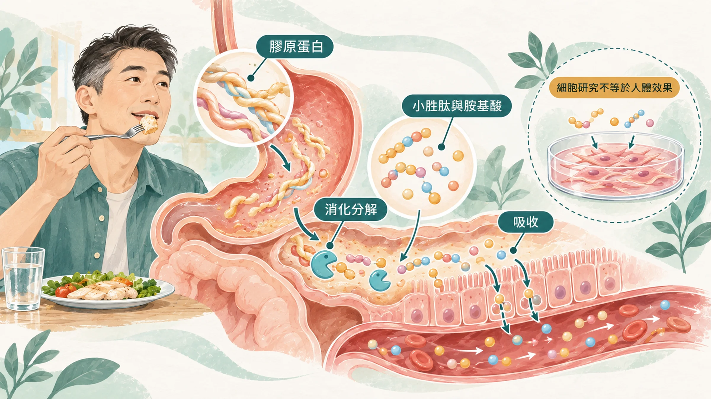
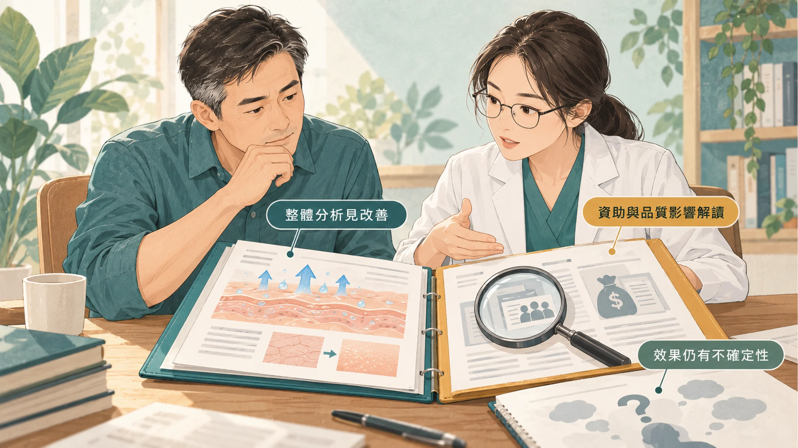
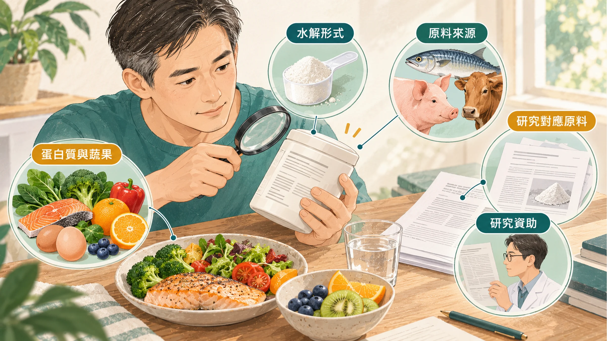

<!-- 🎨 [cover] [類型 A]
畫面：A man's bathroom shelf seen from the front: a mirror, a sunscreen bottle, a glass of water, and a plain unlabeled collagen powder pouch, in soft morning light. Clean flat illustration, warm off-white background, teal and sage palette, one small amber accent.
標籤（Canva 填入）：吃的膠原蛋白有用嗎？
STYLE: 依 IMAGE-STYLE.md 第 7.2 節
-->

> 這篇最後一段會介紹 Nu Skin 的膠原蛋白產品。先說清楚：我是 Nu Skin 經銷商。前面的內容，不管你買不買產品都用得上。

照片裡的自己，眼角的紋路比以前深，臉也沒有以前那麼「撐得住」。很多人第一個想到的是：要不要吃點膠原蛋白？

吃之前，先把三件事弄清楚：膠原蛋白從哪裡來、吃進去之後會變成什麼、研究到底說了什麼。

## 膠原蛋白只在動物食材裡

膠原蛋白是撐起皮膚、骨骼和肌腱的蛋白質，只存在動物身上。豬腳、雞爪、牛筋、魚皮、魚鱗都有。

植物沒有膠原蛋白，撐起植物的是纖維。銀耳、桃膠煮起來黏黏的，那是多醣類，和膠原蛋白是兩回事。看到「植物性膠原蛋白」的標示，要仔細看成分到底是什麼。

**動物來源也有差別：**

- **豬腳、雞爪：** 膠原蛋白多，但脂肪也多，為了膠原蛋白天天吃，腰圍會先抗議。
- **魚皮、魚鱗：** 脂肪少，台灣也有業者用吳郭魚、虱目魚的魚鱗做原料。對魚類過敏的人要避開。

## 吃進去之後，會變成什麼

吃下去的膠原蛋白不會直接跑到臉上。它會像其他蛋白質一樣，在腸胃被分解成胺基酸和很小的胜肽（也就是兩三個胺基酸連在一起的小片段）再吸收。

日本研究讓受試者吃不同來源的水解膠原蛋白，兩小時後在血液裡測到好幾種含有羥脯胺酸的小胜肽，不同來源的種類和數量也不一樣（Ohara et al., 2007）。其中一種叫 Pro-Hyp 的雙胜肽，在實驗室培養的皮膚纖維母細胞（也就是負責製造膠原蛋白的細胞）上，能刺激細胞增生和玻尿酸生成（Ohara et al., 2010）。

這是細胞實驗，說明吃進去的小胜肽「可能」有作用，不代表吃了皮膚就一定會變好。

## 研究到底說了什麼：有正有反

這是最需要誠實講的地方。

**支持的一方：** 2021 年一篇統合分析整理了多個隨機對照試驗，發現補充水解膠原蛋白約 90 天，皮膚的保水度和彈性有改善（de Miranda et al., 2021）。

**質疑的一方：** 2025 年《美國醫學期刊》的統合分析納入 23 個試驗、約 1,500 人。全部合在一起看，同樣有改善；但只看**沒有廠商資助**的試驗，或只看品質較好的試驗，就看不到明顯效果（Myung & Park, 2025）。作者的結論是：目前沒有足夠的臨床證據支持用膠原蛋白來預防或改善皮膚老化。

業界則反駁：「膠原蛋白」包含很多不同原料和配方，混在一起比較並不公平。

我的讀法是：**膠原蛋白不是沒有研究，但效果沒有廣告講得那麼確定**，而且受試者大多是女性。與其期待它，不如把它放在防曬、睡眠和戒菸後面。

## 對男人的臉，更有把握的三件事

- **防曬：** 紫外線是讓皮膚提早出現皺紋和斑點最主要的外在因素。每天在外面跑的人，出門前擦防曬、戴帽子，效果比任何補充品都確定。
- **睡眠：** 睡不夠的臉，最直接的表現就是看起來累，相關研究可以看〈[越睡越累？熬夜催老？](/blog/chronic-inflammation/sleep-duration-biological-aging/)〉。
- **戒菸：** 菸會直接傷害皮膚的血流和膠原蛋白。

## 如果還是想吃，怎麼挑

1. **選「水解」過的膠原蛋白胜肽：** 分子比較小，比較接近研究裡用的形式。
2. **看清楚原料來源：** 魚、豬還是牛，有沒有標示產地；對魚類過敏的人避開魚來源。
3. **看研究是不是做在同一種原料上：** 很多產品引用的研究，是別家原料做的。研究要看原料名稱，不要只看「小分子」「高濃度」這類形容詞。
4. **看研究是誰做的：** 原料廠自己做的研究不是不能看，但要知道它的立場。
5. **搭配足夠的蛋白質和蔬果：** 身體製造膠原蛋白需要維生素 C 幫忙，蔬果吃夠比額外補充更基本。

腎臟功能不好、需要限制蛋白質的人，吃之前先問醫師或營養師。

## 產品介紹：Nu Skin 水光膠原胜肽

再說一次，我是 Nu Skin 經銷商，下面是產品介紹。

Nu Skin 在台灣販售的「水光膠原胜肽」（Beauty Focus Collagen+），主要成分是德國 GELITA 公司的 **VERISOL®** 膠原蛋白胜肽，另外添加金盞花萃取物（含葉黃素）和玻尿酸。詳細成分與含量、食用方式，請依產品標示。

**以下是 VERISOL® 這個原料的成分研究，不代表產品效果。** 這項研究的作者群包含原料廠的研究人員，屬於原廠研究：

- 114 位 45 到 65 歲的女性，隨機分成兩組，每天吃 2.5 公克 VERISOL® 或安慰劑，連續 8 週。研究報告吃 VERISOL® 的那組，8 週後眼周皺紋的體積平均減少約 20%，皮膚裡的第一型前膠原蛋白也增加（Proksch et al., 2014）。

這項研究的受試者都是女性，也還沒有獨立的團隊在男性身上重複驗證。把它當成參考，而不是保證。

## 帶走一句話

**膠原蛋白的研究有正有反，防曬的效果最確定。** 想吃的話，先看原料、看研究是誰做的，再決定。

---

## 參考資料

1. Ohara H, et al. Comparison of quantity and structures of hydroxyproline-containing peptides in human blood after oral ingestion of gelatin hydrolysates from different sources. *Journal of Agricultural and Food Chemistry*, 2007.（PMID：[17253720](https://pubmed.ncbi.nlm.nih.gov/17253720/)）
2. Ohara H, et al. Collagen-derived dipeptide, proline-hydroxyproline, stimulates cell proliferation and hyaluronic acid synthesis in cultured human dermal fibroblasts. *Journal of Dermatology*, 2010.（PMID：[20507402](https://pubmed.ncbi.nlm.nih.gov/20507402/)）
3. de Miranda RB, et al. Effects of hydrolyzed collagen supplementation on skin aging: a systematic review and meta-analysis. *International Journal of Dermatology*, 2021.（來源：[International Journal of Dermatology](https://doi.org/10.1111/ijd.15518)，2021）
4. Myung SK, Park Y.（口服膠原蛋白與皮膚老化的系統性回顧與統合分析）. *American Journal of Medicine*, 2025.（來源：[American Journal of Medicine](https://doi.org/10.1016/j.amjmed.2025.04.034)，2025）
5. Proksch E, et al. Oral intake of specific bioactive collagen peptides reduces skin wrinkles and increases dermal matrix synthesis. *Skin Pharmacology and Physiology*, 2014.（PMID：[24401291](https://pubmed.ncbi.nlm.nih.gov/24401291/)）

*本文為健康教育資訊，不構成醫療診斷或治療建議。產品內容以 Nu Skin 台灣官方標示為準。*
