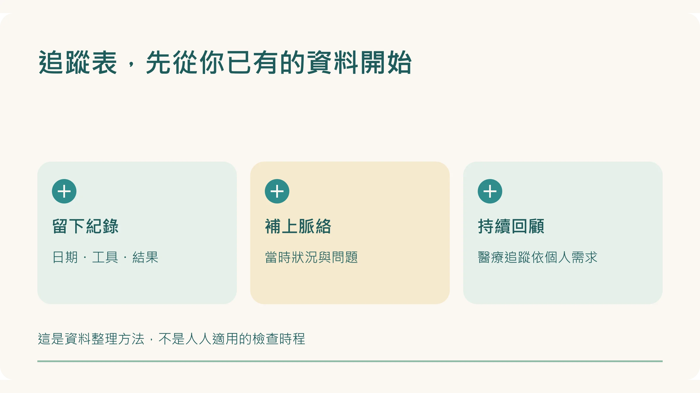
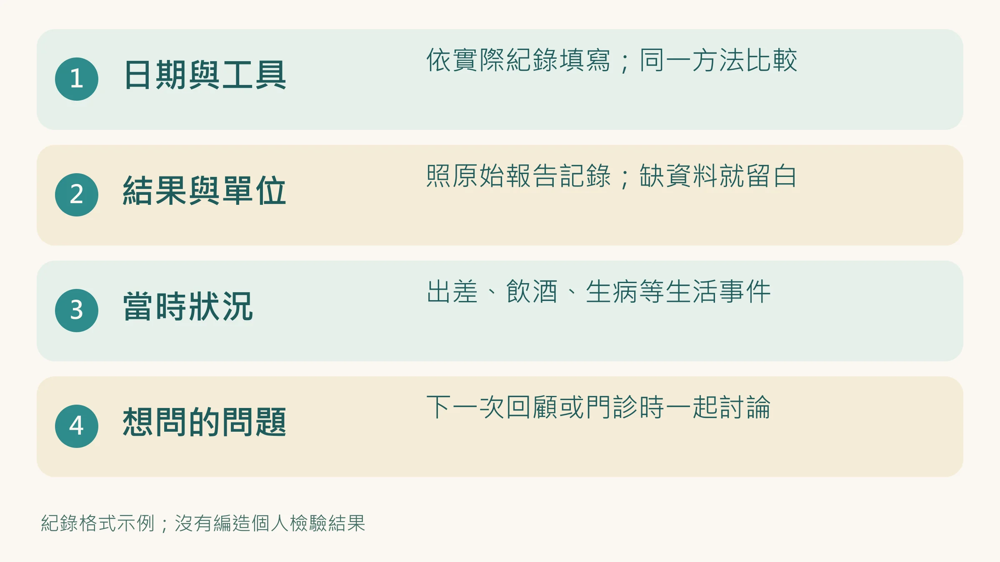

手錶每天都有數據，報告也拍進手機裡了。

然後呢？

如果每次想比較，都要翻相簿、找 App、猜上次發生什麼事，你缺的可能是一張能持續填下去的表。

先從你已經有的資料開始，不必為了填滿欄位，立刻多買工具或加做一套檢查。

## 一張表，只留五個欄位

| 日期 | 項目與工具 | 結果、單位 | 當時狀況 | 想問的問題 |
|---|---|---|---|---|
| 實際量測日 | 例如同一手錶的夜間 HRV | 照原始資料記錄 | 生病、飲酒、旅行、缺資料等 | 和自己過去比，真的有變嗎？ |
| 實際抽血日 | 照報告寫檢驗名稱 | 保留單位及參考範圍 | 是否空腹依檢驗要求；近期不適 | 醫師建議何時追蹤？ |
| 實際量測日 | 皮膚類胡蘿蔔素裝置 | 同一工具的原始分數 | 操作方式、近期飲食變化 | 這次和上次條件一致嗎？ |

這張表不替你診斷。它的用途，是讓下次回顧或回診時，不用從記憶裡補故事。

## 多久看一次？先分「整理資料」和「安排檢查」

你可以每天讓手錶收集資料，每週選一個固定時間回顧；這是生活安排的示例，不是醫療規定。

皮膚類胡蘿蔔素會隨飲食在數週間變化。若原本就有在量，可以約好一致的量測條件與回顧時間，不需要每天追分數。它提供近期蔬果攝取狀態的間接參考，不能代表全身防禦力。[1][2]

**抽血的間隔則另當別論。** 要看檢驗項目、疾病與用藥狀況，由醫師決定。不能因為追蹤表有「年度」欄位，就認定所有血液項目都該一年一次，也不能因為還沒到一年就延後必要複驗。

## 給忙碌生活的一個月起步法

### 第一週：只整理，不加碼

找出最近的報告，記下日期、單位與醫師交代的追蹤時間。把手錶的品牌、指標名稱和缺漏日標清楚。沒有量過的項目，留白就好。

### 第二週：選一件做得到的事

挑一個你自己想改善的生活安排，例如把晚間飲酒情況記下來，或在每天一餐加入原本常少掉的蔬菜。先記錄是否做到了，不急著把每次數字起伏都歸功或歸咎於它。

### 第三週：看條件有沒有變

旅行、工作壓力、生病或換裝置，都可能讓前後資料不容易比較。先找這些變化；資料缺漏時就標缺漏，不補成正常。

### 第四週：留下下一步問題

哪些資料值得繼續留？哪些每天看反而讓你焦慮？有沒有持續不適，需要提早回診？把問題寫下來，比替自己打健康總分更實用。

這是一個整理習慣的示例，不保證一個月內指標一定改善。

## 數字變了，先別直接配補充品

HRV 低不能直接決定該吃哪一款產品；皮膚分數低也不能單獨診斷營養缺乏。血脂、血糖異常，要依各自的臨床意義評估。不同量測的限制見 [血液、HRV、皮膚量測各在看什麼](/blog/chronic-inflammation/inflammation-three-clues/)。

若已有慢性病或正在用藥，保留原本醫療追蹤，不自行停藥。持續疲倦、睡眠困擾或反覆心悸，先和家醫科、內科或相關專科討論。

## 今天就能做的第一步

打開備忘錄，填一筆你已經有的紀錄：日期、工具、結果、當時狀況、想問的問題。

不用填滿。能在下次找得到、看得懂，這張表就開始有用了。

延伸閱讀：[HRV 的四個閱讀原則](/blog/precision-health-tools/hrv-recovery-guide/)｜[健檢五項數字的用途](/blog/body-signals/checkup-five-numbers/)｜[穿戴裝置怎麼選](/blog/precision-health-tools/wearable-choose-guide/)

*本文提供資料整理方法，不是個人化檢查或治療時程。*

## 參考文獻

1. Jahns L, et al. Skin and plasma carotenoid response to a provided intervention diet high in vegetables and fruit: uptake and depletion kinetics. *Am J Clin Nutr*. 2014;100:930–937. https://doi.org/10.3945/ajcn.114.086900
2. Ermakov IV, et al. Optical assessment of skin carotenoid status as a biomarker of vegetable and fruit intake. *Arch Biochem Biophys*. 2018;646:46–54. https://doi.org/10.1016/j.abb.2018.03.033
