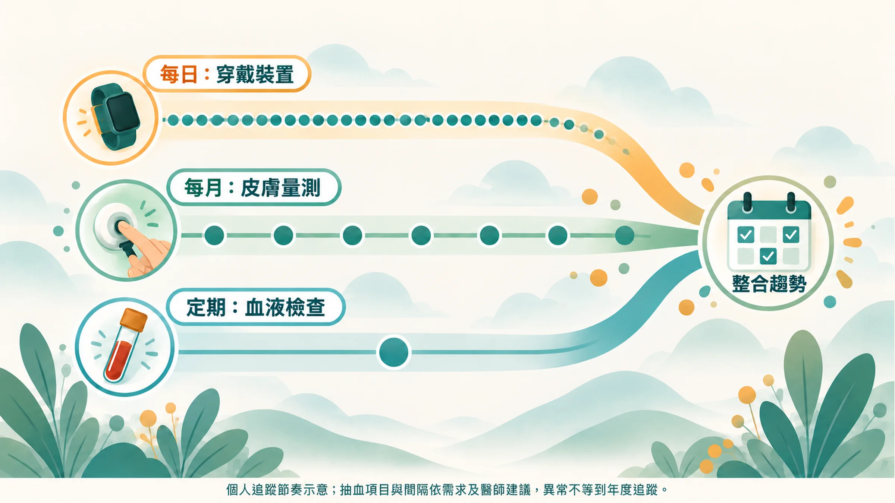
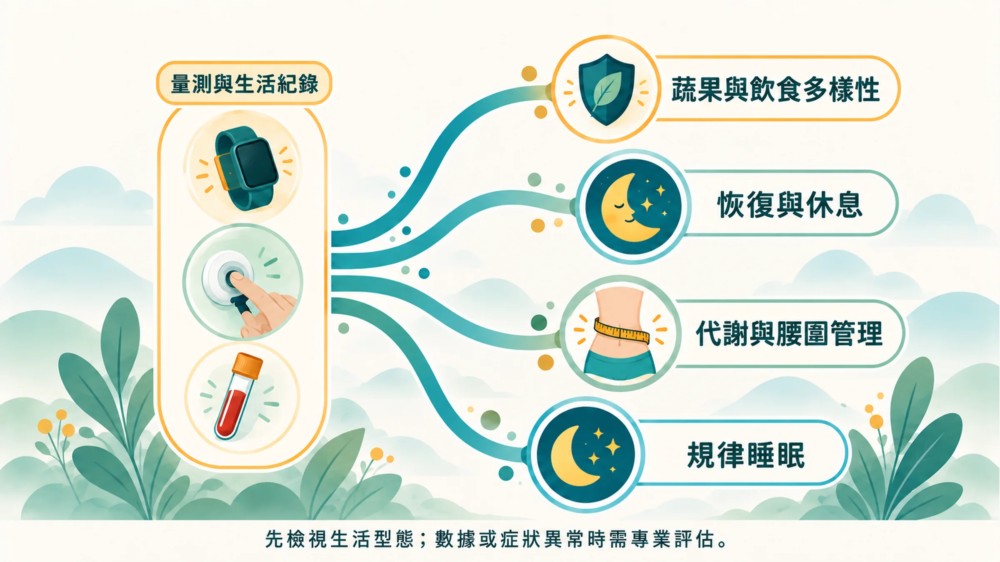

你可能已經買了手錶，也驗過一次 hs-CRP，甚至量過 Prysm 分數。

然後呢？

手錶的通知越來越少點開，報告收在抽屜，量測做了一次就沒再做。數據很多，身體沒什麼改變。

問題通常出在：**沒有一套固定的節奏**。

## 三種線索，三種速度

身體的不同系統，變化速度本來就不一樣。用同一個頻率去追蹤，不是太頻繁浪費錢，就是太稀疏錯過訊號。

| 頻率 | 工具 | 追蹤什麼 | 為什麼是這個頻率 |
|---|---|---|---|
| **每日** | 手錶、戒指、手環 | 睡眠、HRV、靜息心率 | 自律神經每天都在變，看 7 天平均 |
| **每月** | Prysm iO | 皮膚類胡蘿蔔素（抗氧化防禦網） | 皮膚類胡蘿蔔素以「週」為單位升降[1] |
| **每年** | 血液檢查 | hs-CRP、HbA1c、血脂、ApoB；Lp(a) 一生一次 | 代謝和發炎指標變化較慢；異常時依醫師建議縮短間隔 |

## 做得到，比做得完美更重要

很多人一開始就想做到全套：每天看 HRV、每週量一次、每季抽血。三個月後全部放棄。

這套節奏刻意設計得很鬆：

- **每天**：什麼都不用做，戴著睡覺就好。
- **每週**：週日花 2 分鐘，看一下 HRV 和睡眠的週平均，往上、持平還是往下。
- **每月**：固定一天量 Prysm，順便回顧這個月的生活大事。
- **每年**：生日月抽血，把上一年的趨勢一起帶去給醫師看。

## 依照最弱的那個系統，決定先補哪裡

追蹤的目的，是找出**你現在最需要支持的系統**。每個人的弱點不同，該優先做的事也不同。

### 第一步永遠是生活型態

2026 年《JAMA》發表的 DPP/DPPOS 追蹤 21 年結果顯示，糖尿病前期的成人接受密集生活型態介入，日後出現多重慢性病的風險降低約 21%，而服用 metformin 的組別沒有達到顯著差異[2]。睡眠、飲食、活動量是整個計畫的地基，營養補充只能放在地基上面。

### 依照數據找到缺口

| 數據顯示的缺口 | 生活型態優先調整 | 可以搭配的營養補充（延伸閱讀） |
|---|---|---|
| **Prysm 偏低**：抗氧化防禦網變薄 | 每天蔬果 5 份以上、顏色多樣；戒菸；注意防曬 | [LifePak 基礎營養](/blog/intervention-optimization/lifepak-foundation-nutrition/)、[綜合營養素與老化時鐘](/blog/precision-health-tools/multivitamin-lifepak-slow-aging-clock/) |
| **HRV 下滑、白天疲勞**：恢復跟不上 | 固定起床時間、減少晚間酒精、安排休息日 | [ageLOC R2 與細胞更新](/blog/intervention-optimization/ageloc-r2-cellular-renewal/) |
| **HbA1c、TG/HDL、ApoB 偏高**：代謝壓力 | 減少精製澱粉與含糖飲料、增加肌力訓練、控制腰圍 | [ageLOC Meta 的臨床研究與使用方式](/blog/intervention-optimization/ageloc-meta-clinical-protocol/) |
| **睡眠品質差、深睡少** | 睡前 1 小時遠離螢幕、臥室降溫遮光、規律作息 | [MyND360 與大腦夜間關機](/blog/intervention-optimization/mynd360-sleep-brain-shutdown/) |

營養補充品是飲食的輔助，不能取代醫療。血液數值異常、正在服藥或有慢性病，開始任何補充前請先和醫師或藥師確認。

## 90 天一個循環

建議用 90 天作為一次調整的週期：

1. **第 0 天**：建立基準。手錶開始戴著睡、量第一次 Prysm、如果一年內沒抽血就驗一次。
2. **第 1～30 天**：只改一件事。選最弱的系統，挑一個最容易做到的調整。
3. **第 30、60 天**：量 Prysm，回顧 HRV 月平均，記下生活大事。
4. **第 90 天**：檢視三條線索的方向。有進步就加入下一個調整；沒變化就回頭檢查執行狀況，或和顧問一起找原因。

皮膚類胡蘿蔔素在增加蔬果攝取後，通常需要數週才看得到上升[1]。給身體一點時間，也給數據一點時間。

## 從第 0 天開始

第一次量測最重要，它是之後所有比較的起點。

不確定 Prysm iO 怎麼量？先看 [15 秒看懂 Prysm iO](/blog/precision-health-tools/prysm-io-15sec/)。

**延伸閱讀**
- [三個數字一起看：6 種常見組合](/blog/precision-health-tools/three-clues-cross-reading/)
- [一把火，三處煙](/blog/chronic-inflammation/inflammation-three-clues/)

---

*本文為健康教育與趨勢追蹤用途，不等同醫療診斷。營養補充品為一般食品，不具治療疾病之效果。*

## 參考文獻

1. Jahns L, et al. Skin and plasma carotenoid response to a provided intervention diet high in vegetables and fruit: uptake and depletion kinetics. *Am J Clin Nutr*. 2014;100:930–937. https://doi.org/10.3945/ajcn.114.086900
2. Salive ME, et al. Lifestyle and metformin interventions and risk of multimorbidity in adults with prediabetes. *JAMA*. 2026. https://doi.org/10.1001/jama.2026.8492
3. Ermakov IV, et al. Optical assessment of skin carotenoid status as a biomarker of vegetable and fruit intake. *Arch Biochem Biophys*. 2018;646:46–54. https://doi.org/10.1016/j.abb.2018.03.033
4. Darvin ME, et al. One-year study on the variation of carotenoid antioxidant substances in living human skin: influence of dietary supplementation and stress factors. *J Biomed Opt*. 2008;13:044028. https://doi.org/10.1117/1.2952976
