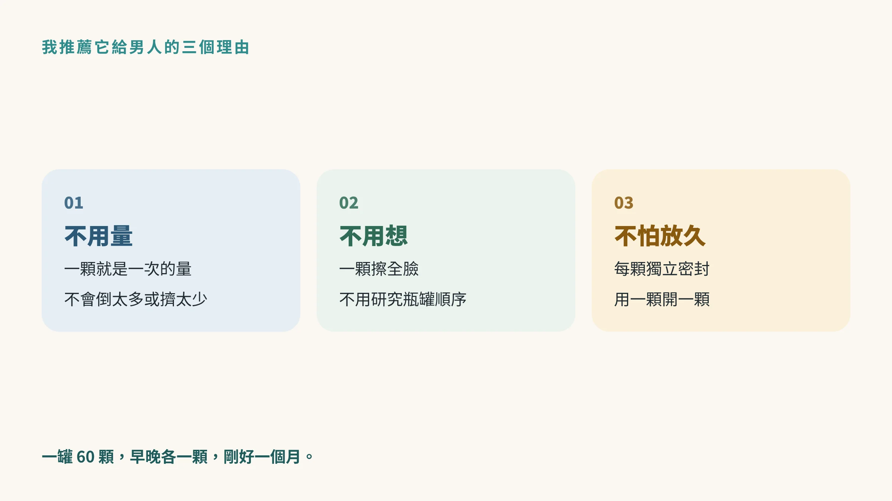
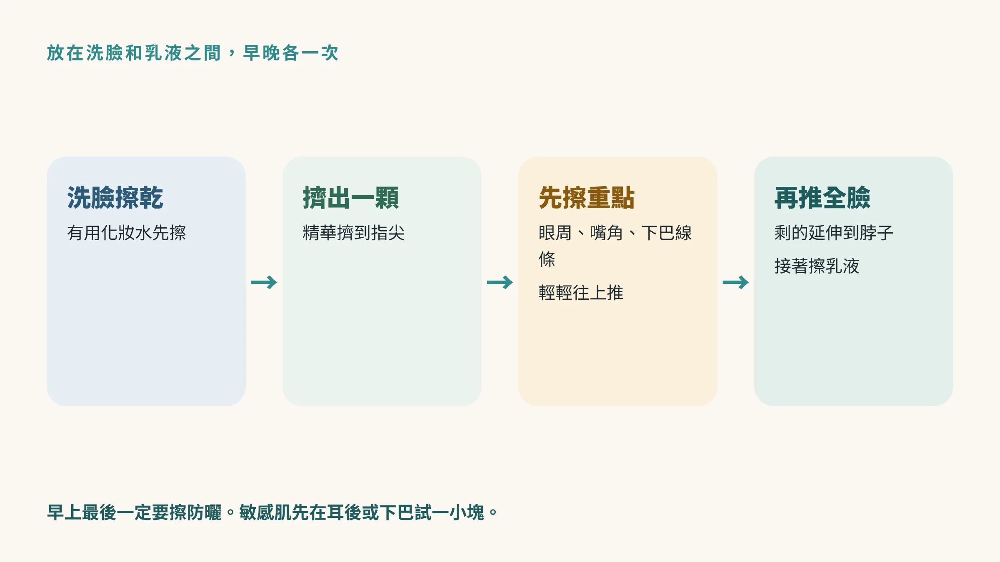
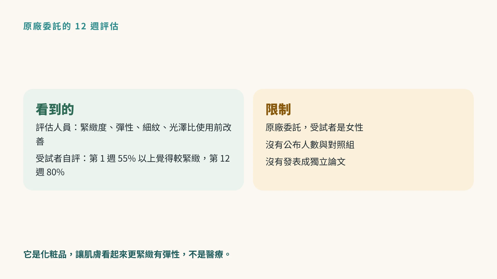

<!-- 🎨 [cover] [類型 D]
產品：ageLOC 活顏倍彈源液（Tru Face Essence Ultra）；左側插圖主題：A middle-aged East Asian man touching his jawline in a bathroom mirror, a few blue pearl capsules on the counter.
標籤（Canva 填入）：一顆藍珍珠，男人保養的第四步
STYLE: 依 IMAGE-STYLE.md 第 7.2 節
-->

> 這篇是產品介紹。先說清楚：我是 Nu Skin 經銷商，透過我的推薦管道購買，可能讓我取得銷售利益。我會把推薦的理由、官方資料和研究的限制分開說清楚。

洗臉、保濕、防曬，你已經做了一陣子。

某天看到朋友拍的合照，側臉那一張：下巴和脖子的線條，好像沒有以前那麼清楚了。法令紋也比印象中深一點。

你心裡想：「基本的都做了，還能再多做一點什麼嗎？」

如果你問我，我會推薦 Tru Face 系列裡的一個單品：**活顏倍彈源液**。我只推這一瓶，原因很簡單：它是一顆一顆的膠囊，男人用起來最不麻煩。

還沒開始做基本保養的話，先看〈[男人保養只做三件事](/blog/body-signals/men-skincare-cleanse-moisturize-sunscreen/)〉，三件事做順了再來加這一步。

## 它是什麼：一顆藍色的小珍珠

活顏倍彈源液（英文名 ageLOC Tru Face Essence Ultra）是 Tru Face 系列主打緊緻的精華，因為膠囊是藍色、圓圓的，很多人叫它「藍珍珠」。

一罐 60 顆，早晚各一顆，剛好用一個月。

**我推薦它給男人的三個理由：**

- **不用量：** 每顆膠囊就是一次的量，不會倒太多、也不會擠太少。
- **不用想：** 一顆擦全臉，不需要研究一排瓶瓶罐罐誰先誰後。
- **不怕放久變質：** 每顆是獨立密封的，用一顆開一顆。

這對保養新手很重要：步驟越簡單，越容易每天做下去。

## 裡面有什麼

依 Nu Skin 公布的產品資料，主要成分包括：

- **Tru Face FirmPlex：** Nu Skin 自家開發的緊緻複方，是這瓶的主軸。
- **ageLOC 專利成分：** Nu Skin 的 ageLOC 系列複方。
- **乳香樹脂（Pistacia lentiscus gum）：** 原廠說明用來讓肌膚看起來更緊實。
- **角鯊烷：** 保濕、讓皮膚摸起來柔軟。
- **脂溶性維生素 C、維生素 E、輔酶 Q10：** 抗氧化成分。
- **綠茶兒茶素萃取：** 抗氧化成分。

配方會更新，各地版本也可能不同，實際成分以台灣包裝上的標示為準。

## 怎麼用：洗臉保濕之間，多一顆

依台灣官方與原廠的使用說明，它放在**精華的位置**：洗臉之後、乳液或乳霜之前，早晚各一次。

1. 洗臉，擦乾。有用化妝水的人先擦化妝水。
2. 打開一顆膠囊，把裡面的精華擠到指尖。
3. **先擦需要加強的地方：** 眼睛周圍、嘴角、下巴線條，輕輕往上推開。
4. 再推到全臉，有剩的話往下延伸到脖子。
5. 接著擦乳液或乳霜。
6. 早上最後一定要擦防曬。

一顆就是一次的量，原廠也提醒不要一顆分兩次用：打開放著，容易受到汙染。

剛開始用，可能會覺得有點油潤，按摩一下讓它吸收，幾分鐘後就會變得滑順。

## 研究資料：原廠委託的 12 週評估

Nu Skin 委託第三方檢測機構，找了一群在意肌膚不夠緊緻的女性，連續使用 12 週。依原廠公布的資料：

- 評估人員觀察到，緊緻度、彈性、細紋、光澤，和使用前相比都有改善。
- 受試者自己的感受：使用一週，就有超過 55% 的人覺得整體和眼周比較緊緻；到第 12 週，這個比例是 80%。

**要說清楚的是：** 這是原廠委託的評估，受試者是女性，原廠沒有公布人數和是否有對照組，也沒有發表成獨立的學術論文。我把它當成參考，實際用起來適不適合，還是看你自己的使用感受。

也提醒一下：它是化粧品，用途是讓肌膚**看起來**更緊緻、有彈性，不是醫療。想處理很深的皺紋或明顯鬆弛，皮膚科有醫療的選擇，可以和醫師討論。

## 價格和購買前要確認的事

台灣官方目前的售價（依當期官網為準）：

- **活顏倍彈源液**（一罐 60 顆）：NT$4,745
- **補充包**（60 顆）：NT$4,175，罐子用完之後買補充包比較划算

一罐大約用一個月。購買前可以先想清楚：你願不願意每天早晚各多花一分鐘；預算上能不能持續用三個月，再來判斷效果。

## 這些情況，先問醫師

- 正在接受皮膚科治療，或正在擦醫師開的 A 酸類藥膏。
- 臉上有傷口、正在發炎、持續泛紅刺痛。
- 皮膚很敏感的人，先在耳後或下巴一小塊試用，觀察一兩天再擦全臉。
- 擦了之後出現紅腫、起疹子、刺痛：先停用，必要時看**皮膚科**。

## 帶走一句話

**基本三件事做順了，想多顧一點下巴線條，活顏倍彈源液是我會推薦的第四步。** 一次一顆，早晚各一次，白天記得防曬。

想讓清潔這一步更有步驟，可以搭配〈[為什麼我推薦 ageLOC LumiSpa iO？](/blog/intervention-optimization/ageloc-lumispa-io-guide/)〉。

---

## 參考資料

1. Nu Skin. *ageLOC Tru Face Essence Ultra Product Information Page*. 原廠產品資料，無 DOI。[官方 PDF](https://www.nuskin.com/content/dam/sea/ph/Documents/PIP/ageloc_tru_face_essence_ultra.pdf)。用於成分、使用方式與 12 週評估設計。
2. Nu Skin. *ageLOC Tru Face Essence Ultra*. 原廠產品頁，無 DOI。[官方頁面](https://www.nuskin.com/en_PT/products/anti-aging_opportunity/the-ageloc-difference/ageLOC-Tru-Face-Essence-Ultra.html)。用於第 1 週與第 12 週受試者自評比例。
3. Nu Skin 如新台灣。*Tru Face 活顏抗老保養產品列表*。官方產品資訊，無 DOI。[台灣官方頁面](https://www.nuskin.com.tw/shop/productlist/1174412216806413733)。用於品項名稱與售價，核對日期 2026-10-30。
4. Marie Claire 美麗佳人。看懂肌膚的需要：Nu Skin ageLOC Tru Face 活顏抗老系列。媒體報導，非同儕審查。[報導連結](https://www.marieclaire.com.tw/beauty/skin-care/92393)。用於台灣使用順序說明。

*本文為產品介紹與保養資訊，不構成醫療診斷或治療建議。產品內容以 Nu Skin 台灣官方標示為準。*
