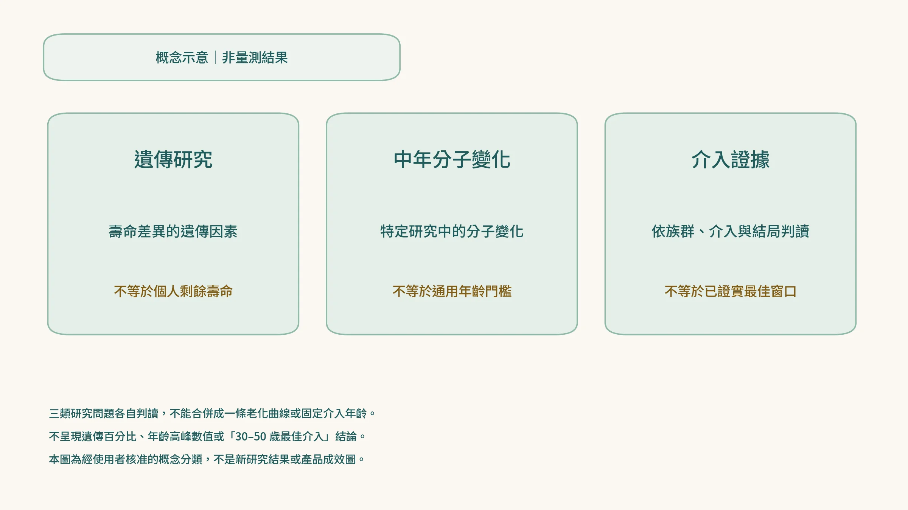
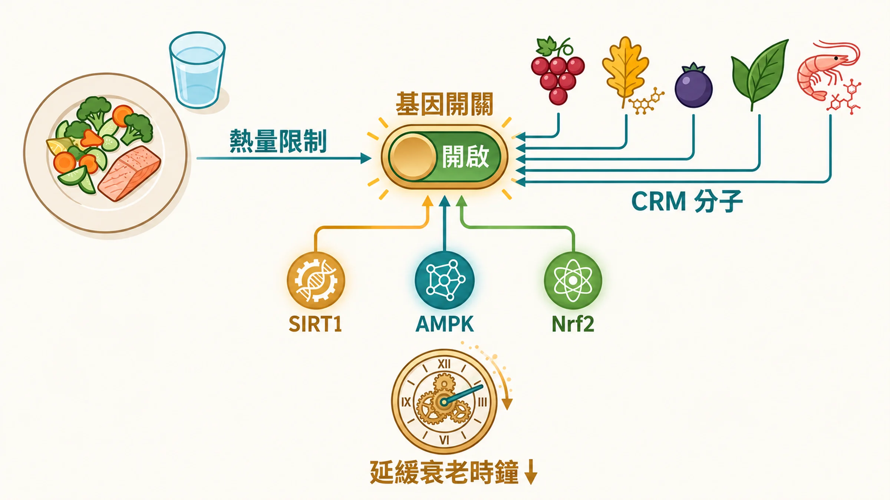
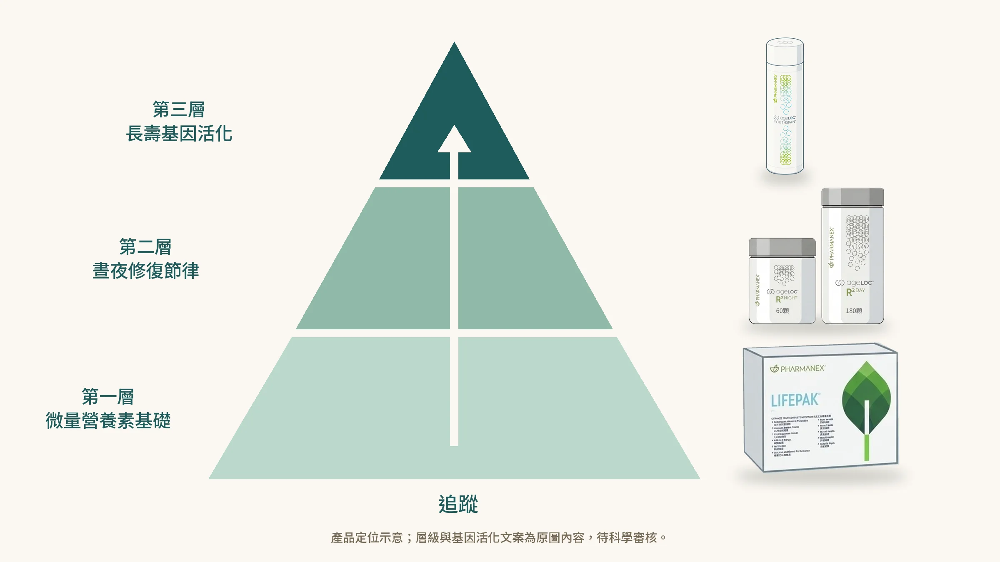
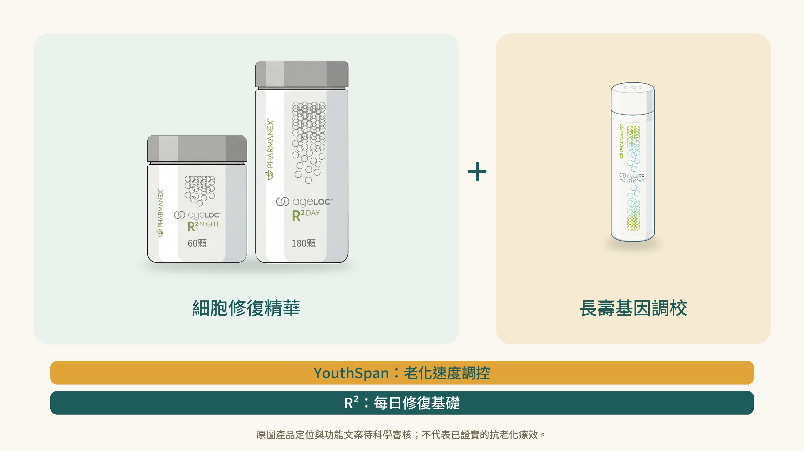

你一定有這個經驗。

同學會上，有人看起來和學生時代差不了多少，有人卻像老了15歲。

同樣的年紀，同樣在高壓環境下工作，但老化的速度明顯不同。

你說：「那是基因差異吧。」

部分正確。但只有部分。

---

## 一半看基因，一半你能決定

2026 年發表在《Science》的一項雙胞胎研究（以色列魏茲曼科學研究所），試圖回答：人能活多久，有多少是命中注定的？

結論是：**排除意外和傳染病之後，壽命的差異大約一半和基因有關，另一半和非遺傳因素有關。**（詳見[〈壽命約一半由基因決定〉](/blog/chronic-inflammation/longevity-55-percent-genetics/)）

基因那一半你沒辦法改。但另一半，是你每天的選擇在填寫的。

另一個關鍵的發現是：老化不是線性的。史丹佛大學 2024 年在《自然・老化》發表的多組學研究顯示，老化有兩個「加速期」，44 歲前後和 60 歲前後。

在這兩個時間點，身體的多個生物標記會同時快速惡化。

如果你現在 30 - 50 歲，你可能正在第一個加速期前後。

**這個時期，是開始調整生活習慣的好時機。**

---

## 什麼在決定你的「生理年齡」

你的出生年齡是固定的。你的生理年齡是浮動的。

生理年齡（biological age）由多個維度決定，包括：

**端粒長度**：染色體末端的保護帽。每次細胞分裂，端粒就縮短一點。端粒短的人，細胞複製能力下降，老化加速。壓力、睡眠不足、慢性發炎，都會加速端粒消耗。

**粒線體效率**：你的細胞發電廠。粒線體功能下降，能量生產效率降低，細胞修復能力同步下降。這就是為什麼 40 歲以後的疲勞，和 20 歲的疲勞在本質上不一樣。

**慢性發炎指數（Inflammaging）**：2000年，義大利老化研究學者 Claudio Franceschi 提出「Inflammaging」概念，老化本身就是一種慢性低度發炎的累積過程。你的 hs-CRP、IL-6、TNF-α 這些發炎標記，和你的生理年齡高度相關。

**表觀遺傳時鐘（Epigenetic Clock）**：你的DNA序列不變，但基因的「表現方式」會因為環境和生活習慣而改變。Horvath 時鐘、GrimAge 時鐘，都是用甲基化模式來估算你的生理年齡。

這四個維度，沒有一個是你完全無法介入的。



*▲ 不同研究層次的概念區分，不能合併推算 30–50 歲為已證實的最佳介入窗口。*

---

## 長壽基因的開關：你可以切換它

你體內有一組基因，科學家稱之為「長壽基因」，包括 SIRT1、SIRT3、FOXO、AMPK 通路。

這些基因在年輕時自然活躍，維持細胞修復效率、對抗氧化壓力、管控細胞老化速度。隨著年齡增長，它們的表現量下降，老化就加速了。

但它們不是靜態的。它們有開關。

最有力的天然開關是 **熱量限制（Caloric Restriction）**：從1935年就開始有動物實驗顯示，適度減少熱量攝取可以延長壽命，機制之一就是重新啟動 SIRT1 和 AMPK。

但長期挨餓對現代人來說不現實。

這就是為什麼科學家開始研究 **CRM（Caloric Restriction Mimetics）**，用特定的植化素模擬熱量限制的細胞信號，在不挨餓的情況下激活這些長壽基因通路。

研究最充分的 CRM 成分包括：
- **白藜蘆醇（Resveratrol）**：SIRT1 的直接激活劑，在紅葡萄皮中含量最高，但食物攝取量遠不足以達到研究劑量
- **槲皮素（Quercetin）**：AMPK 激活、同時具有 Senolytic 清除衰老細胞的效果
- **花青素（Cyanidin-3-glucoside）**：Nrf2 通路激活，增強抗氧化酶系統
- **α-硫辛酸（Alpha-lipoic acid）**：同時作用於粒線體保護和 Nrf2 通路
- **蝦青素（Astaxanthin）**：抗氧化力很強的類胡蘿蔔素，分子能橫跨細胞膜，研究上常被用來探討粒線體膜的保護



---

## ageLOC YouthSpan 的位置

Nu Skin 研究 ageLOC（anti-aging gene locator）技術超過20年，核心思路是：找出與老化最相關的基因表現模式，再用特定成分組合去影響它。

YouthSpan 的設計框架是 CRM。它的五種主要成分，在獨立研究中都被指向能影響 SIRT1、AMPK、Nrf2 等關鍵長壽通路。

我不會說「吃了就會返老還童」，那不是科學說的。

科學目前能說的是：**這些成分在動物與小型人體研究中，被觀察到會影響和老化相關的通路。** 至於能不能讓人的生理年齡變年輕，還沒有人體研究證明。

真正拉開 40 歲看起來 35 歲和看起來 50 歲的，最主要還是睡眠、運動、飲食、壓力這些每天的選擇。補充品是在這個基礎上的輔助。

---

## 但介入有順序，從這裡開始

知道了為什麼要介入，下一個問題是：從哪裡開始？

很多人在還沒有打好基礎的情況下，直接跳去吃針對特定機制的補充品。

這就像在地基沒打好的房子上裝修，外表看起來沒問題，但下面是空的。

如果你今天來找我說想認真處理慢性發炎，我的建議順序是這樣的：

### 第一層：地基（LifePak）

**在你做任何其他事之前，你的細胞需要有足夠的原料。**

你每天製造能量、修復細胞、對抗氧化壓力，全部都需要完整的微量營養素：抗氧化維生素、礦物質、Omega-3、輔酶Q10。

大多數人在這一層就已經不夠了，不是因為吃得差，而是現代食物的營養密度下降、外食蔬菜來源不穩定。

LifePak 的角色是在這一層。它不是讓你立刻有感的東西。它是讓你的細胞有足夠原料可以工作。

**建議：至少先打3個月的地基，再往上疊加其他介入。**

### 第二層：日夜節律（ageLOC R2）

依原廠說明，ageLOC R2 分成日錠和夜錠：日錠著重支持白天細胞的能量代謝，夜錠著重支持夜間身體本身的淨化與修復機制。它是營養補充品，不是藥物，不能治療或改善任何疾病。

### 第三層：基因層面的調校（ageLOC YouthSpan）

前兩層處理的是「讓細胞正常運作」。

第三層處理的是「讓細胞以更年輕的模式運作」。

這是 YouthSpan 進入的位置。

**為什麼放第三層？** 因為SIRT1和AMPK的啟動需要特定的輔因子，如果地基（第一層）還沒建好，這些通路就算被激活了，效率也會大打折扣。

先把環境建好，長壽基因才有地方發揮。

### 監測工具：Prysm iO

```
第一層（地基）：LifePak
        ↓
第二層（修復效率）：ageLOC R2
        ↓
第三層（基因調校）：ageLOC YouthSpan
        ↓
監測工具：Prysm iO 類胡蘿蔔素掃描

確認氧化壓力狀態，追蹤是否在正確方向
```



---

## YouthSpan + R2：兩個維度，才是完整的介入

很多人問我：YouthSpan 和 R2，要選哪個？

這個問題問錯了。它們不是選擇題，是兩個不同維度的介入。

**YouthSpan** 的設計方向是「長壽相關基因的表現」，以模擬熱量限制（CRM）的研究為基礎。

**R2** 的設計方向是「每日的節律」：日錠支持白天的能量代謝，夜錠支持夜間身體本身的淨化與修復機制。



---

## 幾個常見問題

**「我可以直接跳到第三層嗎？」**

可以。我會建議先把基礎營養顧好，是因為基礎微量營養素不足的人，補基礎通常是最划算的第一步。

**「這樣一個月要花多少錢？」**

取決於你目前在哪一層，以及身體的狀況。我不推薦「三層同時上」，除非已評估過基準狀態。最省的方式，是先做掃描、先填清單，讓我了解你的起點，再討論哪一層對你現在最有意義。

**「要吃多久才有感覺？」**

每個人不一樣，我不會給你「幾週有感」的保證。比較可靠的做法是：開始前用 Prysm iO 建立基準，3 個月後再掃一次，看數字有沒有往你要的方向走。

---

## 一個合理的期待設定

YouthSpan 不是速效補充品。它不會讓你下週突然感覺年輕10歲。

它是一個長期的選擇，至少要 3 到 6 個月，才能評估是否在往你要的方向走。

這也是為什麼我建議用 Prysm iO 建立基準，3 個月後再掃描一次，讓你有數字看到自己的抗氧化狀態是否改變了，而不是憑感覺猜。

---

## 長期使用的購買方式

如果你決定長期使用，Nu Skin 有 enJoy 定期購方案，有免運門檻與回饋金。方案內容會調整，請以[官方 enJoy 頁面](https://www.nuskin.com.tw/content/getting_started/enjoy-rewards.html)的最新條款為準。

---

*延伸閱讀：*
- [你的細胞儲備，正在被一個你感覺不到的過程悄悄耗光](/blog/chronic-inflammation/cell-reserve-chronic-depletion/)
- [LifePak：在啟動修護基因之前，你需要補地基打底](/blog/intervention-optimization/lifepak-foundation-nutrition/)
- [ageLOC R2：那個40歲看起來像32歲的男人](/blog/intervention-optimization/ageloc-r2-cellular-renewal/)
- [你上一次知道自己身體真正的狀態，是什麼時候？](/blog/precision-health-tools/prysm-io-15sec/)

## 參考資料

1. Serna Eva, Mastaloudis Angela, Martorell Patricia et al. (2020). A Novel Micronutrient Blend Mimics Calorie Restriction Transcriptomics in Multiple Tissues of Mice and Increases Lifespan and Mobility in C. elegans. *Nutrients*, 12(2):486. DOI：[10.3390/nu12020486](<https://doi.org/10.3390/nu12020486>)。
2. Mastaloudis Angela, Sheth Chandni, Hester Shelly N. et al. (2020). Supplementation with a putative calorie restriction mimetic micronutrient blend increases glutathione concentrations and improves neuroenergetics in brain of healthy middle-aged men and women. *Free Radical Biology and Medicine*, 153:112-121. DOI：[10.1016/j.freeradbiomed.2020.04.017](<https://doi.org/10.1016/j.freeradbiomed.2020.04.017>)。
3. Shenhar Ben, Pridham Glen, De Oliveira Thaís Lopes et al. (2026). Heritability of intrinsic human life span is about 50% when confounding factors are addressed. *Science*, 391(6784):504-510. DOI：[10.1126/science.adz1187](<https://doi.org/10.1126/science.adz1187>)。
4. Shen Xiaotao, Wang Chuchu, Zhou Xin et al. (2024). Nonlinear dynamics of multi-omics profiles during human aging. *Nature Aging*, 4(11):1619-1634. DOI：[10.1038/s43587-024-00692-2](<https://doi.org/10.1038/s43587-024-00692-2>)。
