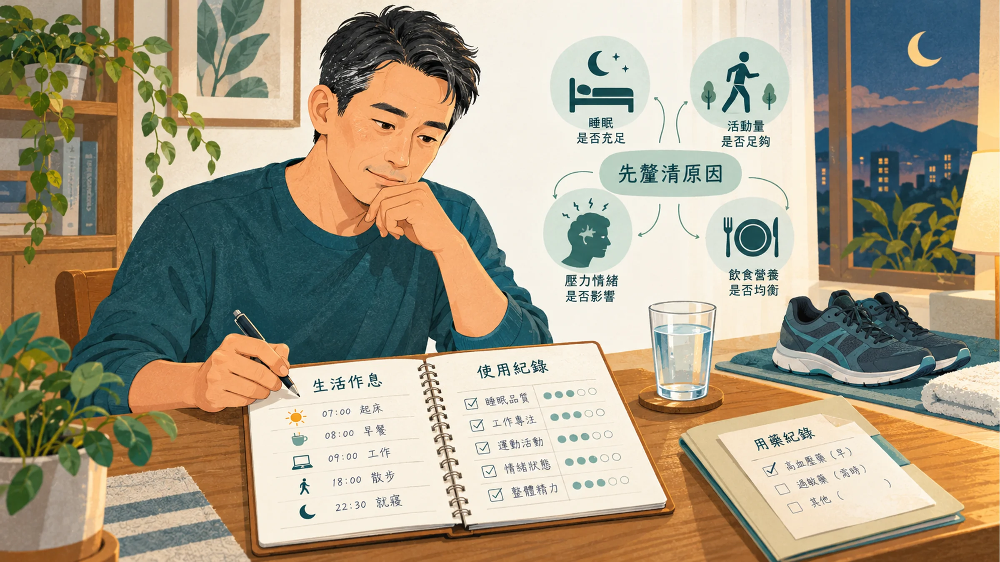
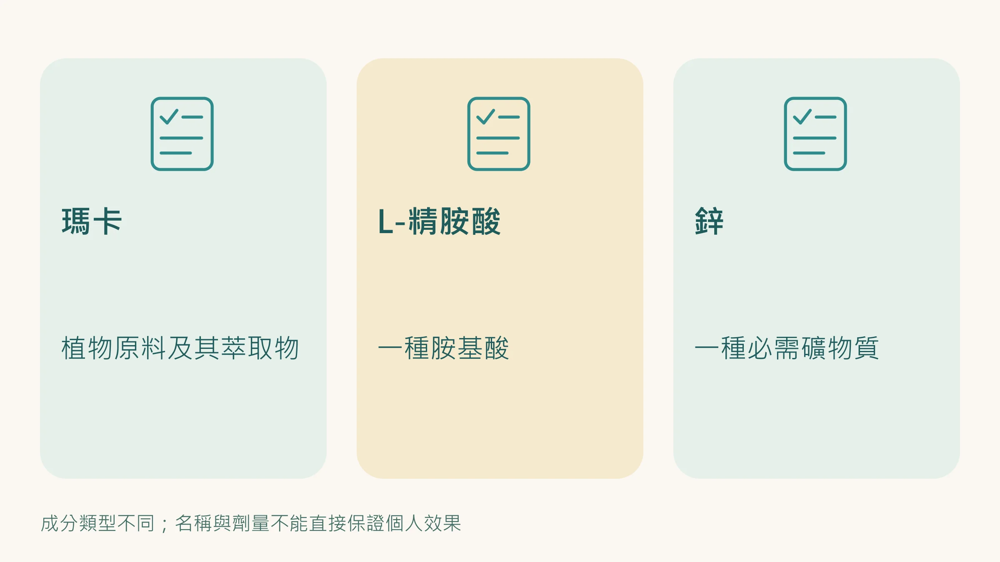
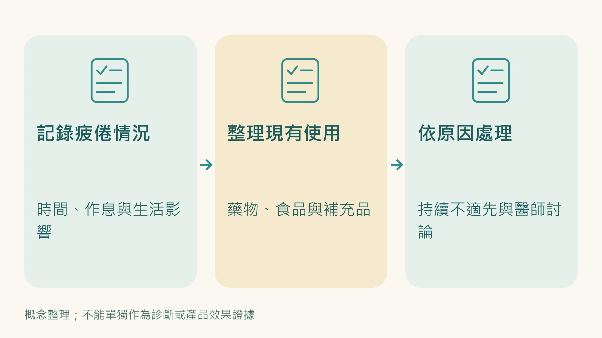

你在網路上搜尋「男性活力」，出來的前幾名幾乎都長一樣：

**高劑量瑪卡 + 精胺酸 + 鋅**

這個組合在台灣保健品市場的市占率極高，廣告往往主打「短期有感、CP值高」。

它確實有它的邏輯，這三種成分都跟男性的生理反應有關。

然後每一家廠商都在宣稱他們家的含量比較高。

但在比較成分之前，你必須先知道一個生物學真相：如果你的發電機（粒線體）已經生鏽，灌入再多高級燃料（補藥）也只會冒黑煙。

**如果這個組合真的這麼神，為什麼還是有那麼多 35 - 50 歲的高壓男性，吃了一罐接一罐，下午照樣腦霧，體力依舊透支？**

這篇的目的，不是要全盤否定這個組合，而是要從「細胞機制」的層次說清楚：

它**根本沒有碰到**的深層缺口是什麼？

---

## 戳破劑量迷思：這三個成分實際上在做什麼？

如果把男性的身體想像成一台跑車，我們來拆解這三個成分真實的生化機制：

### 1. 瑪卡（Maca）：死命猛踩油門

很多廣告暗示瑪卡能提升男性荷爾蒙，這是個大誤解。

臨床研究已經證實，**瑪卡並不會實質提高人體的血清睪固酮濃度**。

瑪卡其實是一種「適應原（Adaptogen）」，主要作用於大腦的 HPA 軸（下視丘—垂體—腎上腺軸）。

它比較像是一種強效的神經刺激物，能短暫讓你「主觀上」覺得精神變好、有衝勁。

**盲點在哪？** 當你的細胞（發電廠）已經因為過勞而處於慢性發炎時，猛踩油門只會讓引擎耗損得更快。

這也是為什麼很多人吃高劑量瑪卡，第一週覺得有效，一個月後卻覺得「越吃越累」。

### 2. 精胺酸（L-Arginine）：強行拓寬輸油管

精胺酸是一氧化氮（NO）的前驅物，它的作用是讓血管平滑肌放鬆、促進局部充血。

這也是它被廣泛用於男性保健品的核心邏輯。

**盲點在哪？** 第一，口服精胺酸的生物利用率很差，大部分在腸道和肝臟就被代謝掉了。

第二，這是純粹的「管線工程」。

如果你的心臟（引擎）本來就沒力，細胞缺的是純粹的能量（ATP），把水管撐得再大，也無法解決你隔天早上的深層疲勞與無力感。

### 3. 鋅（Zinc）：補充機油

鋅確實是睪丸間質細胞（Leydig cells）合成睪固酮的重要輔因子。

**盲點在哪？** 這是三個成分裡機制最實在的，但醫學共識是：**「只有當你體內『缺鋅』時，補鋅才有效。」** 

如果你平常飲食正常，體內鋅濃度在健康水位，吃再多的高劑量鋅也不會讓睪固酮突破上限，多餘的只會隨尿液排出。

---

## 你沒處理到的深層問題：細胞發電效率正在衰退

「瑪卡＋精胺酸＋鋅」的框架，充其量只處理了 **「神經感受」與「局部血流」**。

但 35 歲以上男性的體能下滑，根本不是從這裡開始的。你的疲勞，源自於更底層的系統衰退：

1. **粒線體效率下降：** 肌肉細胞的發電廠（粒線體）生成 ATP 的能力，會隨年齡逐漸下降（一項研究估計大約每十年下降 8%）。下午沒電、睡不飽，是因為細胞的發電能力在實質衰退。
2. **抗氧化主開關（Nrf2）失靈：** 隨著年齡與壓力增加，體內負責啟動抗氧化防禦的「Nrf2 路徑」活性會下降。自由基清不掉，細胞就像生鏽一樣，修復速度永遠跟不上耗損。
3. **夜間自噬機制（Mitophagy）停擺：** 夜間睪固酮的上升與受損粒線體的汰換，都需要完整、不被切碎的睡眠。如果你睡覺時自律神經無法放鬆，這個修復窗口就是在空轉。

這些問題，你吃再多精胺酸或瑪卡，都無濟於事。

---

## 跳出劑量競賽：先處理發電廠和睡眠

高壓主管需要的，不是短暫的亢奮感，而是讓身體的能量系統和睡眠回到正軌。

目前證據最強的做法，其實都不是補充品：

- **規律運動，尤其是有氧加肌力訓練**：直接刺激粒線體生成，也是研究上最能讓睪固酮回升的生活方式之一。
- **把睡眠顧好**：固定作息、睡前不喝酒、會打呼的人先評估睡眠呼吸中止症。
- **控制腰圍**：內臟脂肪會把睪固酮轉成雌激素，腰圍下來，睪固酮常常會跟著回升。

如果你想在這個基礎上加上營養補充，依原廠說明，ageLOC R2 分成日錠和夜錠：日錠著重支持白天細胞的能量代謝，夜錠著重支持夜間身體本身的淨化與修復機制。它是營養補充品，不是藥物，不能治療或改善任何疾病。

**最後也是最重要的一點：** 如果疲勞、性慾下降、晨間勃起減少已經持續一段時間，請先到泌尿科或新陳代謝科抽血檢查睪固酮。睪固酮低下是可以正式診斷和治療的，不要只靠補充品自己摸索。

---

## 停止盲測，讓數據決定你的下一步

你現在的疲勞，到底是哪一層的問題？有三個客觀指標能告訴我們真相：

1. **靜止心率（RHR）：** 近一個月是否緩步上升？（粒線體負擔加重的早期訊號）
2. **心率變異度（HRV）：** 是否低於個人基準線？（自律神經修復系統是否罷工）
3. **TG/HDL 比值：** 是否超過 2？（代謝迴路是否開始消耗過多能量）

這三個數字，比「我吃了瑪卡感覺有沒有差」可靠得多。

**健康管理不該是盲測。**

---

**延伸閱讀：**
- [ageLOC R2：那個40歲看起來像32歲的男人，細胞在夜裡做了什麼？](/blog/intervention-optimization/ageloc-r2-cellular-renewal/)
- [40歲的你只剩一張嘴了嗎？——不是「自然老了」是睪丸細胞提前衰老了](/blog/intervention-optimization/testosterone-cell-aging-40/)

---

## 參考資料

01. Gonzales G. F., Cordova A., Vega K. et al. (2002). Effect of Lepidium meyenii (MACA) on sexual desire and its absent relationship with serum testosterone levels in adult healthy men. *Andrologia*, 34(6):367-372. DOI：[10.1046/j.1439-0272.2002.00519.x](<https://doi.org/10.1046/j.1439-0272.2002.00519.x>)。
02. Melnikovova Ingrid, Fait Tomas, Kolarova Michaela et al. (2015). Effect of Lepidium meyenii Walp. on Semen Parameters and Serum Hormone Levels in Healthy Adult Men: A Double-Blind, Randomized, Placebo-Controlled Pilot Study. *Evidence-Based Complementary and Alternative Medicine*, 2015:1-6. DOI：[10.1155/2015/324369](<https://doi.org/10.1155/2015/324369>)。
03. Chen, Wollman, Chernichovsky et al. (1999). Effect of oral administration of high‐dose nitric oxide donor l‐arginine in men with organic erectile dysfunction: results of a double‐blind, randomized, placebo‐controlled study. *BJU International*, 83(3):269-273. DOI：[10.1046/j.1464-410x.1999.00906.x](<https://doi.org/10.1046/j.1464-410x.1999.00906.x>)。
04. Schwedhelm Edzard, Maas Renke, Freese Ralf et al. (2007). Pharmacokinetic and pharmacodynamic properties of oral L‐citrulline and L‐arginine: impact on nitric oxide metabolism. *British Journal of Clinical Pharmacology*, 65(1):51-59. DOI：[10.1111/j.1365-2125.2007.02990.x](<https://doi.org/10.1111/j.1365-2125.2007.02990.x>)。
05. Prasad Ananda S., Mantzoros Chris S., Beck Frances W.J. et al. (1996). Zinc status and serum testosterone levels of healthy adults. *Nutrition*, 12(5):344-348. DOI：[10.1016/s0899-9007(96)80058-x](<https://doi.org/10.1016/s0899-9007%2896%2980058-x>)。
06. Short Kevin R., Bigelow Maureen L., Kahl Jane et al. (2005). Decline in skeletal muscle mitochondrial function with aging in humans. *Proceedings of the National Academy of Sciences*, 102(15):5618-5623. DOI：[10.1073/pnas.0501559102](<https://doi.org/10.1073/pnas.0501559102>)。
07. Youle Richard J., Narendra Derek P. (2010). Mechanisms of mitophagy. *Nature Reviews Molecular Cell Biology*, 12(1):9-14. DOI：[10.1038/nrm3028](<https://doi.org/10.1038/nrm3028>)。

> *免責聲明：本文所提供之資訊與文獻探討，皆為日常健康促進與保養參考，不具備醫療診斷、治療、減輕或預防任何疾病之功效。若有明確醫療需求，請務必尋求專業醫師協助。*
