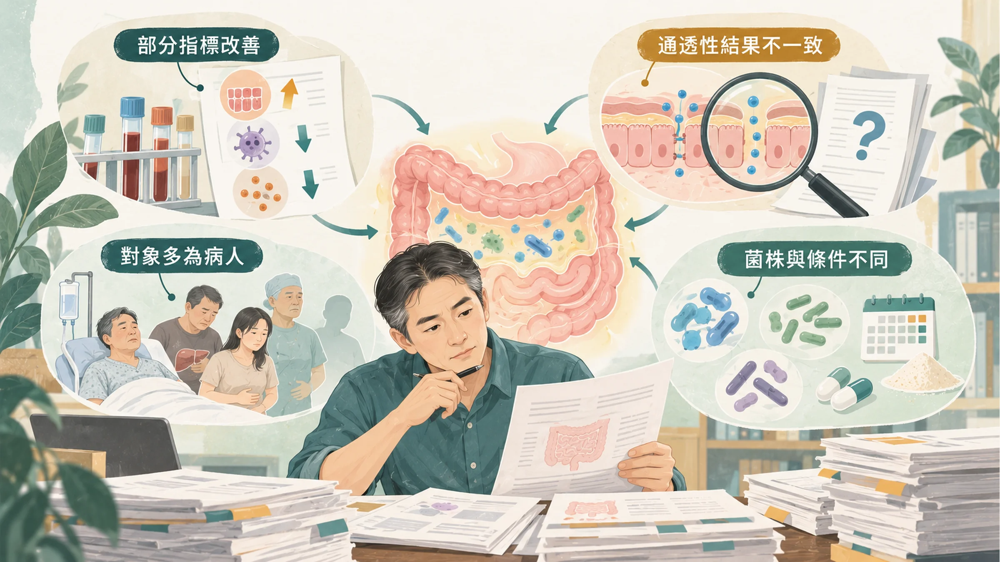
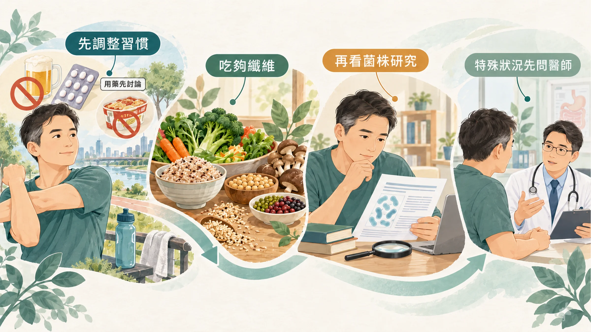
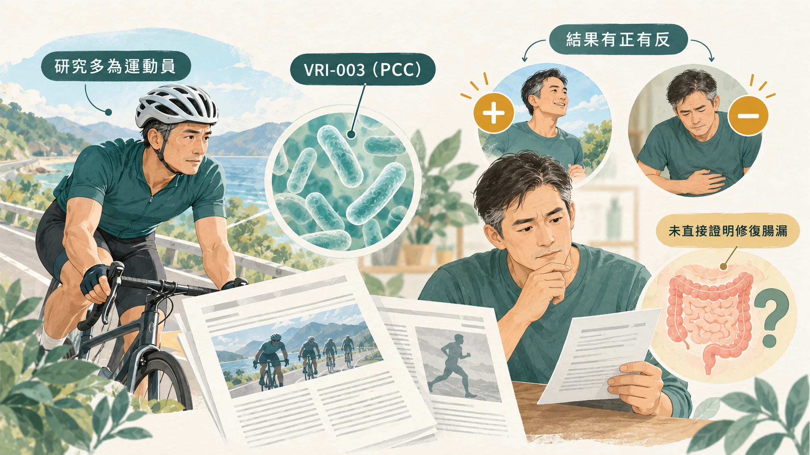

<!-- 🎨 [cover] [類型 A]
畫面：A probiotic capsule opened beside a simplified cross-section of intestinal lining, with a few small gaps between cells being examined under a magnifying glass. Warm off-white, teal and sage palette, soft editorial illustration, no readable text.
標籤（Canva 填入）：益生菌能修腸道屏障嗎？
STYLE: 依 IMAGE-STYLE.md 第 7.2 節
-->

> 這篇最後一段會介紹 Nu Skin 的益生菌產品。先說清楚：我是 Nu Skin 經銷商。前面的內容，不管你買不買產品都用得上。

這個系列寫到第四篇。前面三篇的結論是：

- 腸道真的會變漏，但「腸漏症」還不是一個診斷（〈[腸漏症是真的嗎？](/blog/body-signals/leaky-gut-what-is-real/)〉）。
- 長時間耐力運動、止痛藥、喝酒、加工食品都可能讓腸道變漏（〈[哪些習慣會讓腸道變漏？](/blog/chronic-inflammation/gut-barrier-habits-exercise-nsaids-alcohol/)〉）。
- 市售的 zonulin 檢測，量到的可能不是 zonulin（〈[腸漏症檢測準不準？](/blog/precision-health-tools/leaky-gut-test-zonulin/)〉）。

最後一個問題，也是最多人問的：**吃益生菌，能把腸道修好嗎？**

## 先看整體：統合分析怎麼說

2023 年一篇統合分析，整理了 26 個隨機對照試驗、共 1,891 位受試者，看益生菌對腸道屏障的影響（Zheng et al., 2023）。

**有改善的指標：**

- **腸道細胞的電阻**（也就是細胞之間封得緊不緊，數字越高越緊）：上升，但只有 3 個試驗。
- **血中內毒素和 LPS**（也就是細菌外殼碎片）：下降。
- **發炎指標** CRP、TNF-α、IL-6：下降。

**沒有明顯改善的指標：**

- **喝糖測通透性的比值**（研究裡比較直接量「漏不漏」的方法）：整體沒有達到統計上的明顯差異，只有在腸胃疾病的病人身上看到改善。
- **hs-CRP**：沒有明顯變化。

**要特別注意的地方：**

- 受試者**大多是病人**：重症、大腸癌手術、腸躁症、肝硬化、胰臟炎、代謝症候群等；健康的人只有幾組運動員。
- 血中 zonulin 也有下降，但前一篇提過，市售 zonulin 試劑量到的可能不是 zonulin；而且下降只在病人身上明顯，運動員沒有。
- 很多試驗的隨機分組和盲測方式交代不清，菌株、劑量、時間差很多。作者自己也說，需要更多高品質的試驗。

也就是說，益生菌對腸道屏障「可能有幫助」，證據主要來自病人；對健康的中年男人能做到什麼程度，還不清楚。

## 一個在健康人身上的試驗：止痛藥面前，三株都沒擋住

荷蘭有一個設計很細的試驗。10 位健康的人，輪流吃三種不同的植物乳桿菌（*Lactobacillus plantarum*）菌株和安慰劑，每段 7 天；每段最後吃消炎止痛藥 indomethacin，故意讓小腸變漏，再量通透性、做小腸切片（Mujagic et al., 2017）。

結果：

- 止痛藥確實讓小腸變漏，通透性的比值從 0.06 升到 0.10。
- **三株益生菌都沒有明顯擋住這個上升。**
- 其中 TIFN101 這一株，在小腸切片裡改變了和細胞連接、組織修復有關的基因表現。

這個結果告訴我們兩件事：第一，益生菌不是吃了就能抵銷止痛藥的傷害；第二，就算是同一個種，不同菌株在腸道裡的作用也不一樣。

## 所以，要不要吃益生菌來顧腸道屏障

依照目前的研究，比較實際的順序是：

1. **先把會讓腸道變漏的習慣減下來：** 少喝、不要天天吞止痛藥、少吃加工食品，長距離運動注意補水和高溫。
2. **把益生菌的食物吃夠：** 蔬菜、全穀、豆類、菇類裡的纖維（也就是益生元，腸道好菌可以利用、人體自己消化不了的部分）。
3. **想吃益生菌，看菌株：** 菌株編號要寫清楚，研究要做在同一株，看研究的對象和你像不像。怎麼看標示，可以參考〈[益生菌怎麼挑？](/blog/intervention-optimization/probiotics-how-to-choose-strain/)〉。

**這些情況，先問醫師：**

- 免疫力特別低的人，例如正在化療、器官移植後、重症住院中。
- 有發炎性腸道疾病、肝硬化等慢性腸胃或肝臟疾病。
- 正在吃抗生素的人，怎麼搭配先問醫師或藥師。
- 血便、黑便、體重莫名下降、排便習慣改變超過幾週：請看**腸胃科**，不要只靠益生菌處理。

## 產品介紹：Nu Skin Probio PCC®

再說一次，我是 Nu Skin 經銷商，下面是產品介紹。

Nu Skin 的 Probio PCC® 是單一菌株的益生菌，主要成分是發酵乳桿菌 **VRI-003**（PCC® 是這株菌的專利名稱），台灣版為膠囊。產品取得健康食品許可證「衛署健食字第 A00070 號」，核准內容可以在衛生福利部的健康食品資料庫查詢。食用方式與保存方式，請依產品標示。

先講清楚：**我目前沒有找到 PCC® 直接測量腸道通透性的人體研究。** 所以這篇不會說它能修復腸漏。

**以下是 PCC® 這株菌的成分研究，不代表產品效果：**

- 一項隨機、安慰劑對照試驗，找來 99 位自行車選手，每天補充 PCC® 或安慰劑 11 週。男性受試者的下呼吸道症狀和腸胃症狀嚴重度較低；但補充組輕微腸胃症狀的次數和天數，大約是安慰劑組的兩倍，女性受試者的結果也不一致（West et al., 2011）。這項研究的經費有一部分來自菌株所屬的公司。
- 另一項在耐力型運動員身上的研究，觀察補充 PCC® 後口腔黏膜免疫指標的變化（Cox et al., 2010）。

這些研究的對象是運動員，結果有正有反。把它當成參考，而不是保證。

買益生菌之前，先看清楚菌株編號，再問研究做在哪些人身上、實際量到了什麼。若最近一直有腸胃不適，先釐清原因；日常習慣也要一起調整，別把希望全放在一罐產品上。

---

## 參考資料
1. Zheng Y, et al. Probiotics fortify intestinal barrier function: a systematic review and meta-analysis of randomized trials. *Frontiers in Immunology*, 2023. DOI：[10.3389/fimmu.2023.1143548](https://doi.org/10.3389/fimmu.2023.1143548)。
2. Mujagic Z, et al. The effects of Lactobacillus plantarum on small intestinal barrier function and mucosal gene transcription; a randomized double-blind placebo controlled trial. *Scientific Reports*, 2017. DOI：[10.1038/srep40128](https://doi.org/10.1038/srep40128)。
3. West NP, et al. Lactobacillus fermentum (PCC®) supplementation and gastrointestinal and respiratory-tract illness symptoms: a randomised control trial in athletes. *Nutrition Journal*, 2011. DOI：[10.1186/1475-2891-10-30](https://doi.org/10.1186/1475-2891-10-30)。
4. Cox AJ, et al. Oral administration of the probiotic Lactobacillus fermentum VRI-003 and mucosal immunity in endurance athletes. *British Journal of Sports Medicine*, 2010. DOI：[10.1136/bjsm.2007.044628](https://doi.org/10.1136/bjsm.2007.044628)。
5. 衛生福利部食品藥物管理署。健康食品資料查詢。食藥署。https://consumer.fda.gov.tw/Food/InfoHealthFood.aspx?nodeID=162

*本文為健康教育資訊，不構成醫療診斷或治療建議。產品內容以 Nu Skin 台灣官方標示為準。*