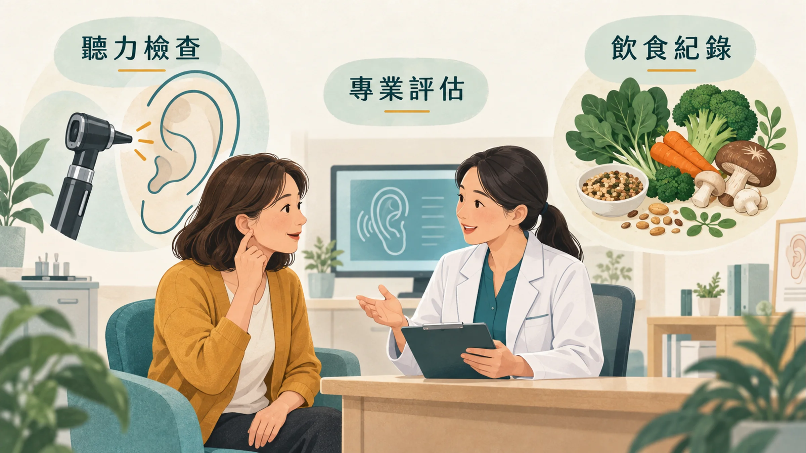
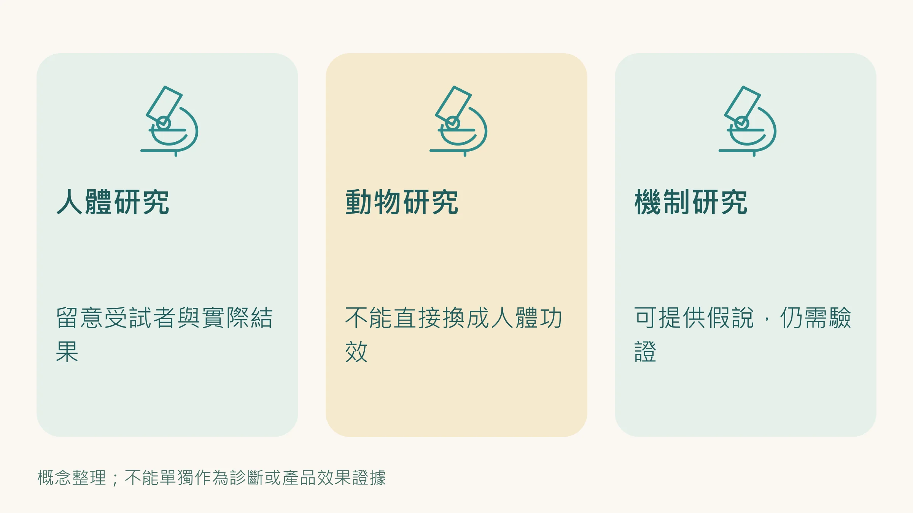
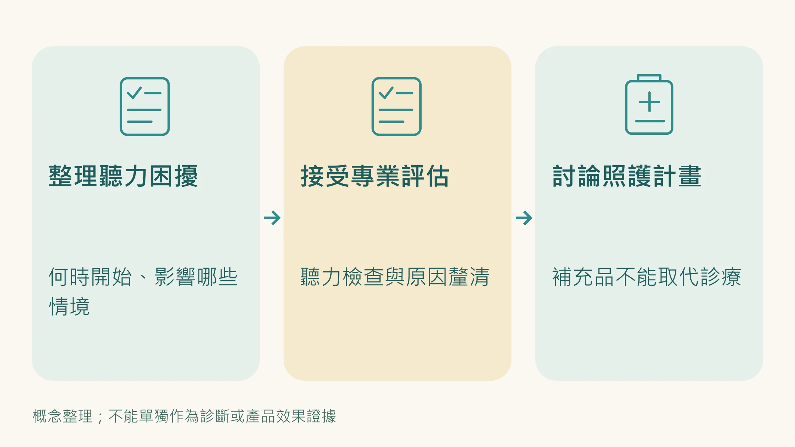

上一篇說到，你耳朵裡的毛細胞是「不補貨的倉庫」，死一根少一根，而且問題在你感覺到之前就已經在進行了。

這篇要談的是：**知道機制之後，你實際上可以做什麼。**

先說清楚一件事：

**目前沒有任何東西能逆轉已死亡的毛細胞。**

這不是悲觀，這是科學的邊界。所有介入的目標只有一個，讓損耗速度慢下來，讓你的倉庫磚頭少掉得慢一點，讓預防窗口維持得更久。

方向對了，介入才有意義。以下是目前證據最強的選項。

---

## 為什麼「亂補」沒有用，甚至有害？

很多人聽說抗氧化很重要，就開始買一堆保健品，但抗氧化劑不是越多越好。

你的細胞環境有自己的氧化還原平衡，貿然大量補充某種抗氧化劑，可能打亂這個平衡，讓本來正常的細胞訊號傳導出問題。

更關鍵的是：**不同的抗氧化劑作用在不同的位置，針對不同的機制。** 在不清楚自己的細胞資源狀態之前，補充的方向可能對，也可能打偏。

這就是為什麼第一步是先了解自己的狀況，而不是直接買東西。

---

## 有科學支持的介入選項

以下根據目前的研究證據分級，從證據較多到較新的選項排列。星等是我依「人體研究多寡」做的整理，大部分證據仍來自動物研究。

**開始任何補充之前，先看這三點：**

1. **先做聽力檢查。** 補充品不能取代聽力檢查和助聽器，那兩件事的證據比任何補充品都強（見[上一篇](/blog/body-signals/hearing-loss-dementia-signal/)）。
2. **劑量依產品標示，不要自己加高劑量。** 下面提到的研究劑量，是讓你判斷產品含量的參考，不是建議你照著吃。
3. **正在服藥的人先問醫師或藥師。** 薑黃素、白藜蘆醇、高劑量魚油會影響凝血，和抗凝血藥、抗血小板藥併用有出血風險；CoQ10 可能影響 warfarin 藥效；懷孕或哺乳中也請先諮詢。

---

### CoQ10（輔酶 Q10）｜證據等級 ★★★★

**它在做什麼：**
CoQ10 直接在粒線體的呼吸鏈裡工作，也就是在你耳蝸那個「24小時全力運轉的發電廠」裡。它讓能量轉換更有效率，同時減少廢氣（自由基）的產生。

**研究怎麼說：**
在17種抗氧化劑的系統性測試中，CoQ10 是唯二對耳蝸毛細胞有顯著保護效果的成分之一。動物研究中，補充CoQ10的組別在噪音暴露後的毛細胞存活率明顯更高。

**怎麼用：**
依產品標示劑量，隨餐補充（脂溶性，需要有油脂才能吸收）。部分研究顯示 ubiquinol（還原型）對年長者吸收較好，但劑型設計（例如包覆技術）的影響也很大。

---

### α-硫辛酸（Alpha-Lipoic Acid, ALA）｜證據等級 ★★★★

**它在做什麼：**
ALA 是少數既溶於水、又溶於脂肪的抗氧化劑，所以它能在細胞的各個角落工作，細胞膜、粒線體、細胞質都到得了。它還能「充值」維生素C和維生素E，讓已經用掉的抗氧化劑重新活化。

**研究怎麼說：**
同樣是那個 17 種測試中唯二有效的成分。與 CoQ10 合用有協同效果，兩者組合是目前動物研究中對耳蝸保護最強的組合。

**怎麼用：**
研究常用劑量約每天 600 mg，依產品標示服用。動物研究中與 CoQ10 合用效果較好，人體還沒有直接證據。糖尿病用藥者要注意，ALA 可能讓血糖再降低。

---

### NAC（N-乙醯半胱氨酸）｜證據等級 ★★★★

**它在做什麼：**
NAC 是合成「穀胱甘肽」的原料，穀胱甘肽是你細胞內最重要的抗氧化防禦系統，也是你內耳主要的自由基清除劑。你沒辦法直接補充穀胱甘肽（口服吸收率很低），但補充NAC可以讓細胞自己合成更多。

**研究怎麼說：**
這是這幾個成分中人體試驗相對較多的一個。針對噪音暴露的軍事人員與工廠勞工的試驗結果並不一致：部分研究看到保護效果，也有大型試驗整體沒有達到統計顯著。

**怎麼用：**
研究劑量多在每天 600–1200 mg，依產品標示服用。一般耐受性良好，可能有腸胃不適。

---

### 薑黃素（Curcumin）｜證據等級 ★★★

**它在做什麼：**
薑黃素激活的是你體內的「消防隊長」Nrf2，啟動幾十個抗氧化基因，對整個耳蝸細胞環境有保護效果，同時有抗發炎作用。

**研究怎麼說：**
2024 年一項雙盲安慰劑對照試驗顯示，薑黃素補充後聽力閾值有改善。要注意的是，受試者是慢性腎臟病患者，結果能不能套用到一般人還不確定。

**怎麼用：**
依產品標示服用。薑黃素本身吸收率極低，選有吸收設計（例如黑胡椒鹼 piperine、磷脂複合）的配方比較有意義。**注意：** 黑胡椒鹼會影響多種藥物的代謝，薑黃素也有抗凝血作用，正在服藥的人一定要先問醫師或藥師；有膽結石的人也不建議自行使用。

---

### 麥角硫因（Ergothioneine）｜證據等級 ★★★

**它在做什麼：**
麥角硫因是近年來老化研究中最受關注的成分之一。它有專屬的細胞運輸受體（OCTN1），可以高效率進入細胞，同時有抗氧化和抗發炎雙重效果。

**研究怎麼說：**
2024年動物研究顯示，補充麥角硫因可以明顯減緩年齡相關性聽力損失的進程。人類試驗尚未完成，但動物數據令人期待。

**怎麼用：**
目前以食物來源為主。牛肝菌和杏鮑菇的麥角硫因含量遠高於其他食物，每週固定吃幾次菇類，是最自然的補充方式。

---

### 白藜蘆醇（Resveratrol）｜證據等級 ★★★

**它在做什麼：**
白藜蘆醇激活 SIRT1（長壽蛋白），對聽覺神經有保護效果，同時有抗發炎作用。

**注意：這個成分有劑量陷阱。**
動物研究顯示，**低劑量有保護效果，高劑量反而有害**。這不是誇大，這是機制上的問題，過高劑量的白藜蘆醇會干擾正常的氧化訊號傳導，反而加速細胞壓力。

**怎麼用：**
依產品標示服用，不要自行加高劑量。如果你的保健品廠商告訴你「越多越好」，這是一個紅旗。

---

## 從餐桌開始：如果你想從最低門檻入手

不想一開始就吃一堆補充劑？這幾種食物有具體的研究支持：

**菇類（牛肝菌、杏鮑菇、香菇）**
麥角硫因的最佳天然來源。每週 3 – 4 次，每次一份，是最實際的補充方式。

**青花菜芽（花椰菜苗）**
含蘿蔔硫素，是目前已知最強效的天然 Nrf2 激活劑。比成熟的花椰菜效力高出數十倍，在超市或有機店能買到。

**高可可含量黑巧克力（≥70%）**
一項韓國大規模研究發現，定期吃黑巧克力的人聽力損失率顯著偏低，且攝取頻率越高效果越明顯。不含可可的甜食沒有這個效果。

**沙丁魚、鯖魚等深海魚**
CoQ10的良好食物來源，同時含豐富 Omega-3，改善內耳血流。

**日常習慣（不花錢但很重要）**
- 每週3次以上有氧運動，每次30分鐘，直接促進粒線體品質控制
- 睡眠認真對待，耳蝸粒線體的修復主要在深睡期進行，睡不夠等於讓補充劑的效果打折
- 高噪音環境（演唱會、工地、射擊）戴耳塞或耳罩，耳機音量不超過最大音量的六成

---

## 怎麼知道介入有沒有效？

這是很多人忽略的問題。

對聽力來說，最直接的指標就是 **聽力檢查本身**。開始調整之前做一次純音聽力檢查，之後每 1～2 年追蹤一次，看高頻聽力有沒有繼續往下掉。

如果你想同時追蹤蔬果與抗氧化營養的攝取，Prysm iO 可以在 15 秒內量化你的皮膚類胡蘿蔔素，反映過去 2 到 4 週吃進去的蔬果與類胡蘿蔔素。要注意它量的是類胡蘿蔔素，不會反映 CoQ10、NAC 這類成分的效果，也不能代表你的聽力狀態。

---

**延伸閱讀：**
- [「蛤？你公蝦？」聽力退化是失智的「前兆」？](/blog/body-signals/hearing-loss-dementia-signal/) ← 聽力退化原因篇
- [你的身體老化速度，有辦法知道嗎？](/blog/precision-health-tools/aging-speed-measurement-methods/) ← Prysm iO 掃描說明
- [Nu Skin CoQ10：為什麼劑型比劑量更重要](/blog/intervention-optimization/nuskin-coq10-bioavailability/)

---

## 參考資料

01. Fujimoto Chisato, Yamasoba Tatsuya (2019). Mitochondria-Targeted Antioxidants for Treatment of Hearing Loss: A Systematic Review. *Antioxidants*, 8(4):109. DOI：[10.3390/antiox8040109](<https://doi.org/10.3390/antiox8040109>)。
02. Le Prell Colleen G., Hughes Larry F., Miller Josef M. (2007). Free radical scavengers vitamins A, C, and E plus magnesium reduce noise trauma. *Free Radical Biology and Medicine*, 42(9):1454-1463. DOI：[10.1016/j.freeradbiomed.2007.02.008](<https://doi.org/10.1016/j.freeradbiomed.2007.02.008>)。
03. Le Prell Colleen G., Gagnon Patricia M., Bennett David C. et al. (2011). Nutrient-enhanced diet reduces noise-induced damage to the inner ear and hearing loss. *Translational Research*, 158(1):38-53. DOI：[10.1016/j.trsl.2011.02.006](<https://doi.org/10.1016/j.trsl.2011.02.006>)。
04. Doostkam Aida, Iravani Kamyar, Malekmakan Leila et al. (2024). The effectiveness of curcumin as a safe agent on hearing threshold improvement in patients with chronic kidney disease: a double-blind, placebo-controlled trial. *Scientific Reports*, 14(1):17576. DOI：[10.1038/s41598-024-68572-8](<https://doi.org/10.1038/s41598-024-68572-8>)。
05. Li Ning, Yan Xirui, Huang Weiling et al. (2023). Curcumin protects against the age-related hearing loss by attenuating apoptosis and senescence via activating Nrf2 signaling in cochlear hair cells. *Biochemical Pharmacology*, 212:115575. DOI：[10.1016/j.bcp.2023.115575](<https://doi.org/10.1016/j.bcp.2023.115575>)。
06. Bauer Mark A., Bazard Parveen, Acosta Alejandro A. et al. (2024). L-Ergothioneine slows the progression of age-related hearing loss in CBA/CaJ mice. *Hearing Research*, 446:109004. DOI：[10.1016/j.heares.2024.109004](<https://doi.org/10.1016/j.heares.2024.109004>)。
07. Song Xingxu, Tian Zhong, Jiang Kexin et al. (2024). Associations between Plant-Based Dietary Patterns and Sensory Impairments among Chinese Older Adults: Based on the Chinese Longitudinal Healthy Longevity Survey. *Gerontology*, 70(10):1042-1054. DOI：[10.1159/000540611](<https://doi.org/10.1159/000540611>)。
08. Zhou Zhongming, Han Yanyan (2024). Association between oxidative balance score and hearing loss: a cross-sectional study from the NHANES database. *Frontiers in Nutrition*, 11:1375545. DOI：[10.3389/fnut.2024.1375545](<https://doi.org/10.3389/fnut.2024.1375545>)。
09. Szczepek Agnieszka J., Olze Heidi (2026). Coenzyme Q10 in Hearing Disorders: Replacement Therapy in Mitochondrial Deafness and Neuroprotective Use in Acquired Hearing Loss. *Journal of Otorhinolaryngology, Hearing and Balance Medicine*, 7(1):8. DOI：[10.3390/ohbm7010008](<https://doi.org/10.3390/ohbm7010008>)。
