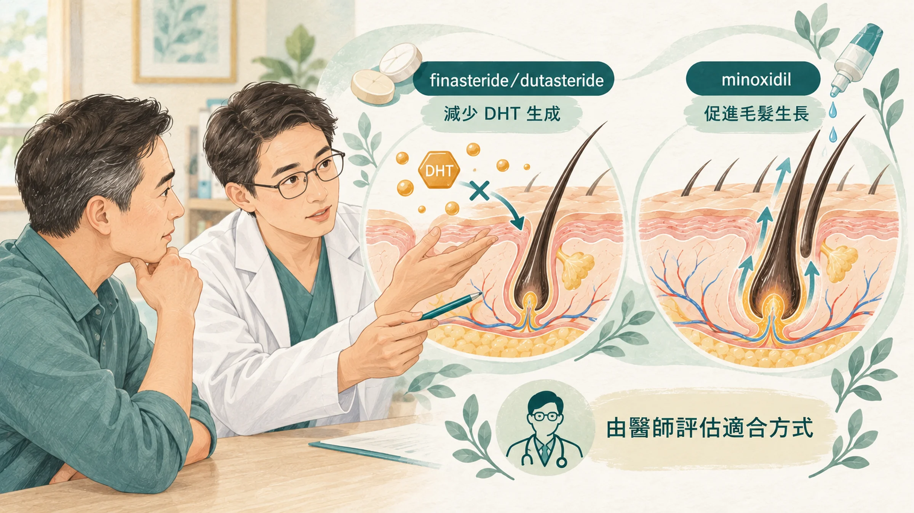
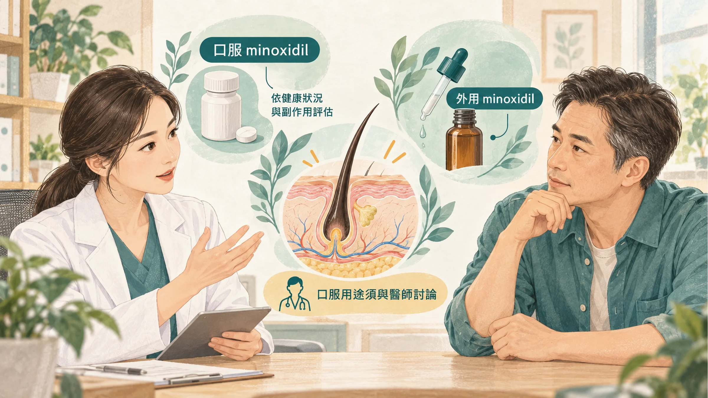
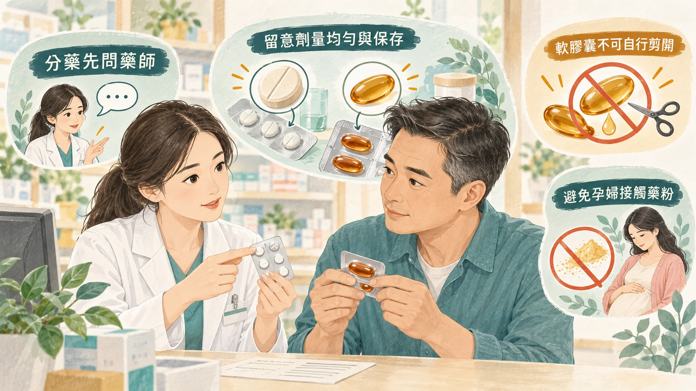

<!-- 🎨 [cover] [類型 A]
畫面：A middle-aged East Asian man sitting across from a dermatologist, looking at a scalp photo on a tablet; on the desk a dropper bottle and a small pill box. Warm off-white, teal and sage, soft editorial illustration, no readable text.
標籤（Canva 填入）：雄性禿吃藥還是擦藥？
STYLE: 依 IMAGE-STYLE.md 第 7.2 節
-->

每天早晚擦生髮水，擦了半年。

頭髮黏成一撮一撮，抓了半天的髮型一擦就塌。頭皮開始癢，抓一抓還會掉屑。你心裡想：「有沒有吃一顆就好的？」

剛好看到一則新聞：「九成皮膚科醫師改開口服藥。」

先別急著換。這篇把最新的研究拆開來看：**口服真的比擦的好嗎？新藥一定比舊藥強嗎？**

雄性禿的基本處理、怎麼先看頭皮，可以先讀〈[髮際線往後退，可以做什麼？](/blog/body-signals/hair-loss-options-scalp-check/)〉。

## 先認識兩類藥：一個「擋」，一個「催」

治療雄性禿的藥，大致分兩類：

- **擋：finasteride、dutasteride。** 雄性禿的毛囊會被雙氫睪固酮（DHT，也就是睪固酮在頭皮被轉換成的更強版本）慢慢縮小。這兩個藥擋住製造 DHT 的酵素（5α 還原酶），讓毛囊不要繼續縮。
- **催：minoxidil。** 讓毛囊的生長期變長，頭髮長得更粗、更久。外用的就是生髮水；口服的原本是降血壓藥。

所以很多皮膚科醫師會兩類一起用：一個擋住讓頭髮變少的原因，一個催頭髮長。

## 2026 年的新調查：處方習慣變了

西班牙的皮膚科團隊，在 2024 年調查了 202 位皮膚科醫師開給雄性禿病人的藥，和 2019 到 2020 年的調查比較（Pindado-Ortega et al., 2026）：

- 會開**口服 minoxidil** 給男性雄性禿的醫師，從 50.6% 上升到 **89.1%**。
- **外用 minoxidil** 的使用在下降。
- 男性雄性禿的抗雄性素藥物，**dutasteride 已經超過 finasteride**，成為最常開的那一個。

看到這裡，很容易得出結論：「生髮水和 finasteride 過時了。」但處方習慣改變，不等於舊藥沒效。下面一個一個看。

## 口服 minoxidil 真的比擦的好嗎？

**為什麼越來越多醫師開口服？** 主要是方便。生髮水要早晚擦、會黏、會影響髮型，有些人擦了頭皮癢、過敏，最後就不擦了。雄性禿要長期處理，吃一顆比擦兩次容易做到。

**效果呢？** 巴西有一項隨機雙盲試驗，找了 90 位男性，一組每天吃 5 毫克口服 minoxidil，一組每天擦兩次 5% 生髮水，持續 24 週（Penha et al., 2024）。

- 主要的比較指標「頭髮密度」，兩組**沒有明顯差別**。
- 用照片評估，口服組在頭頂的進步比較好，但前額沒有差別。
- 口服組有 49% 出現**多毛**（臉上、身上的毛也變多），14% 頭痛。

也就是說，口服沒有全面勝過擦的。它比較像是「擦不下去的人」的另一個選擇。

**口服 minoxidil 要注意的事：**

- **它是降血壓藥。** 用來生髮屬於「仿單外使用」（也就是藥品許可證上沒有寫這個用途，由醫師專業判斷使用）。
- 一項 1,404 位病人的多中心研究，用的是低劑量口服 minoxidil：最常見的副作用是多毛（15.1%），另外有頭暈（1.7%）、水腫（1.3%）、心跳加快（0.9%）（Vañó-Galván et al., 2021）。
- 有心臟病、血壓偏低、正在吃降血壓藥的人，一定要先讓醫師評估。
- 出現心悸、胸悶、腳腫、喘：要回診或就醫。
- 不管擦的還是吃的，**停用之後效果會慢慢消失**，新長出來的頭髮可能又掉。

## Dutasteride 一定比 finasteride 強嗎？

| | finasteride | dutasteride |
| --- | --- | --- |
| 擋哪一種酵素 | 第 2 型 5α 還原酶 | 第 1 型和第 2 型都擋 |
| 雄性禿適應症 | 美國 FDA 核准用於雄性禿 | 主要核准於攝護腺肥大，用在雄性禿多屬仿單外使用 |
| 在身體裡停留多久 | 半衰期約 6 到 8 小時 | 半衰期約 5 週 |
| 定位 | 第一線常用 | 用了 finasteride 一段時間效果不夠時的選項 |

**效果：** 一篇統合分析整理了 3 個隨機試驗、576 位男性，24 週後 dutasteride 組的頭髮數量比 finasteride 組多（Zhou et al., 2019）。性功能相關的副作用，兩組沒有明顯差別。但試驗數量少、時間短，作者也提醒證據有限。

**關鍵差異是「停留時間」：** finasteride 的半衰期只有 6 到 8 小時，萬一出現不舒服，停藥後很快就會代謝掉；dutasteride 的半衰期大約 5 週，萬一副作用讓你受不了，藥物要好幾個月才會完全離開身體。

所以很多皮膚科醫師還是會**先從 finasteride 開始**，效果不夠再討論換成 dutasteride。

**這兩個藥都要注意：**

- **懷孕或可能懷孕的女性不能接觸**，包括碎掉的藥錠和粉末。這兩個藥會影響男性胎兒的發育。
- 可能出現性慾降低、勃起或射精的變化，有任何不舒服回診說清楚。
- 會讓 PSA（攝護腺特異抗原）數值下降，**做攝護腺檢查時要告訴醫師你在吃這類藥**。
- 打算生小孩的人，先和醫師討論。

## 想省錢切藥？先知道這四個風險

finasteride 有專門給雄性禿的 1 毫克劑型，也有給攝護腺肥大的 5 毫克劑型。有些人會請醫師開 5 毫克的再切開吃，因為比較便宜；學名藥通常也比原廠藥便宜。

切藥有四個風險：

1. **劑量不均：** 小藥錠很難切得剛好。
2. **膜衣破掉：** 藥錠外面那層保護膜破了，藥物可能受潮、吸收受影響。
3. **放久會變質：** 一次切好一整盒，斷面長時間接觸空氣。
4. **碎屑和粉末：** 對家裡懷孕的女性有風險，這一點最重要。

**dutasteride 是軟膠囊，不能切。**

要不要切藥、怎麼切，請照醫師和藥師的指示；**家裡有懷孕或備孕的女性，不要自己在家切 finasteride。** 費用上的考量，可以直接和醫師討論學名藥或其他劑型。

## 雷射能不能加分？

有些皮膚科診所提供 2940 奈米的鉺雅鉻雷射（Er:YAG）作為雄性禿的輔助治療。目前的研究：

- 中國一項回溯性研究，192 位男性，一組在吃 finasteride、擦 minoxidil 之外加做 6 次雷射，另一組只用藥。24 週後，加做雷射那組的頭髮數量、髮徑和醫師評分都比較好（Lasers in Medical Science, 2024）。
- 伊朗一項 30 位男性的小型隨機試驗，生髮水加雷射，在皮膚鏡評分上比只擦生髮水好一點，但照片評分沒有差別（Mokhtari et al., 2023）。

這些研究規模都不大，而且多是**搭配藥物**一起用。比較合理的看法是：雷射可能是藥物之外的輔助選項，不是取代吃藥擦藥的方法。費用通常不低，可以和皮膚科醫師討論適不適合你。

## 什麼時候看醫生、看哪一科

- 髮際線或頭頂明顯變薄，想開始治療：看**皮膚科**。
- 正在用藥，出現心悸、胸悶、腳腫、頭暈：回診或就醫；**胸痛、呼吸困難請立即就醫**。
- 用 finasteride 或 dutasteride 後性功能有變化：回診討論，不要自己停藥或換藥。
- 頭皮紅、癢、脫屑、長膿包，或一塊一塊掉髮：先看**皮膚科**，可能不是雄性禿。

## 帶走一句話

**口服 minoxidil 和 dutasteride 是多出來的選項，不是比較強的升級版。** 先從生髮水加 finasteride 開始，擦不下去、效果不夠，再和皮膚科醫師討論換法。

---

## 參考資料

1. Pindado-Ortega C, et al. Prescribing habits for androgenetic alopecia among dermatologists in Spain in 2024: a cross-sectional study. *Actas Dermo-Sifiliográficas*, 2026.（來源：[Actas Dermo-Sifiliográficas](https://doi.org/10.1016/j.ad.2026.104618)，2026）
2. Penha MA, et al. Oral minoxidil vs topical minoxidil for male androgenetic alopecia: a randomized clinical trial. *JAMA Dermatology*, 2024.（來源：[JAMA Dermatology](https://doi.org/10.1001/jamadermatol.2024.0284)，2024）
3. Vañó-Galván S, et al. Safety of low-dose oral minoxidil for hair loss: a multicenter study of 1404 patients. *Journal of the American Academy of Dermatology*, 2021.（PMID：[33639244](https://pubmed.ncbi.nlm.nih.gov/33639244/)）
4. Zhou Z, et al. The efficacy and safety of dutasteride compared with finasteride in treating men with androgenetic alopecia: a systematic review and meta-analysis. *Clinical Interventions in Aging*, 2019.（PMID：[30863034](https://pubmed.ncbi.nlm.nih.gov/30863034/)）
5. Effectiveness and safety of the ablative fractional 2940-nm Er:YAG laser for the treatment of androgenetic alopecia. *Lasers in Medical Science*, 2024.（PMID：[38724798](https://pubmed.ncbi.nlm.nih.gov/38724798/)）
6. Mokhtari F, Zavare Z, Iraji F. Topical 5% minoxidil versus combined erbium-YAG laser and topical 5% minoxidil in androgenetic alopecia: a randomized controlled trial. *Journal of Cosmetic Dermatology*, 2023.（來源：[Journal of Cosmetic Dermatology](https://doi.org/10.1111/jocd.15955)，2023）
7. 蔡宗樺醫師。雄性禿還在擦生髮水？2026 最新研究：9 成皮膚科醫師改開這個？YouTube。https://www.youtube.com/watch?v=v6j3UNHpKzg（醫師衛教影片，作為題目來源）
8. 謝宗廷醫師。雄性禿藥物費用多少錢？6 種常見治療藥物一次整理！YouTube。https://www.youtube.com/watch?v=8J0bV89AUx4（醫師衛教影片，作為切藥風險題目來源）

*本文為健康教育資訊，不構成醫療診斷或治療建議。處方藥的使用請由醫師評估。*
