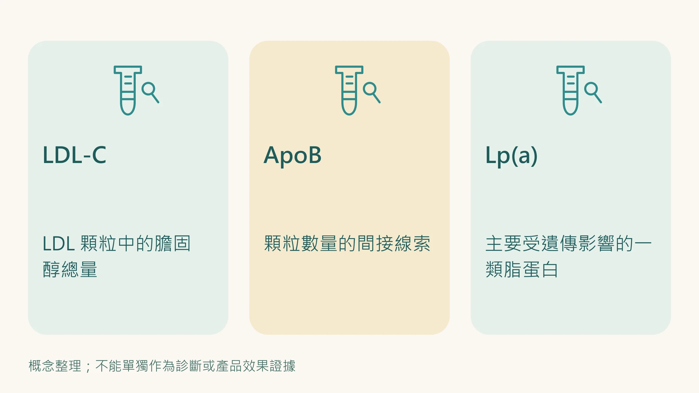

LDL 看起來還好，醫師為什麼還想看 ApoB？

先想像兩條路：一條是少數大貨車，另一條是很多小貨車。兩邊載的貨一樣多，車子的數量卻不同。

LDL-C 和 ApoB 的差別，可以從這裡開始理解。但這個比喻，不能拿來預言誰幾年後會心肌梗塞。

## LDL-C 看貨物，ApoB 提供車流線索

脂蛋白負責在血液中運送膽固醇。LDL-C 量的是 LDL 顆粒裡膽固醇的總量；ApoB 的濃度則可用來反映致動脈硬化脂蛋白顆粒的數量，因為這些顆粒各帶有一個 ApoB。[1]

這裡說的是臨床上的間接估計，並不是報告會直接列出「幾台車」。LDL、IDL、VLDL 殘餘顆粒與 Lp(a) 都可能參與其中；把它們留在血管壁裡的長期暴露，是動脈硬化風險的一部分。[1][2]

## 什麼時候兩個數字可能說不同的事？

如果每顆 LDL 裡的膽固醇含量不同，膽固醇總量和顆粒數量就可能不一致。三酸甘油脂偏高、糖尿病或其他代謝情境下，醫師可能特別留意這種落差。[1]

這不表示每個腰圍變大的人都需要自行加驗，也不表示 LDL-C 不值得看。2026 年美國血脂指引把 ApoB 放在選擇性風險評估的角色，是否使用，要看它能否幫助處置。[3]

你可以問：「我的 LDL-C、三酸甘油脂和病史放在一起，ApoB 會提供額外資訊嗎？」

## 參考範圍和治療目標，為什麼可能不同？

一個已有心血管疾病的人，和沒有相關病史的人，適合的血脂目標可能不同。不能只拿檢驗單是否標紅，來判斷治療是否足夠。

舊版指引中的 ApoB 切點與目標，是在特定風險分類和用途下提出；2026 年美國指引也已更新整體血脂管理架構。這篇不提供一個人人通用的 ApoB 合格線。請醫師說明你屬於哪個風險層級、目前的目標與追蹤安排。[3]

## 它和 Lp(a) 是同一件事嗎？

不是。Lp(a) 是一種帶有 ApoB 的特殊脂蛋白，它的濃度主要受遺傳影響；ApoB 則提供較廣的致動脈硬化脂蛋白顆粒數量線索。兩項的用途不能互相替代。[1]

家人年輕時就發病，想認識遺傳風險，可接著看 [家人年輕就心肌梗塞？認識 Lp(a) 這條遺傳風險線索](/blog/chronic-inflammation/lpa-genetic-risk/)。

## 下一次討論，帶這些就好

把 LDL-C、三酸甘油脂，以及已驗過的 ApoB 報告放在一起，保留各自的日期與單位。再補上疾病史、用藥與家族史。

重點是確認「有沒有會影響處置的落差」，而不是為了多一個數字而檢查。飲食、活動和藥物怎麼安排，由醫師依整體風險決定；不要自行停藥，也不要把補充品當成血脂治療的替代。

如果只是想先看懂報告有哪些項目，回到 [健檢五項數字的用途](/blog/body-signals/checkup-five-numbers/)；想知道如何留下前後可比的紀錄，則看 [做一份能持續的身體追蹤表](/blog/intervention-optimization/tracking-rhythm/)。

**多驗一項的價值，在於它能不能幫助下一個決定。**

*本文供健康教育使用，血脂評估及治療目標請由醫師依個人風險決定。*

## 參考文獻

1. Sniderman AD, et al. Apolipoprotein B particles and cardiovascular disease: a narrative review. *JAMA Cardiol*. 2019;4:1287–1295. https://doi.org/10.1001/jamacardio.2019.3780
2. Ference BA, et al. Low-density lipoproteins cause atherosclerotic cardiovascular disease. 1. Evidence from genetic, epidemiologic, and clinical studies. A consensus statement from the European Atherosclerosis Society Consensus Panel. *Eur Heart J*. 2017;38:2459–2472. https://doi.org/10.1093/eurheartj/ehx144
3. American College of Cardiology。ACC/AHA Issue Updated Guideline for Managing Lipids, Cholesterol。2026 年 3 月 13 日官方指引發布說明。https://www.acc.org/About-ACC/Press-Releases/2026/03/13/18/01/ACCAHA-Issue-UpDated-Guideline-for-Managing-Lipids-Cholesterol
