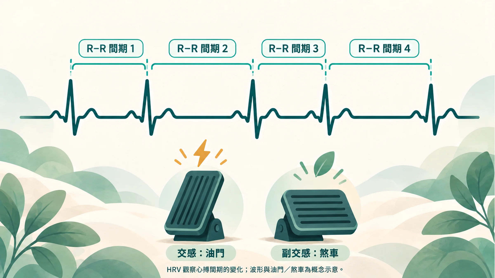
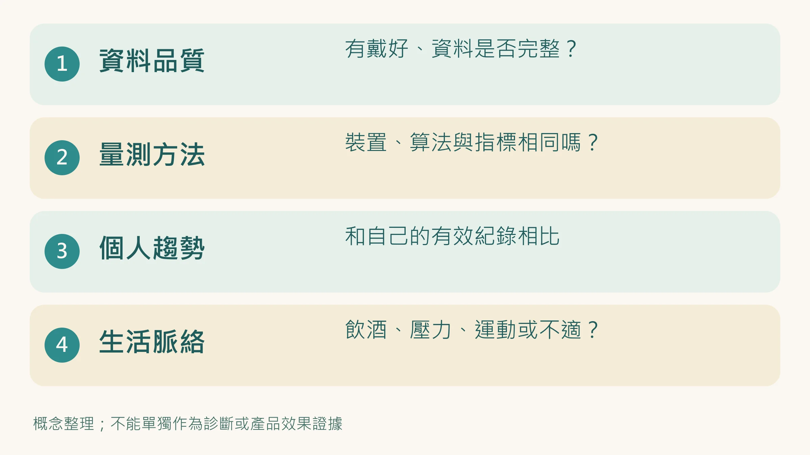
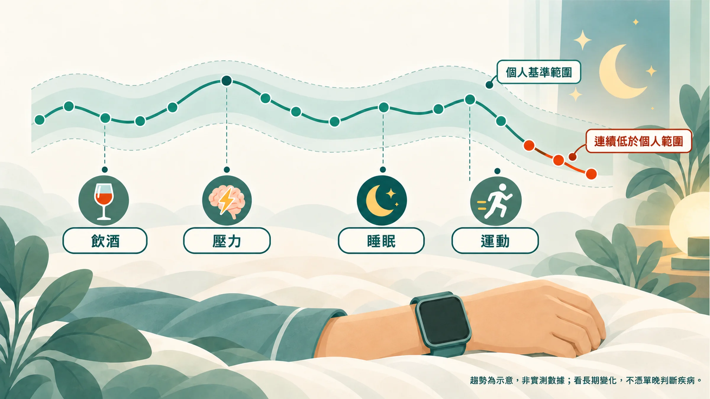

早上醒來，手錶說：「你的 HRV 低於平常。」

你看了一眼，42 毫秒。網路有人說要 60 才好，也有人說 40 很正常。

先不要跟別人的截圖比。要讀懂這個通知，先看下面四件事。

## 1. 昨晚的資料，真的量好了嗎？

錶帶有沒有戴好？晚上是否拿去充電？App 顯示的是完整紀錄，還是只有幾個片段？

沒戴、量測失敗、匯出為零，都應該標成缺資料。先確認你在比較的是有效結果，再談偏高或偏低。

## 2. 你和別人用的是同一把尺嗎？

HRV 是心率變異度，也就是心跳與心跳之間，間隔時間的變化。RMSSD、SDNN 是不同的算法；即使都寫毫秒，也不能直接當成同一把尺。量測長度、姿勢與演算法也會影響結果。[1][2]

Apple HealthKit 的 HRV 資料型別是 SDNN。其他產品的夜間數字，可能採 RMSSD 或不同的取樣方式；比較前先看裝置說明。[3]

## 3. 和你自己過去相比，變化持續多久？

年齡、體能與量測條件，都會影響 HRV。健康成人研究中的平均值，不是每個人的及格線。[2][4]

先累積同一裝置、同一指標、相近條件的有效資料，按照裝置建議建立個人基準。回顧週趨勢可以幫助整理資料，但「七天」或「二十八天」不是適用所有人的診斷門檻。

換裝置或演算法更新時，記下日期，避免把量法改變看成身體突然變差。

## 4. 最近發生了什麼？

喝酒、心理壓力、訓練與身體不適，都值得記在數字旁邊。研究觀察到飲酒、壓力與 HRV 的變化有關；女性生理週期也可能影響個人趨勢。[5][6][7]

有變化，不代表一定找到了原因。它幫你提出問題，還不能替你下結論。

## HRV 可以透露什麼，不能透露什麼？

HRV 與自律神經調節有關。自律神經是身體自動調整心跳等功能的系統，但不能簡化成一個「油門／煞車平衡分數」。不同 HRV 指標有不同生理意義，尤其不能把 LF/HF 直接當成兩者的比例。[1][8]

人體研究的統合分析發現，較低 HRV 和較高發炎指標有關聯。這是研究族群中的關聯，不能反過來說「我今天 HRV 低，所以有慢性發炎」。[9]

它也不能告訴你細胞修好了幾成、睡眠一定有沒有修復成功，或你的壽命還有多少。皮膚分數加進來，也不會自動變成可以定位問題的診斷工具。

不同量測各自的用途，整理在 [血液、HRV、皮膚量測各在看什麼](/blog/chronic-inflammation/inflammation-three-clues/)。

## 看見低值，今天可以做什麼？

先確認資料，回看近期作息與身體感受。若只是單次通知、沒有不適，不必為了把數字拉高而反覆量測。

安排規律生活與活動，可以依自己的情況慢慢調整；數字沒有立刻上升，也不能當成努力失敗。需要留紀錄時，用 [這張五欄追蹤表](/blog/intervention-optimization/tracking-rhythm/)。

如果 HRV 突然明顯異常，或合併心悸、頭暈、胸悶，請找醫師評估；急性胸痛、呼吸困難應即時就醫。心律不整或雜訊也可能讓變異度看起來很高，不能把異常高值當成恢復特別好。HRV 無法取代心電圖。[1][2]

**先看資料，再看自己，最後才看那個通知。**

延伸閱讀：[穿戴裝置怎麼選](/blog/precision-health-tools/wearable-choose-guide/)｜[CRP 與 hs-CRP 怎麼讀](/blog/chronic-inflammation/hs-crp-low-grade-inflammation/)

*本文供健康教育與趨勢整理使用，不以消費型裝置數字診斷疾病。*

## 參考文獻

1. Task Force of the European Society of Cardiology and the North American Society of Pacing and Electrophysiology. Heart rate variability: standards of measurement, physiological interpretation and clinical use. *Circulation*. 1996;93:1043–1065. https://doi.org/10.1161/01.CIR.93.5.1043
2. Shaffer F, Ginsberg JP. An overview of heart rate variability metrics and norms. *Front Public Health*. 2017;5:258. https://doi.org/10.3389/fpubh.2017.00258
3. Apple Developer Documentation. heartRateVariabilitySDNN. https://developer.apple.com/documentation/healthkit/hkquantitytypeidentifier/heartratevariabilitysdnn
4. Nunan D, Sandercock GRH, Brodie DA. A quantitative systematic review of normal values for short-term heart rate variability in healthy adults. *Pacing Clin Electrophysiol*. 2010;33:1407–1417. https://doi.org/10.1111/j.1540-8159.2010.02841.x
5. Pietilä J, et al. Acute effect of alcohol intake on cardiovascular autonomic regulation during the first hours of sleep in a large real-world sample of Finnish employees: observational study. *JMIR Ment Health*. 2018;5:e23. https://doi.org/10.2196/mental.9519
6. Kim HG, et al. Stress and heart rate variability: a meta-analysis and review of the literature. *Psychiatry Investig*. 2018;15:235–245. https://doi.org/10.30773/pi.2017.08.17
7. Schmalenberger KM, et al. A systematic review and meta-analysis of within-person changes in cardiac vagal activity across the menstrual cycle. *J Clin Med*. 2019;8:1946. https://doi.org/10.3390/jcm8111946
8. Billman GE. The LF/HF ratio does not accurately measure cardiac sympatho-vagal balance. *Front Physiol*. 2013;4:26. https://doi.org/10.3389/fphys.2013.00026
9. Williams DP, et al. Heart rate variability and inflammation: a meta-analysis of human studies. *Brain Behav Immun*. 2019;80:219–226. https://doi.org/10.1016/j.bbi.2019.03.009
