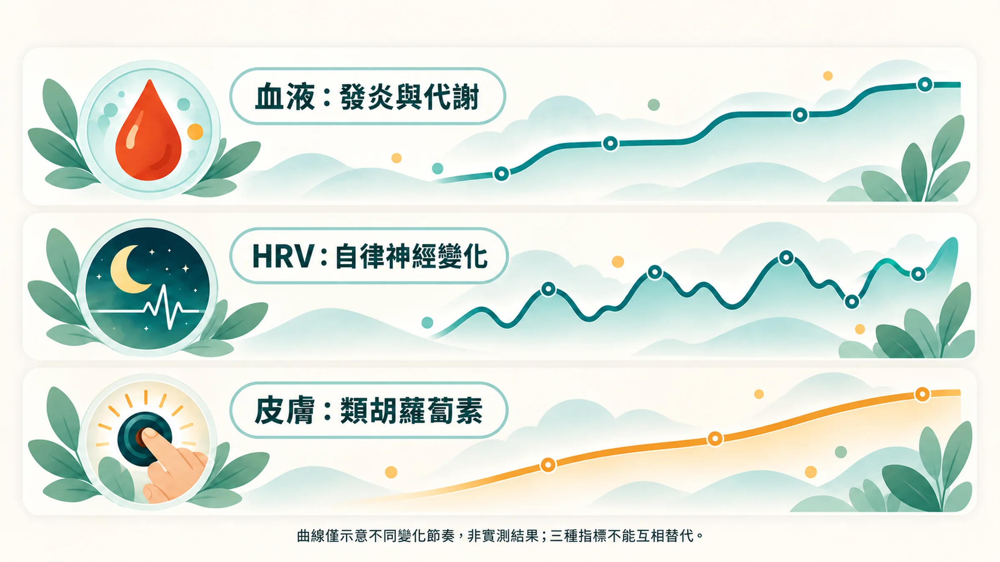
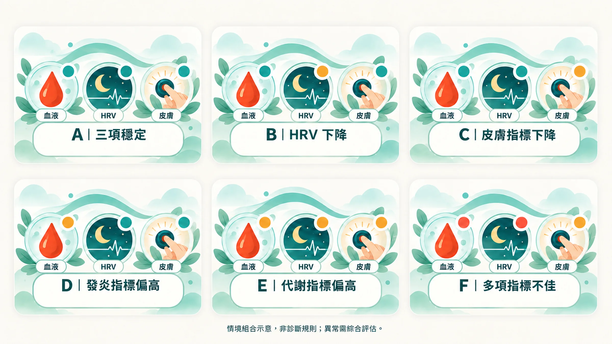

上個月抽血，hs-CRP 0.8，很漂亮。

手錶的 HRV 卻連續三週往下掉，Prysm 分數也比三個月前低了一截。

你開始懷疑：到底該相信哪一個？

答案是：都相信，而且要放在一起看。

## 每條線索各看一面

| 線索 | 主要反映 | 變化速度 | 常見干擾 |
|---|---|---|---|
| **血液**（hs-CRP、HbA1c、ApoB、TG/HDL） | 全身發炎與代謝狀態 | 數週到數月 | 感冒、受傷、劇烈運動後 |
| **睡眠與 HRV** | 自律神經與夜間恢復 | 每天 | 喝酒、晚餐太晚、訓練、生病初期 |
| **皮膚類胡蘿蔔素**（Prysm iO） | 抗氧化防禦網的存量 | 數週 | 近期蔬果攝取、日曬、抽菸 |

皮膚類胡蘿蔔素會隨蔬果攝取增加，在停止攝取後數週內逐漸下降[1]；也會在疲勞、壓力、睡眠不足、抽菸等情況下降低[2]。光學量測的皮膚類胡蘿蔔素和蔬果攝取量有穩定的相關性[6]。HRV 偏低的人，發炎指標也常偏高[5]。三條線索量的是不同層面，彼此有關聯，又各自補上對方看不到的部分。

> 皮膚量測的原理：[類胡蘿蔔素與 RRS 光學量測](/blog/precision-health-tools/carotenoid-rrs-science/)｜分數怎麼看：[Prysm iO 分數解讀](/blog/precision-health-tools/prysm-io-score-guide/)

## 單看一個數字，最容易誤判

只看 hs-CRP，你會以為身體很好，錯過恢復力正在下滑的訊號。

只看 HRV，你可能因為一晚喝了酒就緊張，也可能忽略了血液裡慢慢升高的代謝壓力。

只看 Prysm 分數，你會以為多吃點蔬果就好，沒想到真正拖垮防禦網的是長期睡眠不足。

**交叉比對，才能看出問題出在哪一層**：是火在燒（發炎）、修不好（恢復），還是防不住（抗氧化防禦）。

## 6 種常見組合

以下是方向性的解讀，幫助你和醫師、健康顧問討論，**不能當作診斷**。

### 組合 A：三項都穩定
**血液正常｜HRV 在個人範圍內｜Prysm 穩定或上升**

目前的生活節奏是有效的。維持就好，血液一年驗一次，皮膚每月一次，手錶看週平均。

### 組合 B：恢復跟不上
**血液正常｜HRV 連續 1～2 週低於個人範圍｜Prysm 正常**

身體還沒有發炎的證據，但夜間修復已經吃緊。先檢查最近的睡眠時間、飲酒、晚餐時間、工作壓力和訓練量。這種狀態若持續數月，往往會接著拖累其他數字。

→ [HRV：今天，修好了嗎？](/blog/precision-health-tools/hrv-recovery-guide/)

### 組合 C：防禦網變薄
**血液正常｜HRV 正常｜Prysm 偏低或下滑**

最常見的原因是蔬果攝取不足，其次是抽菸、長時間日曬，或營養吸收不佳。先記錄一週的飲食，看每天的蔬果份量和顏色夠不夠多樣。

→ [類胡蘿蔔素怎麼進到細胞](/blog/body-signals/carotenoid-cell-absorption/)

### 組合 D：發炎的火在燒，但恢復和防禦還撐得住
**hs-CRP 偏高｜HRV 正常｜Prysm 正常**

先排除近期感冒、牙齦發炎、運動傷害，2 週後複驗[3]。若持續偏高，請醫師評估；同時檢查內臟脂肪、牙周、睡眠呼吸中止等常見火源。

→ [CRP 看大火，hs-CRP 看小火](/blog/chronic-inflammation/hs-crp-low-grade-inflammation/)

### 組合 E：代謝壓力先出現
**HbA1c、TG/HDL 或 ApoB 偏高｜hs-CRP 正常或略高｜HRV、Prysm 正常或略低**

代謝問題通常比發炎更早浮現。優先處理精製澱粉、含糖飲料、腰圍和活動量。這個階段做出改變，效果往往最明顯[4]。

→ [ApoB 為什麼比 LDL 更準？](/blog/precision-health-tools/apob-vs-ldl/)

### 組合 F：三項同時往下
**hs-CRP 或代謝指標偏高｜HRV 持續偏低｜Prysm 下滑**

這代表身體的負荷已經在多個系統累積。請先就醫，排除感染、甲狀腺、貧血、睡眠呼吸中止等需要治療的問題；確認沒有急症後，再系統性地調整睡眠、飲食和壓力。

## 讓交叉比對更準的三個習慣

1. **固定時間量測**：Prysm 盡量同一時段、同一隻手指；抽血固定空腹、避開感冒期。
2. **記錄生活事件**：出差、加班、聚餐、生病、換季，寫在旁邊，回頭看趨勢時才知道原因。
3. **看方向，不看單點**：至少累積 2～3 次量測，再判斷是不是真的在變化。
4. **資料不夠，就標「無法判斷」**：手錶沒戴、數值是 0、只有一兩次量測時，這一天或這個月應該記成「無法判斷」，不要當成「正常」。三條線索要都有可靠資料，才適合做交叉比對[7]。

光知道數字不夠，能持續執行才有效。這也是很多人做了功能醫學檢查，卻沒有改變的原因：[功能醫學的執行落差](/blog/precision-health-tools/functional-medicine-execution-gap/)。

## 把三條線索整理成你的個人地圖

你可以自己記錄，也可以讓我們幫你整理。

想知道每一個系統對應的追蹤頻率和調整方式，請看下一篇：[每日、每月、每年：個人化的身體追蹤節奏](/blog/intervention-optimization/tracking-rhythm/)。

**延伸閱讀**
- [一把火，三處煙](/blog/chronic-inflammation/inflammation-three-clues/)
- [生物年齡怎麼量](/blog/precision-health-tools/biological-age-measurement/)

---

*本文為健康教育與趨勢追蹤用途，不等同醫療診斷。任何血液數值異常或身體不適，請優先就醫。*

## 參考文獻

1. Jahns L, et al. Skin and plasma carotenoid response to a provided intervention diet high in vegetables and fruit: uptake and depletion kinetics. *Am J Clin Nutr*. 2014;100:930–937. https://doi.org/10.3945/ajcn.114.086900
2. Darvin ME, et al. One-year study on the variation of carotenoid antioxidant substances in living human skin: influence of dietary supplementation and stress factors. *J Biomed Opt*. 2008;13:044028. https://doi.org/10.1117/1.2952976
3. Pearson TA, et al. Markers of inflammation and cardiovascular disease: AHA/CDC scientific statement. *Circulation*. 2003;107:499–511. https://doi.org/10.1161/01.CIR.0000052939.59093.45
4. Salive ME, et al. Lifestyle and metformin interventions and risk of multimorbidity in adults with prediabetes. *JAMA*. 2026. https://doi.org/10.1001/jama.2026.8492
5. Williams DP, et al. Heart rate variability and inflammation: a meta-analysis of human studies. *Brain Behav Immun*. 2019;80:219–226. https://doi.org/10.1016/j.bbi.2019.03.009
6. Radtke MD, et al. Criterion-related validity of spectroscopy-based skin carotenoid measurements as a proxy for fruit and vegetable intake: a systematic review. *Adv Nutr*. 2020;11:1282–1299. https://doi.org/10.1093/advances/nmaa054
7. sleepbug. Day 18｜Sleep × HRV × Resting HR：單一指標夠嗎？iThome 鐵人賽《30 天拆解 Wearable × AI》（技術部落格，非同儕審查）。https://ithelp.ithome.com.tw/articles/10419695
