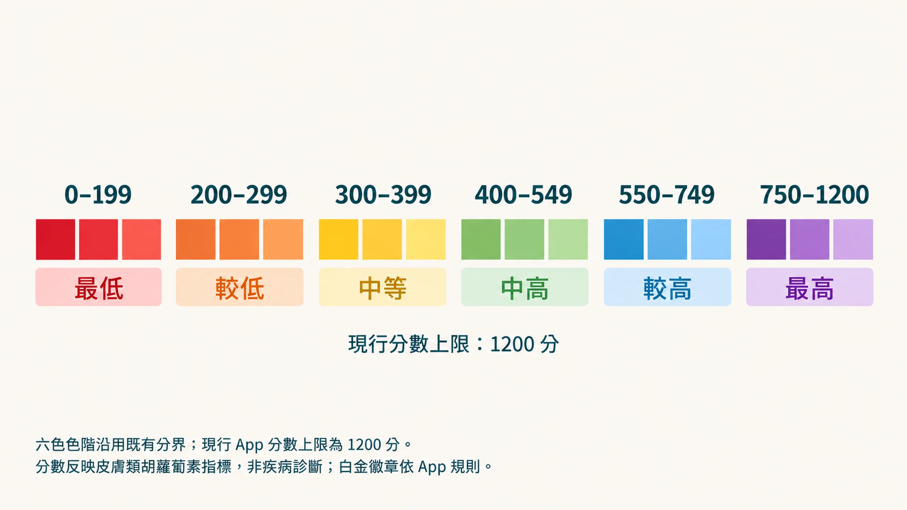

你上一次感覺「身體很好」是什麼時候？

現在再想一個問題：那個「感覺很好」，是真的好，還是你太忙了，沒有時間注意到它在走下坡？

我自己是已經想不起來那個時候，現在都只看今天睡醒等一下不要腰酸背痛。

---

## 氧化損傷不會讓你痛

這是最麻煩的地方。

自由基對細胞的攻擊是沉默的。

它不會讓你當下疼痛，不會在你照鏡子的時候出現一個警告燈。

它只是讓你：

- 比以前更容易累，但歸咎於「工作壓力大」
- 皮膚開始暗沉鬆弛，但歸咎於「年紀到了」
- 補充了一堆保健品，但不確定有沒有用

問題不是你不在乎健康。

問題是 **你一直在憑感覺管理一件感覺不到的事**。

---

## 有一個數字，可以告訴你答案

類胡蘿蔔素是你身體最外層的抗氧化屏障。

它們從食物中吸收後，會花數週時間慢慢沉積在皮膚角質層。

這個倉庫儲存的，是你 **過去 2 到 4 週的真實生活**：不是你今天吃了什麼，而是你這段時間的飲食品質、作息、壓力狀態的綜合結果。

耶魯大學的研究確認，皮膚類胡蘿蔔素濃度和你的蔬果攝取量、血液中的類胡蘿蔔素濃度高度相關，而且比血液數值更穩定。

> 想知道這背後完整的二十年科學演化史？[ → 點這裡看深度科普篇](/blog/precision-health-tools/carotenoid-rrs-science/)

更重要的是：**它可以被測量**，不需要抽血，不需要等報告。

> **「以前要抽血或切皮膚，現在 15 秒就能知道。」**

  <iframe 
    style="position: absolute; top: 0; left: 0; width: 100%; height: 100%; border-radius: 8px;"
    src="https://www.youtube.com/embed/wbT0bLrF-vI" 
    title="Stop Guessing" 
    frameborder="0" 
    allow="accelerometer; autoplay; clipboard-write; encrypted-media; gyroscope; picture-in-picture" 
    allowfullscreen>
  </iframe>

---

## 你的數字，現在在哪裡？

Nu Skin 的 **Prysm iO** 用 25 年的光譜科學與 2,100 萬筆全球掃描數據，做成了掌心大小的裝置，量測結果和實驗室的雷射掃描儀接近。

掃完之後，App 會給你一個顏色分數，從紅色到藍紫色，對應你現在的抗氧化防禦水位。

很多人第一次看到自己的顏色時，有點沉默。

因為他們以為自己在照顧自己。數字說的是另一件事。

測之前，先知道三件事：

1. **它量的是飲食指標。** 分數反映你過去幾週吃進去的蔬果與類胡蘿蔔素，不是疾病診斷，也不能取代健康檢查。
2. **看趨勢，不看單次。** 單次數字會有誤差，同一個時段、同一根手指，固定間隔掃描，才看得出方向。
3. **分數出來之後怎麼讀**，看這篇：[你的 Prysm iO 分數出來了——這個數字對你意味著什麼？](/blog/precision-health-tools/prysm-io-score-guide/)

> **你不需要猜了。先把那個數字拿到手。**

---

## 參考資料

1. Riggs Melanie et al. (2026). Validation of a New Non-invasive Personalized RS-Skin Carotenoid Scanner (Prysm iO) versus the BioPhotonic Scanner S3 RRS Device for Estimating Carotenoid Levels in Humans. *Food &amp; Nutrition Journal*, 11(1). DOI：[10.29011/2575-7091.100334](<https://doi.org/10.29011/2575-7091.100334>)。
2. [Prysm iO User’s Manual and Warranty](<https://www.nuskin.com/content/dam/eu-library/website-content/products/pharmanex/prysm-io/device-care/prysm-io-user-manual-en.pdf>)。Nu Skin官方操作手冊；非臨床診斷效能證據；未查得 DOI，來源頁已核對（2026-10-19）。
