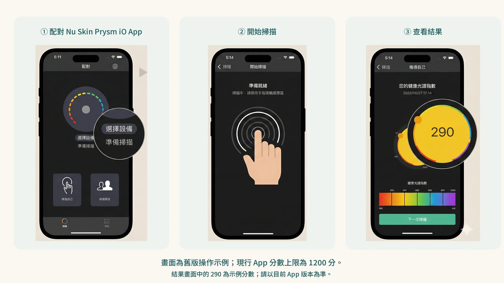

數字出來的那一刻，很多人的第一個反應是：

**「……這樣算好還是不好？」**

然後看了一眼 App，大概知道顏色，放下手機繼續過生活。

這篇文章是要阻止你這樣做。

因為那個數字不是一個無聊的指標，它在說一件關於你正在發生的事。

讀懂它，你才知道下一步應該走哪條路。

---

## 還沒測過？先把數字拿到手

如果你還沒掃描過，這是完整的四步驟教學，三分鐘把它做完。

---

### 測量前：兩件小事，差很多

**清潔手指。** 食指指尖的防曬乳、護手霜、油脂都會干擾光學讀數。用清水沖一下，擦乾。

**室內測量。** 避免強烈光線直射感測窗口。一般室內光線完全足夠。

---

### 第一步：App 配對

打開手機的 **Nu Skin Prysm iO™** App，確認藍牙已開啟。

按下 Prysm iO 電源鍵，App 會自動偵測並完成配對。

第一次使用需要建立個人檔案（年齡、性別、生活習慣），這些數據讓 AI 校準更準確，大約 2 分鐘，之後每次開機就直接連上。

---

### 第二步：食指定位

將**食指**（不是拇指）的指腹平穩放在掃描窗上。

App 畫面上有壓力指示器，它會告訴你力道是輕了、重了，還是剛好。

> **為什麼要「剛好」的力道這麼重要？**
>
> 適當的按壓會把指尖微血管的血液暫時推開，讓光線能不受血紅素干擾直接讀取皮膚類胡蘿蔔素。力道不夠，血液沒排乾淨，讀數會偏低。太重，組織受壓變形，也會影響數值。聽 App 的指示，不要自己猜。

---

### 第三步：靜止 15 秒

指示燈確認力道後， **保持手指不動、不要說話**，讓 Spectral Rai™ 技術完成掃描。

這 15 秒裡，儀器累積超過 700,000 次超光譜吸收測量，每一次都在描繪類胡蘿蔔素在你皮膚裡留下的光學指紋。

15 秒後，App 自動完成分析，你的分數就出來了。

---

### 第四步：看懂你的數字

分數出來，接下來才是重點。

---

## 你的分數，在說一件具體的事

Prysm iO 的分數對應六個顏色區間，從紅色到藍紫色。

很多人把它想成「成績單」，分數高就是好學生，分數低就該慚愧。

這個理解方向是對的，但不夠精確。

更準確的理解方式是：**這個數字是你過去 2 到 4 週的生活在你皮膚裡留下的紀錄。** 

它不評判你，它只是告訴你一個事實，你的抗氧化防線，現在的庫存水位在哪裡。

| 分數顏色 | 防禦狀態 | 你的細胞正在經歷什麼 |
| :---- | :---- | :---- |
| 🔴 **紅色** | 嚴重不足 | 防線幾近瓦解。飲食中的類胡蘿蔔素明顯不足，皮膚這層抗氧化屏障很薄。 |
| 🟠 **橙色** | 入不敷出 | 每天的消耗大於補充。熬夜、空汙、壓力正在榨乾你的存量，但補充速度完全跟不上。 |
| 🟡 **黃色** | 勉強維持 | 防線薄弱但尚未崩潰。大部分高壓工作者都在這一區——感覺「還好」，但數據說你其實在走下坡。 |
| 🟢 **綠色** | 防線穩固 | 儲備充足。但注意：停止補充後，數值會在幾週內慢慢下滑。維持比達到更難。 |
| 🔵 **藍色** | 高水位防禦 | 抗氧化營養攝取很充足。這是用 Prysm iO 追蹤、搭配飲食與補充努力維持的目標區間。 |
| 🟣 **紫色** | 頂尖狀態 | 極少數人能持續維持的水位。通常是飲食習慣優異，或長期精準補充的結果。 |

---

## 為什麼這個數字比「感覺」可靠？

這裡有一件很多人不知道的事：

**你的身體不會讓你感覺到抗氧化不足。** 

氧化損傷是沉默的，它不會讓你當下疼痛，但它正在決定你十年後的樣子。

紅色和橙色的人通常沒有「生病的感覺」。

他們只是容易累，皮膚開始暗沉，睡眠品質下滑，恢復速度變慢。

這些事情太容易被解釋成「工作壓力大」或「年紀到了」，而不會想到抗氧化防線正在被榨乾。

Prysm iO 的價值，就是把這件沉默的事情變成一個你看得見的數字。

---

## 你現在在哪一區？找到你的下一步

### 🔴🟠 紅色或橙色：防線要先補回來

如果你落在這兩個區間，你的當務之急是一件事：**把基礎補回來**。

光靠改善飲食當然是對的方向，但現實是：要靠天然飲食把分數從橙色拉到黃色，通常需要每天達到衛福部建議的 3 份蔬菜＋2 份水果，持續 4 到 8 週。

國健署的國民營養調查顯示，多數台灣成人的蔬菜和水果都吃不到建議量。

這就是 **Nu Skin LifePak®** 存在的原因。

LifePak 是一套設計邏輯非常清楚的每日基礎補充，廣覆蓋、易執行。

它包含你最容易因飲食缺乏的抗氧化維他命（C、E、β-胡蘿蔔素）、礦物質、植化素與微量元素，設計目標只有一個： 

> **確保你的防線每天不再空窗**。

紅色和橙色的人，最需要的不是複雜的補充策略，而是先把基礎建立起來。

**LifePak 是把你從「入不敷出」拉到「基本守住」的第一步。**

---

### 🟡 黃色：已經守住，但你想要的不只是守住

黃色區間是很多認真管理健康的人的起點，你已經有一定的蔬果攝取習慣，或者已經在補充基礎維他命，但你感覺數字卡在這裡上不去。

先檢查兩件事：**蔬果有沒有吃夠、有沒有搭配油脂一起吃**（類胡蘿蔔素是脂溶性的，沒有油脂很難吸收）。這兩件事做到了，分數通常就會往上走。

如果你想再加上營養補充，可以考慮含類胡蘿蔔素的配方。以 **ageLOC® Youthspan** 為例，它本身含有蝦青素、茄紅素、葉黃素等類胡蘿蔔素，原廠研究中受試者使用 6 週後，皮膚類胡蘿蔔素分數明顯上升。要說清楚的是：分數上升主要反映你吃進去的類胡蘿蔔素，不代表其他抗老效果。

---

### 🟢🔵 綠色或藍色：你在對的軌道上，現在的任務是維持

恭喜，你的防線是穩固的。

但這裡有一個不能忽視的事實： **皮膚類胡蘿蔔素不會自動維持**。

停止補充後，數值會在幾週內慢慢下滑，因為身體每天都在消耗，蔬果與補充品的供應必須持續。要注意的是，研究發現反射光譜類裝置在「下坡」時反應比較慢，分數的回落可能延遲幾週，不要因為分數還高就以為可以停。

你現在的任務不是「再往上衝」，是：

**搞清楚你現在是靠什麼維持這個水位的，然後確保那個機制不會中斷。**

如果你現在的方案讓你維持在綠色或藍色，繼續做就對了。

定期用 Prysm iO 掃描，確認數字沒有悄悄往下漂移，特別是在工作特別忙、睡眠特別差的那幾週之後。

---

## 數字是起點，不是終點

你可以用 Prysm iO 記錄從今天開始的每一次掃描。

App 會幫你把所有數值畫成趨勢圖，讓你看見：

- 開始補充後，分數的實際移動速度
- 哪幾週熬夜，數值悄悄往下漂移
- 60 天後，你的投資到底有沒有反映在真實數字上

這個閉環， **掃描、看數字、調整方案、再掃描**：是 Prysm iO 設計的核心邏輯。

它讓健康管理從「感覺有在做」變成「數據說我做到了」。

---

## 不確定自己該從哪裡開始？

你的分數背後，有時候需要一點脈絡才能真正讀懂。

同樣是橙色的兩個人，一個可能需要先從睡眠著手，另一個問題出在飲食結構。

同樣是黃色，有人缺的是基礎礦物質，有人需要的是細胞層次的代謝支撐。

我在健康領域工作超過 15 年，見過各種分數，也陪過很多人走完從橙色到綠色的這段路。

不是每個人都需要一樣的方案，但每個人都值得知道自己真正需要什麼。

## 參考資料

1. Riggs Melanie et al. (2026). Validation of a New Non-invasive Personalized RS-Skin Carotenoid Scanner (Prysm iO) versus the BioPhotonic Scanner S3 RRS Device for Estimating Carotenoid Levels in Humans. *Food &amp; Nutrition Journal*, 11(1). DOI：[10.29011/2575-7091.100334](<https://doi.org/10.29011/2575-7091.100334>)。
2. [Prysm iO User’s Manual and Warranty](<https://www.nuskin.com/content/dam/eu-library/website-content/products/pharmanex/prysm-io/device-care/prysm-io-user-manual-en.pdf>)。Nu Skin官方操作手冊；非臨床診斷效能證據；未查得 DOI，來源頁已核對（2026-10-19）。
