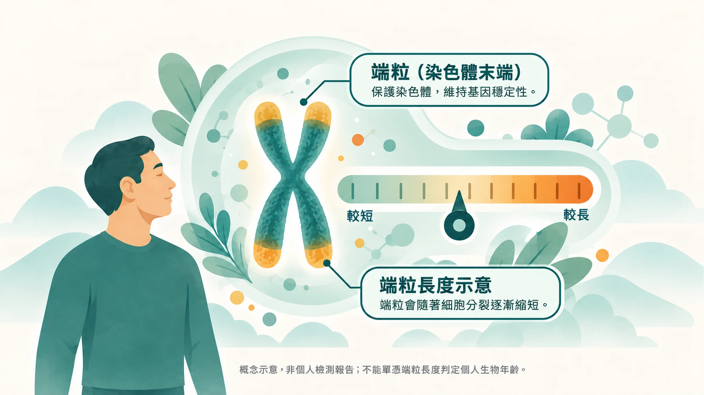
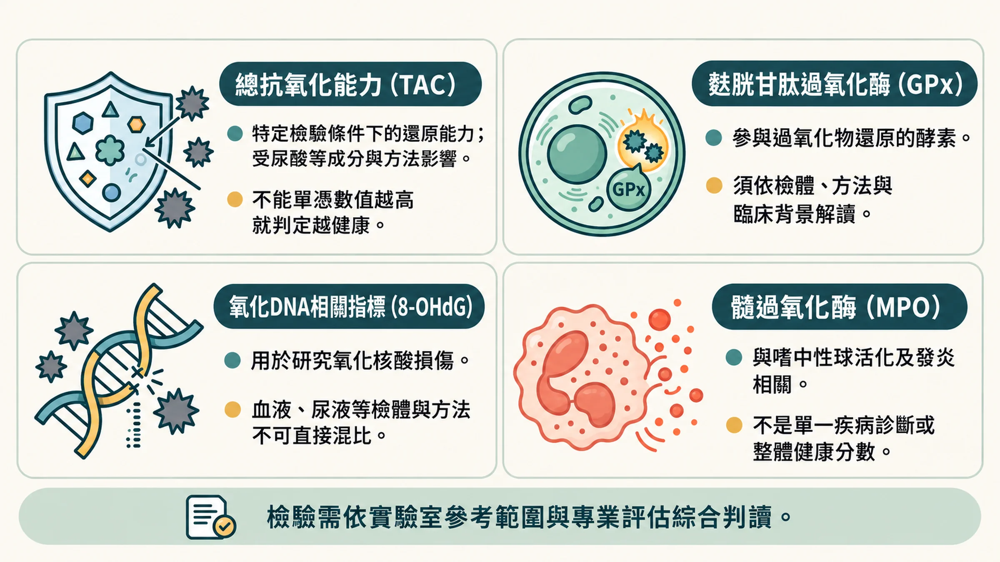

你知道自己幾歲，但你不知道你的細胞，現在幾歲。

這兩個數字，可能差很多。

老年醫學常引用的估計是：人體大部分器官系統的功能，從 30 歲之後就開始以每年約 1% 的速度慢慢衰退。

問題是，這個衰退的速度，人和人之間差異非常大，有些人 50 歲的細胞狀態像 40 歲，有些人 50 歲的細胞狀態已經像 65 歲。

**「感覺還好」，不等於「細胞狀態還好」。**

這就是為什麼同樣 40 幾歲，有人精力充沛、有人下午就在撐。

同樣50幾歲，有人沒有任何慢性病、有人已經開始管理三種指數。

差別不是運氣，是細胞老化的速度不同。

而這件事，現在有辦法測量。

---

## 測量「生物年齡」，你有三種選擇

以下三種方法，從需要專業機構到居家可做排列。

你不需要全部做，了解每種方法在量什麼、能告訴你什麼，才能知道哪一種適合你現在的狀況。

---

### 方法一｜端粒長度檢測

**量什麼：細胞分裂的累積｜門檻：需要去診所抽血｜適合：想要深度評估的人**

每個細胞的染色體末端，有一段叫做「端粒」的保護結構。

細胞每分裂一次，端粒就會縮短一點。當端粒短到一定程度，細胞就停止分裂，這就是細胞層級的「老化」。

所以端粒的長度，是細胞老化的指標之一。不過要知道：同年齡的人端粒長度差異很大，用它預測個人老化的準確度，不如新一代的 DNA 甲基化時鐘（詳見[〈你的身體幾歲了？〉](/blog/precision-health-tools/biological-age-measurement/)）。

**它能告訴你什麼：** 你的細胞分裂能力還剩多少、你的生物年齡大約對應哪個年齡層。

**怎麼做：** 去有提供端粒檢測的診所或基因檢測機構抽血，透過 PCR 分析端粒長度，報告會告訴你現在的端粒狀況以及對應的生物年齡區間。

**限制：** 費用較高、需要專業機構、不適合頻繁追蹤。適合作為一次性的深度評估基準。

---

### 方法二｜抗氧化壓力血液檢驗

**量什麼：血液中的氧化壓力｜門檻：需要抽血、等報告｜適合：想要了解細胞氧化狀態的人**

慢性發炎和細胞老化，有一個共同的底層機制：氧化壓力。

自由基持續攻擊細胞、而你的抗氧化防禦來不及清除，這個失衡狀態，就是細胞層級的耗損。

醫院有一套「抗氧化壓力抽血檢驗」，透過幾個血液指標，可以評估你目前的氧化壓力程度和抗氧化防禦能力：

- **總體抗氧化能力（TAC）**：量你的血液對抗自由基的整體防禦力。數值越高越好。
- **麩胱甘肽過氧化酶（GPx）**：細胞內最重要的抗氧化酵素之一，數值越高代表保護能力越好。
- **DNA 氧化損傷指標（8-OHdG）**：量你的 DNA 被自由基攻擊的程度。數值越低越好。
- **骨髓過氧化酶（MPO）**：反映體內氧化壓力與慢性發炎的活化程度。數值越低越好。

**它能告訴你什麼：** 你現在的細胞環境，氧化損傷和修復之間是否平衡、慢性發炎的活躍程度在哪裡。

**限制：** 需要醫事人員操作、費用視套組而定。血液數值會受到前一天的飲食影響，適合作為階段性評估，不適合日常追蹤。

---

### 方法三｜Prysm iO 皮膚類胡蘿蔔素掃描

**量什麼：皮膚類胡蘿蔔素｜門檻：最低，15秒，不需抽血｜適合：想要追蹤蔬果與抗氧化營養攝取、或定期追蹤的人**

這是目前最容易取得的非侵入性抗氧化測量工具。

原理是這樣的：你每天吃進去的蔬果，裡面的類胡蘿蔔素會花 2 - 4 週的時間，慢慢沉積在皮膚角質層裡。

這個儲存量，反映的是你這段時間的飲食品質、生活作息、和身體消耗類胡蘿蔔素的速度，也就是你的抗氧化防禦水位。

Prysm iO 用光譜技術，15秒掃描指尖，把這個數值轉換成一個顏色分數：從紅色（防禦力不足）到藍紫色（防禦力良好）。

它的科學基礎來自美國猶他大學 Werner Gellermann 博士超過25年的研究，全球已累積超過2,100萬筆掃描數據。

**它能告訴你什麼：** 你過去 2 到 4 週吃進去的蔬果與類胡蘿蔔素，有沒有被身體吸收留下來。它是飲食與抗氧化營養的指標，不是生物年齡，也不能取代健康檢查。

**跟血液檢測的差別：** 血液檢測量的是「今天的循環量」，受前一天飲食影響大。Prysm iO 量的是「皮膚的儲存量」，反映的是更長期的累積狀態，更適合追蹤趨勢。

---

## 這三種方法，你應該從哪裡開始？

不是每個人都需要做到端粒檢測的程度。

如果你現在的狀況是：感冒容易拖很久、睡滿還是累、下午腦霧、傷口癒合比以前慢，先確認一般健康檢查（血糖、血脂、甲狀腺、血球）都正常；這些都沒問題，這些訊號可能代表你的抗氧化防禦和細胞修復能力開始入不敷出。

**這時候，最容易開始的一步是 Prysm iO 掃描**，因為它能在 15 秒內給你一個具體的數字，讓你知道自己的蔬果與抗氧化營養攝取夠不夠。

有了這個基準數字，後續不管是調整飲食、補充策略、還是決定要不要進一步做血液檢測，都有一個起點可以對照。

---

## 你現在的抗氧化水位，在哪裡？

數字出來不是壞消息，是訊息。知道了，才能從對的地方開始。

---

**延伸閱讀：**
- [體檢報告沒有紅字，但你還是一直累——這不是心理問題](/blog/body-signals/normal-checkup-still-tired/) 
- [活到85歲，但有20年是在診所和藥罐子裡——是你要那一種晚年？](/blog/chronic-inflammation/healthspan-vs-lifespan/)

---

## 參考資料

01. Hayflick L., Moorhead P.S. (1961). The serial cultivation of human diploid cell strains. *Experimental Cell Research*, 25(3):585-621. DOI：[10.1016/0014-4827(61)90192-6](<https://doi.org/10.1016/0014-4827%2861%2990192-6>)。
02. Benzie Iris F.F., Strain J.J. (1996). The Ferric Reducing Ability of Plasma (FRAP) as a Measure of “Antioxidant Power”: The FRAP Assay. *Analytical Biochemistry*, 239(1):70-76. DOI：[10.1006/abio.1996.0292](<https://doi.org/10.1006/abio.1996.0292>)。
03. Hata Tissa R., Scholz Theresa A., Pershing Lynn K. et al. (2000). Non-Invasive Raman Spectroscopic Detection of Carotenoids in Human Skin. *Journal of Investigative Dermatology*, 115(3):441-448. DOI：[10.1046/j.1523-1747.2000.00060.x](<https://doi.org/10.1046/j.1523-1747.2000.00060.x>)。
