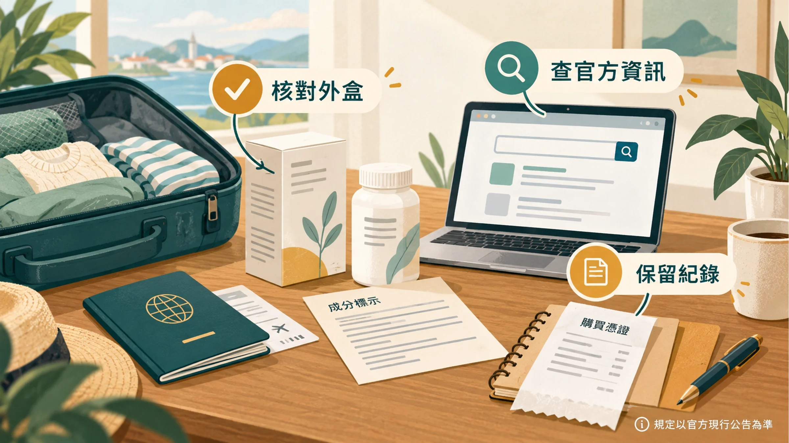
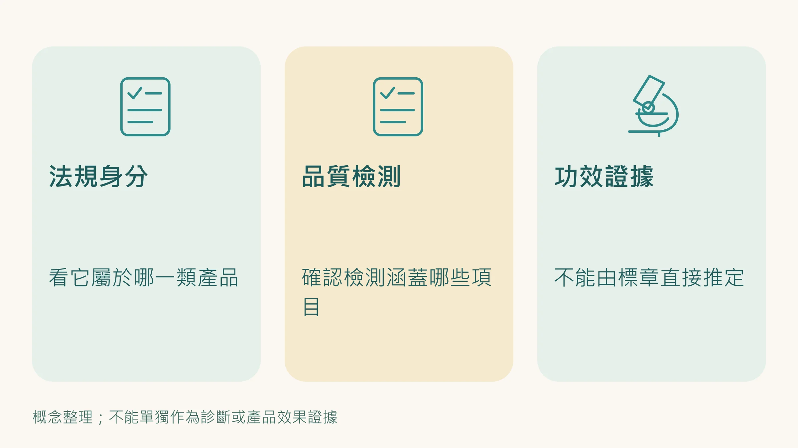
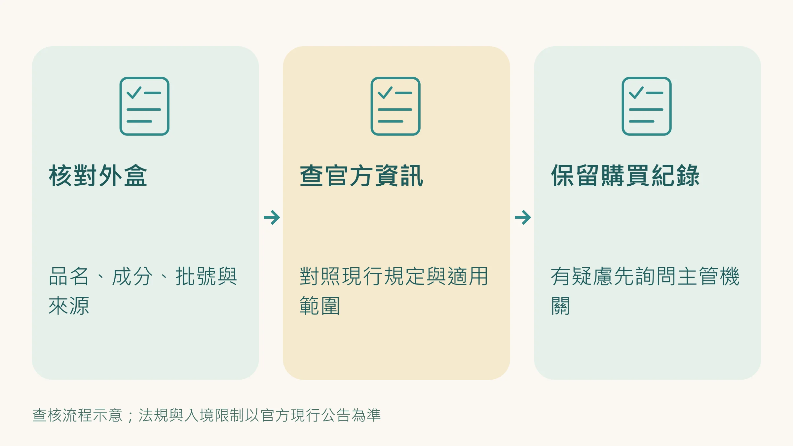

快過年出國，或是朋友請你帶伴手禮，在藥妝店面對一整排外國字的保健品，你怎麼判斷值不值得買？

不同國家的保健品法規差距非常大。

有些國家嚴格到把保健品當藥品管，有些國家寬鬆到廠商自己貼標就能上架。

「日本製」或「美國製」不代表自動通過嚴格把關。

這篇先說各國的法規與認證標章怎麼看，再說最多人問的兩個實務問題：怎麼用 NSF 資料庫查真偽，以及為什麼 Amazon 買保健品有風險。

---

## 各國保健食品法規與認證標章

### 🇯🇵 日本

日本機能性食品發展完整，目前有三種可以宣稱機能性的類別，管制嚴格程度差距很大，要分清楚：

**特定保健用食品（FOSHU）**：門檻最高。必須經日本消費者廳（CAA）審查通過並取得許可證，涵蓋 8 大功效類別、100 種功效成分。包含「有條件FOSHU」、「標準規格化 FOSHU」、「降低疾病風險 FOSHU」三類。包裝上會有明顯的官方許可標章。

**營養機能食品（FNFC）**：針對特定維生素（13種）、礦物質（6種）及 Omega-3 脂肪酸，符合規定標準即可販售，無需事前審查。

**機能性表示食品（FFC）**：2015年起實施的申報制。廠商自行向消費者廳申請，受理後公開於網站，最快60天後上市。廠商需提供科學文獻佐證，並自行承擔責任，上市後若發現功效不符必須立即下架，並面臨刑事責任與罰款。

**怎麼看**：FOSHU 有政府許可標章（橢圓形+文字），FFC 包裝上會有「機能性表示食品」字樣及申請號碼，可至[日本消費者廳官網](https://www.caa.go.jp/)查詢登錄狀態。FFC 的監管強度不如 FOSHU，廠商申報就可上市，並非政府審查通過。

---

### 🇰🇷 韓國

韓國於2004年實施《健康機能性食品法》，由韓國食品藥物安全部（MFDS）管理。機能性食品分兩類：

**告示型（Listed）**：使用健康機能食品公典中列出的 95 種活性成分（28 種營養素＋67 種天然機能性成分），符合基準即可上市，無需再次安全評估。

**個別認定型（Product-specific）**，不在告示清單內的成分，上市前須由食藥部進行安全及功效資料審查，取得認定書後才可使用認證標章並宣傳健康訴求。

**怎麼看**：韓文包裝上找「건강기능식품」（健康機能食品）字樣及認定標章。看不懂韓文的，優先選有個別認定標章的產品，品質保障較高。

---

### 🇺🇸 美國

根據1994年DSHEA法案，美國的保健品（Dietary Supplements）屬於食品類別，廠商符合 GMP 生產條件和 FDA 標示規範即可上架，本質上是廠商自主管理，FDA只負責事後執法。

「Made in USA」或「FDA Registered」都不等於政府審查過這個產品有效（FDA篇已有詳細說明）。

**美國最有意義的標章是第三方獨立認證**，主要三個：
- **NSF/ANSI 173**：保健品業界最嚴格的第三方認證，涵蓋成分驗證、污染物測試、GMP廠房稽核，每年複查
- **USP Verified**：美國藥典認證，成分純度與標示準確性的第三方驗證
- **ConsumerLab Approved**：獨立實驗室測試，確認成分含量符合標示

**怎麼查NSF認證是否真實：** 包裝上有NSF標章不代表一定是真的，廠商可能把標章印在沒有通過認證的批次上。正確的查詢方式是：前往 nsfsport.com/certified-products 或 info.nsf.org/certified/dietary，輸入產品名稱、品牌名稱或批次號碼（lot number）搜尋，確認搜尋結果中的產品名稱與批次號碼與你手上的產品完全吻合。

> **查詢連結**
> - NSF 保健品認證查詢：[info.nsf.org/certified/dietary](https://info.nsf.org/certified/dietary/)
> - NSF Certified for Sport 查詢：[nsfsport.com/certified-products](https://www.nsfsport.com/certified-products/)
> - USP Verified 查詢：[quality-supplements.usp.org](https://quality-supplements.usp.org/)
> - ConsumerLab 查詢：[consumerlab.com](https://www.consumerlab.com/)

---

### 🇨🇦 加拿大

加拿大是全球保健食品管理最嚴格的國家之一。

自 2004 年《天然保健品法規》生效起，所有在加拿大進口、生產、銷售的自然保健品（NHPs）都必須經過以風險為基礎的審查，由衛生部（Health Canada）核發許可。

通過的產品沒有認證標章，而是核發 **8位數的自然產品批號（NPN）**或順勢療法藥品批號（DIN-HM），並要求生產、進口、貼標、包裝、運輸及存儲全程符合加拿大GMP標準。

**怎麼查**：包裝上找「NPN XXXXXXXX」或「DIN-HM XXXXXXXX」，前往[加拿大政府官方NPN查詢頁面](https://www.canada.ca/en/health-canada/services/drugs-health-products/natural-non-prescription/applications-submissions/product-licensing/licensed-natural-health-products-database.html)輸入批號確認合法性。

看到加拿大出產且有 NPN 號碼的保健品，代表已通過政府實質審查，可信度高。

---

### 🇦🇺 澳洲

澳洲是全球極少數把保健品放在「藥品法規」底下管理的國家。

保健品被稱為「輔助藥品（Complementary Medicine）」，由澳洲藥物管理局（TGA）監管，同一個機構也監管處方藥與疫苗。

TGA 要求所有原料廠符合 TGA 規範、產品必須在通過 PIC/S GMP 認證的藥廠生產、完成後由 TGA 認證實驗室進行穩定性測試。

**怎麼看**：包裝上找「**AUST L XXXXXX**」號碼（L代表低風險列管藥物，即保健品）。注意「AUST R」開頭是針對特定病症的藥物，不同意義。

**怎麼查**：前往[澳洲政府AUST L查詢頁面](https://www.tga.gov.au/resources/artg)輸入號碼確認是否合法登記。

要分清楚的是：AUST L 是「登錄制」，廠商自行保證功效宣稱有依據，TGA 上市前不審查功效，事後抽查；但生產端必須符合 PIC/S GMP，品質管理的門檻很高。所以 AUST L 代表的是 **品質與安全有把關**，不代表功效經過政府審查（AUST R 才有）。

---

### 🇪🇺 歐盟

歐盟自2007年起實施No 1924/2006號規則，要求健康訴求必須有科學實證支持，成分與功效之間必須能建立明確因果關係，由歐盟食品安全局（EFSA）審查。

功能宣稱分為：一般功效宣稱、新功能宣稱、降低疾病風險宣稱、促進兒童發展宣稱，全部需要科學審查後才能使用。

**怎麼看**：歐盟產品標示要求嚴格，標示清楚、宣稱有科學佐證是基本要求。購買時確認產品來自歐盟境內生產，並注意健康宣稱是否具體且有引用依據。

---

## Amazon買保健品：你需要知道的風險

很多人習慣在Amazon上買美國或歐洲品牌的保健品，覺得價格好、選擇多。但這個購買方式有一個系統性的風險，很少人知道。

**假貨問題比你想像的嚴重**

2022 年一項研究測試了 30 款在 Amazon 販售的免疫保健品，結果只有 13 款的成分與標示相符且沒有其他問題。換句話說，57% 的受測產品標示不準確（成分不符、含量不符或含未標示成分），不一定是假貨，但都不是你以為買到的東西。

NOW Foods 曾發現旗下 11 款保健品在 Amazon上 被偽造，由單一賣家販售；Fungi Perfecti 則發現 23 個假冒店面在販售他們的 Host Defense 產品，部分甚至含有未標示的過敏原。

根本原因是 Amazon 的倉儲系統：不同賣家的同款產品會被混放在同一個倉庫儲位，當你下單時，Amazon 寄出的不一定是你選擇的那個賣家的貨，而可能是同儲位裡來自其他賣家（包括假貨賣家）的庫存。

**五個降低風險的具體步驟**

1. **確認「Sold by」是品牌官方或授權經銷商**，在Amazon產品頁面找「Sold by」欄位，確認是品牌名稱本身或品牌官網列出的授權賣家，不是不知名的第三方賣家。

2. **查Amazon Transparency Code**，部分品牌在包裝上印有Transparency唯一碼，收到後用Amazon App掃描，出現綠色勾勾才是正品。但注意：這個系統是廠商自願參加，目前參與的保健品牌數量有限，且Amazon沒有提供完整的參與品牌清單。

3. **對照官網正品外觀**：收到後仔細比對：標籤有無錯字、字體是否一致、防拆封口是否完好、批次號碼格式是否正確、顏色和形狀是否與官網一致。

4. **直接從品牌官網或實體授權通路購買**：最根本的解法。最可靠的方式是直接從品牌官網購買，或從品牌的「Where to Buy」頁面找授權通路。

5. **價格明顯低於市價要警覺**：正品有固定成本，異常低價通常代表假貨或過期品。

---

## 帶回台灣的注意事項

**法規面**

台灣 TFDA 對進口保健品的規定：個人自用攜帶入境，錠狀、膠囊狀食品 **每種最多 12 瓶（盒），所有種類合計不超過 36 瓶**，超過就要向食藥署申請輸入查驗。

尤其幫帶幫買的人最要注意，超量可能在海關被扣查。

每個產品必須是商業包裝，且成分不得含有台灣禁用成分，部分在日本或美國合法的草藥成分在台灣屬管制品，例如某些含有麻黃鹼（Ephedra）或卡瓦胡椒（Kava）的產品。

出發前可至[TFDA 食品藥物管理署](https://www.fda.gov.tw/)確認。

**保存面**

保健品的有效期限和儲存條件常被忽略。幾個常見問題：

溫度敏感成分（益生菌、某些酵素、魚油）在行李箱長途托運過程中可能因溫度變化而降低活性，可以放隨身行李，避免高溫暴露。

液態保健品（膠原蛋白飲、超級果汁）在飛機上受壓差影響容易外漏，建議用密封袋包裝，並放入托運行李的衣物中間緩衝。

開封後的保健品有其有效期，帶回台灣後注意標示上的「Opened: use within XX days」說明。

---

## 一個快速判斷流程

在藥妝店看到一個陌生的外國保健品，45 秒內的決策邏輯：

**第一步：確認產地國的法規等級**
加拿大NPN、日本FOSHU標章 → 政府事前審查，可信度高
澳洲AUST L → 生產品質把關嚴格，但功效未經事前審查
美國產品、日本FFC → 看第三方認證標章（NSF/USP/ConsumerLab）
其他產地 → 更謹慎

**第二步：查標章或批號**
有NSF/USP/ConsumerLab標章 → 前往官網查詢確認是真的（包裝有標章不等於通過）
有AUST L號碼 → TGA官網查詢
有NPN號碼 → 加拿大衛生部官網查詢

**第三步：對照選品框架**
這個產品的功效，有沒有人體臨床試驗？劑量是否符合有效範圍？（見[我篩選保健品只看一件事](/blog/precision-health-tools/supplement-one-thing-to-check/)）

三步走完，你對一個陌生的外國保健品就有了基本的判斷。

---

現在你知道怎麼看各國標章、怎麼查NSF資料庫、為什麼Amazon有系統性風險。

下一個問題是：就算買到了正品，你怎麼確認這個產品真的有效？

這是另一層完全不同的問題，標章管的是安全，不管有效。

**延伸閱讀：**
- [廠商那張SGS合格報告和你吃進去有沒有用，是兩件事](/blog/precision-health-tools/sgs-report-vs-efficacy/) 
- [「本產品通過FDA認證」和你以為的FDA認證根本不一樣](/blog/precision-health-tools/fda-certification-myth/) 
- [為什麼 Nu Skin 敢說他們以製藥的標準來開發營養補充品？](/blog/precision-health-tools/nuskin-pharmaceutical-standard/) 
- [我篩選保健品只看一件事——其他都是行銷](/blog/precision-health-tools/supplement-one-thing-to-check/) 

---

## 參考資料

01. [機能性表示食品について](<https://www.caa.go.jp/policies/policy/food_labeling/foods_with_function_claims>). 日本消費者廳官方制度及公表資料庫入口。未查得 DOI；來源身分已核對（2026-10-19）。
02. [Health Functional Foods: Labeling](<https://www.mfds.go.kr/mfds/eng/html/sub01/MFDS-DE01-10-05-L0001.jsp>). 韓國MFDS官方說明，載明Health Functional Foods Act第17、18條。未查得 DOI；來源身分已核對（2026-10-19）。
03. [Dietary Supplement Health and Education Act of 1994, Public Law 103-417](<https://www.congress.gov/bill/103rd-congress/senate-bill/784/text>). 美國國會法律原文。未查得 DOI；來源身分已核對（2026-10-19）。
04. [Natural Health Products Regulations (SOR/2003-196)](<https://lois.justice.gc.ca/eng/regulations/SOR-2003-196/FullText.html>). 加拿大司法部法規原文。未查得 DOI；來源身分已核對（2026-10-19）。
05. [Understanding listed and registered complementary medicine regulation](<https://www.tga.gov.au/resources/guidance/understanding-listed-and-registered-complementary-medicine-regulation>). 澳洲TGA官方指引。未查得 DOI；來源身分已核對（2026-10-19）。
06. [Regulation (EC) No 1924/2006](<https://eur-lex.europa.eu/eli/reg/2006/1924/oj/eng>). 歐盟法規原文。未查得 DOI；來源身分已核對（2026-10-19）。
07. [Athlete Advisory: Always Verify Third-Party Certified Logos on Dietary Supplements](<https://www.usada.org/dietary-supplements/verify-third-party-logos-supplements/>). USADA官方說明。未查得 DOI；來源身分已核對（2026-10-19）。
08. [Where to Safely Buy Real Vitamins and Supplements Online, Not Fakes or Counterfeits](<https://www.consumerlab.com/answers/avoid-counterfeit-supplements/counterfeit-supplements/>). ConsumerLab原始文章；部分內容可能需訂閱。未查得 DOI；來源身分已核對（2026-10-19）。
09. Crawford Cindy, Avula Bharathi, Lindsey Andrea T. et al. (2022). Analysis of Select Dietary Supplement Products Marketed to Support or Boost the Immune System. *JAMA Network Open*, 5(8):e2226040. DOI：[10.1001/jamanetworkopen.2022.26040](<https://doi.org/10.1001/jamanetworkopen.2022.26040>)。
10. [國內外保健食品管理制度概況](<https://www.biotaiwan.org.tw/image_doc/11/04國內外保健食品管理制度概況.pdf>). 原刊PDF，許朝凱，農業生技產業季刊第11期（2007）；更正原刊名食品生技。未查得 DOI；來源身分已核對（2026-10-19）。
11. 衛生福利部。入境旅客攜帶自用錠狀、膠囊狀食品限量說明。衛生福利部網站。<https://mohw.gov.tw/cp-16-82861-1.html>
