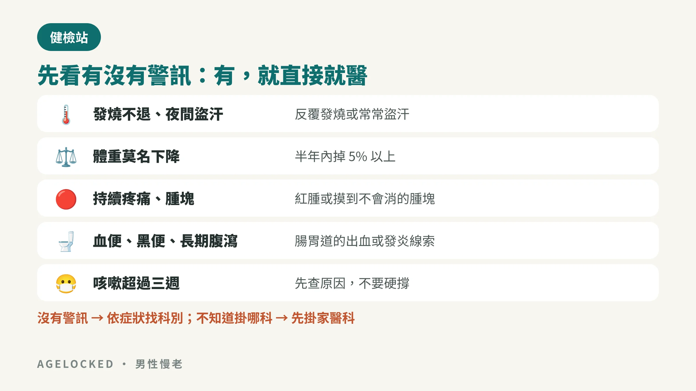
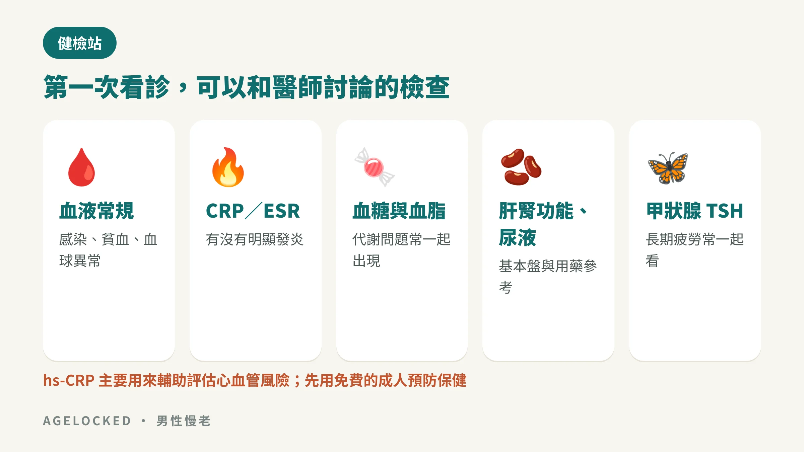
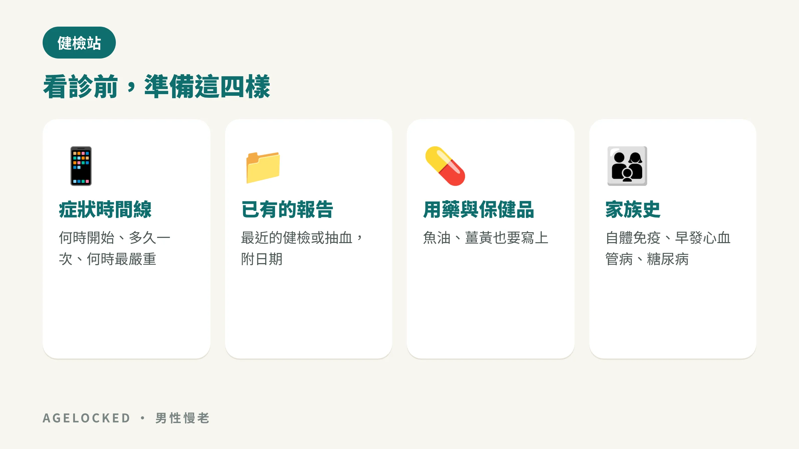

<!-- 🎨 [cover] [類型 A]
畫面：A middle-aged East Asian man standing in a hospital lobby, looking up at a large signboard with many blank department labels, holding a folded health report and a phone. Calm, slightly puzzled expression. Clean, bright hospital interior with plants.
標籤（Canva 填入）：慢性發炎看哪科？
STYLE: 依 IMAGE-STYLE.md 第 7.2 節
-->

你上網查了一晚「慢性發炎」，文章越看越多，隔天站在醫院掛號機前面，還是不知道要按哪一科。

答案先說：**醫院沒有「慢性發炎科」。**

慢性發炎不是一個病名，而是一種狀態。也就是說，你的免疫系統沒有在對付一場明確的感染，卻長期維持在低度開機，像一台關不掉的暖氣。它可能來自腰圍、睡眠、牙周、腸道，也可能是某個還沒被找出來的疾病。

所以要掛哪一科，取決於「你的症狀落在哪裡」。這篇照順序走三步：先排除急事，再依症狀找科別，最後整理第一次看診可以討論的檢查。

## 第一步：這些情況，先不要自己查，直接看醫生

如果你有下面任何一項，請先就醫，不要停在網路文章：

- 反覆發燒、發燒不退，或常常夜間盜汗
- 沒有刻意減重，半年內體重掉了 5% 以上
- 某個部位持續疼痛、紅腫，或摸到不會消的腫塊
- 血便、黑便，或長期腹瀉
- 咳嗽超過三週

這些不屬於「慢慢調整生活習慣」的範圍。不知道掛哪科時，先掛**家醫科**；症狀嚴重（高燒、劇痛、喘、胸痛）就直接去急診。

<!-- 🎨 [fig-01] [類型 B]
畫面：A simple decision flow illustration: a person at the top, splitting into two paths. Left path leads to a hospital emergency icon with warning symbols (fever thermometer, scale with arrow down, cough). Right path leads to a calm clinic door with a stethoscope. Orange-red accents only on the warning path.
標籤（Canva 填入）：先看有沒有警訊, 發燒不退, 體重莫名下降, 持續疼痛腫脹, 血便黑便, 咳嗽超過三週, 有→直接就醫, 沒有→依症狀找科別
STYLE: 依 IMAGE-STYLE.md 第 7.2 節
-->

## 第二步：依症狀找科別

沒有警訊，再看你最困擾的是哪一類症狀：

| 你最困擾的是 | 可以先掛 | 醫師可能會看什麼 |
|---|---|---|
| 說不出哪裡不對，全身累、常感冒 | 家醫科 | 從基本抽血開始，決定要不要轉診 |
| 關節腫痛、早上手指僵硬、口乾眼乾、反覆皮疹 | 風濕免疫科 | 自體免疫疾病的抗體與發炎指標 |
| 長期腹瀉、腹痛、血便 | 腸胃科 | 糞便檢查、大腸鏡等 |
| 腰圍變大、血糖或血脂偏高 | 新陳代謝科、家醫科 | 血糖、HbA1c、血脂、脂肪肝 |
| 刷牙流血、牙齦腫 | 牙科（牙周病科） | 牙周囊袋深度與牙結石 |
| 鼻塞、鼻涕倒流超過 12 週 | 耳鼻喉科 | 慢性鼻竇炎 |
| 皮膚長期濕疹、脫屑 | 皮膚科 | 濕疹、乾癬等慢性皮膚發炎 |
| 打鼾、白天嗜睡、睡不好 | 睡眠門診（胸腔科、耳鼻喉科、精神科都有開設） | 睡眠呼吸中止症 |
| 家族有人早發心血管病，想看心血管風險 | 心臟內科、家醫科 | 血脂、血壓，必要時加 hs-CRP |
| 壓力大、失眠、情緒低落 | 身心科 | 焦慮、憂鬱與睡眠問題 |

如果情緒低落已經超過兩週，或影響工作和睡眠，請找身心科醫師。需要有人聊聊，可以打衛福部安心專線 **1925**（24 小時免付費）。

很多人會同時中好幾格，這很正常。這時候家醫科是最好的第一站：他能把散在各科的線索收在一起，再決定轉給誰。

## 第三步：第一次看診，可以和醫師討論哪些檢查

以下是常見的起點，**要不要驗由醫師依你的狀況決定**：

- **血液常規（CBC）**：白血球、紅血球、血小板。也就是說，看有沒有感染、貧血或血球異常的線索。
- **一般 CRP 或紅血球沉降速率（ESR）**：兩個都是「身體有沒有明顯發炎」的粗略指標，數字高，醫師會往感染或自體免疫方向找。
- **空腹血糖、HbA1c、血脂**：慢性低度發炎和代謝問題常常一起出現。
- **肝腎功能、尿液**：基本盤，也是用藥前的參考。
- **甲狀腺（TSH）**：長期疲勞時，醫師常會一起看。

那 hs-CRP 呢？它是高敏感度的 CRP，能量到比一般 CRP 低很多的濃度，主要用途是**輔助評估心血管風險**。美國心臟學會和美國疾病管制與預防中心的建議是：低於 1 mg/L 屬低風險，1–3 mg/L 為中度，高於 3 mg/L 為高風險；最好間隔約兩週驗兩次取平均。如果超過 10 mg/L，醫師通常會先找有沒有感染或其他明顯的發炎來源，這時候的數字先不拿來評估心血管風險[1]。更完整的讀法可以看〈[CRP 正常，還需要看 hs-CRP 嗎？](/blog/chronic-inflammation/hs-crp-low-grade-inflammation/)〉。

先用免費的。國健署的成人預防保健服務自 2025 年起擴大：**30–39 歲每 5 年一次、40–64 歲每 3 年一次、65 歲以上每年一次**，內容包含血壓、血糖、血脂、腎功能等[2]。很多人連免費的那份都還沒做，就先去找自費套餐。

<!-- 🎨 [fig-02] [類型 B]
畫面：A clinic desk seen from above with a blood test tube rack, a health report with blank rows, and five round icon badges arranged in a row: a blood drop, a flame, a sugar cube, a kidney, a butterfly-shaped thyroid. A doctor's hand pointing at the report.
標籤（Canva 填入）：第一次看診可以討論, 血液常規, CRP／ESR, 血糖與血脂, 肝腎功能, 甲狀腺, hs-CRP：看心血管風險, 先用免費的成人健檢
STYLE: 依 IMAGE-STYLE.md 第 7.2 節
-->

## 帶這四樣東西去，比較不會白跑一趟

門診時間很短。準備好下面四樣，醫師比較快抓到重點：

1. **症狀時間線**：從什麼時候開始、多久一次、什麼時候比較嚴重。寫在手機備忘錄就好。
2. **已有的報告**：最近一次健檢或抽血，連同單位和日期。
3. **正在吃的藥和保健品清單**：包括魚油、薑黃這類常被忽略的。
4. **家族史**：父母兄弟姊妹有沒有自體免疫疾病、早發心血管病、糖尿病。

如果你有戴手錶，最近一兩個月的睡眠時間和靜止心率趨勢也可以帶著。它不能診斷任何病，但能幫你把「最近都睡不好」說得更具體。

<!-- 🎨 [fig-03] [類型 B]
畫面：Four items laid out on a table like a checklist: a phone showing a simple timeline, a folder of reports, a small pill organizer with a few supplement bottles, and a family tree card. A middle-aged man packing them into a bag.
標籤（Canva 填入）：看診前準備四樣, 症狀時間線, 已有報告, 用藥與保健品清單, 家族史
STYLE: 依 IMAGE-STYLE.md 第 7.2 節
-->

## 檢查都正常，然後呢？

這是很多人最常遇到的情況：報告沒有紅字，人還是累。

檢查正常，代表醫師目前沒有找到需要治療的疾病，這是好消息。但慢性低度發炎很多時候不是單一疾病造成的。2019 年《自然醫學》的綜論整理了推高慢性發炎的常見因素：缺乏活動、飲食、內臟脂肪、睡眠不足、長期壓力、抽菸，以及慢性感染[3]。這些大多不在一般門診處理的範圍，要靠自己日常調整。

可以從兩個方向開始：

- **吃**：研究最一致的是整體的飲食型態。看〈[抗發炎食物排行榜？研究給的答案是一桌菜](/blog/body-signals/anti-inflammatory-foods-ranking/)〉。
- **睡和壓力**：長期睡不好、繃太緊，和發炎指標偏高有關。看〈[自律神經失調和慢性發炎有關嗎？](/blog/chronic-inflammation/autonomic-imbalance-chronic-inflammation/)〉。

如果你想追蹤飲食有沒有真的改變，Prysm iO 皮膚類胡蘿蔔素掃描可以當作參考。它反映的是過去幾週蔬果與類胡蘿蔔素的攝取狀態，適合看趨勢；它不是發炎檢測，不能取代抽血和看診。

> 記住這一句：**先找症狀的位置，再找科別；先用免費的健檢，再談自費加驗。**

延伸閱讀：

- [健檢沒紅字，還要看什麼？5 個值得和醫師討論的數字](/blog/body-signals/checkup-five-numbers/)
- [體檢報告沒有紅字，但你還是一直累——這不是心理問題](/blog/body-signals/normal-checkup-still-tired/)
- [慢性發炎怎麼找線索？先分清血液、HRV、皮膚量測各在看什麼](/blog/chronic-inflammation/inflammation-three-clues/)

## 參考資料

1. Pearson Thomas A., Mensah George A., Alexander R. Wayne et al. (2003). Markers of Inflammation and Cardiovascular Disease: Application to Clinical and Public Health Practice: A Statement for Healthcare Professionals From the Centers for Disease Control and Prevention and the American Heart Association. *Circulation*, 107(3):499-511. DOI：[10.1161/01.CIR.0000052939.46093.45](<https://doi.org/10.1161/01.CIR.0000052939.46093.45>)。
2. 衛生福利部國民健康署。成人預防保健服務自114年起再升級，年齡下修至30歲。衛生福利部，2025。<https://mohw.gov.tw/cp-16-81240-1.html>
3. Furman David, Campisi Judith, Verdin Eric et al. (2019). Chronic inflammation in the etiology of disease across the life span. *Nature Medicine*, 25(12):1822-1832. DOI：[10.1038/s41591-019-0675-0](<https://doi.org/10.1038/s41591-019-0675-0>)。
